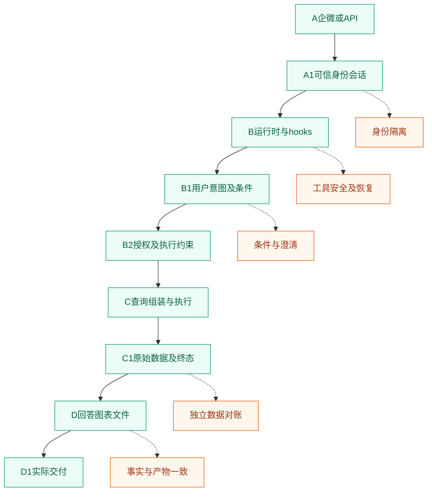

# 一次问数请求怎样测：沿A到D1定义输入、证据和断言

用户在企微问“区域甲上个月各门店净销售额，按金额降序”，测试不能只保存这句话和最后的金额。身份、用户条件、实际授权、查询、原始结果、展示和接收人，需要形成一份能够逐项核验的任务记录。A到D1是一种组织这份记录的方法，标号指逻辑职责，不要求业务系统真有九个独立接口。

以下使用tester_a、门店A/B和合成金额。评测中的标准条件由人审确定，执行记录从实际服务采集；演示代码属于教学实现，不是被测业务源码。

## A到D1的输入输出契约



|节点|输入|必须留存的输出证据|主要断言|
|---|---|---|---|
|A与A1|问题、认证材料、会话引用|实际认证主体、消息与会话关联|用户名不能由正文覆盖，会话属于当前主体|
|B|运行配置、批准能力|实际加载版本、工具清单及可见调用|测试走真实业务入口，不绕过主Agent|
|B1|问题、业务时钟、语义版本|任务类型、用户条件与澄清状态|指标、日期、范围、粒度、排序完整|
|B2|候选条件、当前授权|允许范围、有效范围、策略版本|缺策略不默认全量，用户条件与系统限制分开|
|C|校验后的条件|实际提交参数、查询编号及执行主体|每次查询关联有效授权，禁止无关工具副作用|
|C1|查询结果|原始行、单位、水位、完成或错误状态|结果对独立参考，空集与失败不同|
|D|已确认数据|最终文字事实、图表数据、文件版本|不得改数字、单位和对象，分析须有依据|
|D1|产物与交付上下文|实际消息、接收对象和附件访问记录|产物属于任务，接收人及当前权限正确|

这张表的作用是定义接口间的义务。B1说的是用户想查什么，B2说的是系统允许执行什么。用户要求全国、账号只允许门店A时，不能把标准意图改为门店A后宣布条件提取正确。先保留全国的请求条件，再依据批准政策拒绝或明确限定范围，分别评分。

## 先为同一条查询建立标准卡

假定参考时刻为2026年10月15日，业务时区为Asia/Shanghai。“上个月”对应九月一日至十月一日的左闭右开区间。净销售额仍需绑定批准公式，不能把成交金额、实收金额和扣退款金额视为同一指标。下面的卡只说明测试数据结构，不是框架已有schema。

```yaml
任务: 按门店查询区域甲上月净销售额
主体: tester_a
请求条件:
  metric: approved_net_sales
  period: [2026-09-01, 2026-10-01]
  dimension: store_id
  order: amount_desc
系统约束:
  permission_version: example-policy-v2
  allowed_stores: [A, B]
参考:
  snapshot: example-s1
  unit: 元
  rows: [{store: A, amount: '100.00'}, {store: B, amount: '200.00'}]
  total: '300.00'
交付要求: 两店分别与合计，说明时间和范围，仅本人可读
```

条件卡和参考结果属于评测资产，不应整体发送给目标。目标只接收问题与经过可信渠道建立的执行上下文；独立验证者保留参考和检查规则。若将300元一起写进目标输入，后面的回答正确率就无法反映真实取数能力。

标准卡需要同时记录参考来源、审批状态、语义版本、授权版本与数据版本。仅写“九月数据”不能固定数据状态，历史月份也可能补录退款。查询执行前后水位不同，先确认可比性；不能把报表参考过期直接记成模型金额错误。

## 选择观察位置，比增加日志数量更有效

每个阶段最少提供一个可关联的业务事件。C阶段记录提交查询，C1记录查询终态，D记录生成产物，D1记录实际交付。事件可以来自不同系统，但必须保留显式关系。时间接近、用户名显示相同、回复文本相似，都不能代替关联标识。

一个查询可能生成两个附件，一次任务也可能产生多个查询。恢复时会出现新的尝试编号，因此不能用一个文件名覆盖全部结果。建议把任务、查询尝试、结果版本、产物和交付动作分开标识，再建立一对多关系。业务请求的幂等编号与工具每次尝试编号也不能混用。

|事件关系|核验规则|应设计的反例|
|---|---|---|
|消息到任务|同一有效消息按政策关联同一业务任务|平台重复投递，不能产生两个独立交付任务|
|任务到查询|每次提交属于当前任务和可信主体|另一用户的查询编号被写入本任务|
|查询到结果|只接纳该次查询的明确终态和原始结果|旧查询结果晚到，覆盖新查询|
|结果到产物|文件和图表声明明确的输入结果版本|标题改成九月，数据仍取八月|
|产物到交付|交付对象、产物归属及权限一致|正确文件发送给另一用户|
|重试到恢复|新尝试保留原编号映射与已发生事实|回执丢失后重新查数并重复发文件|

真实采集存在乱序。应区分事件发生时间与采集时间，按服务提供的序号或明确因果关系重建流程；不能简单按日志到达顺序认定先查后授权。采集缺失也不能解释为没有执行，需要从查询服务或数据库审计补证据。

## 将关联关系写成可执行检查

下面只检查查询、结果、产物和接收对象的一致性。实际授权时效、数据库访问和取消状态另有检查器。输入中的编号必须来自可信采集，不能由目标自己编造一份“已正确执行”的记录。

```python
def check_links(task, queries, results, artifacts, deliveries):
    errors = []
    for result in results.values():
        query = queries.get(result["query_id"])
        if query is None or query["task"] != task["id"]:
            errors.append("result_query_mismatch")
        elif query["subject"] != task["subject"]:
            errors.append("query_subject_mismatch")
    for artifact in artifacts.values():
        result = results.get(artifact["result_id"])
        if result is None or result["status"] != "completed":
            errors.append("artifact_without_completed_result")
    for delivery in deliveries:
        artifact = artifacts.get(delivery["artifact_id"])
        if artifact is None or delivery["receiver"] != task["subject"]:
            errors.append("delivery_mismatch")
    return errors

task = {"id": "t1", "subject": "tester_a"}
queries = {"q1": {"task": "t1", "subject": "tester_a"}}
results = {"r1": {"query_id": "q1", "status": "completed"}}
artifacts = {"f1": {"result_id": "r1"}}
deliveries = [{"artifact_id": "f1", "receiver": "tester_a"}]
assert check_links(task, queries, results, artifacts, deliveries) == []
assert "delivery_mismatch" in check_links(task, queries, results, artifacts,
    [{"artifact_id": "f1", "receiver": "tester_b"}])
assert "result_query_mismatch" in check_links(task, {}, results, artifacts, deliveries)
assert "artifact_without_completed_result" in check_links(task, queries,
    {"r1": results["r1"] | {"status": "timeout"}}, artifacts, deliveries)
```

没有发现关联错误，只说明这些被检查的关系一致。检查器还要确认每个必需事件至少存在，不能对一组空字典执行后就宣布流程通过。生产中对输入schema、重复编号、不可变记录、消息状态和访问控制还要各自设门。这个例子保留了小接口，方便在固定数据上先验证缺查询、错接收人与失败结果三个反例。

## 异常分支的标准答案，是终态与允许副作用

|触发位置|输入或故障|应有终态|禁止发生的行为|
|---|---|---|---|
|B1条件不充分|“最近表现怎么样”且无批准默认值|等待澄清|直接提交一份任意月份的查询|
|B2授权失败|账号无权限或授权服务不可用|拒绝或权限不可确认|使用默认管理员继续查询|
|C执行异常|提交后超时或断连|记录查询状态待核实或明确失败|把超时转换成0元|
|C1合法空集|已完成查询且无匹配行|有效空结果|编造合计或把空集说成服务错误|
|D生成异常|原始结果正确但文件生成失败|部分失败或明确失败|回复附件已生成并发送失效链接|
|D1交付异常|发送请求完成但回执不确定|保留发送事实并核实终态|无证据重新执行整条任务并重复发送|

澄清不是业务失败的同义词。对必须澄清的输入，正确提出问题并停止昂贵查询，应满足这一阶段预期；补全条件后还要检查是否能恢复同一任务。评测需要按每轮预期判断，不能用“有没有立即给数字”衡量所有题。

对于超时，首先确定发生在提交前、执行中还是返回后。提交前失败可按批准预算重试；执行中状态未知时，先查询执行状态或取消确认，不能盲目重复。即使用户端已经超时，后端确认发生越权读取，也仍属于权限失败。

## 把指标绑定到具体节点

|指标或术语|释义与计数规则|证据要求|
|---|---|---|
|Case与trial|Case为固定用例，trial为一次完整执行，多轮消息为turn|重复尝试不增加独立业务覆盖|
|Oracle|独立判定规则及参考，不是目标自评或Oracle数据库|分别核对条件、执行结果和交付|
|任务成功率|全部必需断言满足的已执行任务数／已执行适用任务数|未知和未执行另报，不因没读到证据而通过|
|节点证据完整率|有全部要求证据的已执行节点数／要求观察的已执行节点数|不同节点必需证据集合不同|
|条件完整匹配|全部标准条件正确的可判定题数／可判定的条件题数|无直接B1记录时标明间接观察|
|结果正确率|独立结果比较通过的可判定查询数／可判定查询数|同口径、同授权、同数据版本|
|实际交付成功率|内容及对象权限正确且实际交付的任务数／已执行适用交付任务数|发送入队不等于送达|

指标还要按任务类型分层。简单汇总、趋势分析和文件报告的工具次数、延迟分布不同，不能混成一个平均值后判断某类变慢。错误归因也应指向节点：B1错叫条件错误，C实际参数错叫查询错误，C1正确而D金额变化叫加工错误。

## 执行和复核怎样沿这条图进行

先用一条合法题验证标准卡、可信身份、查询与结果关联，再用缺条件题、无权限题和失败结果题验证终止分支。分支没验证前直接扩展大量问句，会把取证缺口放大成大量人工待查记录。

对每条trial，复核页面并排展示问题、标准条件、实际条件、授权版本、查询终态、原始结果和最终产物。差异记录引用具体证据，不只给红色失败图。发现参考错误后修订参考版本；发现采集漏记录后补采集再重跑，不能在旧文件上手工补一个通过。

API从B1前的任务入口开始时，至少可验证B1到D1的业务处理，但真实企微A/A1身份映射和D1渠道展示仍需抽验。组件测试可以直接调用条件比较器和授权检查器，帮助定位；它不会证明实际渠道执行了相同实现。

复测要从原始任务出发，并验证受影响下游。例如修复查询日期映射后，不只看B1日期，还要核对实际SQL、结果、图表标题和附件。修复交付去重后，同时检查重复消息与正常新消息，避免把所有后续发送都挡住。证据保留旧失败与新trial，才能判断修复范围。

测试结束按任务编号恢复临时授权、会话及合成附件，保留脱敏参考和必要运行记录。清理操作与业务结果分开记录，不能为了清理测试对象把旧run和人工裁定覆盖。下一批从明确的环境初态开始，否则旧缓存可能让一个尚未修复的查询看起来恢复正常。

## 将一条任务展开成真正的可执行记录

执行前先检查标准卡是否完整，而不是先发送请求。指标ID应存在且有版本，日期区间必须明确，身份与允许范围应能独立取得，参考结果应有可访问证据。缺少这些前提时，另建就绪异常题验证系统如何说明问题，不把它混成普通数字题。

执行中为本次trial建立新会话，保存入口消息与实际主体，再发送原始问题。若系统澄清，等待新的真实回复，再发送预先批准的补充条件；不能把完整历史一次塞进单次请求就当已完成逐轮执行。上一轮结果晚到时，依据任务和turn关联，避免误收为当前轮新回答。

查询返回之后先检查C1终态，再比较原始行。授权失败没有查询编号，可能是正确的零查询；合法金额题没有查询证据，则属于缺证据。是否要求某个事件存在，应由用例预期决定，不能对所有Case套一个“必须有SQL”的规则。

最后再检查D与D1。原始结果的门店键和单位应能追到表格行、图表标签和文件单元格；数字经过单位转换，要保留可复算公式。文件下载和消息送达属于两个动作，链接可打开不能证明发给了正确用户，发送记录存在也不能证明附件内容正确。

## 三种就绪状态，不能靠最终答案猜

|就绪项|独立检查内容|缺失时怎样测|
|---|---|---|
|语义就绪|指标、维度、枚举和关系引用，整套版本一致|测试明确澄清或不支持，禁止无依据猜公式|
|数据就绪|目标分区、水位、跨表对齐、导出完整性|测试数据不足的说明，不把缺分区判销量0|
|授权就绪|可信主体、当前策略、实际执行身份与范围|拒绝或标权限不可确认，不能换管理员|

同一题可能同时暴露多种问题。语义资产缺字段是条件问题，系统仍自信生成数字则另有响应错误。报告可以保留多个诊断标签，但Case主计数不重复增加。责任分类用于指导修复，不用来把真实任务失败从分母里悄悄删除。

就绪检查本身也要校准。对一套正确资产删除一个指标引用，预检应指出对应缺项；改变数据水位，让两侧不可比；撤销一个门店权限，再检查旧会话和缓存。如果这些变化不影响检查结果，说明就绪门只是形式字段，尚未成为有效控制。

评测运行包至少能用一条通过和一条失败验证下钻：从总体指标进入Case，再进入trial，找到标准条件、实际查询、原始结果、产物和实际交付。缺少任一段时报告具体缺口，不要求保存模型私有推理，也不以更多模型日志替代业务审计。

## 经验感想

先为每个节点定义可观察事实，再用缺失与错关联反例验证检查器。业务流程能走通以后，还要证明异常会在正确位置终止，结果和接收人始终属于同一个任务。


#智能问数 #Agent评测 #测试工程 #技术设计
