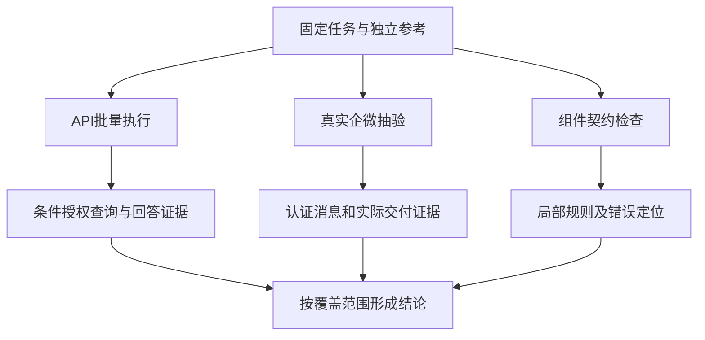

# 智能问数评测路线：入口怎么选，SQL和受控IR怎样对照

API跑了一批问题，企微人工也聊通了几次，能不能写“智能问数测试通过”？先把两个入口分别经过的身份、工具和交付路径画出来，再决定它们能证明什么。测试设计的第一个技术问题，是观测与判定的覆盖范围，而不是选一个最方便发消息的入口。

以下以Hermes承载企业问数为例，比较不同入口与查询实现的验证范围。组织、账号和计算数据使用教学示例；已有框架协议与待建设的领域检查分别说明。

## 术语要对应可执行的检查

|术语|通俗解释|本方案中的适用限制|
|---|---|---|
|Text-to-SQL|把用户的问题转换成数据库查询语句|SQL能执行不等于口径、数据和权限正确|
|受控IR|IR是中间表示，可理解为“受限制的查询参数单”|AI填写批准的指标、时间、范围、分组与排序，程序检查权限并生成SQL；仅列为后续可选试点|
|组件L0|直接测试系统里的一个小模块，L0是本方案第0层|如身份记录、权限规则、脱敏和消息去重；固定输入输出不能替代完整业务链|
|L1／L2／L3|L1测Hermes业务链，L2测真实企微，L3测真实运行环境|每层分别记录证据和缺口；不能相互抵消失败|
|Case|一条测试用例：任务、输入、账号、条件及预期|不同角色或实质不同输入一般分成独立用例|
|trial|某条用例的一次完整执行|一条Case跑3遍是3次trial；多轮对话整体算一次，不按消息数拆算|
|Oracle|独立的结果检查器，类似对账员|不是Oracle数据库；按规则核对权限、数量、金额、SQL和文件|
|fixture／GT|fixture是受控测试数据，GT是已审核的参考答案与依据|合成数据只核实验逻辑，不代替真实数仓验收|
|Query／Result／Answer Contract|查询、结果和回答的核对清单|写清指标、日期、粒度、单位、权限、数字和交付要求；字典存在不代表框架自动判定|
|rubric／LLM-as-Judge|rubric是评分标准；LLM Judge是按标准评分的另一个模型|先人工校准；主要评表达与分析依据，不能推翻事实Oracle失败|
|Laya|框架可选的前级决策模型观察工具|当前不自动放行或跳过Judge；高概率不等于业务正确|
|Golden|人工审核后冻结的基准用例版本|新范围重新审核；Agent不得模拟批准或自动晋升|
|Eval Pack／Adapter|Eval Pack承载项目测试规则；Adapter对接被测系统|业务口径先留项目层；共享协议缺口才扩Core|
|Harness Loop|基线→归因→改进候选→对照→审核→验收→回流|是流程设计，不是现成的agent-eval loop命令|
|unavailable／blocked|缺证据无法判断／条件不足阻断|都不能计作业务通过；环境报错不等于安全拒绝成功|

受控IR示例：“区域甲上月销量前10”可整理为参数单。
指标为已批准的有效零售成交量，地区为区域甲，时间为2026年9月。
按门店分组，成交量降序，取前10；不支持的需求应澄清或按批准策略处理。
它仍需真实权限检查和独立结果对账。

## 推荐结论与决策依据

推荐 **真实Hermes接口/服务器CLI批量回归 + 真实企微渠道抽验 + 确定性组件测试 + 独立测试Agent探索**。四种方式互相补足，不选择一个入口包办所有测试。

1. **批量主线**：先复用部署版本的Hermes API；若暂不开放接口，复用已有服务器CLI观察包。两者必须加载同一业务空间、Skill、插件和真实查询工具。直接绕过Hermes调用数仓，只能验证数据服务，不能验证主Agent。
2. **渠道主线**：用真实企微测试账号验证账号绑定、首次消息、身份透传、多人隔离、消息交付、websocket恢复。底层权限逻辑能自动化，完整企微认证链仍需要渠道证据。
3. **组件主线**：对身份解析、授权决策组件、字段脱敏、SQL构造/执行契约、结果加工、消息去重进行固定输入输出验证。用于快速定位，并不替代端到端测试。
4. **探索补充**：独立测试Agent可通过接口做追问、改口、诱导越权；测试脚本控制账号、会话、预算、终止条件。Oracle独立判断，不能让聊天双方自行宣布通过。
5. **不推荐被测Hermes自评作发布依据**：它可以提出用例、汇总日志、运行受控检查，但不能同时产生答案、真值和最终裁决；容易重复自身的口径错误，且测试指令可能改变原业务上下文。

发布决策先看权限、安全和确定性业务正确性，再看回答质量、延迟与成本。一次“回答正确”只证明该次观察；未知证据、未执行和环境失败单独报告。

主实施路线为现有Text-to-SQL加查询/结果/回答契约及独立Oracle；增加语义资产与数据就绪门禁、反例校准、分析方法、语义版本与跨入口回归、覆盖驱动候选生成。可以用示例首批40条中的12条查询题验证流程，实际规模按覆盖矩阵审核，不作为承诺；3个高频指标的受控IR仅作后续可选对照试点，完整Cube/图谱底座后置。

## 四种测试入口怎么选

|方式|能证明什么|不能单独证明什么|准备/成本|建议|
|---|---|---|---|---|
|①人工企微聊天|真实身份绑定、客户端展示、附件交付、渠道隔离、真实插件恢复|大批量覆盖、稳定重复、所有SQL口径和安全路径|需多角色账号、步骤、录屏/消息记录、服务端审计；重复成本高|保留为渠道发布门禁，按风险抽样|
|②另建企微AI测试机器人|若平台允许，可探索真实渠道多轮交互和批量记录|机器人的身份不代表员工身份；不保证机器人能互相触发/私聊；不会自动获得多角色权限|需验证平台支持、机器人消息是否触发、群聊/私聊与限流；容易循环、混合身份|不作为第一阶段主线；先做最小可行性验证，不预设能替代人工|
|③Hermes API聊天|主Agent意图、提取、路由、SQL、加工、多轮；可大规模重复|若跳过企微鉴权/身份hook，不能证明渠道身份链；固定账号不覆盖所有角色|先复用现有API，补可信身份/会话/证据适配；较可控|长期主线；接口暂停时用服务器CLI过渡|
|④Hermes自行测试|辅助生成候选、检查配置/代码、调用受控工具、自诊断|独立真值、完整渠道、安全隔离、可靠发布裁决|低启动成本，但污染上下文/记忆、同源偏差明显|仅辅助；测试主体另用独立实例/进程，判定交给Oracle与人审|

②能否落地，先用测试租户验证“测试机器人消息是否进入被测机器人的正常消息处理”，是否有稳定sender、能否接回复、是否改变触发/权限路径、是否被过滤或互相踢线。不能落地就用API测试Agent，不建设机器人互聊平台。

③固定userid的接口仍有价值：它能测该账号下的合法/非法范围、SQL正确性和多轮行为。但固定账号为总部/管理员会掩盖局部权限问题。要多角色自动化，可采用隔离环境中 **多测试凭据→服务端绑定账号** 或 **同一测试账号分批切换独立权限配置**，都需可信映射和授权版本证据，不能允许用户正文或任意请求字段改变身份。

权限逻辑不是“只能人工测”：授权决策组件可固定输入验证，底层ACL可接口验证，集成链可可信上下文验证。只能由真实企微证明的是实际企微认证/绑定/透传路径，而非整个权限测试领域。

## 查询实现路线：现有SQL、受控IR与完整语义底座

|方案|做法|收益假设|代价/风险|建议|
|---|---|---|---|---|
|A：现有Text-to-SQL+领域契约Oracle|Hermes/业务路径不变，增资产门禁、AST/结果/回答检查|快速发现静默口径错误，降低回归维护成本|仍需追踪自由SQL与多路径，AST/Oracle必须校准|立即作为设计落点|
|B：少量高频指标受控IR|Hermes负责理解/澄清/分析，输出指标/维度/过滤/时间；受控工具校验授权并确定性编译|口径和权限执行更稳定，主Agent责任更易分层|需产品/数据治理、稳定ID和编译器；限制自由分析覆盖，未知指标应显式降级|选3个高频指标试点，与A同题对照后决策|
|C：完整Cube/图谱/本体底座|多消费端通过统一治理查询引擎，必要时对象关系/血缘图|大规模跨部门复用与治理|依赖现有数仓、方言、商业与开源能力的适用范围、运维和迁移；不保证消灭分析错误|后置可行性研究，不直接迁移|

受控IR可以先用批准的语义资产与最小查询服务试点，不必先引入完整Cube。只有所有实际取数路径都经过相同授权，参数单才有控制意义；多写一个JSON对象并不能关闭其他数据出口。

B试点输入：3个经业务批准的指标，例如销售成交量、采购量、综合毛利（仅示例，毛利分项/权重必须明确）；至少12条Query Contract题，可复用首批40的查询子集，追加必要反例而非凭空扩总集。

对照保持同模型/参数、身份/授权、数据快照、问题/split、预算、Oracle和质量rubric；比较A/B的契约合规率、实际结果、拒绝/澄清、口径漂移、可观测性、延迟和成本，至少多trial。B改变的是业务查询实现，不是框架Runner；先在隔离空间，发布/权限更改需单独授权。

收益是待验证假设：不能引用文章“更可控”就宣称B已优于A。两者均须过P0权限/真实企微验证。多轮Scenario可探索，但不能取代固定快照/Oracle；不引入MiroFish模拟数据库真值或训练框架做权限验收。


## 选入口之前，先定义同一条题的可比条件

“区域甲上月有效成交量前十门店”可以同时经过API和企微执行，但前提必须一致。首先固定参考时刻、指标版本、授权范围和数据水位，再确认两次运行加载相同业务规则。若API绑定总部账号，企微用的是店长，两个结果不同是预期差异，不能归为渠道回归；如果两个账号显示名相同，也不能据此认为认证主体一致。

一份入口覆盖清单应明确三种信息：从哪里开始执行，哪些阶段能取证，哪些阶段被绕过。批量接口从任务理解阶段进入时，仍可验证该可信主体下的条件、授权、结果与回答；真实企微验签、首次绑定、消息去重和实际收件人则需要渠道证据。不能为了宣传端到端，把未经过的阶段画进已覆盖范围。



这张图保留原设计的组合路线：主Agent批量、真实渠道、确定性组件相互补充。探索测试Agent可以增加追问和诱导输入，但它不替代独立参考，也不能读取标准答案后再帮助目标完成验收题。探索发现需要人工整理，形成稳定输入和可复查断言后才能进入固定回归。

通用任务说明可以写成如下结构。它是教学DTO，不是现有框架Case格式，真实接入需映射到已经支持的字段。

```yaml
任务: 区域甲上月有效成交量前十门店
入口: API
可信主体: tester_a
固定条件:
  参考时刻: 2026年10月15日
  数据快照: 合成快照S1
  指标口径: 已批准有效成交量
要求证据: [授权, 实际查询, 原始结果, 最终回答]
渠道补充: [认证映射, 实际收件人, 附件访问]
```

任务与证据要求分开，才能在输出不足时保持诚实。没有实际查询记录，只能检查文本内容，不能宣称SQL口径正确；拿不到权限版本，就无法判断撤权后的请求是否用了新策略。检查器应返回不可判定原因，运行成功不能直接补成业务成功。

## 一个最小判定器，先验证缺证据不会被放过

按评测逻辑整理的教学实现，非业务项目源码。下面仅使用标准库，演示入口要求、观察事实和严重失败的裁决顺序；不是Harness已存在的类，也不替代完整Oracle。

```python
from dataclasses import dataclass

@dataclass(frozen=True)
class Observation:
    evidence: frozenset[str]
    unauthorized_read: bool
    answer_matches: bool

def decide(obs: Observation, required: frozenset[str]) -> str:
    if obs.unauthorized_read:
        return "fail"
    if required - obs.evidence:
        return "unknown"
    return "pass" if obs.answer_matches else "fail"

required = frozenset({"authorization", "query", "result", "answer"})
good = Observation(required, False, True)
missing = Observation(required - {"query"}, False, True)
leak = Observation(required, True, True)
assert decide(good, required) == "pass"
assert decide(missing, required) == "unknown"
assert decide(leak, required) == "fail"
print("合法、缺证据、越权三个对照均符合预期")
```

这里先处理已确认的越权，再判断证据不足。假如已经观察到泄露，另一个证据文件缺失，不能把失败降为未知。反过来，没有泄露事件但审计缺失，也不能写没有读取。教学判定器只覆盖三个分支，生产判定还需要逐项证据、错误定位和版本绑定。

## SQL路线和受控IR，应该比较什么

对同一批准指标，保留当前Text-to-SQL和受控IR两种实现，采用相同模型、身份、快照、问题与预算。Query Contract检查实际执行的指标、过滤、粒度和授权，Result Assertions对独立结果，Answer Contract检查用户最终看到的内容。三者都通过，才有资格比较延迟和成本。

受控IR可能减少自由组合，也可能限制业务覆盖。未知指标不能悄悄换成最接近的已支持指标，缺少维度不能自动删掉分组要求。试点题需要同时包含支持范围内的正常问题、未知指标、歧义术语和不支持组合，观察澄清、拒绝和降级是否明确。

完整语义底座则增加治理与运维职责。指标稳定标识、维度枚举、对象关系、数据血缘需要一起维护。先检查这些资产能否形成一致版本，再判断是否需要引擎。文件能够解析只证明语法可读；引用存在、口径无冲突、执行路径符合定义，是后续不同的验收任务。

若一套资产同步后指标含义变化但标识未变，旧用例可能错误复用参考结果。可通过行重排、插入删除定义、别名变化和中途同步失败构造反例，检查整套版本是否原子切换。当前版本不可确认时应阻断受影响题，而非让模型依赖历史记忆猜测。

## 受控IR的最小编译试验

按评测逻辑整理的教学实现，非业务项目源码。下面固定指标和维度白名单，校验日期半开区间，再用可信授权校验请求范围；值作为绑定参数返回，不把输入直接拼成SQL。表列名来自程序内的批准映射，用户不能提供任意标识符。这仅演示一个单指标查询，不是通用SQL框架。

```python
from datetime import date

METRICS = {"net_sales": "SUM(net_amount)"}
DIMENSIONS = {"store": "store_id"}

def compile_query(spec, allowed_stores):
    if spec["metric"] not in METRICS:
        raise ValueError("unknown metric")
    if spec["dimension"] not in DIMENSIONS:
        raise ValueError("unknown dimension")
    start, end = map(date.fromisoformat, spec["period"])
    if start >= end:
        raise ValueError("invalid half-open period")
    requested = frozenset(spec["stores"])
    if not requested or not requested <= frozenset(allowed_stores):
        raise PermissionError("unauthorized scope")
    stores = sorted(requested)
    marks = ",".join("?" for _ in stores)
    dim = DIMENSIONS[spec["dimension"]]
    expression = METRICS[spec["metric"]]
    sql = (f"SELECT {dim}, {expression} FROM approved_sales "
           f"WHERE business_date >= ? AND business_date < ? "
           f"AND store_id IN ({marks}) GROUP BY {dim}")
    return sql, [start.isoformat(), end.isoformat(), *stores]

spec = {"metric": "net_sales", "dimension": "store",
        "period": ["2026-09-01", "2026-10-01"], "stores": ["A"]}
sql, params = compile_query(spec, {"A", "B"})
assert params == ["2026-09-01", "2026-10-01", "A"]
assert "'A'" not in sql and "store_id IN (?)" in sql
for changed, error in [({"metric": "unknown"}, ValueError),
                       ({"stores": ["C"]}, PermissionError)]:
    try:
        compile_query(spec | changed, {"A", "B"})
    except error:
        pass
    else:
        raise AssertionError("known invalid input was accepted")
print("正常查询通过，未知指标与越权范围被拒绝")
```

编译器能拒绝未知标识、无效时间和超出授权的请求，不能证明批准公式本身正确，也不能保证数据水位齐全、退款归属正确或执行账号受限。返回的SQL仍要经过实际受控执行，结果交独立Oracle对账。参数绑定保护数据值，不代表任何SQL文本都安全；动态表名和函数若来自不可信输入，同样可能引入风险。

## 指标选择也要受入口证据约束

可以给每个候选指标建立证据依赖：意图分类需要标准标签与实际可观察任务，槽位匹配需要规范化条件，结果正确率需要独立参考，权限需要可信身份和执行审计，交付需要实际对象与接收记录。依赖缺失时，相应指标显示不可用，同时统计覆盖，不能把文本相似度替代所有缺口。

路线比较还应记录适用范围。受控IR只支持三个批准指标，不能直接与覆盖全部业务的SQL路线比整体成功率。先在共同任务上配对，再分别呈现额外支持范围、正确拒绝及未知组合。多次trial保留逐次结果，不能只选一次最好回答；严重权限失败也不应被普通查询的平均分抵消。

## 经验感想

入口路线选得合理，才能知道一份通过记录究竟覆盖什么。先用一条有独立参考的任务同时打通接口证据、真实渠道和组件反例，再扩展批量覆盖。SQL、IR或完整语义引擎的选择，都应接受同条件任务与失败样本的比较，而不能由架构名称代替结果。

#智能问数 #Agent评测 #测试入口 #查询契约
