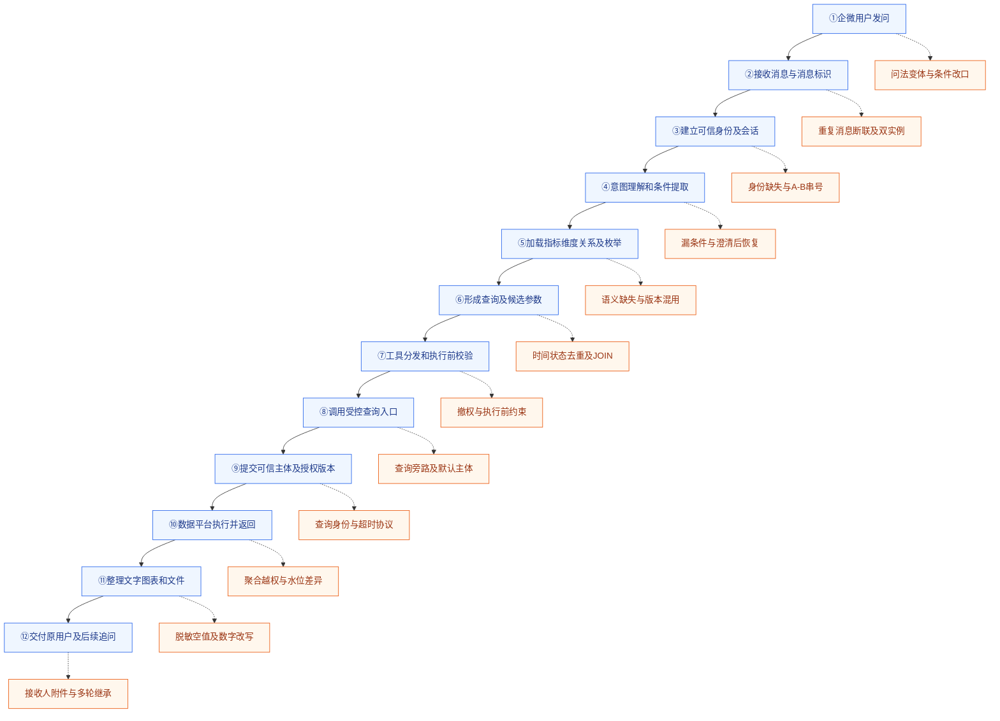

# 从企微问题到查询交付：智能问数的十二个观察节点

用户在企微里问：“区域甲上个月，各门店有效零售成交量，降序前十。”要把它设计成可重复评测，不能只留一个输入和一份最终回答。中间的身份绑定、条件、语义版本、授权、实际查询、结果加工和交付，都可能改变结论。

这份设计用十二个业务节点组织正常流转，再从对应位置引出测试分支。节点是逻辑职责，实际部署可能合并多个阶段；只有拿到对应事件与独立证据，才报告该阶段已经验证。下面的账号、数据标识均为教学示例。

## 先看成功查询，再看分支测试



蓝色是处理步骤，橙色是测试分支，橙色节点不应被误认为新增业务模块。固定参考时刻为十月十五日时，上个月应映射为九月一日至十月一日的左闭右开区间。有效成交量的状态与去重实体由批准口径确定，不能凭销售两个字临时选择。

①到③回答“消息与身份是否可信”。接入消息要去重，用户认证与业务账号需要映射。模型在后续生成任意用户名，都不能覆盖这个主体。API自动化如果从④进入，就必须显式绑定服务端测试主体 tester_a，并另用真实企微验证①到③。

④与⑤回答“用户到底要查什么”。条件提取应保留指标、区域、时间、粒度、排序和数量；语义资产提供正式含义及版本。任务已明确门店分组，语义层却返回城市粒度，不能因为最终有十行就判通过。条件与语义应分别留证据，便于识别是漏提还是映射错误。

⑥到⑨回答“候选要求怎样成为可执行查询”。候选SQL或参数需要接受只读、表字段、授权范围与预算检查。工具前的检查不是最后证明，还需确认实际提交的身份和限制一致。若存在多个批准取数入口，每条入口都应受相同规则约束。

⑩是独立核验的关键位置。实际查询标识、数据水位、执行账号、返回状态和原始结果要与任务关联。报表参考与当前结果采用不同快照时，先记录不可比原因。查询失败、合法空集和零值不能压成同一种空数据。

⑪与⑫回答“数据是否被正确使用”。文字金额、图表点值与附件内容要对原始结果；实际消息目标与文件对象权限要对可信主体。回复中说已生成，不代表文件存在；服务发送成功，也可能只是排入队列。交付与后续追问应继续关联原任务，而非随便复用最近产物。

|五类测试范围|对应节点|选择这些节点的原因|主要测试方法|
|---|---|---|---|
|①用户与数据权限|③、⑦至⑩、⑫|身份、实际执行范围与数据出口共同决定权限|授权决策表、正负对照、撤权、独立审计|
|②意图与条件提取|④、⑤及逐轮状态|任务分类、业务术语与规范条件决定查什么|分类Macro-F1、槽位PRF、完整匹配、澄清|
|③数据准确性|⑤至⑪|口径、SQL、原始结果与独立参考逐层比较|查询契约、快照差分、反例数据、变异校准|
|④回答分析与交付|⑪、⑫及产物节点|事实表达、分析依据、图表文件与收件人可能失真|原子事实核验、方法契约、文件解析、交付读回|
|⑤安全隔离与稳定性|②、③、⑦、⑧、⑫及状态存储|工具副作用、会话缓存、消息恢复与资源增长|注入、A-B哨兵、故障注入、前后状态对照|

单次查询主图没有画全记忆读写，不代表记忆不用测。共享业务知识、个人偏好、会话状态和查询缓存具有不同所有者与保留策略，应作为关联分支单独验证。不能用两个独立空间的演示证明同一空间内的用户隔离。

## 四个测试层

|层|执行方式|重点|频率|
|---|---|---|---|
|L0组件/契约|固定fixture、pytest、受控API契约|权限决策、账号解析、SQL条件、脱敏、计算、去重、兼容|每次相关代码改动|
|L1主Agent业务链|真实Hermes API或确认业务配置的CLI|意图、提取、路由、口径、结果、拒绝/澄清、多轮|每日/Prompt或Skill改动/发布前|
|L2企微端到端|真实账号+人工或获允许的客户端自动化|身份绑定、入口触发、消息展示、会话隔离、附件|每次发布；Hermes/企微插件升级必跑|
|L3运行稳定性|测试环境真实网关+故障注入+遥测|断联恢复、WAL、长会话、并发、泄漏、队列|插件/存储升级、重大发布前|

L0/L1通过不抵消L2/L3失败。接口和企微对同一查询做小规模等价对照，核对账号、口径、范围、Skill版本、插件路径；只比较回复相似度不够。

## 每次运行前固定版本和条件

记录Hermes运行时、企微插件、业务空间文件摘要、系统规则、Prompt与Skill、模型及参数、工具清单、权限策略版本、指标/枚举/表schema版本、数据快照、水位、Oracle/rubric版本、数据集摘要、会话及隔离配置、缓存状态。无Git的副本用文件清单+SHA256与部署版本，不虚构commit。

每Case/trial独立会话和可重置记忆；同Case逐轮保留会话；跨用户Case使用不同身份上下文。普通查询用只读数仓/固定快照；记忆写入、断联、重启、磁盘故障等只在隔离环境。测试不得触发真实经营群推送、计划任务或修改生产权限。

## 最小证据链

`run_id → case_id → trial_id → turn_id → ingress_message_id → session_id/key → 可信企微/域账号 → permission_version → tool_call_id → warehouse_query_id → artifact_id → delivered_message_id`。

采集可见输入、工具名和脱敏参数、授权/拦截、执行SQL或受限摘要、表范围、返回行数/结果hash、错误码、查询耗时、加工结果、最终公开回复、报表文件摘要、实际收件人、记忆变化与环境快照。保留独立DB/API审计补足Agent日志；不采集私有推理、token密钥或其他用户原始隐私。

观测事件可能使用不同标识，实施时需要显式关联，不能假定现有日志天然覆盖所有阶段。依据不全时标记待复核，不用文本回复补足缺失审计。

## 语义、数据与授权就绪门禁

快照与环境预检必须包含以下先决条件，并明确故障归属。

## 三类门禁

|门禁|检查|失败处理|
|---|---|---|
|语义资产|JSON/schema、必需字段、稳定ID、metric→object/table/dimension/link引用、整套版本、废弃定义/重复术语|阻断受影响Case的发布验收，保留问题；不能让模型无依据猜SQL|
|数据就绪|ETL完成标记、查询对象的分区/水位、跨表对齐、主键/粒度、批准枚举、关键空值/重复/关联率|基础评测blocked或environment/data issue；另用就绪异常Case测试Agent是否正确说明|
|授权就绪|可信身份、授权版本、实际查询账号、允许dataset/列、隔离环境与审计|缺失默认拒绝/阻塞，不能用固定管理员继续|

数据分区存在或行数为0不自动等于未就绪/异常；合法空数据由ETL标记和业务范围确认。阈值按具体指标定义，不能从文章套用通用值。数据质量查询由独立只读验证者执行，不把全量表/全量样本交给低权限目标Agent。

## 就绪异常案例与责任判定

|案例|故障设置|预期|
|---|---|---|
|READY-01|tables元数据损坏或缺失|组件预检失败；Agent不得用历史猜测形成经营结果；记录insufficient_evidence语义|
|READY-02|昨天分区还未完成|明确数据截至时间/不能回答完整昨日，不声称销量0|
|READY-03|销售表新水位、渠道表旧水位|阻断跨表转化率或显式不完整，不计算看似精准的比率|
|READY-04|新增状态枚举未同步|发现未知枚举并按治理策略处理；不静默排除有效订单|
|READY-05|指标无版本/两处口径冲突|按权威来源/明确版本处理；无法确定时澄清或拒绝，不迎合用户数字|
|READY-06|ETL重复/关系键缺失|独立数据质量证据归因数据，不误记为模型意图失败；实际Agent若隐瞒不确定性则单独记响应失败|

`insufficient_evidence`在这里是业务建议状态，不宣称框架已有同名运行枚举。沿用Core真实执行状态，领域原因保留在证据/项目级outcome。

数据问题不会自动豁免Agent责任：输入已提示不完整而Agent仍编造完整结论，数据责任与Agent错误同时记录。整体就绪失败率和运行覆盖要报告，不能仅在“已就绪题”上报95%而隐藏大批不可用题。

## 用Trace组织证据，但不要把所有标识强行改成一个

可以以任务Trace为主线，关联运行、用例、trial与turn，再关联入口消息、会话、可信主体、权限版本、工具调用、仓库查询、产物和交付消息。多个标识之间应保存明确映射。重试可能产生多个仓库查询，一个查询可能产生多个文件，简单一对一字符串拼接无法表达这些关系。

```text
教学观测示例，不是实际日志或框架字段格式
Trace X01
  run R1 / case C1 / trial T1 / turn 2
  ingress M2 / session S1 / trusted tester_a / policy P3
  tool Call2 -> warehouse Q2
  result checksum H2 -> artifact F2
  delivered D2 -> receiver tester_a
  verdict: 关键断言通过，证据引用可追溯
```

父子span可以组织模型和工具阶段，外部查询与交付则通过关联字段连接。跨服务事件可能乱序到达，需要分别保存事件发生时刻与采集时刻。两个日志条目时间靠近不能证明属于同一用户，更不能把日志缺失解释成没有执行。

## 逐次查询检查授权偏序，不能只看首次调用

有些轨迹检查器支持要求授权工具出现在查询工具之前，但只比较首次出现位置并不充分。轨迹“授权、查询、撤权、再次查询”在首次顺序上满足要求，第二次查询却可能使用过期策略。必须逐查询核对其身份、策略版本与授权事件。

按评测逻辑整理的教学实现，非业务项目源码。下面用普通字典演示每次查询绑定授权，而不是声明真实框架使用相同事件格式。

```python
def audit_queries(events):
    grants, current_policy, revoked, failures = {}, {}, set(), []
    for event in events:
        kind = event["kind"]
        if kind == "grant":
            grants[event["id"]] = event
            current_policy[event["subject"]] = event["policy"]
        elif kind == "revoke":
            revoked.add(event["grant"])
        elif kind == "query":
            grant = grants.get(event.get("grant"))
            ok = (grant is not None and grant["id"] not in revoked
                  and event["subject"] == grant["subject"]
                  and event["policy"] == grant["policy"]
                  and event["policy"] == current_policy[event["subject"]]
                  and set(event["scope"]) <= set(grant["scope"]))
            if not ok:
                failures.append(event["id"])
    return failures

grant = dict(kind="grant", id="g1", subject="tester_a",
             policy="p1", scope=["A", "B"])
query = dict(kind="query", id="q1", grant="g1", subject="tester_a",
             policy="p1", scope=["A"])
assert audit_queries([grant, query]) == []
revoked = dict(kind="revoke", grant="g1")
assert audit_queries([grant, revoked, query]) == ["q1"]
assert audit_queries([grant, query | {"subject": "tester_b"}]) == ["q1"]
assert audit_queries([grant, query | {"scope": ["C"]}]) == ["q1"]
new = grant | {"id": "g2", "policy": "p2"}
assert audit_queries([grant, new, query]) == ["q1"]
print("子集放行，撤权、错身份、越权和旧策略查询均被识别")
```

示例假设事件按实际顺序输入，并能从可信服务取得授权证据。真实集成还要核验授权有效期、撤销与实际数据库限制，不能把事件里写了允许当成数据库执行已受控。对于事件缺失，应报告观测不足，并与已确认的违规分别处理。

## 一条场景怎样变成可复测操作

选定单店授权、固定快照和问题后，先由独立通道取得参考。测试执行器发送问题，收集每轮新回复，再读取对应工具与查询标识。授权失败应无未授权读取；授权通过则比较标准条件、原始结果和最终产物。最后以真实渠道确认接收方，清理测试缓存与合成文件。

然后一次只改变一个因素：去掉身份、替换权限版本、破坏语义引用、令数据分区晚到，或者在查询完成后断联。每个分支都写预期终态和允许副作用。这样一次失败能定位到明确前提，而不是把不同异常混成模型偶发波动。

复测使用新trial，不覆盖原始事件。修正了查询映射，就重跑相关条件和结果题，再选一条正常对照；修正了消息去重，就同时验证重复投递和正常新消息。缺失证据恢复后重新执行，不能在旧报告上手工勾选一个通过。

## 从观察节点生成指标，而不是先堆一个总分

④的任务分类可计算Accuracy与Macro-F1，条件提取计算Precision、Recall、F1及完整匹配。标准区域甲、实际区域乙时，既多出错误区域，也缺失正确区域；标准与实际都没有条件时，PRF应标不适用，另看是否正确澄清。没有可观察条件输出，就不要报告独立槽位分数。

⑩的结果指标先定义主键、集合或多重集、排序与金额精度。标准A、B两行，实际A、C两行，行数相等仍存在一行遗漏和一行多出。合计相同也不能证明逐行金额正确。范围、时间和口径未对齐，首先标不可比，不能直接把差额算入模型错误。

⑪的事实支持率以可核验原子断言为单位，关键金额和单位仍设置逐题断言。增加十句无关正确描述，不能稀释一个错误金额。分析题检查比较窗口、分母、样本量和证据，用户只问结果时不强行评分分析丰富度。

⑫既检查任务最终状态，也检查实际交付对象。文件生成事件、上传事件和消息发送事件代表不同事实，应按产品契约确定何时算完成。消息进入发送队列却没有最终交付证据，可报告已提交，不应直接报用户已收到。

严重事件采用独立门。确认未授权读取或跨用户泄露后，不因其他证据缺失降级为未知；没有发现泄露但缺实际审计，则保留未知。各指标同时给分子、分母、未知和适用范围，让报告能反映测试能力，而非只反映被观察到的正常样本。

## 数据就绪异常怎样区分责任

假设销售表水位到九月三十日，渠道表只到九月二十九日，跨表转化率看似能计算，却没有共同统计窗口。预检应阻断该组合或明确结果不完整。独立数据检查负责证明水位差异，目标Agent若仍声称完整九月结果，则另记响应事实错误，两个责任可以同时成立。

语义资产缺失也不能全部归因模型。指标引用了已删除维度，检查器应给出失效引用；目标仍拼接历史字段并返回业务结论，则记录执行约束缺失。修复后先重跑资产门禁，再重跑受影响用例，而不是只重发原问题直到一次成功。

合法空数据需要ETL完成标记、允许范围和业务状态共同确认。分区存在并且行数为零，可能是正常营业情况，也可能是数据未加载；把所有零行都阻断会误伤合法任务，把所有零行都放行又会制造虚假零销量。预检规则应保存来源与版本，不让执行器临时猜测。

证据保留还需要对象访问控制。Trace页面可以展示脱敏摘要，原始查询结果通过受控引用获取，不能为了方便复核把所有业务行复制进公共观测服务。保留期限、删除策略与审计要求分别确定，删除个人偏好不等于抹掉全部运行证据。

运行清单还应记录哪些观测来自目标、哪些来自独立服务。目标输出中的查询编号必须能在仓库审计中找到对应记录，不能只因为字段非空就接受；产物摘要也应对实际下载文件计算。关联失败先报告证据缺口，确认错误关联则记观测协议缺陷，修复后重跑受影响trial。

## 经验感想

流程图的价值在于节点能对应输入、证据和断言。图里每一条橙色分支都应能落为一个可复测操作；没有实际观察的阶段保留缺口。先让一个任务从可信身份连到实际查询与交付，再增加场景变化，报告里的结论才有可查依据。

## 推荐标签

#智能问数 #可观测性 #Agent评测 #测试设计
