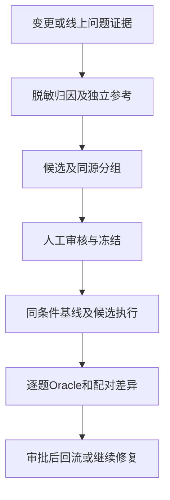

# 智能问数回归与数据集：从变更影响到可比较的执行

同样一批问题，候选版本的通过率提高了，能说明修复有效吗？如果同时换了数据快照、参考答案和Judge，答案可能只是不可比。回归首先是实验条件管理，再是重复执行。

这里保留变更清单、影响映射、生产问题回流、升级比较、统一Case和覆盖预算。回归贯穿权限、意图、准确性、回答交付、安全稳定性五类，不另算第六类，也不把旧设计中的类别序号延续到新方案。

## 必须列新增/修改文件清单

清单不是只列Python：Hermes runtime、企微adapter、插件、config、SOUL/Prompt、Skill及references、指标/枚举/schema、脚本、依赖锁、启动/部署配置、数据库迁移、记忆规则、报表模板都纳入。

|字段|内容|
|---|---|
|变更对象|路径、新增/修改/删除、旧/新摘要或commit、所属部署包|
|行为变化|之前/之后、使用入口、角色/表/字段/模型影响|
|风险/责任|高风险、负责人、缺证据项|
|测试映射|新增/修改Case ID、关联历史回归、渠道/稳定性专项|
|发布/回滚|备份、兼容性、迁移是否可逆、回滚条件及验证|

没有Git元数据时对测试包与生产清单做受限文件摘要差异；排除密钥、运行日志和数据库内容，单独记录其schema/配置版本。文件存在于测试环境不代表生产部署成功，需要读回实际生效清单。

## 新增修改怎么测，已有功能怎么测

新增功能：需求→正式口径/权限→正例、端点条件、异常、越权、多轮→独立真值→组件+Agent+受影响渠道。缺陷修复：先保留原失败证据和可复现反例，修复后同Case新run，补相邻场景，禁止改GT使结果“变对”。

生产已有功能：冻结一套全局冒烟/关键业务Golden；按变更映射选影响集，但P0权限/跨用户隔离每次发布必跑。Prompt/模型/工具路由改动影响面大，应跑完整核心集；不能只测试新增问题。

|变更类型|最低回归范围|
|---|---|
|指标/字段/SQL模板|关联查询口径+权限+跨表+空/异常+报告对账|
|权限/身份|所有角色、合法和拒绝、缓存/撤权、多轮/并发、企微首轮身份、绕行|
|Prompt/Skill/模型|主Agent路由/提取、全部核心问数、安全、澄清、多轮、延迟/成本|
|企微插件|身份+消息/附件交付、群/私聊、去重/流式、websocket、WAL/资源|
|记忆/长上下文压缩|跨用户隔离、遗忘/删除、压缩、重启/迁移、长会话问数|
|Hermes运行时/依赖|以上关键能力及hook/middleware/API/CLI契约、工具注册、存储与会话兼容|

## 生产问题怎么导出

按允许的日志/工单/监控只读抽取：稳定event_id、来源版本、时间、脱敏用户角色/授权范围、逐轮输入和公开回复、工具/SQL/查询错误、数据水位、文件交付、真实outcome、投诉标签。账号与客户字段统一脱敏，真实私有日志不可直接放候选文件。

按意图、条件、口径、SQL、数据、权限、工具、渠道、记忆、环境、GT错误归因；证据不足使用unknown。缺少数据快照的问题保留为待复现，不把历史错误数字直接当今日GT。

同会话/同问题模板去重并绑定leakage_group：diagnosis供分析，validation选修复候选，test最终发布；同源不能跨split。线上Bad Case→证据/脱敏→候选→业务及权限期望人审→新Golden release→新run回归；不自动入Golden。

## Hermes升级怎么做

1. 固定旧版本+业务空间+插件+schema+Golden/Oracle/模型/参数/快照，保存基线run。
2. 新版本在隔离副本做兼容预检：hook参数/执行顺序、middleware过滤、工具schema、企微adapter、API/profile/session/鉴权、CLI续会话、记忆和长上下文压缩/SQLite迁移。
3. 先测“业务资产不变，只有Hermes升级”；再单独测新增业务资产。把多因素变化分开，否则无法解释回归来源。
4. 同Golden/同fixture跑旧新多trial，分角色/场景/指标对比；重复3次起步，P0和不稳定题增加次数；一次pass不能掩盖一次泄漏。
5. 真实企微抽验+断联/去重/WAL soak；尤其核对插件是否加载、业务空间是否正确、旧会话可恢复。
6. 有授权后灰度小范围账号，监测查询错误、拒绝异常、权限/记忆泄漏、延迟/成本与WAL；未授权不自动发布。
7. 预设回滚：版本/配置/插件/Prompt清单、停止迁移写入、兼容快照/受支持备份；数据库schema不可逆时不能只回退二进制。回滚后再跑身份、查询、记忆、渠道冒烟。

P0泄漏、查询账号串用、禁止系统动作、数据损坏立即阻断/回滚；业务准确率/恢复/延迟阈值由业务与运行负责人批准。升级不重新生成容易题替代原Golden，不把框架报告生成当发布成功。

## 语义版本、缓存与多入口一致性回归

|变化|回归检查点|实施证据|
|---|---|---|
|指标定义v1→v2|同问句是否使用指定版本；旧session/Skill/缓存是否用旧公式|指标bundle摘要、实际SQL、结果/报告来源|
|源文档排序/新增指标|metric_id是否保持含义；旧Golden是否仍指相同业务指标|稳定ID映射、前后diff、引用完整性|
|维度/组织/枚举变化|重名门店、门店迁区、历史组织与当前授权区分|业务时间/组织版本/实时授权版本|
|同步中断|不能混用metrics v2与dimensions/tables v1；失败后恢复|bundle一致性标记、备份和读回|
|缓存/预聚合|冷/热缓存同合同结果；权限/水位变更立即按约定失效|cache key、命中/版本、授权后的独立数据证据|
|Agent/API/报表/BI同题|同指标/时间/授权/水位/粒度下对照结果|规范化contract、独立结果与各交付物|

缓存只在实际存在且可观察时测试，不假定业务已经部署Cube或预聚合。权限必须在缓存命中时仍有效；不能缓存一个全量结果然后靠目标自行遵守范围。

同一编译器输出的Agent结果和Dashboard相等，只能证明一致，不能证明正确。三方使用同一坏公式也会全错；独立经人审的GT/对账仍保留。动态数据对比必须相同水位/快照；无法锁水位时只做结构/已声明不变量与巡检，不声称精确业务正确性。

Oracle按批准的统一指标定义消费，但用独立人工可计算fixture、独立参考实现/参考SQL与部分源数据对账校准，避免把被测编译器代码复制成Oracle。

## 回归机制的具体执行方案

**推荐组合：变更清单影响分析＋冻结Golden脚本重放＋baseline/head配对差分＋生产Bad Case证据回流＋真实企微和稳定性复测。** 回归不是让另一个Agent自由聊一遍；它重复同一批准Case并按正式期望裁决。

## 每次变更的回归流水

1. 负责人提交“必须列新增/修改文件清单”中的变更清单；测试人员把路径/行为变化映射Case和专项。选择“关联新增/缺陷题＋受影响历史题＋全局P0”；Prompt/模型/路由或Hermes升级按“新增修改怎么测，已有功能怎么测”中的影响规则跑完整核心集。
2. 固定Golden、Oracle、rubric、身份/权限、fixture/水位、模型参数与环境初态；先旧版本baseline，再新版本head，分别新run。除声明的变更外条件相同，记忆/缓存按合同复位，禁止复用旧trial缓存冒充新版本运行。
3. 两版本执行同一固定问句和多轮脚本，独立Oracle分别裁决；比较配对Case的正确→错误、错误→正确、不可用、P0事件，以及角色/指标/场景和延迟/成本分布。至少按方案多trial，不只比总体均分。
4. 使用真实`compare`读取两个run；严格门禁需满足当前框架的manifest、Golden、Judge及允许变更约束，必要时按规则绑定改进提案。对照条件不兼容时先修正实验设计，不能改旧报告绕过gate。
5. 新增/修改期望的题另走人审与新Golden版本，不能偷偷改旧GT。新特性题未进入共同Golden时单独报告，不硬凑成严格配对回归。
6. 插件/身份/记忆/Hermes变化另跑企微抽验及断联、存储和会话恢复专项；读取实际生效部署清单。发布/灰度/回滚由有权人员决定，框架compare通过不等于部署成功。

真实run完成且比较条件满足后，使用当前CLI支持的regression入口读取基线与候选。工作区与运行标识应指向真实产物，工具执行通过不代表已完成发布。

## 生产问题与升级的执行分支

生产Bad Case按“保留证据→脱敏→补足当时口径/水位或隔离复现→独立GT→候选人审→新Golden→修复版本新run”执行。问题无快照时先列待复现，不能拿当前数据直接断言历史数字错；同源问题按leakage_group隔离。

Hermes升级先只换运行时，业务资产/模型/插件按比较目标保持不变，执行同题对照；之后另批验证新增业务或插件。存储迁移、旧会话恢复和回滚在受控环境实做，操作者记录数据库/文件版本及消息状态，不能用启动成功替代迁移验收。

**交付记录**：变更→Case映射、真实baseline/head run ID、配对回归及阻断原因、生产问题来源/审核链、企微/故障复测、实际部署清单与回滚演练证据。无新版本/真实run时仅能交付回归设计。

## 统一Case结构

沿用Harness现有Case，五大范围是业务分类，`scenario_families`是正交的正常/边界值/异常/对抗/长程任务标签，不混为同一个分类。`task_difficulty`取L1/L2/L3，`risk_level`表达后果。

每条必须具有：稳定ID、来源、脱敏记录、业务规则/真值证据、角色与授权策略别名、日期/水位、逐轮输入、必要资源、执行层、难度/风险、期望与独立Oracle、适用版本、关联缺陷/变更。领域条件可放CaseInput.context或CaseExpected.semantic的项目命名空间，但仍需领域检查器消费，不另起不兼容格式。

`expected.intent`用于标注，`trajectory.assertions`表达框架支持的工具约束，`outcome.assertions`校验传入的独立状态摘要，`output`用于用户看到的内容。框架默认output断言要求最终内容可解析JSON；自然语言回答不要硬套JSON断言，使用领域Oracle提取可核验事实，质量部分交给Judge。

```yaml
id: teaching-month-sales
category: query_correctness
subcategory: sales_monthly
scenario_types: [region_scope, date_boundary, sales_caliber]
scenario_families: [happy_path, boundary]
task_difficulty: L2
risk_level: high
priority: P0
status: draft
source: design-fixture-v1
gt_evidence: [教学参考证据编号]
required_resources: [trusted_identity, warehouse_snapshot, query_audit, business_oracle]
solvability_status: missing_resources
input:
  history:
    - role: user
      content: 上个月区域甲有效销售多少台、多少元？
  context:
    identity_profile: region-a-test
    business_clock: '2026-10-01T00:00:00+08:00'
    fixture_ref: design-fixture-v1
    execution_layers: [agent_api, wecom_sample]
expected:
  intent: sales_monthly_summary
  constraints: [身份仅从可信入口绑定, 不允许非授权行贡献聚合]
  outcome:
    assertions:
      - {path: '$.acl.scope_enforced', equals: true}
      - {path: '$.acl.identity_chain_match', equals: true}
      - {path: '$.business.order_count', equals: 3}
      - {path: '$.business.amount_yuan', equals: 600}
      - {path: '$.delivery.facts_match', equals: true}
      - {path: '$.evidence.complete', equals: true}
  output: {}
  trajectory: {}
reference_solution:
  steps: [确认指标与授权, 按冻结月份过滤有效销售, 独立核对结果与交付]
```

这是可供设计审查的教学结构，需另建可信参考和领域Oracle，不是可直接发布执行的候选。`identity_profile`需由测试环境可信注册表解析，不发给LLM冒充权限；actual工具名称需部署预检后才填写trajectory，不能假造某工具已经注册。3单/600元来自独立合成参考：区域甲三条有效订单金额100、200、300元，不能套线上。布尔结果只能由独立Oracle读取证据后计算，不能采信Target自己返回的“权限正确”。

## 示例规模与执行预算怎样计算

先建立指标、角色范围、时间、维度关联、数据状态与任务类型的覆盖矩阵，再选择独立预期充分的用例。示例首批40条可以按权限12、意图10、准确性12、回答3、安全3组织，目的是验证接入、身份、取证与判定，不是已批准的覆盖承诺。

|测试范围|必要风险单元|计数原则|
|---|---|---|
|用户与数据权限|六配置、字段、撤权、聚合及附件|同题多标签不增加Case|
|意图与条件|指标术语、日期、排序、澄清、多轮|同源改写按模板组管理|
|数据准确性|时间状态、关联、空集、金额、报表参考|独立参考充分才可判定|
|回答分析交付|事实、分母、图表文件和接收人|组件与端到端分别留证据|
|安全稳定性|注入、旁路、隔离、断联、幂等、WAL|专项按实际操作及负载计数|

一条Case是固定任务，一次完整执行是一个trial，多轮的每条消息是turn。假设40条业务Case每条执行3次，共120个trial；其中5条高风险再各执行2次，增加10个，总130个业务trial。高风险5条从原40条内选择，不再增加Case数。渠道故障、负载、探索和Judge调用另计，不能把两小时耐久当成一次普通HTTP请求。

运行预算应限制最大轮数、工具调用、并发、超时与费用，采集所有已发生消耗，包括失败和重试。没有真实调用与计费证据时，先报告单位和缺项，不捏造金额。三次重复只能观察稳定性，不能证明总体风险已经充分估计；关键泄露事件一次发生就保留。

分区采用diagnosis、validation与test等真实支持用途，并按来源、会话与模板组隔离。选择数量由风险单元与独立来源决定，不能用机械比例让关键角色缺席。固定回归采用脚本化多轮，动态Scenario用于探索；探索失败经整理和人审后再固化为Case。

## 覆盖驱动候选生成与经营价值覆盖

候选先做覆盖映射，不以问题数量作为主要目标。

构建`指标×角色/范围×时间×维度/JOIN×数据状态×任务类型`的必需风险单元：

- 高频销售、采购、成本、毛利、转化指标有合法正例、禁止范围、时间端点与状态。
- 有JOIN的题一定有关系/重复计数反例；有比率的题有分母/零值/时滞/组成效应。
- 所有实际查询路径有绕行/身份反例；敏感指标不被普通账号访问。
- 报表/归因等任务按业务频率与误判影响纳入，不用大量同义改写稀释难例。

有限生成循环：批准规则/覆盖缺口→独立测试Agent生成候选问句/多轮→结构/重复/来源检查→独立GT验证→人审→新版本Golden。生成失败保留原因，优先补仍缺的风险单元；设置批次/重试/成本上限，不无限自优化。

GraphGen/Augmentoolkit可启发多跳关系与多轮候选，DataGen可启发按配额补缺；目前不安装其重型依赖。Autodata“强模型对、弱模型错”只能筛有区分度的题，模型一致性不是业务真值，强弱模型输出也不能流入盲测上下文。禁止测试Agent修改Target提示使其故意失败、调整Oracle让自身方案通过或自动晋升Golden。

领域覆盖方向包括：语义缺失/版本冲突、ETL就绪/水位、counterexample、analysis_method、semantic_drift、cache_scope、cross_surface。这些是新增领域标签/契约，放既有`scenario_types`、`input.context`、`reference_solution`和`expected`中，仍使用现有Case Schema。

就绪、分析与语义漂移题优先映射现有候选，按最新五类中的主要风险计数；跨分类标签不额外累计。Oracle变异集合是判定器校准资产，不当作新增用户问句计入业务Case；若必需覆盖确实超出目标，再明确调整规模和预算。

## 让数据集分组真正约束采样

同一报表条件生成的正式问法、口语问法和多轮改写，应有相同来源组。分区以组为单位，防止近重复题一部分进入调优、一部分进入验收。复杂模板也可能共享事实来源，不能只根据字符串不同就当独立任务。



按评测逻辑整理的教学实现，非业务项目源码。下面检查同源分区与比较清单，演示发现已知泄漏和不可比条件，字段不是现有框架manifest格式。

```python
import hashlib
import json

def digest(value):
    text = json.dumps(value, sort_keys=True, ensure_ascii=False,
                      separators=(",", ":"))
    return hashlib.sha256(text.encode()).hexdigest()

def assert_group_partition(rows):
    seen = {}
    for row in rows:
        old = seen.setdefault(row["group"], row["partition"])
        if old != row["partition"]:
            raise ValueError("same source group leaked across partitions")

def comparable(a, b):
    fixed = ("dataset", "snapshot", "oracle", "policy", "trials")
    return all(a[k] == b[k] for k in fixed)

rows = [{"group": "g1", "partition": "test"},
        {"group": "g1", "partition": "test"}]
assert_group_partition(rows)
try:
    assert_group_partition(rows + [{"group": "g1", "partition": "diagnosis"}])
except ValueError:
    pass
else:
    raise AssertionError("known leakage was missed")
base = dict(dataset=digest(rows), snapshot="s1", oracle="o1", policy="p1", trials=3)
assert comparable(base, dict(base))
assert not comparable(base, base | {"snapshot": "s2"})
print("同源泄漏和快照变化均未进入可比实验")
```

这不是严格发布门禁的完整实现。真实比较还需核对环境等级、Case集合、逐题证据、审批摘要、必需Judge与遥测，不能仅靠五个字段认定可发布。摘要用于绑定内容，不能代替内容审阅；把状态字符串改成approved也不会生成真实人工凭据。

## pass@k与pass^k，用同一批执行解释清楚

pass@k看k次机会至少一次成功，pass^k看预定k次全部成功。两者不能互换，也不能把缺一次执行视为已完成三次。若某题发生一次越权，其严重事件始终保留，其他成功不会平均抵消。

```python
trials = {"a": [True, True, True], "b": [True, False, True],
          "c": [False, False, False], "d": [True, True]}
k = 3
complete = {key: values for key, values in trials.items() if len(values) == k}
assert len(complete) == 3
at_k = sum(any(v) for v in complete.values()) / len(complete)
all_k = sum(all(v) for v in complete.values()) / len(complete)
assert at_k == 2 / 3 and all_k == 1 / 3
assert len(complete) / len(trials) == 0.75
print("至少一次、全部成功和重复完成覆盖分别计算")
```

该段同样是按评测逻辑整理的教学实现，非业务项目源码，计算的是直接观察比例。不同采样设置可能采用统计估计，必须写明方法。运行预算据Case数、trial数、平均调用与平台限额规划，并单列专项机器负载。

## 经验感想

一个可比较的回归包应同时保留变更、冻结参考、运行条件、逐题证据和人工裁定。发现失败先判断条件可比、真值可靠、检查器适用，再定位产品变化。新的好看分数不覆盖旧失败，证据不足也不自动进入通过集合。


#智能问数 #回归测试 #数据集 #评测工程
