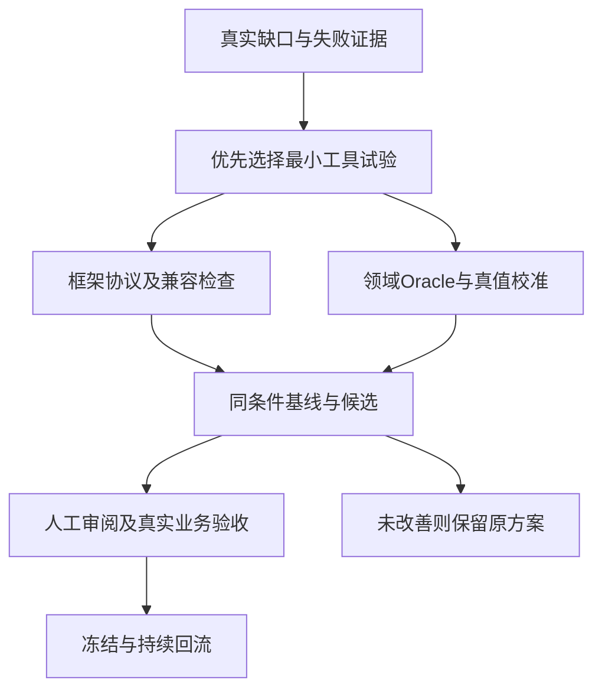

# 首次智能问数评测适配：工具箱、框架扩展与Harness Loop

第一次用通用Agent评测框架承接智能问数，容易把两种工作混为一谈：业务系统答得对不对，以及评测框架有没有把真实输入、证据和失败正确传递。框架冒烟通过可以证明协议的一部分，不会替业务金额、行级权限和企微交付背书。

工具选择应从实际缺口出发。缺SQL结构证据时考虑解析器，缺反例时考虑属性测试，缺隔离引擎时考虑容器，缺跨服务关联时考虑观测；不能先装一长串工具，再把集成成本当成评测进展。

## 工具各自解决什么问题

评测框架采用 **agent-eval-harness**，命令入口是 `agent-eval`。
领域资产放在独立评测工作区，复用框架协议。
它组织用例、执行、判定、证据和回归，不替代被测 Hermes。
下面的“已有”表示存在实现，不表示 Hermes 已通过真实接入验收。

|工具／能力|通俗解释与本项目用途|使用阶段|当前状态与前置条件|
|---|---|---|---|
|agent-eval-harness 控制平面|测试的总控台：管理计划、用例、运行、证据和报告|全程|已有；真实 Hermes、身份、环境与业务判定仍需接入|
|AI-IDE 的 agent-eval Skill|指导主 Agent 读项目、设计用例、解释失败；Core 负责检查和执行|准备、设计、诊断|已有；设计产物先作为草稿|
|确定性 Oracle＋固定数据|按明确规则核对权限、SQL、数量、金额和文件，类似独立对账员|首批小样本起|已有通用断言；Hermes 领域检查器、参考SQL、数据快照与审计关联待补|
|LLM-as-Judge＋rubric|让另一个大模型按评分表检查回答是否清楚、分析是否合理；rubric就是评分标准|评分标准准备后；首批需要语义判分的用例即可启用|框架已有；需要模型端点、凭据、人工标注校准与版本化规则；不能推翻Oracle失败|
|Laya 本地决策模型|在LLM Judge前，判断预设选项，例如意图类别、回答与任务是否对齐；保存概率和分歧|取得真实基线后，可选观察试点|框架已有 sequential_all；启用前需确认当前配置；需业务问题文件、独立模型环境及人工校准|
|SkillOpt：外部Skill优化候选|根据诊断失败提出或优化查询Skill版本，再由Harness测是否改善|基线、独立真值与数据分区就绪后，可选试点|未作为当前框架的现成集成；先验证版本、Hermes后端适配、凭据和预算；不承诺当前可直接训练|
|HTTP／SSE／SDK Runner＋可信桥接|把用例发送给真实Hermes，执行任务并收集返回；桥接绑定账号和逐轮会话|接口接入与批量测试|Runner已有；需核实真实协议；HTTP不会自动重放history/context；SDK只执行被测Agent|
|Hermes服务器CLI观察包|接口暂未开放时，在服务器核对配置并执行查询、导入结果|接入预检或过渡|可复用项目的预检、批量执行和导入能力；仍需身份和独立业务证据，不能替代企微验收|
|Scenario 动态多轮测试|模拟用户继续追问、改口和诱导，探索固定脚本之外的失败|固定多轮能稳定执行后，可选扩展|Runner已有；独立环境；先核实Target协议；内置Judge时外层 --judge off；探索结果不自动成为Golden|
|pytest 与组件固定输入测试|直接检查身份记录、权限判断、脱敏、去重等小模块|组件L0与每次相关修复|框架测试环境已有；业务组件仍需自己的用例、数据和运行环境|
|环境生命周期＋故障与状态读回|每次测试准备环境、植入受控故障、读取结果状态，再清理；防止测试互相影响|首批隔离测试及渠道专项|框架已有 provision/faults/snapshot/cleanup协议；真实环境服务、数据装载、撤权和记忆复位待实现|
|报告文件核对：openpyxl／JSON／CSV读取|打开实际生成文件，核对明细、汇总、单位与权限；不是仅检查文件是否存在|首批报告题起|框架已有openpyxl依赖；业务报表解析与逐项断言待补；SQL解析器须先验证数仓方言适配|
|Trace／Evidence／Manifest 与报告|记录执行轨迹、证据和版本摘要，关联到每条用例与每次执行|每次运行|已有；业务SQL、账号、文件、渠道审计需补关联；不默认采集宿主聊天、框架外调用或私有推理|
|指标、采样与预算记录|分别统计执行率、正确率、未知比例、延迟、模型用量和实际覆盖|运行与报告|框架已有指标与采样能力；费用依真实遥测与计费；无工具轨迹时不填虚构路由准确率|
|数据审核／Golden／coverage／partition|审核并冻结基准用例；检查风险覆盖；隔离诊断、选方案与最终验收数据|设计、审核、优化前|已有；新增范围需重新人审；同来源、模板或会话不能泄漏到多个分区|
|compare／regression＋受控改进工具|比较旧新版，登记改进候选，形成审核与回滚材料|有基线后的每次修复与发布|已有；匹配用例、账号、数据、环境及允许变更；人工选择与真实生产读回仍不可省略|
|feedback-import／reflow／Learning|把真实失败先脱敏为待审核候选，再决定是否纳入回归或经验库|持续回归|已有；禁止自动晋升Golden或Playbook；保留原始run与引用|

## LLM Judge、Laya 与 SkillOpt 的分工

- **Oracle核事实**：是否查错账号、范围、数量或金额。
- **LLM Judge评表达与方法**：说明是否清楚，分析是否有依据。
- **Laya做前级观察**：选择预设标签，供人工校准和分歧分析。
- **SkillOpt提改进候选**：若接入成功，尝试优化Skill，再接受独立评测。

Laya当前只观察，不自动放行，也不跳过LLM Judge。
sequential_all串行执行两者，不节省LLM调用。
模型高概率不等于业务正确；服务失败记unknown。
当前Laya模式不支持与缓存、续跑、Scenario或MiroFish组合。
其他业务的决策问题与校准结果不能直接迁移到问数。

SkillOpt试点先选有限、可审核的Skill片段。
只用诊断数据生成候选，用验证数据选方案。
最终测试数据不能供优化器反复调参。
只允许修改批准范围，不能改Oracle或预期来让候选通过。
优化器仅提出候选，批准与发布仍使用人工凭据。

## Harness Loop 怎样设计

这里的 Harness Loop 是评测与改进的工作流程。
它不是 `agent-eval loop` 命令，也不是第二套框架大模型运行时。

1. 固定账号、数据、版本和评分规则，记录基线运行。
2. 从真实证据判断失败属于身份、SQL、数据、工具或交付。
3. 登记改进提案，写清假设和允许修改的文件。
4. 生成候选，仅改批准范围，在验证分区同条件对照。
5. 生成审核包，交由用户选择；保留回滚版本。
6. 在最终测试分区验收，获批准后才发布并读取真实状态。
7. 把真实线上失败脱敏回流，经审核后补入回归。

每条路径都要保留基线、候选、版本摘要与证据引用。
修复后生成新run，不能覆盖旧记录。
同一个问题因Oracle或数据错误导致失败时，先修测试条件。
不得把所有失败都归给Hermes或直接改它的Skill。

## 使用真实命令族，不把设计流程写成不存在的命令

框架入口是agent-eval。先读取当前status与命令help，再使用dataset validate、coverage、sample、partition核对数据；review与release分别承担人工审核和冻结。target validate与env verify检查接入和环境，run产生新执行，report读取结果，regression比较真实基线与候选。

run的runner可选native、sdk、http、scenario、mirofish、sse；judge可选off、rule、llm，不能把脚本中的on当成CLI值。profile支持smoke、core、full、held-out，purpose支持capability、regression、release-test，partition支持diagnosis、validation、test。具体选项组合仍以当前help为准，存在枚举不等于真实业务端点已经可用。

CLI管理确定性流程，不启动第二套框架LLM编排器。SDK Runner用于执行被测Agent，不能反过来承载评测框架自己的自主业务决策。环境接口存在，也不代表数据库、撤权、记忆清理与故障服务已经实现。

## 本项目采用顺序与交付要求

|阶段|优先采用|进入下一步的条件|
|---|---|---|
|入口与资产准备|status、预检脚本、可信桥接、组件检查、语义与数据就绪检查|确认实际部署、账号、语义版本、水位与可读证据|
|首批小样本|固定脚本＋Oracle＋运行报告；必要的LLM Judge先校准|真实查询、权限与交付可独立核对；测试检查器能发现故意错误|
|核心覆盖扩展|coverage／partition、建议每用例3次执行、分组报告；按需Scenario|覆盖缺口与缺资源单列，不以用例数量代替验收|
|可选优化|Laya观察试点；SkillOpt最小适配；受控版本对照|独立真值、业务校准、数据隔离和预算齐备|
|发布与持续回归|compare／regression、企微抽验、状态读回、feedback-import／reflow|P0无失败；无未裁决关键问题；审批、发布与回滚证据完整|

MiroFish属于群体仿真辅助工具，框架已有集成。
问数与权限主线不需要优先采用，仿真也不能作为业务真值。
无需把所有可选工具都装上后才启动首批测试。

## 首次问数项目：业务验收与框架适配一起推进

这是框架首次面向智能问数的适配试点。
每个失败先核对证据，再判断应修业务、测试资产还是框架。
业务与框架分别验收，测试条件另列就绪门禁。
不能用框架测试通过代替Hermes业务通过。
本节是实施建议，新增能力尚未实现，外部工具尚未接入。

|验收线|具体检查|通过时必须拿出的证据|
|---|---|---|
|Hermes业务线|问题理解、指标口径、权限范围、SQL、结果、报告和企微交付|可信账号、独立预期、实际查询与文件、权限审计及渠道回执|
|Harness工程线|输入协议、会话隔离、领域判定、异常归类、证据关联和旧项目兼容|协议反例、框架回归结果、新旧报告可读及失败可复现记录|
|测试条件线|数据水位、语义版本、账号授权和检查器可靠性|固定数据摘要、授权快照、已审口径及故意错误检出结果|

## 从现有流程节点找扩展点

节点编号沿用十二步查询场景：④理解、⑤语义、⑥查询、⑦校验、⑧入口、⑨提交、⑩执行、⑪加工、⑫交付。
会话记忆需另建生命周期测试。
API自动化仍从④开始，测试桥接固定可信userid。
不得接受问题文本或模型输出提供的userid覆盖可信身份。

|节点／对象|首次适配需要补什么|实现位置与原因|最小验收实验：建议值，尚未执行|
|---|---|---|---|
|④理解→⑤指标与元数据→⑥SQL|版本化查询约定：指标、时间、粒度、单位、排序与歧义处理|Hermes Eval Pack；这些是业务口径，Core不应写死|对同一问题改写3种表达；口径一致。歧义题必须追问，不强行查数|
|⑥SQL→⑦工具分发→⑧脚本→⑨API→⑩数仓|SQL结构检查＋多数据集执行判定＋权限状态读回|领域Oracle与数据环境；仅解析成功不能证明可执行或权限正确|等价写法应通过；漏权限、错月份、JOIN放大、错去重等8类故意错误逐一检出|
|⑩数仓结果→⑪加工→⑫回复／报告交付|结果表类型、精度、NULL、重复、顺序、单位和文件内容比较|Eval Pack结果归一化；保留原始值和文件摘要|整数、Decimal、NULL、重复行、并列排名各有正反例；仅允许预先声明的误差|
|①身份→③会话；④API会话|逐轮输入、账号绑定、会话ID、撤权与记忆复位|可信桥接与Runner适配；当前HTTP不自动重放history/context|账号A/B交错追问无串话；撤权后禁止读旧结果；会话重复投递不重复执行|
|⑨查询请求→⑩执行；⑫发送／回执|超时、断流、重试、取消与交付状态关联|Adapter与环境；基础设施失败不能算成业务回答错误|超时和断流分别归类；重试次数有限；查询成功但发送失败单列；恢复后读取真实状态|
|全处理过程与历史项目|版本、时间、SQL、数据、权限、账号、文件、trace关联|先做证据映射；共享缺口才扩Core协议|证据缺失记不可判定；旧case仍合法、旧run仍可读；原有项目回归结果可对照|

八类必需校准错误覆盖日期字段、去重、有效状态、时间端点、权限、JOIN、缓存和交付事实。
错指标、错单位、TopK等追加风险仍需覆盖，但不替换这8类校准。

“查询约定”是测试要核对的结构化清单。
它不是新增一个字典就能让框架自动理解。
现有可执行rubric有受限执行入口，仍需验证领域数据与证据传递。
若该入口满足需要，先复用；不足时再提出明确的协议扩展。

## 专业工具选型：先做最小试验，再决定接入

以下能力已查阅官方资料。优先级是本项目建议。
未验证安装条件、真实端点或Hermes适配，不承诺直接可用。
“优先”表示先做小范围验证，并非首批测试前必须全装。

|优先级／工具与官方资料|专业能力，用通俗话解释|本项目怎样用／对应节点|接入前提、适用限制与验收证据|
|---|---|---|---|
|优先：[SQLGlot](https://github.com/tobymao/sqlglot)|把SQL解析为结构树，查看表、列、条件与方言|⑥⑦：提取查询范围、危险语句和结构差异|指定真实方言；CTE、子查询、UNION分别试验。解析器较宽松，解析成功不代表数据库接受，也不证明权限或语义正确|
|优先：[Hypothesis](https://hypothesis.readthedocs.io/en/latest/)|按规则生成边界值输入，并帮助找出失败反例|⑤至⑨：日期端点、重复记录、NULL、账号范围变化|业务专家先确认变化规律；保存失败输入和配置。增加未授权行后结果应不变，但权限必须由真实查询路径验证|
|优先：[DuckDB](https://github.com/duckdb/duckdb)|在本地小数据库中执行固定测试数据|⑥⑩⑪：快速验证聚合、去重、JOIN与结果比较器|本地Oracle实验；不能替代真实数仓方言和ACL。数据包含撤销订单、重复关联、跨月记录与未授权门店|
|按环境优先：[Testcontainers Python](https://testcontainers-python.readthedocs.io/en/latest/)|为测试启动、隔离和清理数据库容器|⑩及环境生命周期：接近真实引擎的集成测试|需Docker、正确镜像与驱动；锁定版本。不可容器化的数仓用真实隔离库；验证初始化、快照、清理和相互隔离|
|接口就绪后：[Schemathesis](https://schemathesis.readthedocs.io/en/stable/)|根据接口说明生成正常与异常请求|④API桥接：缺字段、错误类型、会话和响应格式|先有可信OpenAPI与认证约定；身份覆盖测试另写断言。保存最小复现；接口格式正确不代表问数正确|
|按证据缺口：[OpenTelemetry](https://opentelemetry.io/docs/what-is-opentelemetry/)|用trace标识关联多个服务的调用与耗时|④至⑫：关联Hermes、查询服务、数据库审计与发送回执|先补现有Trace映射；只在跨服务证据不足时引入。采样缺失不能当业务通过，不默认记录密钥、完整数据或私有推理|
|安全专项：[promptfoo red teaming](https://www.promptfoo.dev/docs/red-team/)|生成提示注入、越权等攻击测试|④⑦⑪⑫：冒充账号、诱导绕过限制、从报告泄漏数据|隔离测试环境、脱敏输入、可信账号绑定；用实际SQL、返回数据和文件核对。模型红队评分仅作发现线索|
|故障专项：[Toxiproxy](https://github.com/Shopify/toxiproxy)|在网络连接上制造延迟、断连等受控故障|⑨⑩⑫：查询或发送超时、连接中断与恢复|可代理的隔离TCP连接；并非全部企微错误模拟器。核对有限重试、状态分类、无重复交付与清理结果|
|基线后：[SkillOpt](https://github.com/microsoft/SkillOpt)|根据运行轨迹修改自然语言Skill，并用验证数据筛选|⑤⑥：有限范围优化指标选择或SQL生成Skill|不训练模型权重；需后端适配、独立数据分区与预算。候选交Harness验收，不改Oracle、权限策略或Golden|
|备选前沿：[GEPA／DSPy](https://github.com/gepa-ai/gepa)|利用评分和失败反馈搜索更好的提示或程序配置|④至⑥：已有可测接口时优化限定提示片段|与SkillOpt先二选一小试；不要求重写Hermes为DSPy。冻结检查器、限制调用预算、保留独立最终测试集|

工具生成的结果先作为候选证据导入现有Case与run。
保留来源、版本和关联ID，不另建不兼容的Golden格式。
Laya继续做观察与校准；LLM Judge继续评表达与分析依据。
两者都不能代替SQL执行、数据结果和真实权限断言。

## 业界方法：检查“碰巧答对”，也检查整个任务

[Text-to-SQL Test Suite Evaluation](https://github.com/taoyds/test-suite-sql-eval)
提出在多份数据库内容上比较执行结果。
本项目可借鉴：相同题目使用多份受控反例数据。
这些有限实验提高检错能力，不能证明所有输入下语义等价。

例如：正确SQL与遗漏去重的SQL，在无重复数据时可能都答对。
加入重复成交与一对多关联后，应只接受口径正确的结果。
比较器须保留重复行；仅在业务不要求顺序时忽略排序。
Top10并列如何处理、金额误差多少，必须预先写明。

[Spider 2.0](https://spider2-sql.github.io/)强调企业问数工作流。
可借鉴元数据理解、多步查询、方言和最终CSV产物测试。
外部榜单题不能替代企业指标口径、账号权限与企微验收。
不依据榜单分数推导业务覆盖数量。

## 首轮实施顺序与框架改动收口

1. 建框架基线：保留原有项目的协议、用例和报告样例。
2. 首批小样本逐条核对需求、数据、账号与独立预期。
3. 先校验领域Oracle：正确样例通过，8类故意错误全部检出。
4. 接真实④入口，读取SQL、数据、权限、文件及调用证据。
5. 每个失败登记责任：Hermes、测试资产、框架或环境。
6. 先补Eval Pack与Adapter；确需共享能力时单列框架变更。
7. 同时重跑领域回归和原有项目回归，再决定覆盖扩展。
8. 基线稳定后，再试多轮探索、安全专项和有限优化。

框架变更单写清：触发用例、协议缺口、修改位置与兼容策略。
新增字段须定义版本、默认值、未知状态与旧产物读取行为。
缓存键须覆盖账号、权限、数据、语义和Oracle版本。

如果无法证明隔离，关闭缓存，不跨账号复用查询结果。
未知关键字段或缺失关键证据不得静默放行。
新运行保留新ID；不覆盖历史run或人工审核记录。

后续若改框架代码，执行相关pytest与适用完整检查。
完整检查包括pytest、ruff和pyright；另验真实Target与环境。
框架工程门通过与业务门通过分开报告。
该设计只补研究和方案，未执行这些集成验收。

官方资料核对日期：2026-10-11。
采用前仍须锁定版本、核对许可与部署要求，运行最小样例。

## 两条验收线，使用同一批反例但分开结论

框架工程线要验证参数映射、错误分类、证据关联、报告兼容与历史项目；业务线要验证真实主体、授权、条件、查询和交付。测试条件线则确认参考、水位、语义版本与检查器。三条线可能分别通过、失败或缺条件，不能合并成一个“工具已接入”。



## 最小Runner适配逻辑，先证明不会吞掉错误

按评测逻辑整理的教学实现，非业务项目源码。真实EvalRunner有prepare、run、collect、normalize四个接口。下面用标准库模拟一次协议归一化，字段是教学DTO，不是Trial序列化schema；它演示HTTP成功不自动代表业务通过、缺审计也不能填空列表。

```python
from dataclasses import dataclass

@dataclass(frozen=True)
class Captured:
    transport_ok: bool
    reply: str
    query_ids: tuple[str, ...] | None
    side_effects: tuple[str, ...] | None

def normalize_capture(response):
    return Captured(
        transport_ok=200 <= response["status"] < 300,
        reply=response.get("reply", ""),
        query_ids=tuple(response["queries"]) if "queries" in response else None,
        side_effects=tuple(response["effects"]) if "effects" in response else None,
    )

def ready_for_business_check(item):
    return (item.transport_ok and bool(item.reply)
            and item.query_ids is not None and item.side_effects is not None)

ok = normalize_capture({"status": 200, "reply": "完成", "queries": ["q1"], "effects": []})
assert ready_for_business_check(ok)
missing = normalize_capture({"status": 200, "reply": "完成"})
assert not ready_for_business_check(missing)
assert missing.side_effects is None
error = normalize_capture({"status": 503, "reply": "失败", "queries": [], "effects": []})
assert not ready_for_business_check(error)
print("正常、缺证据、传输失败没有被归一化成同一种成功")
```

这里的ready只表示具备进入某类检查的最低记录，不是业务pass。有些合法拒绝场景本就不应产生query_id，应按用例要求选择证据，而不是一律要求存在查询。实际Runner保存Trial、Trajectory和执行状态，独立Oracle计算业务摘要，再由框架生成Evidence；目标返回自评不能补足审计。

## Harness Loop给优化器的权限要比目标更窄

优化器可以修改批准提示片段、术语映射或Skill候选，不能改真值、Oracle、权限策略或验收分区。先在诊断集生成候选，在验证集选择，最终测试集独立评估。每个候选有允许变更清单与预算，失败原因与旧版本仍保留。

按评测逻辑整理的教学实现，非业务项目源码。它展示变更允许清单与预算检查，避免优化器通过修改裁判取得假提升；不声称某个外部优化工具已经提供同名函数。

```python
ALLOWED = {"query_prompt", "metric_aliases"}

def check_candidate(candidate, remaining_calls):
    if not set(candidate["changed"]) <= ALLOWED:
        raise PermissionError("candidate changed protected assets")
    if type(candidate["calls"]) is not int or type(remaining_calls) is not int:
        raise TypeError("call budgets must be integers")
    if candidate["calls"] > remaining_calls or candidate["calls"] < 0:
        raise ValueError("call budget exceeded")
    if candidate["partition"] != "validation":
        raise ValueError("selection must use validation partition")
    return remaining_calls - candidate["calls"]

good = {"changed": ["query_prompt"], "calls": 4, "partition": "validation"}
assert check_candidate(good, 10) == 6
for bad, error in [(good | {"changed": ["oracle"]}, PermissionError),
                   (good | {"calls": 11}, ValueError),
                   (good | {"calls": True}, TypeError),
                   (good | {"partition": "test"}, ValueError)]:
    try:
        check_candidate(bad, 10)
    except error:
        pass
    else:
        raise AssertionError("protected change or budget violation was missed")
print("保护资产、预算与选择分区的已知错误均被拒绝")
```

这个检查只验证候选清单，实际还需要对产物做摘要差异与受限执行，不能相信优化器自己列出的changed字段。预算应根据真实消耗扣减，失败尝试也计入。批准发布后仍需真实状态读回，不能用候选比较报告代替部署结果。

## 工具试验的退出条件也要写清

SQL解析器不支持仓库方言时，保留不支持标记，不能退化成WHERE字符串判断；属性测试生成的变形关系若不满足业务前提，先修测试关系，不给目标记错；本地数据库结果无法覆盖真实ACL时，只保留为逻辑校准证据。

观测工具需要核对采样、隐私、保留与跨服务标识。红队工具输出是候选攻击与线索，最终仍通过真实副作用、查询和交付证据裁决。提示优化器没有带来独立测试收益，或者增加了维护复杂度，应允许不采用，保留基线与试验记录。

## 经验感想

首次适配的重点是把业务规则和框架职责接准。先完成一条可对账任务、一组已知错误和一份能关联证据的报告，再按缺口引入专业工具。每项扩展都保留输入、输出、失败反例和兼容检查，工具清单才会变成可维护的工程能力。


#智能问数 #评测工具 #AgentEvalHarness #HarnessLoop
