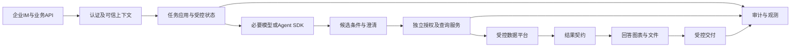

# 专用智能问数平台，为什么要重新考虑Agent基座

公司只需要一个按权限查询业务数据的助手，工程里却开始维护通用会话、工具限制、空间规则、脚本入口和各种运行时适配。每增加一个报表 API，都要确认它会不会绕开既有检查；每次升级，还要重新核对身份和工具行为。

这时值得讨论的架构问题，是哪些职责应该由业务应用掌握。对业务范围固定的问数平台，更倾向于自有业务应用、必要的 Agent SDK、受控编排，以及独立授权与查询执行能力。这个方向不等于某个 SDK 自动更稳定，也不能据此宣称 Hermes 无法提供 API 或安全能力。

以下是基于需求的架构分析与验证方案，没有进行候选框架安装、性能比较或迁移实测，也不披露任何内部项目实现。

## 成品 Agent 运行时与 SDK，承担的事情不同

Hermes 是包含多种能力的 Agent 产品运行时。公开架构与安全文档介绍了入口、会话、工具以及隔离和审批等机制。对需要广泛日常工作能力的助手，集成这些能力可以减少搭建成本。但公司专用问数是否需要这些能力，要按产品职责逐项判断。

Agent SDK 通常作为应用依赖，提供模型调用、工具循环、状态或协作能力。公司仍然负责业务 API、身份、存储、部署和数据授权。SDK 也来自第三方，也会升级，也可能引入复杂行为。区别不在于第三方与自研的标签，而在于依赖承担多宽的职责、业务规则是否需要依赖其内部细节。

受控编排指应用明确规定执行阶段，例如先认证、理解、检查条件，再授权和查询，之后加工与交付。模型可以在指定位置生成候选内容，但不能决定是否跳过授权或替换执行身份。一个按固定顺序运行的普通业务流程，也可以使用模型，不必先设计多个自由协商的 Agent。

还可以不使用完整 Agent SDK。如果需求主要是结构化条件提取加受控查询，一次或少量模型调用可能已经足够。只有当工具循环、暂停恢复或复杂任务确实带来价值时，再引入相应框架能力。架构投入应与真实任务匹配。

## 维护成本，不只来自上游升级

能力收窄有持续成本。通用运行时允许多种工具，专用平台只需要其中少数，就需要证明其他能力不会被用户请求触发，也不会接触业务凭据。关闭配置、限制工具、审计旁路和回归验证，都属于产品长期责任，不能因为功能暂时没有被使用就忽略。

授权覆盖也有成本。若规则分散在多个钩子、脚本和输出加工步骤，每新增一条数据路径都需要确认限制是否完整。更易维护的目标是让所有数据读取、缓存访问和交付经过明确服务规则。提示词里的“不要越权”可以辅助约束，不能代替服务端检查。

API 定制会暴露另一个差异。业务接口需要确定任务标识、状态、错误码、取消、幂等和结果格式；通用对话接口可能更关注消息与工具输出。适配层如果不断翻译运行时内部对象，测试和客户端都容易受到变化影响。将外部契约放在业务应用中，能减少这种耦合。

测试成本同样要量化。一个授权规则是否必须启动整套运行时才能验证，能否替换数据服务、固定模型输出并观察阶段结果，失败是否只能从聊天记录推断，都会影响迭代速度。不能只比较第一版代码量，还应比较新增业务条件和定位失败所需的工作。

|比较项|成品运行时承载业务|应用掌握流程并使用窄 SDK|
|---|---|---|
|首次接入|可复用已有渠道和能力|需建立必要应用能力|
|能力范围|需要验证关闭与限制效果|按需注册，仍需禁止旁路|
|业务接口|依赖适配是否稳定|应用定义版本化契约|
|授权规则|检查是否覆盖全部出口|集中到受控服务仍需实测|
|可测试性|取决于运行时可替换接口|可设计阶段输入输出与假依赖|
|持续成本|配置、适配和升级回归|业务维护、SDK 升级与运维|

这张表是比较维度，不是性能结论。现有团队熟悉度、渠道能力和实际定制量可能改变短期选择。对较成熟且已经可控的系统，先抽出查询与授权服务，通常比一次重写全部入口风险更可管理。

## 目标架构，先把业务不可变规则放清楚

接入层验证企业 IM 或 API 身份，建立不可被模型覆盖的请求上下文。任务应用负责状态、预算、幂等和业务流程。语义服务提供批准的指标、维度与术语。模型只产出候选条件或必要解释，授权服务与查询执行负责最终允许范围和数据访问。

查询结果进入统一结果契约，包含数据、单位、粒度、数据水位和明确状态。回答加工据此生成文字、图表或文件；交付前再次核对对象、权限和产物归属。观测系统关联各阶段，不把业务授权寄托在追踪工具上。



模块独立不等于必须部署成很多微服务。先用清晰接口组织模块化应用，可以降低复杂度；涉及凭据与执行隔离时，再选择进程或网络隔离。同一进程中的两个类不会自动形成安全隔离，模型可执行环境是否持有仓库凭据，需要按实际部署检查。

“空间”中的业务资产可以保留，例如术语、指标说明、脱敏示例与提示资料。它们需要负责人、版本和可见范围。权限判断、重试与执行状态应进入受版本管理的应用规则，不能因为写在某个文件夹里就认为已经具备访问控制。

以下为职责契约的通用设计示意，不是项目源码或任何 SDK 的真实接口。

```yaml
接入层:
  负责: 验证身份并创建请求上下文
  禁止: 用问题正文覆盖执行主体
模型阶段:
  负责: 提供候选条件或澄清请求
  禁止: 自行授予数据权限
查询服务:
  负责: 校验口径和授权后执行
  禁止: 信任客户端传入的最终允许范围
交付阶段:
  负责: 核对产物归属与接收对象
```

## OpenAI Agents SDK 可以考虑，但不是预定赢家

OpenAI Agents SDK 提供 Agent、工具、执行与追踪等能力，可以运行在自有应用中，适合由应用管理部署与业务规则的路线。它的结构化输出能够约束格式，却不会自动证明指标口径正确；guardrail 可以做检查，也不能替代查库前不可绕过的授权。

会话和状态能力还需要与生产存储、并发和访问控制结合。SDK 追踪能够记录其覆盖的步骤，但外部查询服务、仓库审计和企业消息交付仍需自行关联。对敏感业务数据，要核对追踪导出、字段脱敏、保留和关闭策略，不能默认把完整结果送到外部观测平台。

LangGraph 更强调图状态、持久化和恢复能力，适合流程状态和暂停恢复比较复杂的场景。其持久化与中断文档也提示了恢复执行的语义：节点可能重新执行，因此查询和交付仍需幂等。检查点保存进度，不会自动保证所有外部动作恰好一次。

Pydantic AI 可作为类型化工具和依赖组织的候选，Microsoft Agent Framework 也有其协作与工作流定位。是否适合，需要看语言、模型提供方、部署要求和团队维护能力。不能把文档里的能力列表当作兼容性已经验证。

如果需要连接兼容模型接口，应实测工具调用、结构化输出、流式、错误状态与追踪。某个提供方声称兼容，并不意味着所有细节一致。SDK 版本、模型端点和适配器都应进入运行清单，后续升级用同一组业务题回归。

## API 以业务任务组织，避免暴露运行时内部对象

业务 API 可以围绕提交查询、查看状态、取得结果和取消任务组织。返回稳定任务标识与错误含义，客户端不必理解内部工具循环或 SDK 对象。字段规范、权限和状态由公司版本化管理，SDK 更换时只调整内部适配。

幂等标识与可信身份需要绑定。相同业务请求重复提交，应关联原任务或按批准政策处理，不能串到另一个用户的任务。超时表示等待结束，未必表示查询未执行；取消请求也需要实际终态确认。这些语义要写进接口说明和测试预期。

缓存与状态恢复同样属于业务架构。缓存应考虑授权、语义与数据水位；恢复时重新核验可能过期的权限。一个长任务暂停期间用户被撤权，不能仅凭旧检查点继续交付。SDK 提供状态机制，不替业务决定撤权政策。

## 用同一套评测比较迁移路线

可以设三种候选：继续现有运行时并加固、先抽授权与查询服务保留现有入口、应用掌握流程并使用必要 SDK。每种候选用相同身份、语义、数据快照、问题、预算和交付要求进行验证，不能让新路线只测最容易的查询。

首先比较不可妥协的正确性与安全要求：权限是否可绕过，缺身份是否拒绝，条件与结果能否对账，交付对象是否一致。任何候选在这些关键项失败，都不能靠延迟或开发体验得分抵消。证据不齐时，结论应为待验证。

再衡量工程收益。新增一个指标需要改哪些地方，新增一个授权场景能否独立测试，API 契约是否受 SDK 升级影响，故障定位需要多久，版本回滚是否保留任务状态。可以设计相同变更任务记录实际投入，而不是凭架构图推断维护成本一定降低。

以下是概念验证的通用步骤，不对应现有工程命令或框架配置。

```text
冻结一组脱敏业务任务与独立参考
固定身份、语义版本、快照和运行预算
分别执行现有与候选路线
逐项核验权限、条件、结果和交付
注入超时与重复请求，检查状态与副作用
记录新增规则、排障和升级适配的实际耗时
根据证据决定扩大试点或保留原路线
```

## 迁移按职责推进，先让旧系统也受益

第一步可以统一查询与授权服务，让现有运行时继续作为入口和理解层。所有数据出口都经过该服务，先补独立测试和审计。这一步即使暂不迁移 SDK，也能提高规则一致性和可观察性。

第二步建立应用自有任务 API 和结果契约，在少量高频只读任务上接入候选流程。采用隔离数据或受控对照，避免双跑生成两份报告。线上影子执行若会增加仓库负载或接触真实用户数据，需要单独授权和预算，不能视为无成本验证。

第三步逐步转移状态与交付职责，保留回滚入口。切换前确认进行中任务、缓存和附件如何处理；回滚时不重复发消息，不恢复已经撤销的权限。旧系统下线以真实覆盖与运行证据为依据，不能只因新版本能完成演示就结束迁移。

架构方案本身不是实施许可。当前业务测试与迁移验证可以复用数据和断言，但目标版本、运行清单和批准范围应分开。尚未接入真实身份、仓库和渠道时，只能证明设计或本地协议，不能宣称维护收益和稳定性提升已经兑现。

## 可测试性可以成为选型任务，而非一句评价

给候选架构安排同一项测试任务：不用真实模型，固定一份候选条件，验证服务是否能拒绝跨店请求；再固定原始结果，检查图表与接收人。若每次都必须启动整套运行时、访问真实数据，测试成本就有了可观察差异。记录准备时间、外部依赖和失败定位步骤，比简单打一个可测试性五星更具体。

还可以安排一次语义变更。把合成指标的退款归属规则更新到新版本，观察需要修改提示、业务代码、数据参考和检查器的哪些部分。合理目标是语义资产与受影响参考显式更新，授权和接口保持可验证。如果一个口径调整牵动运行时深层对象，需要把这项耦合写进比较结果。

升级比较也需要实际任务。锁定旧版本和候选版本，运行相同回归组，核对工具参数、流式终态、错误类型和追踪字段。不能因为 SDK 名字更专业就免除这一步。若没有兼容性证据，选择仍然属于待验证建议，不应升级成稳定性承诺。

## 团队维护能力也是架构约束

应用掌握流程意味着团队要承担更多明确责任：业务接口由谁维护，语义规则由谁确认，授权变更如何审批，数据服务故障由谁处理，模型与 SDK 升级由谁回归。这些职责应有明确负责人和变更接口，避免测试时只能通过运行时内部状态推断业务行为。

同时也要控制自研范围。没必要为了绕开通用运行时，重新实现模型客户端、所有观测组件和完整工作流引擎。可以保留可靠公共依赖，用小接口隔离变化，将自研投入放在公司特有的语义、授权、任务和交付规则上。新增抽象是否有价值，可以用具体变更是否更容易测试来衡量。

## 回滚验证要覆盖已经在途的任务

切换期间可能存在旧运行时已提交但未完成的查询。新应用接管后，需要确定由谁继续等待、谁负责交付、旧任务是否还能重试。若只回滚入口配置，没有处理在途状态，就可能出现重复文件或无人领取的结果。概念验证应安排切换时暂停一个合成任务，再观察恢复与交付。

回滚也不能回退业务权限。权限已经撤销的用户，即使切回旧应用版本，也应遵守当前授权；新的语义资产是否向后兼容，需要单独说明。应用发布版本、数据版本和权限版本是不同维度，回滚其中一个不能自动恢复其他两个。

选型记录最好区分必须项和偏好项。可信身份不可被模型改写、授权不可绕过属于必须项；图式界面、调试体验或团队熟悉度属于偏好项。先验证必须项，再比较维护成本与体验，能避免一个展示漂亮的候选抢先占据结论。若必须项缺少实际证据，记录待验证即可，不用给出带小数点的综合排名。

## 把架构判断落实为可验证的状态机

采用 SDK 以后，应用需要拥有任务状态。至少要区分已接收、执行中、查询完成、产物生成、已交付、取消请求中、已取消和失败。数据库已经完成查询但消息发送失败，应该保留查询完成及发送失败的事实，恢复时重试交付；不能把整个任务重新当成一条全新查询。

下面按照任务状态语义给出一个教学实现，只演示状态迁移校验，不是内部业务源码。真实系统还需要数据库事务、版本比较更新及事件日志。示例全部在内存执行，断言中的非法迁移应被拒绝。

```python
TRANSITIONS = {
    "accepted": {"running", "cancelled"},
    "running": {"query_done", "cancel_requested", "failed"},
    "query_done": {"rendered", "failed"},
    "rendered": {"delivered", "failed"},
    "cancel_requested": {"cancelled", "query_done", "failed"},
    "cancelled": set(),
    "delivered": set(),
    "failed": set(),
}

def transition(state, event):
    if event not in TRANSITIONS.get(state, set()):
        raise ValueError(f"invalid transition: {state} -> {event}")
    return event

assert transition("running", "query_done") == "query_done"
assert transition("running", "cancel_requested") != "cancelled"
assert transition("cancel_requested", "query_done") == "query_done"
try:
    transition("accepted", "delivered")
except ValueError:
    pass
else:
    raise AssertionError("查询未执行就交付，应被拒绝")
```

取消请求存在竞争：请求到达时查询可能已经完成。因此允许记录查询完成，但接下来是否生成和交付，应由产品的取消政策决定，不能据此继续默认发送。这个例子只验证状态顺序，不证明数据库取消或消息去重已实现。生产代码需要把查询编号和取消确认状态一同保留，才能区分请求发出与实际停止。

|架构要求|可执行评测动作|需要读回的状态|
|---|---|---|
|身份不能由模型改写|在用户问题和候选条件里注入另一账号|实际查询主体仍等于认证主体|
|查询和授权绑定|在授权通过后撤销范围，再继续查询|执行前采用批准的授权时效策略|
|取消不伪装完成|暂停查询，提交取消，再恢复网络|取消请求、查询终态、交付状态分别可查|
|交付有幂等语义|同一产物发送步骤重试多次|业务交付标识及实际发送次数|
|SDK可被替换|固定相同候选条件替换模型实现|业务API、授权与结果契约保持一致|
|任务可独立复测|固定条件和结果，分别注入查询与发送失败|错误阶段明确，恢复不会覆盖旧证据|

这些检查可以接入 agent-eval-harness：Runner 负责执行固定输入；环境读回查询与消息状态；领域 Oracle 检查表中的约束；框架保留每次执行的证据和版本。模型输出的“已取消”“已发送”都只是候选文字，不能替代环境读回。

## 缓存和幂等，需要同时带上主体与版本

缓存结果是否可复用，至少依赖主体或批准的共享策略、授权版本、语义版本、数据水位和查询条件。只用问题文本做键，同一句“上个月销售多少”可能在不同用户之间复用。使用会话编号也不充分，同一会话暂停期间权限仍然可能变化。

以下代码演示受控缓存的一个保守策略：版本必须全部一致，结果包含的门店还要属于当前允许范围。它同样是教学实现，并未提供真实缓存存储或授权服务。每次调用的 current 都应来自可信服务，不能由问题正文提供。result_scope应来自独立查询审计；只有合计而没有门店明细时，也必须保留实际取数范围，不能传空集合跳过范围检查。

```python
from dataclasses import dataclass

@dataclass(frozen=True)
class QueryContext:
    subject: str
    policy_version: str
    semantic_version: str
    data_version: str
    query_digest: str


def reusable(saved, current, result_scope, allowed_scope):
    return saved == current and set(result_scope) <= set(allowed_scope)

before = QueryContext("tester_a", "p1", "m1", "s1", "q1")
assert reusable(before, before, {"A"}, {"A", "B"})
after_revoke = QueryContext("tester_a", "p2", "m1", "s1", "q1")
assert not reusable(before, after_revoke, {"A"}, {"B"})
other_user = QueryContext("tester_b", "p1", "m1", "s1", "q1")
assert not reusable(before, other_user, {"A"}, {"A", "B"})
assert not reusable(before, before, {"A", "C"}, {"A", "B"})
```

同样的方法用于交付幂等标识：标识应关联业务任务、主体、产物版本和交付动作，而不是每次重试都生成新值。进程内集合可以演示去重，无法承诺进程崩溃后的恰好一次。需要测试“发送已发生但回执丢失”的情形，核对发送服务是否支持幂等键、是否能查询已有消息；这些能力缺失时，应采用可审计的补偿和人工处理策略。

把状态、授权和交付规则掌握在应用中，选型就有了可执行的比较方法。对 Hermes 和 SDK 路线使用相同状态反例、缓存撤权题和交付重试题，再比较各自需要多少适配、观察和维护。框架名称本身不会给出这个答案。

## 经验感想

专用问数平台需要自主掌握的是业务执行规则：谁能查、查什么、怎样解释、发给谁，以及失败后如何恢复。采用什么 Agent 产品或 SDK，需要围绕这些职责比较。

长期方向可以倾向应用掌握流程，短期仍要用同条件验证适配成本和收益。先挑选少量高频任务，比较授权、API、取证与故障恢复，再决定框架和迁移节奏；当前尚没有完成这组概念验证的实测结论。

## 公开资料

- [Hermes 官方架构文档](https://hermes-agent.nousresearch.com/docs/developer-guide/architecture)
- [Hermes 官方安全文档](https://hermes-agent.nousresearch.com/docs/user-guide/security)
- [OpenAI Agents SDK 文档](https://developers.openai.com/api/docs/guides/agents/sdk)
- [OpenAI Agents Guardrails](https://developers.openai.com/api/docs/guides/agents/guardrails-approvals)
- [LangGraph 概览](https://docs.langchain.com/oss/python/langgraph/overview)
- [LangGraph 持久化](https://docs.langchain.com/oss/python/langgraph/persistence)
- [Pydantic AI 概览](https://pydantic.dev/docs/ai/overview/)
- [Microsoft Agent Framework 概览](https://learn.microsoft.com/en-us/agent-framework/overview/)

## 推荐标签

#智能问数 #Agent架构 #工程设计 #测试工程
