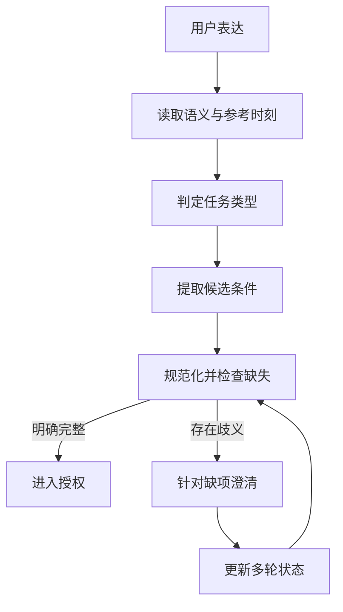

# 自然语言条件怎样评测：从人工标注到归一化与多轮状态

意图测试首先要回答“用户要求的条件有没有被忠实保留”。结果金额碰巧相等，不能掩盖月份、门店或排序理解错误。把B1用户条件与B2系统授权分开，才能判断是理解错了，还是正确识别之后按权限拒绝。

下面从自然语言条件标注、归一化、澄清和多轮更新说明设计，所有组织与账号均为教学别名。


**输入：** 经人工核验的自然语言问句及可信身份；**预期：** 人工标注的指标、时间、组织/门店、分组、排序、top_k、比较/计算方式和澄清状态。授权过滤是系统限制，不得把用户输入“全国”偷偷标成“门店A”来让意图测试通过。

|场景/输入|标准条件/状态|断言|
|---|---|---|
|请看看门店A2026年9月的销售额|指标销售额、店门店A、9月、金额汇总|不混成订单数/区域甲；日期界限与指标ID正确|
|请看区域甲上个月各门店销售额前5名|固定基准时间2026-10-13、业务时区；9月/区域甲/门店分组/金额降序/5|相对日期基于固定时钟；字段与排序全部正确|
|看看门店A最近的表现|时间/表现指标歧义|按批准规则澄清；不擅选销售额和任意日期|
|第一轮查门店A9月；第二轮只看门店B|第二轮替换门店、保留日期；再检查权限|B1条件和B2授权分开判；门店改对但无权应拒绝|
|查区域甲9月，但只看门店A和门店B两店|明确两店集合、9月；大区为附加约束|不能漏掉“只看”或扩成整个区域甲|

执行：人工写条件标注→LLM按原条件改写→逐句检查语义守恒→真实API调用→提取B1条件→按槽位比对。明确条件必填槽位匹配，歧义题应澄清，多轮逐轮发送/读回；数值最后正确不能掩盖错时间/错门店。临界日期、NULL/缺省、多个条件组合各挑高价值题。

|TODO/阶段|要做的事项|
|---|---|
|INT01／设计|设计明确条件、同义词、相对日期、歧义和多轮改口|
|INT02／数据构建/标准答案/标注|标注指标/时间/门店/分组/排序/limit等；人工验收LLM改写|
|INT03／跑批/执行组织|真实API获取B1条件或实际生效查询条件|
|INT04／人工review|逐槽位比对条件、澄清和继承；错误不能靠碰巧正确结果抵消|
|INT05／归因/复测/报告|定位条件/语义映射问题，有限复测与报告|


“查一下区域甲上个月线上渠道净销售额最高的五家店。”

系统识别成销售排名，任务类型答对了。可如果时间用了本月，渠道条件没带上，指标又换成成交额，这道题仍然失败。你在报告里看到“意图准确率百分之九十五”，究竟能据此相信多少？

智能问数里的理解能力至少涉及任务分类、条件提取、企业语义映射，以及多轮状态管理。把这些揉成一个准确率，数字会好看，定位问题却费劲。以下用虚构业务说明评测设计，所有结果数字均为计算示例，不是模型实测成绩。


## 先把任务类别和条件集合分开

任务类别描述用户准备做什么。明细查询、汇总、排名、同比、环比、趋势，可能需要不同的执行方式。同一句问题也可能包含多个任务，例如先给各店金额，再解释下降最多的门店。数据集需要明确这是单标签主任务，还是多标签任务，不能在评分时临时切换口径。

条件集合描述具体查什么。指标、时间、地区、门店、渠道、分组、排序和数量，都是常见槽位。槽位就是一个待填写的业务条件位置。你可以把它理解为查询申请单：任务类别写“排名”，申请单里继续写明排名依据和筛选要求。

用户原文和规范值要同时保留。“上个月”是原文，规范值是基于参考时刻计算出的起止时间；“老店”是原文，规范值可能是经过批准的门店集合或开业时长规则。只保存标准值，复核时看不到映射依据；只保存原文，自动检查又无法稳定比较。

不能把用户条件与授权条件混合打分。用户想查全国，正确理解可以是全国，之后授权拒绝；如果理解阶段擅自改成单店，任务分类可能正确，但条件匹配失败。权限负责限制执行范围，意图评测负责检查用户含义是否被忠实表达。

以下为通用标注卡示意，不是项目代码，也不是任何框架的现有数据格式。

```yaml
问题: 查区域甲上个月线上净销售额最高的五家店
参考时刻: 2026年10月15日09时
时区: 已批准的业务时区
主任务: 排名
标准条件:
  指标: 净销售额
  区域: 区域甲
  时间: 九月完整自然月
  渠道: 线上
  分组: 门店
  排序: 指标降序
  数量: 5
预期行为: 条件完整后进入授权检查
```

这张卡还需要标注哪些条件来自明确表达，哪些来自已批准默认值。用户没说渠道，而产品默认全部渠道时，不应把“全部”当成模型凭空多提；如果产品没有默认值，模型自行补了线上，就应计入错误。默认规则属于语义资产，需要版本管理。


## 分类正确率之外，还要看每个类别

分类正确率，也就是 Accuracy，适用于有明确主标签的任务集合。二十道单标签题，十八道主任务正确，正确率为百分之九十。它能回答整体有多少题分类正确，但容易受到样本分布影响。

假设一百道题里九十道普通汇总，十道同比。模型把所有题都预测成汇总，整体正确率仍有百分之九十，同比能力却为零。因此还应看类别混淆表和各类别的精确率、召回率。混淆表会列出真实同比被判成汇总、真实排名被判成趋势等数量，直接提示需要补哪类样本。

精确率 Precision 关注模型判成某类的任务中，有多少确实属于该类；召回率 Recall 关注真实属于该类的任务中，有多少被识别出来。F1 是两者的调和平均，任何一个很低，综合值都会受影响。Macro-F1 先算每类 F1，再做类别平均，让少数类不会完全被大类淹没。

多标签任务要事先定义标签集合和匹配规则。一道题真实包含汇总与趋势，模型只输出汇总，不能因为主标签正确就把整题判全对。可以单独计算标签层精确率、召回率和集合完整匹配率。不同任务标签之间若有层级关系，也要写明允许的等价表示。

|指标|回答的问题|适用对象|需要同时呈现|
|---|---|---|---|
|分类 Accuracy|主任务判对了多少|单主标签任务|各类样本量和混淆表|
|分类 Macro-F1|少数任务是否被忽略|多个已定义类别|每类 Precision 与 Recall|
|条件 Precision|提取出来的条件有多少正确|规范化条件事实|多提与错提列表|
|条件 Recall|应该提取的条件找回多少|人工标准条件|漏提列表|
|条件 F1|多提和漏提的综合情况|条件事实集合|原始计数与匹配规则|
|完整匹配率|一题全部关键条件是否正确|整题条件集合|缺项、多项和冲突项|

这些指标服务于不同判断。不能因为召回高就忽略乱补条件，也不能因为精确率高就接受大量漏条件。对问数执行而言，少一个区域限制或时间条件可能改变全部结果，完整匹配率通常需要作为一道独立的执行前门。


## 条件精确率和召回率，怎样算才不会虚高

先规定计数单位。可以把一个条件记为“槽位名称、操作符、规范值”的三元事实，例如渠道等于线上、金额大于一百元。门店多选值按整个集合计一个条件，还是按每个门店计一个事实，都有合理场景，但必须提前固定，否则同一结果能被算出两套分数。

举一个四条件例子。标准要求净销售额、九月、区域甲、线上。模型正确给出前三项，漏掉线上，又增加了不应出现的“仅直营”。正确事实数为三，多提一，漏提一，因此精确率与召回率都是四分之三，F1 也是百分之七十五。整题条件完整匹配为失败。

再看一种更容易误读的情况：标准四条件，模型只正确给出三条件，没有多提。精确率是三除以三，即百分之百；召回率是三除以四，即百分之七十五。报告若只列精确率，会把漏条件问题藏起来。这正是问数场景不能只写“准确率”的原因。

错值也应计入两侧错误：标准为九月、实际为八月时，产生一条错误提取和一条应有条件缺失，分别进入多提 FP 与漏提 FN，而非只算漏提。

相对日期应使用规范时间比较。上月、最近三十天和过去一个自然月不是必然等价。跨月、跨年、闰年和业务日截止点都需要测试。参考时刻要固定，否则同一问题今天与下月执行预期不同，看起来像回归，实际只是日期变化。

对零分母要明确处理。某题没有可抽取条件，模型也没提取，不能随手记成一次百分之百精确率再混入条件统计。可以将该题的条件 PRF 标为不适用，另外检查是否正确澄清或拒绝；全批累计事实计数后计算 Micro-F1 时，也要交代空条件题如何参与。

标注不确定的题不应强行成为标准答案。业务术语存在多个合法解释时，先交业务裁定；无法及时裁定的样本列为待确认，暂不进入确定性得分分母，同时报告这部分数量。把未知题排除后不说明，会造成评测范围被悄悄缩小。


## 歧义题要测“有没有问对问题”

“看一下区域甲上月销售”可能缺指标口径。“销售”若同时对应成交额和净销售额，正确动作也许是澄清；如果公司已批准唯一默认值，则可以按默认执行并说明。评测前需要把词义规则明确下来，不能把模型猜中某个测试人员的偏好当成正确。

澄清测试要验证问题是否针对缺失项。已经明确区域和时间时，不应反复询问这两个条件；只缺指标口径，就应该围绕口径提问。问得礼貌但无关，不能算有效澄清。还要验证澄清前没有执行代价高昂或未授权的数据查询。

歧义题可以设计最小差异对照。“销售额”与“净销售额”、“去年同期”与“上个月”、“前五名”与“后五名”，每组只变一个关键表达。这样更容易识别模型是否真正使用了限制词。单纯给同一道题改十种措辞，覆盖的是表达变化，不能替代业务条件变化。

业务外问题也需要样本。专用问数产品收到与数据查询无关的聊天，应按已批准产品规则处理，不能自动调用通用工具。拒绝范围外任务和没有理解用户条件是不同结果，应在标签与预期动作里区分。




## 多轮任务，最怕旧条件偷偷留下来

第一轮查区域甲九月净销售额，第二轮说“换成区域乙”，第三轮说“只看线上”。第三轮的标准条件应继承九月、净销售额，替换区域，并新增渠道。测试需要在每个回合保存完整状态，而不只是检查最后一条消息里出现了“线上”。

再问“时间改成八月，其他不变”，应只更新时间。若后续说“重新开始，查门店 A 本周订单数”，旧的区域和渠道是否保留，必须按产品的重置语义核验。多轮继承、覆盖、删除和重置是不同操作，样本需要分别覆盖。

跨用户会话要另作隔离检查。用户 B 不应继承用户 A 的时间、范围或历史结果。上下文长度截断时，也要验证系统能否明确说明缺失信息，而不是用残留片段拼一个自信答案。会话压缩摘要如果参与条件恢复，应记录摘要版本和实际恢复的条件。

下面是通用多轮核验步骤，属于测试说明，不是工程脚本或框架配置。

```text
第一轮：查询区域甲九月净销售额
检查：指标、区域、时间均正确
第二轮：区域换成乙，其他不变
检查：只替换区域，旧区域被移除
第三轮：只看线上
检查：新增渠道，指标与时间继续有效
第四轮：重新开始，查询门店A本周订单数
检查：按重置规则建立新状态，不夹带旧条件
```


## 数据集构建，比生成问法更花时间

先建立覆盖矩阵，把任务类型与指标、时间、范围、排序、歧义和多轮操作交叉起来。优先选择业务频率高、误差影响大的组合，再补少数类别。不要先让模型自由生成几百问，再临时给问题找标准答案，那样很难知道覆盖缺了什么。

每份标准条件需要可追溯的依据。术语来自已批准词表，时间来自参考时刻和业务时区，数量与排序来自问题原文，默认值来自产品规则。标注者对其中一项有疑问，先记争议，不能凭经验补齐。模型可以辅助初标，但关键条件必须经过人工确认。

人力有限时，可以对高风险与歧义样本安排逐条复核，对普通模板采用分层抽样，并记录抽样范围和分歧率。一个人先标后复核，也应隔开时间或采用盲化视图，避免被初次答案牵着走；这并不等价于两位独立标注者，报告要如实说明。

数据分区还要按语义模板管理。同一条件的五种改写若分散到调优集与验收集，会让模型或提示词间接见过测试结构。先按模板、业务意图或同源参考分组，再分区，才能减少近重复泄漏。验收题不用于反复修改提示词，失败修复应在独立回归题上确认后再评估。

## 评分前，先把匹配器的规则验清楚

条件检查器如果直接比较两段文字，会把同义表达当错，也会把关键差异藏进相似度。“九月一日至十月一日之前”可以与九月完整自然月等价；“九月一日至十月一日当天”多了一天，就不能因为文本相近而判正确。时间应转换为批准的区间形式，再比较起止点与端点包含关系。

金额条件也需要单位规范化。“超过一万元”与“一万元及以上”有操作符差异，不能只提取数值一。排序中的升序、降序，前五与至少五家，也不是可忽略的修饰。匹配器应对这些关键字段做明确相等或集合比较，不能交给一个宽松的语义相似度阈值包办。

门店别名可以通过受治理的标识映射统一，但映射失效时需要显式报错。假设“中心店”在两个城市都存在，标准答案应要求澄清城市或使用已批准的上下文。匹配器不能偷偷把短名补成某家店，否则评测系统也在替模型猜用户意图。

验证匹配器时，可以从一份正确条件复制出几种反例：删除时间、交换排序、增加渠道、把大于换成大于等于、把门店集合加一项。每种变异应触发对应的漏提、错提或多提记录。若检查器只给整题零分却没有字段差异，人工归因仍然会费劲，应补上可读的差异说明。


## 人工复核要记录争议来自哪里

意图失败可以分为语义资产缺失、模型映射错误、默认规则冲突、上下文更新错误和检查器误判。它们需要不同动作。词表里没有某个业务简称时，盲目加长提示词未必有效；上下文残留时，更换大模型也不一定修复状态存储。

复核记录应把标准条件依据放在实际条件旁边，允许标注“参考有误”而不是只能选择模型对错。确认标准答案错误后，需要修订数据版本，保留原记录及理由，再重新执行受影响用例。不能直接改旧运行文件，让历史失败看起来从未发生。

还要区分自然语言本身不成立的输入。日期前后颠倒、互斥条件同时出现、数量为负数等任务，应核验系统是否说明冲突并停止执行。它们不是普通的分类错误，也不能因为没有提取出完整条件就一律记召回失败。先确定预期动作，再选择适用指标，才不会用一个公式惩罚正确的澄清。

批量报告可以增加逐槽位分布。例如时间条件错误多于门店条件时，优先检查相对日期规范化；渠道召回偏低，则核对简称和省略表达。每个槽位都带适用样本量，只有两条题的高分不能与几十条题的稳定表现等量看待。若同时修改词表、提示和状态规则，应保留变更清单，否则下一轮提升很难归因。


## 请求范围和有效范围必须保存两份

|字段|谁提供|用途|禁止的混用|
|---|---|---|---|
|requested_scope|用户问题与批准语义解析|作为条件提取的标准答案|不能为了让低权限题通过而改成授权范围|
|allowed_scope|可信身份和当前策略|判断哪些对象可以访问|不能由模型或客户端任意声明|
|effective_scope|批准的拒绝或交集政策|决定实际执行范围|不能静默裁剪后假装已经回答原请求|
|applied_scope|查询审计与原始执行事实|证明约束是否落地|不能从最终回复文字反推后当独立证据|

用户明确“全国”而策略只允许A店，意图标注仍然是全国。产品若采用整条拒绝，执行范围为空且不能查库；采用明确交集时，应说明仅查询允许范围。系统返回A店金额却声称全国正确，至少存在范围表达错误，不能用宽松语义相似度放过。


以下按普通Python数据对象演示月份与范围规则，不是框架CaseExpected.intent的类型。真实框架intent为字符串；结构化条件需领域检查器明确读取。

```python
from datetime import date, timedelta

def previous_month(clock):
    end = clock.replace(day=1)
    start = (end - timedelta(days=1)).replace(day=1)
    return start.isoformat(), end.isoformat()

def apply_scope(requested, allowed, mode):
    if mode not in {"reject", "explicit_intersection"}:
        raise ValueError("unknown scope policy")
    requested, allowed = set(requested), set(allowed)
    if requested <= allowed:
        return requested
    if mode == "reject":
        return set()
    if mode == "explicit_intersection":
        return requested & allowed
    raise ValueError("unknown scope policy")

assert previous_month(date(2026, 10, 15)) == ("2026-09-01", "2026-10-01")
assert previous_month(date(2026, 1, 2)) == ("2025-12-01", "2026-01-01")
request = {"A", "B"}
assert apply_scope(request, {"A"}, "reject") == set()
assert apply_scope(request, {"A"}, "explicit_intersection") == {"A"}
assert request == {"A", "B"}
```

日期函数只计算自然月端点，不承担财务月、业务日或时区转换。时间戳问题先确定业务时区，再计算区间；以机器当前日期代替冻结业务时钟，会让同一道回归题每月自动变义。多轮改口也要保留每轮条件版本，不能只记录最后一份字典。

比较器需要记录漏提、多提、错值的实际位置。错月份同时产生一项错误事实和一项标准事实缺失；排序方向、包含关系、否定条件和TopK都属于有业务后果的字段。一个高频指标准确不能补偿一个关键范围漏提。

## 经验感想

把任务分类、用户条件、授权约束和实际执行拆开记录。评测先证明标准语义与比较器可信，再讨论模型指标，避免把正确拒绝记成理解失败。

## 推荐标签

#智能问数 #Agent评测 #测试工程 #技术设计
