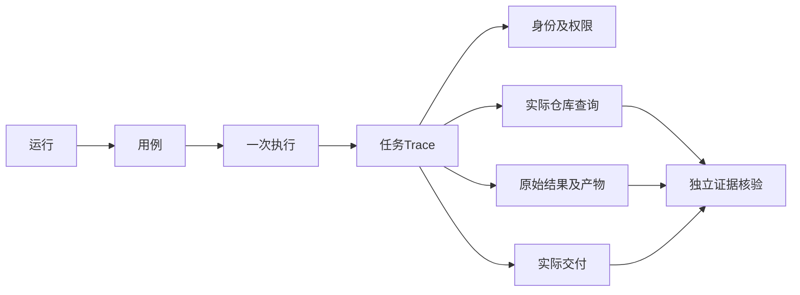

# 测试怎样按阶段落地：依赖、人工复核、复测与交付

测试实施的先后顺序，应由数据和证据依赖决定。独立参考尚未建立就扩大跑批，缺身份审计就测试权限，检查器尚未校准就统计正确率，都会把后续复核变成猜测。可以把计划组织为依赖图和完成门，而不是仅列待办名称。

这里讨论方法、阶段和交接，不给人员安排或实际投入估算。框架适配、数据构建、标注、执行和人工复核都作为真实工作项处理。

## 先明确七个可交接产物

|阶段|输入与工作|完成门|返回上游的条件|
|---|---|---|---|
|入口就绪|确认身份、会话、Target和实际加载版本|合法及拒绝请求可关联真实证据|身份不可信或实际入口不明|
|参考构建|采集报表、固定口径、水位及授权范围|来源可复核，关键题有独立计算|导出不全、口径争议或数据漂移|
|候选标注|写问法、条件、动作和逐轮状态|语义人工审核，歧义有预期策略|LLM改写改变指标或范围|
|Oracle校准|固定数据、正确样例和故意错误|合法替代通过，必需错误被检出|一律通过、一律拒绝或不支持未说明|
|冻结与执行|审阅后的数据集、版本清单、预算|每次trial证据和终态完整|审批不匹配、资源缺失或P0事件|
|人工复核|差异、原始结果、参考和产物|事实、原因与待决项都有引用|参考错误、检查器误判、缺独立证据|
|复测与交付|批准修复、影响映射与原始失败|原题、邻接反例与合法对照形成新证据|修复只适配固定问法或出现新退化|

同一人可以承担多个角色，但同一动作不能自证。参考采集后要保留独立审阅；模型起草条件之后不能自己宣布语义完全等价。人工批准绑定的是当时的资产摘要，后续新增题或改预期需要新的记录，不能把一次笼统同意扩展成任何范围的批准。

## 适配工作先处理哪些具体缺口

|适配任务|可复用能力|需要补充的方法|验证反例|
|---|---|---|---|
|可信API与会话|HTTP/SSE Runner及Task协议|服务端注册表绑定测试主体，逐轮调用|正文换账号、A-B交错追问|
|条件观察|可见任务或工具参数|提取标准条件与实际条件，标明间接证据|漏日期、错排序、旧槽位残留|
|报表规范化|独立参考与outcome断言|金额、键、NULL、重复行、单位及水位比较|300变301、漏店、重复行|
|产物与交付|文件解析和证据映射|下载实际文件，核对数据与对象权限|文件存在但内容错、错接收人|
|报告下钻|Case/trial/Evidence|差异与证据并排，支持人工裁定|找不到对应查询或参考版本|

## Case、trial 与参考答案，先各归各位

Case 是一条用例，包含任务输入、身份条件、数据前提和预期。trial 是该用例的一次完整执行。多轮任务从开始到终态可以算一次 trial，里面再按回合记录 turn。底层模型重试是内部尝试，不应未经约定就膨胀成新的独立用例。

一条题执行三次，意味着一个 Case、三个 trial。每次使用哪个数据集版本、模型、语义资产与权限配置，都要可回查。如果中途修改输入或参考，新的执行应指向新版本，不能让同一个用例标识在历史上代表不同问题而没有说明。

参考答案是独立判断依据，运行基线是某个被测版本的历史输出，两者不能互相替代。新版本与旧版本回答一致，只说明没有观察到差异；旧版本原本可能就错。回归比较同时需要独立参考，才能区分一致地错误与真正保持正确。

预期也不只是最终文字。可以按意图、过程、结果和回答四类组织：意图记录标准条件；过程记录必须发生或禁止发生的关键操作；结果记录业务数据或终态；回答记录数字、单位与交付要求。检查器只核验有证据的可见行为，不要求保存模型私有推理。

```yaml
用例示意:
  任务: 查询门店A九月净销售额
  条件预期: 指标和时间完整匹配
  过程预期: 授权通过后才允许提交查询
  结果预期: 独立快照中的300元
  回答预期: 明确金额单位并交付给发起主体
运行记录:
  用例编号: 示例C01
  执行编号: 示例T01
  参考版本: 示例R1
  数据版本: 示例S1
```

示意中的三百元为合成值，真实落地需要连接独立参考。字段名称只为解释职责，不能直接当作某个框架已支持这些自动断言的证明。适配时应复用框架既有用例协议，把领域核验规则留在项目评测包中，确有共性缺口再扩共享能力。

## Trace 需要串起业务证据，而非只看模型调用

Trace 可以理解为一次任务的观测时间线，span 是其中某个阶段的记录。类似 Langfuse 的观测页面能展示模型与工具阶段，但完整业务取证还要关联身份、权限、仓库查询和交付记录。工具自带追踪不等于自动覆盖全部服务。

一条通用关联关系可以从运行、用例、执行和回合，继续连到入口消息、会话、可信账号、权限版本、工具调用、仓库查询、产物与实际交付消息。它们不必强行用同一个字符串作为主键，但要能通过明确映射互相追溯。



下面是纯合成的观测报告示意，不是实际日志、项目标识或既有框架结构。

```text
任务Trace 示例X01
  入口：消息M01，会话S01，可信主体tester_a
  理解：净销售额、九月、门店A
  授权：策略P2允许门店A
  查询：仓库编号Q01，状态完成
  结果：合成金额300元，参考R1匹配
  产物：文件F01，内容与原始结果一致
  交付：消息D01，接收对象与主体一致
  裁决：证据齐全，关键断言通过
```

观测数据本身也需要权限与脱敏。不要把完整业务行、凭据和原始用户输入默认导出到第三方。可以记录经过脱敏的摘要、标识映射和受控证据引用，详细数据留在批准环境。模型私有推理不属于必须采集内容。

## 报告要写清适用范围与可复查差异

报告首页应说明测的是哪个版本、哪些入口、哪些业务范围，实际完成多少，严重问题和未知项是什么。五类指标分别列出分子、分母与样本量，再附失败列表和证据引用。总分可以作为概览，但不能替代关键失败的发布判断。

未知要单独统计。计划二十题，十八题已执行，十七题证据充分，则执行覆盖为十八除以二十，已执行证据完整率为十七除以十八，可判定覆盖为十七除以二十。这三项分别回答跑了多少、跑过的证据是否齐、计划范围里能判断多少，不应共用一个百分比名称。

失败明细应该能让复核人员直接操作：打开对应执行，看到标准条件、实际条件、参考与原始结果，再查看展示和交付。按语义、权限、查询、加工、渠道、环境和检查器分类归因，必要时标记待确认。不要让模型直接生成最终根因结论，未经证据核对的推测只能作为线索。

## 失败回流，不是自动把旧答案加入基准

线上问题先保留证据并脱敏，确认复现条件和独立预期，再形成候选用例。真实客户问题可能包含敏感信息或不稳定数据，不能原样写入公开数据集。无法得到可靠标准答案的样本，可以作为探索线索，暂不进入发布基准。

候选题经过人工审阅和冻结后，才进入后续回归。修复时先用对应失败题与反例验证，再做受影响覆盖。旧运行保留，新的结果关联修复版本与数据版本。这样才能回答修了什么、有没有副作用，而非只知道最新页面变绿。

如果使用现有评测框架，应优先复用执行、证据、报告和数据版本能力。领域特有的报表参考、授权范围与数值断言放在项目适配中。框架第一次承接问数场景，确实可能缺少协议或观察点，但不必因此再启动一套内部 Agent 编排系统。

## 对照实验中，提示、检查器和数据不要同时改

假设基线版本出现漏时间，候选版本同时修改了提示、日期工具和参考数据，成功率提高后很难知道哪项改动有效。更可解释的方式是先固定参考与检查规则，只改变一个明确因素；确需组合修改时，至少记录每项变化和影响范围，并保留必要的分组对照。

候选优化不能直接覆盖冻结基线。先在开发数据上形成修改，在独立校准样本确认没有破坏检查器，再使用验收数据比较。若反复根据验收题调整提示，验收集就逐渐变成调试集，需要补充新的独立样本，并说明历史分数的可比性下降。

同一题的三次执行也不是三个独立业务场景。它们可以估计随机表现，但不能增加业务覆盖的多样性。报告应分别列出独立条件模板数量、具体问法数量、用例数量和执行次数，让读者看清性能变化来自覆盖扩展还是重复测量。

## 一份可交接的运行包应包含什么

最小运行包可以由运行清单、冻结数据集摘要、独立参考版本、逐次执行记录、检查器结果、人工裁定与报告组成。敏感原始数据通过受控引用访问，公开摘要仅保留合成示例。目录形式可以不同，责任与引用关系需要清楚。

交接时选择一条通过和一条失败，要求复核者从报告找到对应条件、证据与终态。找不到关联，说明报告仍有缺口；有记录但访问权限不匹配，也会妨碍复核。把这个操作作为交付检查，比仅验证文件已经生成更接近实际使用需求。
## 用依赖图验证实施顺序


TopologicalSorter是Python标准库的依赖排序工具。下面检查依赖和环，不替代业务批准；一个节点排在前面，不意味着它已经完成。真正的调度还应读取每个完成门的证据。

```python
from graphlib import TopologicalSorter, CycleError

deps = {
    "reference": set(), "identity": set(),
    "annotation": {"reference"},
    "oracle_calibration": {"reference", "annotation"},
    "review": {"oracle_calibration", "identity"},
    "execute": {"review"}, "manual_review": {"execute"},
    "retest": {"manual_review"},
}
order = list(TopologicalSorter(deps).static_order())
assert order.index("reference") < order.index("execute")
assert order.index("identity") < order.index("execute")
assert order.index("execute") < order.index("manual_review")
try:
    list(TopologicalSorter({"a": {"b"}, "b": {"a"}}).static_order())
except CycleError:
    pass
else:
    raise AssertionError("cyclic plan was accepted")
```

## 人工review采用分流状态，不能只有已处理

|状态|触发条件|下一动作|
|---|---|---|
|待取证|缺查询、参考、水位或交付记录|补采集或重新执行，不直接判正确|
|待业务裁定|指标定义、默认时间或混合范围有争议|明确产品契约并冻结新版本|
|产品错误|独立证据确认目标违反预期|保留失败，登记修复与影响集|
|测试资产错误|参考、比较器或采集映射不正确|修资产后重跑，不给目标记假失败|
|已确认但未复测|原因已定位而修复尚无执行证据|保持开放，不靠口头说明关闭|
|复测完成|原题及影响反例在新版本有证据|关联旧失败，报告剩余范围|

严重权限与安全事件优先处理，随后处理未知和Judge分歧，同时抽验通过项以检查漏报。抽验不会把未抽到的每条trial都变成已人工确认；报告应区分自动判定、人工逐题审阅和抽样审阅。

指标可以使用可执行覆盖、参考就绪率、人工裁定完成率、证据完整率、未决关键问题数和复测关闭率。关闭率的分子必须有新执行证据，不能把状态字段改成已解决直接计入。Case、trial、参考组与问法数分别统计，能看出工作是在扩展覆盖还是重复测量。

最后的交付包括冻结数据集摘要、参考版本、每次运行、检查器结果、人工裁定、失败与未知清单，以及恢复环境记录。选择一条通过和一条失败，让另一位工程师从报告找到查询、参考和产物；这个操作能验证交接是否真正可用。

## 分批执行的停止与恢复条件

批次启动前核对资产摘要、身份配置和环境初态，执行中保存每条trial，不能直到全批结束才统一写结果。确认权限泄露或禁止副作用时停止相关输入，保留事件和查询状态；环境断连则先区分是否已有实际查询，避免重复触发。停止并不删除已发生的失败。

恢复批次需要明确哪些任务已经完整结束，哪些状态不确定，哪些仅缺采集。已有完整证据可以按版本一致规则复用；目标、数据、权限或Oracle已经改变的任务，应形成新运行，不能把旧结果搬进来冒充新版本表现。框架的续跑与跨run缓存有各自约束，不能混为一个“继续运行”按钮。

## 复核队列也要保留来源分组

同一个报表条件生成十种问法，失败可能来自同一时间映射。可以先按独立根因假设聚合，复核代表样本，再确认影响范围；但不能未查看就给剩余九题改通过。队列保留每条Case与trial，群组只用于导航和选择，不替代逐项结果。

通过样本的抽验可以按角色、指标、异常和交付类型分层。全部只抽常见合法汇总题，很难发现检查器对拒绝、空集或附件的漏报。记录抽样规则与实际抽取范围，避免报告里“人工review完成”被理解为每条记录都已阅读全文核对。

## 完成门怎样处理争议与例外

不能自动判定的项需要理由、证据和负责人，而不是空白备注。比如无稳定快照的实时题，可以转为已批准不变量巡检；不能继续计入精确金额通过率。没有附件能力的产品，不把附件题自动记满分，而是记录不适用及产品范围。

一次批准绑定候选内容与范围。若复核发现必须新增指标或更改预期，需要重新展示变化并记录审核，不能把后续资产塞进旧凭据。人工审阅与Golden冻结属于真实动作，不由生成模型模拟确认；实施方案完成也不等于真实业务运行已经通过。

## 经验感想

用完成门管理执行顺序：参考与身份未就绪不扩大跑批，检查器未校准不宣称业务正确，缺复测证据不关闭问题。保留旧记录和未知项，后续接手才有可靠起点。

## 推荐标签

#智能问数 #Agent评测 #测试工程 #技术设计
