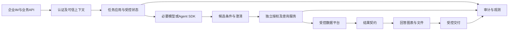

# 专用智能问数的基座怎样选：从产品职责到架构不变量

企业问数的架构核心，是让合法主体在批准口径与数据版本下得到允许访问、能够对账的结果。自然语言是入口，模型与Agent运行时是实现手段。围绕这些职责讨论长期基座，比先为某个产品或SDK站队更容易形成可验证的决策。

以下限定为业务范围固定的专用问数产品，不推及个人开放助手。架构方向属于设计判断，候选的性能、稳定性和维护收益仍须同条件验证。


产品范围已明确为专用智能问数，架构目标应是小范围能力、明确业务流程与可验证数据权限。应用 Agent 框架更符合这个目标：模型负责理解和生成，应用掌握流程与数据服务。
这是基于需求匹配的推荐，不是证明 Hermes 本身不稳定。具体实现问题与上游迭代风险需要分别处理；新框架同样需要锁版本和回归。


**用户确认的产品边界：** 只做授权范围内业务数据查询及必要的结果解释、查询澄清；不提供通用聊天或开放问答。图中的解释与报告沿用此前研究范围，实际交付功能以产品需求为准。

由此形成的工程原则：工具白名单只包含必要业务能力；不注册终端、任意文件访问等无关工具；业务会话仅保存必要上下文；查询前授权由服务强制执行。业务范围判断不能替代数据权限检查。

**架构适配成本不只来自升级：** 本项目要把通用运行时收窄为专用服务，需同时解决能力限制、全路径授权、业务 API 定制和测试控制。若这些约束依赖分散钩子、空间脚本或对运行时内部的修改，开发、排障与持续维护都需要额外投入。这是本项目倾向应用 Agent 框架的主要理由。

“第三方成熟产品”本身不能直接推出不适用：Agent SDK 也是第三方依赖。需要比较第三方承担的职责有多宽、业务定制是否依赖内部实现，以及应用能否独立定义接口和测试范围。

Hermes 在个人/通用助手中整合多种能力的价值，不等于这些能力都适合此专用产品。即使能关闭，也要比较关闭后的配置、升级和回归维护成本。Agent 框架同样可能开放过多工具，因此“只装必要能力、流程由应用控制”才是具体设计目标。

这里将“空间”理解为业务知识、Skills、配置和会话资产集合。空间如何隔离，仍须由实际身份、存储与执行规则证明。

|关注点|判断|具体原因|
|---|---|---|
|后期维护、定制困难|需要核实耦合及实际维护成本|业务依赖运行时钩子、工具调度及空间脚本；须核实实际改动范围和升级成本|
|权限、边界不好控制|风险值得优先解决|工具级拦截必须覆盖所有取数路径，且不能替代查询服务和数仓授权|
|Hermes 是否适合长期业务基座|需要按项目要求论证|已有接口和扩展机制不代表维护成本低；也不能因是成品运行时就判定不能工程化|
|Agent 框架更适合这个专用产品|架构上倾向采用|应用明确掌握业务流程、工具清单和发布职责；实际维护成本仍须验证|
|Agent 框架会更稳定|尚不能下结论|要用同题、同数据、同模型和故障恢复测试测量；没有实测性能结果|

三者职责不同：**Hermes 是带大量能力的 Agent 产品运行时；应用 Agent 框架是构建业务流程的库/运行时；agent-eval-harness 是独立评测框架。** 后者可持续评测新旧两条路线。

[Hermes 官方架构](https://hermes-agent.nousresearch.com/docs/developer-guide/architecture)列出了多类入口与运行时职责。[官方安全文档](https://hermes-agent.nousresearch.com/docs/user-guide/security)介绍用户授权、命令审批、文件和容器隔离等控制。它们不证明本项目已实现企业数据的行列权限。

### A.1 决策依据是产品职责与架构控制权

**对公司专用、业务范围固定的智能问数平台，不建议把 Hermes＋空间作为长期核心架构。** 推荐采用自有业务应用、必要的 Agent SDK、受控编排、独立授权与查询执行能力。这里的“独立”首先指规则和测试范围独立，不要求每个模块都是微服务。

智能问数的关键产物是“某个合法用户，在某个业务口径和数据版本下，得到允许访问且能够对账的结果”。自然语言只是入口，业务契约和数据授权才是执行依据。因此，这个产品的核心应该围绕查询任务组织，而不是围绕一个可调用广泛工具的通用对话运行时组织。

从专业架构设计看，问题在于依赖的层次：如果业务流程嵌入成品运行时的会话、工具和钩子行为，应用需要理解并约束这些行为才能保证业务不变量。应用使用窄范围 SDK 时，可以自行规定哪些步骤必须执行，把模型调用放在明确位置。SDK 实现 Agent 循环，不决定公司数据权限和业务发布契约。

这是需求适配结论，不是对 Hermes 全部使用场景的评价。现有系统短期仍需加固和连续运行；是否立即迁移要考虑投入与风险。长期目标可以明确，迁移节奏和具体 SDK 要通过验证决定。

### A.2 六个架构设计原则及其工程含义

|设计原则|在专用问数中的要求|当前路线需要核对的适配成本|应用自有流程的设计目标|
|---|---|---|---|
|领域约束明确|只处理业务查询、必要澄清和结果解释|通用聊天、工具与业务执行是否共用运行时入口|业务任务白名单，越界请求不能继续调用数据工具|
|最小权限|用户与执行身份都只能访问必要数据和能力|无关工具、脚本和出网路径是否保留了可用凭据|只注册必要工具；模型运行环境不持有数据平台执行凭据|
|授权不可绕过|每次取数、读缓存和交付都检查当前权限|权限是否分散于若干工具名或钩子，是否存在旁路|统一授权与数据出口；缺身份、缺策略、策略不可用时拒绝|
|稳定业务契约|API、指标口径与错误含义由公司定义|业务行为是否受通用会话和工具输出约定影响|版本化 Query/Result/Answer 契约，接口与 SDK 对象解耦|
|可测试性|业务规则能脱离真实模型确定性验证|是否必须启动整个运行时才能复现授权或查询问题|关键依赖可替换、阶段可取证，真实集成另设验收门|
|变更隔离|升级某项依赖时可定位影响范围|上游变化是否牵动身份、流程、工具、空间脚本和报告|SDK 适配集中；业务与模型版本分别管理，按影响回归|

这些原则不会因为选择了某个框架而自动成立。若自研应用仍开放任意工具、让模型填写身份，或把全部业务塞进提示词，也会失去同样的控制能力。

### A.3 “空间”保留什么，执行规则迁移到哪里

业务资产可保留：指标定义、业务词汇、授权可见的表说明、脱敏示例、提示词与测试资料。这些资产需要负责人、版本、审阅与加载记录，不能因存在于某个目录就视为可信或对所有用户可见。

查询执行、权限判断、错误处理、重试和状态转换应迁入应用代码与配置，并随发布接受独立测试。用户会话、缓存和查询结果进入受访问控制的数据存储；密钥进入专用凭据管理。文件夹层级和 Agent profile 不能直接充当员工数据授权约束。

“业务可编辑”与“执行可控制”可以同时满足：业务人员维护受治理的口径资产，开发团队维护执行契约，安全和数据团队维护授权及数据平台约束。新增一个指标通常先更新语义资产和回归题，不应默认要求修改第三方运行时内部。

## 成品 Agent 运行时与 SDK，承担的事情不同

Hermes 是包含多种能力的 Agent 产品运行时。公开架构与安全文档介绍了入口、会话、工具以及隔离和审批等机制。对需要广泛日常工作能力的助手，集成这些能力可以减少搭建成本。但公司专用问数是否需要这些能力，要按产品职责逐项判断。

Agent SDK 通常作为应用依赖，提供模型调用、工具循环、状态或协作能力。公司仍然负责业务 API、身份、存储、部署和数据授权。SDK 也来自第三方，也会升级，也可能引入复杂行为。区别不在于第三方与自研的标签，而在于依赖承担多宽的职责、业务规则是否需要依赖其内部细节。

受控编排指应用明确规定执行阶段，例如先认证、理解、检查条件，再授权和查询，之后加工与交付。模型可以在指定位置生成候选内容，但不能决定是否跳过授权或替换执行身份。一个按固定顺序运行的普通业务流程，也可以使用模型，不必先设计多个自由协商的 Agent。

还可以不使用完整 Agent SDK。如果需求主要是结构化条件提取加受控查询，一次或少量模型调用可能已经足够。只有当工具循环、暂停恢复或复杂任务确实带来价值时，再引入相应框架能力。架构投入应与真实任务匹配。

## 目标架构，先把业务不可变规则放清楚

接入层验证企业 IM 或 API 身份，建立不可被模型覆盖的请求上下文。任务应用负责状态、预算、幂等和业务流程。语义服务提供批准的指标、维度与术语。模型只产出候选条件或必要解释，授权服务与查询执行负责最终允许范围和数据访问。

查询结果进入统一结果契约，包含数据、单位、粒度、数据水位和明确状态。回答加工据此生成文字、图表或文件；交付前再次核对对象、权限和产物归属。观测系统关联各阶段，不把业务授权寄托在追踪工具上。



模块独立不等于必须部署成很多微服务。先用清晰接口组织模块化应用，可以降低复杂度；涉及凭据与执行隔离时，再选择进程或网络隔离。同一进程中的两个类不会自动形成安全隔离，模型可执行环境是否持有仓库凭据，需要按实际部署检查。

“空间”中的业务资产可以保留，例如术语、指标说明、脱敏示例与提示资料。它们需要负责人、版本和可见范围。权限判断、重试与执行状态应进入受版本管理的应用规则，不能因为写在某个文件夹里就认为已经具备访问控制。

以下为职责契约的通用设计示意，不是项目源码或任何 SDK 的真实接口。

```yaml
接入层:
  负责: 验证身份并创建请求上下文
  禁止: 用问题正文覆盖执行主体
模型阶段:
  负责: 提供候选条件或澄清请求
  禁止: 自行授予数据权限
查询服务:
  负责: 校验口径和授权后执行
  禁止: 信任客户端传入的最终允许范围
交付阶段:
  负责: 核对产物归属与接收对象
```
## 把设计原则翻译为不变量

不变量指流程经过任何允许分支后仍必须成立的规则。例如可信主体不能被模型替换，实际读取不能超过当前授权，缺少独立结果时不能编造成功。它们可以先脱离模型做确定性测试，再通过真实运行证明没有绕过执行位置。

|原则|可检验不变量|正向样本|反向样本|
|---|---|---|---|
|最小能力|仅注册批准业务工具|调用窄查询工具|用终端或外发工具绕过|
|可信身份|执行与交付主体保持可信来源|tester_a查询本人数据|候选改成tester_b|
|集中授权|实际对象是当前允许集合子集|授权A/B只查A|读C后在回答里隐藏|
|稳定契约|业务结果不依赖SDK内部类型|更换模型适配仍返回同业务结构|外部客户端依赖SDK run对象|
|可测试性|关键规则可以固定依赖复现|固定时钟、策略和候选|每次只能通过真人聊天猜测|
|变更隔离|只改变声明的比较变量|固定数据更换运行时|同时改模型、权限和真值|

以下代码只检查已采集摘要，属于教学实现。实际授权记录、执行对象和工具调用要来自独立审计，不由目标自报；缺证据应该返回不可判定，不应生成一组默认安全值。

```python
def invariant_errors(record):
    required = {"trusted_subject", "executed_subject", "read_scope", "allowed_scope", "tools"}
    if not required <= record.keys():
        return ["missing_evidence"]
    errors = []
    if record["trusted_subject"] != record["executed_subject"]:
        errors.append("subject_changed")
    if not set(record["read_scope"]) <= set(record["allowed_scope"]):
        errors.append("scope_exceeded")
    if not set(record["tools"]) <= {"approved_query"}:
        errors.append("unrelated_tool")
    return errors

ok = dict(trusted_subject="tester_a", executed_subject="tester_a",
          read_scope=["A"], allowed_scope=["A", "B"], tools=["approved_query"])
assert invariant_errors(ok) == []
assert invariant_errors(ok | {"executed_subject": "tester_b"}) == ["subject_changed"]
assert invariant_errors(ok | {"read_scope": ["C"]}) == ["scope_exceeded"]
assert invariant_errors(ok | {"tools": ["shell"]}) == ["unrelated_tool"]
assert invariant_errors({}) == ["missing_evidence"]
```

## 维护职责怎样分配，才能验证推荐成立

指标资产的负责人确定含义与版本；应用负责API、状态和模型适配；授权与数据服务负责强制范围；渠道负责真实身份和交付；评测负责独立参考及反例。组织可以兼任角色，但某项规则必须有清楚的变更与验收入口。没有维护能力时，直接重写可能比加固现有运行时更难运营。

资产保留也不等于原样执行。业务词表、指标说明和脱敏示例可以继续复用，但动态数据和权限应通过可信服务获取。目录权限、profile或会话编号都不能直接充当员工的行列授权。把规则从提示词迁入应用时，仍要保留可编辑语义资产，不把所有业务变更变成修改代码。

## 架构结论用哪些指标支持

授权覆盖率以已识别且可达的数据出口为分母，以有强制检查并完成反例验证的出口为分子，同时说明是否存在未盘点路径。SDK类型泄露可以统计业务API或领域模型中直接引用第三方运行对象的位置。它们是本项目可定义的工程指标，不是某个行业统一排名分。

可测试性采用相同变更任务测量：添加一个指标、增加一条拒绝规则、替换一个模型适配、复现一次发送回执丢失，分别记录修改模块、外部依赖和必要回归。仅有类和接口分层图不算已经更容易维护；必须让另一位工程师能固定输入重现错误。

Oracle指独立判定规则，PoC指小范围技术验证，SLO指服务目标，ACL指谁可访问哪些对象的授权规则。高层原则落实到这些可读回事实，才能成为架构验收条件。即使选择专业SDK，若仍允许模型决定身份、随意调用工具或修改过滤范围，也没有实现原先的设计目标。

## 经验感想

长期基座应让业务契约、身份与执行规则掌握在应用中。是否采用某个SDK、怎样迁移，继续用相同任务、独立参考和故障反例验证，不能用框架名称代替结论。

## 推荐标签

#智能问数 #Agent评测 #测试工程 #技术设计
