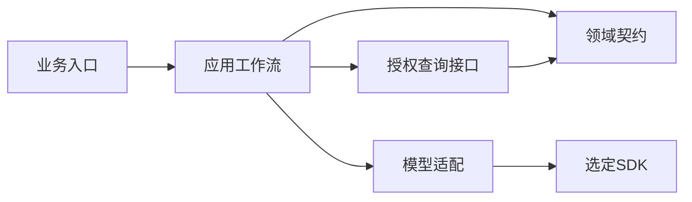

# Agent项目为什么难维护：把运行时耦合变成可验证的架构问题

维护困难应先定位到具体依赖，再谈是否更换运行时。授权写在多个工具入口、API暴露第三方状态对象、会话与业务身份混用、修一个规则必须启动整套模型系统，都可以成为可检查的架构假设。它们不应在没有证据时被写成某个产品的固有缺陷。

以下把维护压力整理为审计与实验方法，不引用私有源码位置，也不认定线上存在漏洞。

## 六类耦合怎样从抱怨变成证据

|假设|需要盘点的对象|验证动作|能够支持的结论|
|---|---|---|---|
|授权分散|所有批准取数、缓存与下载入口|逐入口执行同一权限反例|哪些出口强制执行、哪些仍缺证据|
|身份语义不一致|对话、任务、定时报表与数据服务主体|并发A/B、缺身份、恢复旧任务|是否存在默认账号或跨请求覆盖|
|业务API依赖内部对象|请求、错误、状态与结果结构|替换运行时适配，重跑客户端契约|外部契约是否被SDK升级牵动|
|业务资产不可追踪|指标、枚举、提示与脚本版本|变更一项定义并读取加载摘要|实际执行是否混用新旧资产|
|测试依赖过重|策略、条件与结果模块的外部依赖|固定模型和查询替身，单测拒绝题|哪些规则可独立验证|
|发布责任不清|启动配置、依赖、状态库和回滚步骤|升级及回滚演练后读真实状态|恢复是否只退程序却遗留任务或权限|

盘点不只看工具名称。一个禁止直接查询的入口，可能经文件、脚本、子任务或定时执行间接访问数据。相反，某个工具虽然存在，但生产配置不可达、没有业务凭据且有隔离证据，风险与实际可调用路径不同。可达性和执行事实应分开记录。

## 维护成本，不只来自上游升级

能力收窄有持续成本。通用运行时允许多种工具，专用平台只需要其中少数，就需要证明其他能力不会被用户请求触发，也不会接触业务凭据。关闭配置、限制工具、审计旁路和回归验证，都属于产品长期责任，不能因为功能暂时没有被使用就忽略。

授权覆盖也有成本。若规则分散在多个钩子、脚本和输出加工步骤，每新增一条数据路径都需要确认限制是否完整。更易维护的目标是让所有数据读取、缓存访问和交付经过明确服务规则。提示词里的“不要越权”可以辅助约束，不能代替服务端检查。

API 定制会暴露另一个差异。业务接口需要确定任务标识、状态、错误码、取消、幂等和结果格式；通用对话接口可能更关注消息与工具输出。适配层如果不断翻译运行时内部对象，测试和客户端都容易受到变化影响。将外部契约放在业务应用中，能减少这种耦合。

测试成本同样要量化。一个授权规则是否必须启动整套运行时才能验证，能否替换数据服务、固定模型输出并观察阶段结果，失败是否只能从聊天记录推断，都会影响迭代速度。不能只比较第一版代码量，还应比较新增业务条件和定位失败所需的工作。

|比较项|成品运行时承载业务|应用掌握流程并使用窄 SDK|
|---|---|---|
|首次接入|可复用已有渠道和能力|需建立必要应用能力|
|能力范围|需要验证关闭与限制效果|按需注册，仍需禁止旁路|
|业务接口|依赖适配是否稳定|应用定义版本化契约|
|授权规则|检查是否覆盖全部出口|集中到受控服务仍需实测|
|可测试性|取决于运行时可替换接口|可设计阶段输入输出与假依赖|
|持续成本|配置、适配和升级回归|业务维护、SDK 升级与运维|

这张表是比较维度，不是性能结论。现有团队熟悉度、渠道能力和实际定制量可能改变短期选择。对较成熟且已经可控的系统，先抽出查询与授权服务，通常比一次重写全部入口风险更可管理。

## API 以业务任务组织，避免暴露运行时内部对象

业务 API 可以围绕提交查询、查看状态、取得结果和取消任务组织。返回稳定任务标识与错误含义，客户端不必理解内部工具循环或 SDK 对象。字段规范、权限和状态由公司版本化管理，SDK 更换时只调整内部适配。

幂等标识与可信身份需要绑定。相同业务请求重复提交，应关联原任务或按批准政策处理，不能串到另一个用户的任务。超时表示等待结束，未必表示查询未执行；取消请求也需要实际终态确认。这些语义要写进接口说明和测试预期。

缓存与状态恢复同样属于业务架构。缓存应考虑授权、语义与数据水位；恢复时重新核验可能过期的权限。一个长任务暂停期间用户被撤权，不能仅凭旧检查点继续交付。SDK 提供状态机制，不替业务决定撤权政策。

## 可测试性可以成为选型任务，而非一句评价

给候选架构安排同一项测试任务：不用真实模型，固定一份候选条件，验证服务是否能拒绝跨店请求；再固定原始结果，检查图表与接收人。若每次都必须启动整套运行时、访问真实数据，测试成本就有了可观察差异。记录准备时间、外部依赖和失败定位步骤，比简单打一个可测试性五星更具体。

还可以安排一次语义变更。把合成指标的退款归属规则更新到新版本，观察需要修改提示、业务代码、数据参考和检查器的哪些部分。合理目标是语义资产与受影响参考显式更新，授权和接口保持可验证。如果一个口径调整牵动运行时深层对象，需要把这项耦合写进比较结果。

升级比较也需要实际任务。锁定旧版本和候选版本，运行相同回归组，核对工具参数、流式终态、错误类型和追踪字段。不能因为 SDK 名字更专业就免除这一步。若没有兼容性证据，选择仍然属于待验证建议，不应升级成稳定性承诺。
## 依赖方向可以先做一个小型确定性检查

领域契约描述业务问题和结果，不应该依赖SDK会话、工具或运行对象。适配器可以依赖SDK，也可以把结果转换为领域类型；依赖方向反过来，业务就会跟随第三方内部类型变化。



以下教学代码使用人工整理的依赖图检查传递依赖。真实仓库需从导入、调用及配置生成事实图，再人工核验动态加载；这不是声称几行代码已能自动完成源码审计。

```python
def reaches(graph, start, target):
    pending, seen = [start], set()
    while pending:
        node = pending.pop()
        if node == target:
            return True
        if node not in seen:
            seen.add(node)
            pending.extend(graph.get(node, set()))
    return False

good = {"workflow": {"domain", "adapter"}, "adapter": {"sdk"}, "domain": set()}
assert not reaches(good, "domain", "sdk")
bad = good | {"domain": {"shared"}, "shared": {"sdk"}}
assert reaches(bad, "domain", "sdk")
assert reaches(good, "workflow", "sdk")
```

工作流能够到达SDK是正常依赖，领域契约间接到达SDK才是这条规则关注的违规。不能用全仓库SDK引用数量简单衡量好坏；集中在适配器中可能合理，少量但分散在授权、API与核心状态中反而更难维护。

## 用变更任务测量耦合后果

|变更任务|固定前提|记录什么|防止误判|
|---|---|---|---|
|新增一个批准指标|同数据与授权服务|修改模块、资产和回归范围|新指标复杂度必须相当|
|添加字段拒绝规则|相同角色与查询题|所有数据出口是否同步受限|只测主工具会漏旁路|
|更换模型提供方|同业务API与语义|适配改动、错误类型和结构化输出行为|不能只看一题聊天成功|
|SDK升级|固定业务代码、数据和用例|接口、状态、工具与恢复差异|同时改Prompt会混淆原因|
|复现故障|同暂停点与消息负载|所需外部依赖、取证步骤和定位依据|一份漂亮Trace不等于业务证据完整|

修改数量不是唯一指标。删除某个安全检查会减少代码，却扩大风险；把所有规则塞进一个大函数也可能减少模块数量。需要同时检查必须项是否成立，并保留复杂度的具体来源：重复状态、隐式重试、权限分支和工具转换规则。

## 指标、证据和未知项怎样报告

上游补丁位置数可以反映对第三方内部实现的修改范围；业务变更触及模块数用于观察变更扩散；SDK类型渗透位置数用于发现接口耦合；独立测试可重放率表示指定任务中无需真实模型仍可验证的比例。每项都需要预先定义计数对象，不能跨团队直接排名。

授权覆盖与泄露事件属于不同测量。所有已识别入口都有检查，不代表所有输入绝对安全；没有观察到泄露也不证明未盘点路径安全。报告列已知出口、可达性、完成反例、缺审计和未测范围，结论才不会超过证据。

一次审计可以使用Task作为任务，Trial作为完整执行，Evidence记录断言、来源和定位。记录独立SQL审计和文件状态，避免只靠目标日志。对于缺失或动态路径，保留unknown或unavailable等项目级原因，不把空列表当作确认没有调用。

## 从加固实验到架构决策

先选最具代表性的耦合问题处理，例如统一授权查询出口。保留现有入口完成相同反例，再接新的流程实现。如果旧运行时经过窄接口后同样容易测试，短期无需立即替换；如果业务变更仍反复牵动其深层对象，再用具体证据决定迁移。

每个假设应有退出条件。若无法取得实际加载版本，先补发布事实；若无法读取授权和查询审计，先补观测；若失败来自参考口径错误，先修评测资产。不能把所有缺证据都归因运行时，也不能因有扩展点就认为定制成本已经很低。

架构审阅要交付依赖图、数据出口清单、变更任务记录、对应回归和未决项。另一位工程师应能从一条失败追到规则、入口和实际副作用；无法复现的主观“难维护”只能作为调查线索，不能直接替代选型依据。

## 常见词汇先对应到实际检查

|词汇或指标|这里的含义|怎样避免空泛|
|---|---|---|
|耦合|一个业务修改依赖另一个模块的内部约定|记录真实类型、调用、配置与受影响测试|
|适配层|将第三方输入输出转换成公司业务契约|不能把SDK对象原样穿透API|
|可测试性|能够控制输入、依赖及初态并独立观察结果|用同一拒绝和故障任务实际复现|
|可观察性|通过事件和指标解释已发生行为|Trace须关联外部查询与交付审计|
|不变量|所有允许分支都必须保持的业务规则|每个规则有正向与违反样例|
|变更扩散|一次业务修改触及的模块及发布范围|区分必要业务复杂度与重复实现|

审计要区分结构线索与运行证明。某模块导入SDK说明存在代码依赖，不能直接证明授权可绕过；实际出现无授权查询，则需要追到执行路径。把两类证据放在同一报告，可以解释“为什么值得调查”和“已经确认发生什么”，不会夸大静态扫描结论。

针对事件证据，再核对来源权限与完整性。模型输出的工具列表是意图描述，实际工具执行日志才是运行观察；数据库审计能补足代理漏报，但也需要确认覆盖范围。缺某段审计时保留未知，不因为没有异常日志就写作安全。

## 将审计假设写成可复核任务卡

下面是教学记录格式，不是现有框架Case。它将结构假设、运行实验与证据分开，避免静态图自动变成漏洞结论。

```yaml
审计主题: 所有业务取数经过授权服务
结构线索: 已识别的查询工具和后台任务
运行实验:
  - 合法门店查询
  - 拒绝范围请求
  - 撤权后旧会话与缓存
要求证据:
  - 实际执行主体与策略版本
  - 查询及对象访问审计
  - 结果和附件范围
结论状态: 已确认问题或缺证据或未复现
```

## 经验感想

用数据出口、依赖方向与同一变更任务定位维护压力。先验证可以消除的耦合，再决定是否替换运行时，避免把未接完的业务规则误认为第三方产品的必然缺陷。

## 推荐标签

#智能问数 #Agent评测 #测试工程 #技术设计
