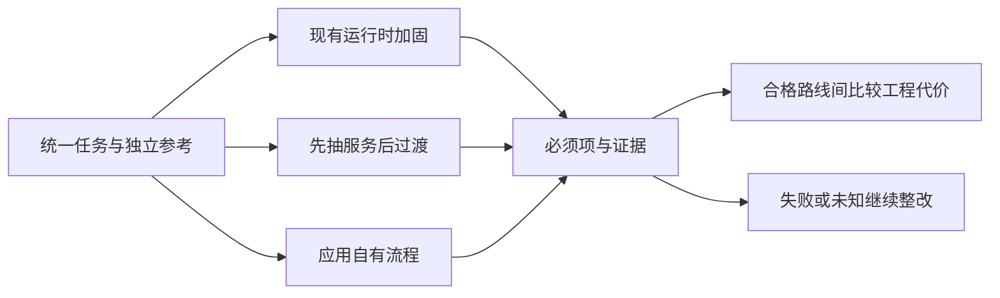

# Hermes加固、服务抽离与应用编排：三条路线怎样公平比较

继续加固现有运行时、先抽授权与查询服务、直接采用应用自有编排，是三种不同迁移策略。它们承担的接入、状态和运维责任不同，不能只比较一个新SDK演示的代码行数。


|比较维度|继续 Hermes＋空间|先抽服务，Hermes 过渡|应用 Agent 框架主运行时|
|---|---|---|---|
|短期上线成本|通常改动少，但要补覆盖与隔离|新增服务和适配；改动可分批|需重建接入、编排与运维，初期成本最大|
|业务定制|插件/钩子/空间脚本；需跟踪运行时约定|核心规则在自有服务，入口可替换|应用直接管理节点、状态和业务契约|
|能力收窄与权限覆盖|关闭无关能力，核对所有可达工具和旁路；授权不能漏在某个入口|在查询服务集中授权；过渡运行时仍需限制工具|仅注册必要工具，模型与数据服务分离；服务授权仍须强制执行|
|业务 API 定制|已有通用接口，但业务身份、错误码、查询契约和取消状态需适配；是否要改内部待核实|自有服务先定义业务 API，Hermes 作客户端|应用独立定义 API 与版本，SDK 作为内部组件|
|辅助测试与排障|需查明真实加载目录、工具/钩子链及状态，补可控入口和取证|先独立测授权与查询服务，再测 Hermes 集成|可独立注入模型、权限和数据服务替身，逐层测业务代码，再做真实端到端验收|
|授权约束|能加固，但须堵住全部旁路|服务与数仓统一强制执行|同样需要服务与数仓；框架本身不提供公司 ACL|
|升级回归|运行时广泛能力会扩大需核对的影响面|查询服务可独立发布；Hermes 升级仍需渠道回归|编排依赖仍会变更，但业务发布职责更明确|
|稳定性责任|继承运行时能力，还需验证实际部署|新旧双流程有额外运维成本|自建超时、限流、取消、恢复和消息交付|
|适合条件|小范围助手、快速试点、低耦合定制|已有用户和业务资产，需要降低迁移风险|长期产品、多角色数据权限、持续迭代与审计|
|本项目定位|现有系统的加固与成本对照|降低已有系统迁移风险的实施路径|按已明确产品范围推荐的长期架构；框架选型另验证|

Hermes 上游升级可能改变工具、会话、钩子和配置约定，因此需要影响分析与回归；目前没有生产升级事故或版本对照证据，不能写成“上游迭代必然不稳定”。Agent 框架也会升级，但选择窄接口和少量能力，有机会缩小需要管理的依赖范围。

这是架构推断，不是跑分结果。若团队不能维护独立服务、监控和回归流水线，直接重写可能比加固现有系统更难维护。

“空间”仍可保留为业务资产仓库：指标说明、脱敏示例、提示词和测试资料进入版本管理；执行脚本改为应用模块；用户会话和敏感数据进入受授权的存储。保留可编辑的知识资产，不把目录访问当作员工数据权限。

## 用同一套评测比较迁移路线

可以设三种候选：继续现有运行时并加固、先抽授权与查询服务保留现有入口、应用掌握流程并使用必要 SDK。每种候选用相同身份、语义、数据快照、问题、预算和交付要求进行验证，不能让新路线只测最容易的查询。

首先比较不可妥协的正确性与安全要求：权限是否可绕过，缺身份是否拒绝，条件与结果能否对账，交付对象是否一致。任何候选在这些关键项失败，都不能靠延迟或开发体验得分抵消。证据不齐时，结论应为待验证。

再衡量工程收益。新增一个指标需要改哪些地方，新增一个授权场景能否独立测试，API 契约是否受 SDK 升级影响，故障定位需要多久，版本回滚是否保留任务状态。可以设计相同变更任务记录实际投入，而不是凭架构图推断维护成本一定降低。

以下是概念验证的通用步骤，不对应现有工程命令或框架配置。

```text
冻结一组脱敏业务任务与独立参考
固定身份、语义版本、快照和运行预算
分别执行现有与候选路线
逐项核验权限、条件、结果和交付
注入超时与重复请求，检查状态与副作用
记录新增规则、排障和升级适配的实际耗时
根据证据决定扩大试点或保留原路线
```

## 迁移按职责推进，先让旧系统也受益

第一步可以统一查询与授权服务，让现有运行时继续作为入口和理解层。所有数据出口都经过该服务，先补独立测试和审计。这一步即使暂不迁移 SDK，也能提高规则一致性和可观察性。

第二步建立应用自有任务 API 和结果契约，在少量高频只读任务上接入候选流程。采用隔离数据或受控对照，避免双跑生成两份报告。线上影子执行若会增加仓库负载或接触真实用户数据，需要单独授权和预算，不能视为无成本验证。

第三步逐步转移状态与交付职责，保留回滚入口。切换前确认进行中任务、缓存和附件如何处理；回滚时不重复发消息，不恢复已经撤销的权限。旧系统下线以真实覆盖与运行证据为依据，不能只因新版本能完成演示就结束迁移。

架构方案本身不是实施许可。当前业务测试与迁移验证可以复用数据和断言，但目标版本、运行清单和批准范围应分开。尚未接入真实身份、仓库和渠道时，只能证明设计或本地协议，不能宣称维护收益和稳定性提升已经兑现。

## 团队维护能力也是架构约束

应用掌握流程意味着团队要承担更多明确责任：业务接口由谁维护，语义规则由谁确认，授权变更如何审批，数据服务故障由谁处理，模型与 SDK 升级由谁回归。这些职责应有明确负责人和变更接口，避免测试时只能通过运行时内部状态推断业务行为。

同时也要控制自研范围。没必要为了绕开通用运行时，重新实现模型客户端、所有观测组件和完整工作流引擎。可以保留可靠公共依赖，用小接口隔离变化，将自研投入放在公司特有的语义、授权、任务和交付规则上。新增抽象是否有价值，可以用具体变更是否更容易测试来衡量。
## 必须项先筛选，偏好项后比较

|比较层|检查对象|判定方式|不能采用的补偿|
|---|---|---|---|
|业务正确性|指标、范围、结果与交付|独立契约和真值|回答流畅不能补金额错|
|权限安全|身份、读取、缓存、附件与工具副作用|实际审计及状态读回|更快、更便宜不能补越权|
|运行语义|重复、取消、恢复和明确终态|固定故障与持久记录|启动成功不能补恢复缺证据|
|工程维护|依赖、适配、独立测试和发布|同一变更任务及升级演练|少代码不能补不可测试|
|运行成本|延迟、查询和模型调用、实际计费|同负载、同版本条件对照|删失败尝试会低估真实代价|

以下代码只演示决策顺序，示例分数不代表任何真实框架。必须项为未知时不能把它算成通过；只有合格候选之间才能按批准的偏好权重排序。

```python
REQUIRED = {"identity", "authorization", "result", "delivery", "recovery"}

def eligible(record):
    return all(record.get(k) is True for k in REQUIRED)

def rank(records, weights):
    qualified = [r for r in records if eligible(r["checks"])]
    return sorted(qualified, key=lambda r: sum(r["preferences"][k] * v
                  for k, v in weights.items()), reverse=True)

checks = {k: True for k in REQUIRED}
a = {"name": "example_a", "checks": checks, "preferences": {"testability": 3}}
b = {"name": "example_b", "checks": checks | {"authorization": False},
     "preferences": {"testability": 5}}
c = {"name": "example_c", "checks": checks | {"recovery": None},
     "preferences": {"testability": 5}}
assert [r["name"] for r in rank([a, b, c], {"testability": 1})] == ["example_a"]
assert not eligible({})
```

布尔摘要必须由真实检查器计算，不应由候选方案负责人自填。若只是架构设计评审，可以标设计已覆盖，但不能把设计布尔值直接送入真实发布门。框架现有compare/regression会进一步检查运行清单、数据集与逐题证据，教学排序不替代这些门禁。



## 公平比较需要固定哪些变量

目标只有一个变化因素时，模型、参数、语义、权限服务、数据水位、问法、Oracle和交付要求保持一致。比较编排路线时，不能让新路线使用新模型，旧路线使用实时旧数据，再将差异归功于架构。无法固定的因素进入显式变化清单和结论限制。

基线与候选执行相同Case集合，并保留每条trial。Case是固定任务，trial是一次完整执行；重复三次是在测同一任务的波动，不增加三个独立业务场景。平均正确率之外列正确变错误、错误变正确、两边都错及不可比；严重事件不被平均抵消。

对于延迟，可分别看任务接收至首字、查询执行和实际交付，报告p50/p95及样本数。对于成本，包含失败与重试的所有调用，真实计费和token估算分开。若新路线能减少无意义重试，仍须检查它是否把原本应该完成的任务提前拒绝。

## 过渡路线也有独立验收内容

先抽服务能够让两条入口共用授权和查询契约，降低重复建设；但过渡期会增加部署、版本和路由组合。需要验证旧入口不能绕过新服务，新的身份上下文不会退化为默认服务账号，并确保只允许一条路径完成用户交付。

受控查询接口可以沿用现有SQL或采用小范围IR试点，这是查询实现路线，与选择SDK是两个决定。更换编排时先保留已校准的SQL契约和独立结果，再决定是否优化查询方式，避免同时变更多项而无法归因。

## 指标释义与退出条件

可测试性关注指定规则能否固定依赖重放及取得独立证据；适配范围表示每个业务变更需要触及哪些模块与第三方内部位置；契约兼容率统计同一API测试包中的通过项，不能只看响应能否解析。PoC是有限范围验证，SLO是业务服务目标，不能把示例阈值写成行业统一标准。

试点结束应明确进入、暂停或保留原路线的条件。权限和结果未达要求则继续修复；收益只在少量题上观察到时，扩大代表性覆盖后再判断；如果重建基础设施负担超过现阶段维护能力，可以保留加固与服务抽离路线。中立比较允许不迁移，而不以已经投入多少决定技术结论。

## 对照报告不要只写总分

以一组配对任务为例，新版本把两个金额错误修好，却新增一个撤权后读取问题。总体任务成功率可能提高，权限必须项仍然失败。报告应先列严重事件，再列逐题变化，不能依靠给安全加权后被其他收益抵消。

另一种情况是新版本通过题数相同，独立证据更完整、调用更少。可以记录这些工程改善，但要核对是否相同任务、相同数据及相同成功要求。若只是删除困难输入或降低交付要求，既不是架构收益，也不能算回归稳定。

|报告术语|定义|最小展示|
|---|---|---|
|配对差异|同Case同前提下旧新结果的变化|正确到错误、错误到正确与未知|
|可比较覆盖|满足版本和重复条件的任务数／计划比较任务数|被排除原因及样本数|
|拒绝正确性|应拒绝任务按政策停止且无禁止读取|策略与副作用证据|
|全任务成本|包括失败重试的实际消耗|模型、查询、交付和真实计费分开|
|恢复成功|原任务按约定到达正确终态|无串号、重复交付和后台残留|

当样本较少，展示每条差异比给带小数点的综合排名更诚实。统计区间与显著性依赖样本结构和重复设计，不能把同一模板的多种问法当作完全独立业务样本来夸大置信程度。

## 经验感想

把正确性、安全和恢复设为必须项，再比较可测试性与维护代价。三条路线使用相同业务任务和独立证据，才能决定需要怎样迁移。

## 推荐标签

#智能问数 #Agent评测 #测试工程 #技术设计
