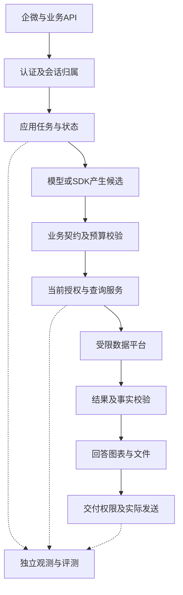

# 问数应用架构怎样落到代码：可信上下文、任务API、状态与缓存

专用问数的目标架构需要回答四件事：谁有权发起任务，模型产生的候选怎样成为合法查询，结果能交给谁，失败之后从什么状态恢复。模块图、业务API和状态机应共同描述这些规则。


下图为框架中立的建议架构，尚未实现。SDK 路线用普通应用代码表达显式工作流，LangGraph 路线用节点与边表达；身份、授权与取数边界均由应用和数据平台强制执行。

|模块|必须掌握的规则|框架能帮什么|不能交给模型的内容|
|---|---|---|---|
|企微接入/身份|验证当前渠道所用的消息来源与服务鉴权；账号映射；重复请求处理|接入工作流|可信 tenant/userid，不能从问句、工具参数或客户端自报认定|
|会话与存储|绑定租户、用户、会话、请求；读取时鉴权；并发和删除策略|状态传递、检查点|thread_id 只是索引，不是授权；共享记忆按业务权限读取|
|指标与查询契约|指标口径、时间端点、币种、维度、数据水位和版本|约束结构化输出|业务语义正确性和授权范围|
|查询服务与数仓|真实权限、允许的表/列/函数、只读、配额、审计与超时|作为一个窄工具调用|数据凭据、账号兜底及权限过滤修改权|
|结果与交付|结果核验、最小化、附件权限、群聊接收范围和链接有效期|组织回答流程|数值事实和文件访问边界|
|运维与恢复|部署、锁版本、预算、取消、重试、备份和回滚|流程恢复能力|业务幂等、权限撤销和外部副作用的交付语义|

**userid 不写死在生产逻辑里，也不让模型填写。** 由接入层验证后作为不可被模型覆盖的服务上下文传递。测试时可以在隔离环境绑定固定测试账号，但必须证明这个绑定没有跳过身份和权限检查。Pydantic AI 的[依赖注入](https://pydantic.dev/docs/ai/core-concepts/dependencies/)可辅助传递服务上下文，鉴权仍由应用实现。

查询路线与框架路线分开决定：沿用现有 Text-to-SQL＋Query/Result/Answer 契约和独立 Oracle。服务校验 SQL 语法树、允许对象及数据授权；单纯检查 SELECT 关键字不够。语法树也不能代替数仓行列权限。受控 IR（模型填写受限查询参数，服务编译 SQL）仍是后续小指标试点，迁移编排不等于立即重写全部 SQL。

[LangGraph persistence](https://docs.langchain.com/oss/python/langgraph/persistence)区分会话检查点与跨会话存储。生产须选持久存储并配置访问隔离。[interrupts 文档](https://docs.langchain.com/oss/python/langgraph/interrupts)说明恢复时节点会重执行。因此查询、附件生成和消息发送需要请求编号、去重及幂等设计；不能把检查点当成“只执行一次”的保证。

### E.1 模块化应用先行，按真实隔离要求拆部署

建议初期保持少量可独立理解的业务模块，不先建设多 Agent 平台或一组微服务。以下为职责示意，不是当前代码目录或已实现模块。

```tree
智能问数应用
  渠道与 API | 企微适配、身份验证、请求和响应契约
  查询工作流 | 阶段顺序、澄清、预算、状态与取消
  业务契约与语义 | 指标口径、版本、合法查询对象
  模型适配 | Agent SDK、模型接口、结构化候选和解释
  授权与查询 | 实时权限、SQL校验、受限执行、数据审计
  会话与结果 | 用户归属、缓存、保留、附件访问
  交付与观测 | 消息状态、关联证据、脱敏日志
独立评测
  agent-eval-harness | 真实Target适配、独立Oracle、回归证据
```

依赖方向应明确：工作流依赖业务契约与受控服务；SDK 适配依赖 SDK；业务契约不引用 SDK 的会话或工具对象。API 返回公司定义的结果，不直接暴露第三方 run 对象。实现上先用少量普通函数和明确的数据类型即可，不为每个模块增加抽象工厂或插件系统。

**代码模块职责不是凭据安全约束。** 如果模型工具能够执行任意代码，共享进程中的秘密仍可能被访问。查询凭据需要不可达时，应放在独立受限执行服务，通过认证接口访问，并限制网络出口；业务入口禁止注册任意代码、终端或文件操作工具。具体部署隔离根据威胁模型和数据平台要求验证。

其他模块先同部署也可以；当独立扩缩容、数据网络隔离或发布责任确有需要时再拆分。这样同时减少运行时耦合与自研系统的部署复杂度。

### E.2 三条信任分界与不可破坏的规则

|信任分界|输入如何被看待|强制执行位置|必须保留的证据|
|---|---|---|---|
|用户/渠道到应用|问句、session_id、附件均是可修改输入；渠道身份也须验证来源|接入层鉴权、企业账号映射和会话所有权检查|验证主体、渠道消息编号、请求编号；不记录密钥|
|模型到业务执行|模型生成的 SQL、工具参数和文本只是候选|业务契约、预算、授权与查询服务；模型不能覆盖身份或策略|候选摘要、语义版本、校验结果、策略版本和允许对象|
|结果到接收人|已经查到的数据仍须按接收范围交付；缓存和附件也是数据出口|结果/交付层、缓存读取、附件下载和服务端访问控制|结果版本、交付对象、当前授权决定与交付状态|

身份认证回答“调用者是谁”，授权回答“这次能访问什么”。前者通过不代表后者通过。模型收到的 Schema、指标描述和检索片段，也应按可见范围裁剪，避免在真正查数前泄露元数据或敏感业务信息。

行列权限至少需要明确到数据集、字段与组织范围。聚合查询还需业务定义哪些统计可以披露；合法读取底层行并不自动证明所有小样本汇总都可发布。不要通过简单拼接 WHERE 实现全部 SQL 权限，要在受控查询与数据平台层验证连接、子查询、函数和过滤语义。

执行前检查一次；长时间澄清或暂停后恢复要重新检查；交付和下载也要检查。如果权限源不可用，不能回退到管理员账号或此前缓存的宽权限。只有隔离环境明确配置的测试替身才可使用模拟授权，生产路径不得悄悄降级。

群聊是单独交付策略：提问者获授权，不代表群内成员都能看到同一数据。业务未定义合法群聊披露范围时，应按既定策略拒绝在群内交付敏感结果或转到经验证的个人入口；不能让模型自行决定。

### E.3 业务 API 应围绕查询任务设计

以下是拟议接口契约，不是当前部署已经提供的 API。名字和路径供设计讨论，正式实现再按现有接口规范确定。

|拟议接口|业务输入与行为|权限/状态约束|测试要点|
|---|---|---|---|
|POST /api/v1/query-requests|问句、业务会话引用、幂等键；创建查询任务|身份从可信认证上下文取得；先验证会话归属；不接受客户端覆盖执行账号|伪造身份、重复请求、跨用户session、非法范围|
|GET /api/v1/query-requests/{id}|读取任务状态、允许查看的结果与错误|任务所属用户/组织校验；当前授权仍适用；请求编号不是访问凭据|枚举他人编号、撤权后读结果、状态一致性|
|POST /api/v1/query-requests/{id}/clarifications|提交对同一任务的业务澄清|只允许合法等待状态；重新鉴权；不扩大原权限|重复回复、已结束任务、并发澄清与恢复|
|POST /api/v1/query-requests/{id}/cancel|请求取消在途查询|先核对任务归属；区分已请求取消与执行器确认取消|取消/完成竞态、远端查询仍运行、重复取消|

提交接口不暴露通用工具列表、Shell 命令或任意执行脚本。传入业务问题不等于允许原始 SQL；若未来确需专家 SQL 入口，要单独授权和校验，仍走同一执行约束。

响应至少区分 request_id、trace_id、业务状态、结构化错误、可见结果及口径/数据版本。API 版本、指标版本和 SDK 版本各自管理；换 SDK 时不要求客户端改变业务字段。HTTP 传输是否成功与查询业务是否成功分开表达。

业务错误需区分“需要澄清”“不支持该任务”“权限拒绝”“候选校验失败”“上游不可用”“预算耗尽”和“查询结果为空”。这些状态对应不同用户行动与运维处理，不能都压成模型生成的一段自然语言。错误详情还需控制可见范围，避免泄露内部表名、凭据或其他用户信息。

测试接口不是生产后门：固定账号和数据注入只能存在于隔离测试配置，测试主体依然经过对应鉴权逻辑。生产不增加任意 userid 的冒充参数；日志查看和调试数据读取也须有权限。

### E.4 可恢复的执行状态与有限重试

图为正常流程和一个取消分支。各阶段都应有失败出口；权限拒绝、非法查询和范围外任务结束流程，不进入无限“反思后再试”。每个阶段记录当前状态、版本与结果引用，敏感 SQL 和数据仅在受保护的证据存储中保留。

应用负责总超时、模型轮次、工具调用次数、查询配额与重试预算。SDK 和 HTTP 客户端自身的重试也纳入这个预算，避免外层与内层重复放大请求。口径歧义可以澄清；错误 SQL 可在明确限制内修正；权限拒绝不能通过修改问句不断试探。

网络超时不一定代表查询没有执行。执行器需要查询编号、状态查询及取消能力；无法确定远端状态时记录为待核实状态，而不是自动新建同一查询。客户端收到取消确认前，不宣称数据库任务已停止。

相同幂等键应绑定调用主体、规范化请求和业务版本；重复请求若载荷不同必须拒绝或按明确契约处理。检查点、查询记录和消息发送没有天然跨系统事务，重启后要根据已执行事实恢复，不能简单从头双跑。消息交付使用持久待发送记录和去重；具体一次性效果由渠道能力与恢复验证决定，不承诺框架自动保证。

### E.5 语义、缓存与观测纳入业务架构

指标定义需要明确口径、粒度、时间区间、时区、币种和可查询维度，并绑定版本。数据水位表示数据何时完整就绪。模型选对了字段却使用过期口径或不完整数据，同样可能得到业务错误的答案。

结果缓存必须区分调用主体/授权范围、查询条件、指标版本、数据版本或水位。命中缓存仍要验证当前权限；权限变更后失效或拒绝。不能只按问句文本共享缓存，也不能让被裁掉的字段继续留在可下载文件中。

从渠道消息到模型、授权、实际查询与交付使用可关联的编号。常规监控保留时延、调用次数、预算、错误类别、版本和脱敏摘要；敏感原始证据单独控制权限和保留期限。SDK Trace 辅助排障，查询服务和数仓审计证明实际执行，独立评测证明是否满足业务契约。




## 把架构判断落实为可验证的状态机

采用 SDK 以后，应用需要拥有任务状态。至少要区分已接收、执行中、查询完成、产物生成、已交付、取消请求中、已取消和失败。数据库已经完成查询但消息发送失败，应该保留查询完成及发送失败的事实，恢复时重试交付；不能把整个任务重新当成一条全新查询。

下面按照任务状态语义给出一个教学实现，只演示状态迁移校验，不是内部业务源码。真实系统还需要数据库事务、版本比较更新及事件日志。示例全部在内存执行，断言中的非法迁移应被拒绝。

```python
TRANSITIONS = {
    "accepted": {"running", "cancelled"},
    "running": {"query_done", "cancel_requested", "failed"},
    "query_done": {"rendered", "failed"},
    "rendered": {"delivered", "failed"},
    "cancel_requested": {"cancelled", "query_done", "failed"},
    "cancelled": set(),
    "delivered": set(),
    "failed": set(),
}

def transition(state, event):
    if event not in TRANSITIONS.get(state, set()):
        raise ValueError(f"invalid transition: {state} -> {event}")
    return event

assert transition("running", "query_done") == "query_done"
assert transition("running", "cancel_requested") != "cancelled"
assert transition("cancel_requested", "query_done") == "query_done"
try:
    transition("accepted", "delivered")
except ValueError:
    pass
else:
    raise AssertionError("查询未执行就交付，应被拒绝")
```

取消请求存在竞争：请求到达时查询可能已经完成。因此允许记录查询完成，但接下来是否生成和交付，应由产品的取消政策决定，不能据此继续默认发送。这个例子只验证状态顺序，不证明数据库取消或消息去重已实现。生产代码需要把查询编号和取消确认状态一同保留，才能区分请求发出与实际停止。

|架构要求|可执行评测动作|需要读回的状态|
|---|---|---|
|身份不能由模型改写|在用户问题和候选条件里注入另一账号|实际查询主体仍等于认证主体|
|查询和授权绑定|在授权通过后撤销范围，再继续查询|执行前采用批准的授权时效策略|
|取消不伪装完成|暂停查询，提交取消，再恢复网络|取消请求、查询终态、交付状态分别可查|
|交付有幂等语义|同一产物发送步骤重试多次|业务交付标识及实际发送次数|
|SDK可被替换|固定相同候选条件替换模型实现|业务API、授权与结果契约保持一致|
|任务可独立复测|固定条件和结果，分别注入查询与发送失败|错误阶段明确，恢复不会覆盖旧证据|

这些检查可以接入 agent-eval-harness：Runner 负责执行固定输入；环境读回查询与消息状态；领域 Oracle 检查表中的约束；框架保留每次执行的证据和版本。模型输出的“已取消”“已发送”都只是候选文字，不能替代环境读回。

## 缓存和幂等，需要同时带上主体与版本

缓存结果是否可复用，至少依赖主体或批准的共享策略、授权版本、语义版本、数据水位和查询条件。只用问题文本做键，同一句“上个月销售多少”可能在不同用户之间复用。使用会话编号也不充分，同一会话暂停期间权限仍然可能变化。

以下代码演示受控缓存的一个保守策略：版本必须全部一致，结果包含的门店还要属于当前允许范围。它同样是教学实现，并未提供真实缓存存储或授权服务。每次调用的 current 都应来自可信服务，不能由问题正文提供。

```python
from dataclasses import dataclass

@dataclass(frozen=True)
class QueryContext:
    subject: str
    policy_version: str
    semantic_version: str
    data_version: str
    query_digest: str


def reusable(saved, current, result_scope, allowed_scope):
    return saved == current and set(result_scope) <= set(allowed_scope)

before = QueryContext("tester_a", "p1", "m1", "s1", "q1")
assert reusable(before, before, {"A"}, {"A", "B"})
after_revoke = QueryContext("tester_a", "p2", "m1", "s1", "q1")
assert not reusable(before, after_revoke, {"A"}, {"B"})
other_user = QueryContext("tester_b", "p1", "m1", "s1", "q1")
assert not reusable(before, other_user, {"A"}, {"A", "B"})
assert not reusable(before, before, {"A", "C"}, {"A", "B"})
```

同样的方法用于交付幂等标识：标识应关联业务任务、主体、产物版本和交付动作，而不是每次重试都生成新值。进程内集合可以演示去重，无法承诺进程崩溃后的恰好一次。需要测试“发送已发生但回执丢失”的情形，核对发送服务是否支持幂等键、是否能查询已有消息；这些能力缺失时，应采用可审计的补偿和人工处理策略。

把状态、授权和交付规则掌握在应用中，选型就有了可执行的比较方法。对 Hermes 和 SDK 路线使用相同状态反例、缓存撤权题和交付重试题，再比较各自需要多少适配、观察和维护。框架名称本身不会给出这个答案。
## 状态与错误也需要指标定义

业务状态一致率表示跨任务存储、查询执行器和交付记录中，适用状态关系符合契约的任务比例。取消请求确认率与实际停止率不同：前者说明请求被接收，后者需要远端执行终态。重试次数统计所有层级，SDK、HTTP客户端和应用外层的重试不能分别忽略后只看总耗时。

幂等以业务动作及标识为单位验证。查询重试、文件生成和消息发送的允许次数可能不同，不能一律要求所有底层调用只有一次。对于“发送已发生、回执丢失”，先按消息标识读回事实；渠道没有查询或幂等能力时，记录明确的不确定状态与补偿政策，不宣称应用代码自动获得恰好一次。

缓存命中率也不是正确性指标。还要看授权版本、语义版本、数据水位及查询条件是否匹配；缓存对象缺少来源范围时，即使是合计数字也不能忽略授权核验。未能确认这些条件时，宁可不复用该缓存，也不能用一次命中改善性能数字。

## 经验感想

应用掌握可信上下文、状态和数据出口，模型负责生成候选。模块可以先同部署，但凭据隔离、当前授权与外部副作用需要按实际威胁和执行事实验证。

## 推荐标签

#智能问数 #Agent评测 #测试工程 #技术设计
