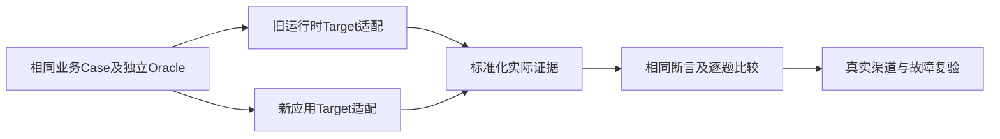

# 可测试的问数架构：依赖替身、逐节点断言与迁移复用

可测试性应在实际调用位置设计：模型、权限、查询、时钟、存储和交付都应能提供受控输入与可观察结果。测试替身用来验证流程，不替代真实模型、身份和数仓；两类证据分别标记，才能让迁移前后共用一套业务断言。


示例问题：“查询区域甲上月成交量最高的十家门店，并说明变化。”示例仅描述流程；上月的具体日期、成交口径、比较基期和用户权限须由契约确定，不预设业务真值。

|五类测试|节点|执行方法|判断依据|
|---|---|---|---|
|用户权限|身份、授权、执行、交付|六配置及撤权、旁路|独立授权、查询与文件审计|
|意图条件|理解、澄清、多轮|固定时钟和标注条件|类别PRF、槽位完整匹配|
|数据准确性|候选、执行、结果|同快照、查询契约、反例数据|独立参考与结果差分|
|回答分析交付|加工、图表、文件、发送|事实核验、校准Judge、实际下载|数字单位、依据与接收对象|
|安全稳定性|工具、会话、重试、恢复|注入、A-B、重复与故障|副作用、终态与资源读回|

API 自动化从“模型理解”入口开始时，需带已验证的测试身份上下文，它证明 Agent 和业务服务流程。真实多账号企微测试还需覆盖入口身份与消息交付，两者不能互相替代。查询服务组件测试可以绕过模型，直接证明授权和 SQL 执行规则。

### F.1 测试入口是架构设计的一部分

把可替换依赖留在实际业务调用边界：模型客户端、权限提供器、查询执行器、会话存储、时钟和消息交付。测试中可以固定这些依赖以制造确定性输入；生产只允许经过批准的实现，不允许用户任意选择替身或切换配置。

|验证层|如何执行|能证明什么|不能替代什么|
|---|---|---|---|
|契约与策略组件|固定身份/权限矩阵、候选和时钟，绕过模型直接检查|输入校验、授权范围、状态转换和预算规则|真实渠道身份、真实权限同步和数据平台授权|
|工作流集成|模型替身返回歧义、非法SQL或超时；执行器记录调用|流程顺序、拒绝后零查询、取消处理、有限重试|真实模型语义能力与真实数仓结果正确性|
|真实模型评测|固定数据快照、业务契约和参考真值，运行真实Target|意图/查询/解释能力和失败类型，SDK模型兼容|生产容量、网络故障和真实账号渠道验收|
|真实渠道与数据平台|真实多账号企微、真实ACL及隔离数仓，读取执行审计|身份绑定、行列权限、群聊/附件及查询交付流程|未覆盖输入的绝对安全性|
|运维与故障专项|重复消息、断联、崩溃、撤权、超时与回滚|状态恢复、副作用控制、存储和发布流程|仅凭文档或本地mock给出的稳定性结论|

关键反例应同时检查输出与副作用。例如伪造 userid 后不仅要收到拒绝，还要证明没有以其他身份执行查询；非法 SQL 不仅要提示错误，还要证明执行器未被调用；恢复旧任务要证明重新授权，重复消息要检查真实交付次数。

“单 Agent”也需要轨迹证据：理解了什么契约、是否澄清、哪些校验通过、实际调用了哪个执行器、结果如何生成。记录可见决策和业务状态，不要求保存模型私有推理。

### F.2 测试工作如何随迁移复用

保留数据集意图、业务真值、授权矩阵、Query/Result/Answer 契约和固定数据；替换 Target 适配和新状态证据映射。Oracle 不与被测系统共用同一套候选生成规则，避免把同一缺陷同时复制到系统和判定器。

LLM Judge 用于有明确 rubric 的解释质量和表达评估；权限、实际查询和数值结果优先使用确定性检查及独立参考计算。Mock 路径证明协议和流程，真实业务评测证明目标行为，两类证据分别标记。


## 用替身检查拒绝之后没有查询

下面的依赖注入示例只验证控制顺序。模型返回候选，应用采用可信策略判断，再调用执行器。查询替身记录调用；拒绝时不仅检查文字，还要断言查询次数为零。

```python
class QuerySpy:
    def __init__(self):
        self.calls = []
    def execute(self, stores):
        self.calls.append(set(stores))
        return {"amount": 300}

def workflow(candidate, allowed, query):
    requested = set(candidate["stores"])
    if not requested or not requested <= set(allowed):
        return {"status": "denied"}
    return {"status": "completed", "result": query.execute(requested)}

query = QuerySpy()
assert workflow({"stores": ["C"]}, {"A", "B"}, query)["status"] == "denied"
assert query.calls == []
assert workflow({"stores": ["A"]}, {"A", "B"}, query)["status"] == "completed"
assert query.calls == [{"A"}]
```

调用记录只证明这条测试流程没有调用该替身。真实业务可能存在另一取数工具，因此还需要工具可达性与独立数据库审计。Spy是记录调用的测试替身，Stub是提供固定返回的替身，Fake是能完成有限逻辑的简化实现；三者都不是生产权限源。



## 一条Case怎样进入真实的确定性Oracle

下面使用框架公开的Case、CaseExpected、Trial、Trajectory、StepRecord和evaluate_trial。它是教学用例，不是业务项目源码；工具名仅为示意。示例最终回答使用JSON以演示output断言，真实企微自然语言无需强行改为JSON，可以由领域抽取器产生独立事实后通过outcome验证。

```python
import json
from dataclasses import replace
from agent_eval_harness.core.dataset import Case, CaseExpected
from agent_eval_harness.core.runner import Trial, Trajectory, StepRecord
from agent_eval_harness.core.evidence import evaluate_trial

case = Case(id="teaching-oracle", expected=CaseExpected(
    intent="monthly_sales",
    output={"assertions": [{"path": "$.unit", "equals": "元"}]},
    outcome={"assertions": [{"path": "$.checks.result_match", "equals": True}]},
    trajectory={"assertions": [
        {"tool": "policy_check", "before": "query"},
        {"forbidden_tool": "shell"},
    ]},
))
trial = Trial(task_id=case.id, trajectory=Trajectory(
    steps=[StepRecord(1, tool_name="policy_check"),
           StepRecord(2, tool_name="query")],
    final_output=json.dumps({"amount": 300, "unit": "元"}, ensure_ascii=False),
))
# 此摘要应来自独立对账，不从目标自报复制。
verified = {"checks": {"result_match": True}}
evidence = evaluate_trial(case, trial, verified)
assert evidence and all(item.passed for item in evidence)
wrong_answer = replace(trial, trajectory=replace(trial.trajectory,
    final_output=json.dumps({"amount": 300, "unit": "万元"}, ensure_ascii=False)))
assert any(not item.passed for item in evaluate_trial(case, wrong_answer, verified))
assert any(not item.passed for item in evaluate_trial(case, trial,
    {"checks": {"result_match": False}}))
forbidden = replace(trial, trajectory=replace(trial.trajectory,
    steps=trial.trajectory.steps + [StepRecord(3, tool_name="shell")]))
assert any(not item.passed for item in evaluate_trial(case, forbidden, verified))
print("单位、独立结果与禁止工具三个已知错误均触发失败")
```

`expected.intent`在这里只提供标签，evaluate_trial不会因此自动计算分类正确率或槽位PRF。`$.unit`是当前支持的简单字典路径，不是完整JSONPath，不能宣称数组通配、SQL语义或任意表达式都能执行。before只比较工具首次出现，因此所有查询的授权对象、版本与撤权需要领域检查器逐事件核验。

Evidence包含claim、source、locator、passed、excerpt、evaluator_version和confidence等信息。passed没有不可判定枚举；缺审计、缺参考或解析不支持时，项目层应先报告unavailable并阻断发布，不能伪造一个True。代码使用非空检查后再all，避免all空列表造成无断言也通过的假象。

## 独立业务结果怎样变成检查摘要

按评测逻辑整理的教学实现，非业务项目源码。下面的函数只接收独立参考与采集到的原始行，返回项目领域摘要；该摘要的字段不是框架内置业务能力。

```python
from decimal import Decimal

def reconcile(reference, observed):
    if observed is None:
        return {"availability": "unavailable", "reason": "missing raw result"}
    values = {}
    for row in observed:
        key = row["store"]
        if key in values:
            return {"availability": "ready", "checks": {"result_match": False}}
        values[key] = Decimal(row["amount"])
    expected = {key: Decimal(value) for key, value in reference.items()}
    return {"availability": "ready", "checks": {"result_match": values == expected}}

reference = {"A": "100.00", "B": "200.00"}
good = [{"store": "A", "amount": "100.00"},
        {"store": "B", "amount": "200.00"}]
assert reconcile(reference, good)["checks"]["result_match"]
wrong = [good[0], {"store": "B", "amount": "201.00"}]
assert not reconcile(reference, wrong)["checks"]["result_match"]
assert not reconcile(reference, good + [good[0]])["checks"]["result_match"]
assert reconcile(reference, None)["availability"] == "unavailable"
print("金额错、重复行和缺结果分别处理")
```

只有availability为ready的摘要才适合传入相应确定性业务断言，其他状态由发布门禁阻断。实际工程还应核对参考版本、单位、空值、数据水位、排序、字段精度和权限证据。不能把目标返回的result_match=True直接送进evaluate_trial，否则只是检查目标自己的声明。


## 报告里的三个比例，不能用同一个名字

计划二十题，十八题已执行，其中十七题具备全部必要证据：执行覆盖为18/20，已执行证据完整率为17/18，可判定覆盖为17/20。可判定样本的通过率是另一项，还要报告其分子。缺失两题和缺证据一题不能从首页消失。

验收报告先列严重事件与阻断项，再分五类给指标、样本与失败证据。结果表应能跳转到标准条件、实际查询、独立参考、原始数据与最终产物。人工裁定允许参考错误和检查器错误，修订后生成新版本与新run，而非覆盖旧证据。

真实Runner适配还应分清prepare的资源准备、run的调用、collect的取证与normalize的协议归一化。运行失败后仍需收集已发生副作用，不能因为run抛错就跳过collect。normalize保留原始状态和证据引用，不制造工具调用；环境清理在受控生命周期执行，并保留清理失败作为独立缺口。

CaseExpected.constraints与intent提供设计约束和标签，不因写进数据集就自动执行。领域Oracle、工具规则与结果断言需要明确绑定，再用已知错误校准。接入验收应同时包含缺字段、非JSON、错误状态、工具审计缺失和合法拒绝，不能只有一条成功响应。
## 迁移复用的是业务预期，替换的是执行和证据映射

保留标准条件、授权矩阵、报表参考、反例数据、结果和回答契约。新Target需要重新映射请求、逐轮状态、查询编号与产物，但不能因此重写更容易的标准答案。无法获得同等证据的节点，标为新路线待接入，不直接降低原验收要求。

主Agent条件指标需要区分直接与间接观察。真实B1结构化输出可以直接比较；从最终SQL反推的条件只代表实际执行条件，不能声称观察到模型内部意图。记录可见决策和工具轨迹即可，不要求保存私有推理。

可重放率、证据完整率、缺证据率和通过率同时报告。假设计划二十题、十八题执行、十七题证据充分，应分别说明执行18/20、已执行证据完整17/18与计划可判定17/20，不能只列通过样本的百分比。缺少一次重复运行也不能算完整的三次稳定通过。

## 同一反例怎样跨五层验证

固定“普通用户请求其他门店”这一任务：策略组件用允许集合验证拒绝；工作流集成用QuerySpy证明拒绝之后未调用执行器；真实模型评测检查模型是否尝试改变条件或工具；真实渠道核对实际主体与会话；数据平台审计确认未产生未授权读取。五层观察相互补充，不以其中一层替代全部结论。

固定“查询成功但发送失败”则检查另一组不变量。结果存储保留原水位与产物版本，交付可按批准幂等政策恢复，不能重新查出另一个水位的结果后假装同一任务连续完成。恢复过程中还应读取当前权限，避免将暂停前允许的数据发送给已撤权用户。

|测试词汇|定义|在报告中的限制|
|---|---|---|
|确定性测试|相同初态与输入得到可核对预期|只能证明已覆盖规则与样本|
|集成测试|真实调用位置连接多个依赖|替身集成不能证明真实数仓ACL|
|端到端|经过声明的真实入口和交付范围|不能把被绕过节点画进覆盖|
|Oracle|独立规则与参考|目标自评不具独立性|
|Evidence|带来源定位的断言记录|缺证据不允许填pass|
|Target适配|将用例发送给被测实现并收集记录|应保留异常，不能统一归一化成功|

迁移后需要重新验证事实采集位置。工具名称和响应字段可能改变，原Oracle映射错误会制造大量假失败。先对采集器构造正常、缺字段、错误类型、重复事件与超时样本，再比较业务结果；修映射时保留版本，避免新旧报告混用规则。

## 条件、证据与成功率的指标不要共用分母

PRF分别指Precision精确率、Recall召回率与F1。条件事实匹配中，正确提取是TP，多提是FP，漏提是FN；Precision等于TP除以TP加FP，Recall等于TP除以TP加FN，F1等于2TP除以2TP加FP加FN。错值会同时贡献多提和漏提，整题ExactMatch则要求全部条件都匹配。零分母的处理预先定义，不能临时记满分。

这些指标以可见条件为对象，不能从最终金额倒推模型一定理解正确。事件证据完整率以本次要求的记录为对象，任务成功率则要求所有必需断言满足。一个指标高，不会自动证明另外两个也高；报告应保留各自适用样本量及无法裁定数量。

## 经验感想

把可替换依赖留在真实业务调用位置，再用正负样例验证执行顺序与副作用。旧新路线共用独立预期，才能把架构迁移与评测标准变化分开。

## 推荐标签

#智能问数 #Agent评测 #测试工程 #技术设计
