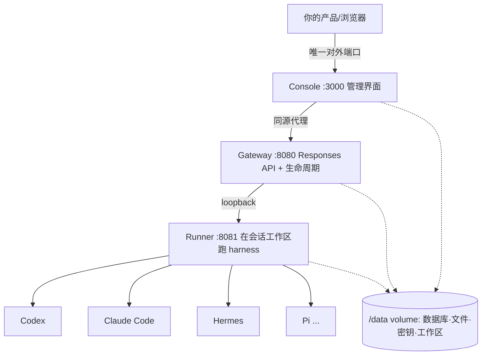

# HarnessRouter 解读：一条把编码 Agent 做成可插拔后端的统一协议

Codex、Claude Code、Hermes、Pi、DeepSeek Harness——编码 Agent 多到记不住。每个都自带一套自己的循环、工具和会话状态，每个都能干活。问题不在 Agent 本身，而在「你的产品要怎么驱动它们」：怎么起任务、怎么跟进度、怎么续会话、怎么取消、怎么拿它产出的文件、怎么判断它为什么挂了。这套问答，现在每个产品都对着每个 Agent 各写一遍。

HarnessRouter 就是冲这个问题去的。它是自托管的开源实现（Apache-2.0，3.1k star），定位一句话：**把现有编码 Agent 变成即插即用的后端，你的产品通过一个 API 跑任务、拿结果、切 Agent**。它实现了一条叫 UHP（Unified Harness Protocol，统一 Harness 协议）的开放标准，任务接口刻意做成和 OpenAI Responses API 兼容——已有的 Responses SDK、流解析器、UI 组件不用改就能用。

仓库里实际有什么，对应到源码目录是这样的分层：

| 层 | 源码目录 | 对应职责 |
|---|---|---|
| Web 控制台 | `ui/` | 建 harness、连模型、跑任务、看文件的管理界面 |
| API 网关 | `gateway/app.py` | Responses API、会话、取消、幂等、错误字面 |
| Harness 驱动 | `runner/*_driver.py` | 把 Codex / Hermes / Pi / aider 等 CLI 包成统一执行 |
| 协议本体 | `protocol/versions/` | UHP 规范：生命周期、harnesses、tasks、files、security |
| 机器可读契约 | `protocol/schema/` | OpenAPI 3.1 + JSON Schema 2020-12 |
| 一致性套件 | `protocol/conformance/` | 「什么叫符合 UHP」的可运行定义 |

## 它先想清楚了一件事：harness 不是模型 API

UHP 在 `protocol/README.md` 里把这个分界讲得很直接。模型 API 给你的是一个 **turn**：消息进、token 出，工具还得自己跑。UHP 给你的是一个 **task**：活儿进去，一个真的在跑的 Agent 用自己的工具、自己维护会话，把结果和文件交回来。交换单位是 job，不是 completion。

作者对 harness 的定义也写得很明白：harness 是一套完整的 Agent 运行时——一个「规划、调工具、改文件、回报」的循环。Codex、Claude Code、Hermes 都是 harness。每一个都已经知道怎么干活，它们不统一的是「产品该怎么驱动它」。UHP 的回答是：驱动这件事，每个产品只答一次，之后对谁都一样。

这带来一个测试侧很舒服的推论：**客户端不需要知道背后跑的是哪个 harness**。UHP 架构文档里把「客户端应该看不出是哪个 harness 跑的工作——除非它主动问」列为设计原则第一条，因为换 harness 不会让产品崩掉，才谈得上可插拔。

## 核心机制：三处把「调度 Agent」变成了可验收的工程

技术解读的价值在机制，挑三个和测试最相干的讲。

### 1. 幂等重试：Agent 任务重跑两遍，比慢更糟

Agent 任务是贵且带副作用的。UHP 的 `tasks.md` 里对幂等的定义是从「重跑一遍的代价」反推的：

- 客户端带 `Idempotency-Key`；服务器遇到相同 key，返回**第一次**请求的结果，**不**起第二次执行。
- 如果第一次还在跑，服务器**等它**做完再返回，而不是给个半截结果或冲突。「Agent 任务既贵又有副作用：重试把活干两遍，比慢更糟」——文档原话。
- key 至少保留 24 小时。

测试读者一眼能认出来这是什么：把「重试」从「客户端自己的 Naive 重发」升格成「服务端可控的语义」。同一个 key 换不同请求体返回 `409`，只改 `stream` 不算新请求。这对「断网重发会不会把同一个文件改两遍」这类问题，就是一道契约级的答案。

### 2. 模型替换必须留痕：别让测量数据悄悄变脏

服务端发现请求的模型它给不了，只允许两条路：要么 `422 model_unavailable` 直接拒；要么替换成 harness 授权的默认模型，但**必须在响应的 `metadata` 里写清楚**——`requested_model`、`model_fallback: true`、原因。这样客户端永远能回答「点的模型跑没跑」，对比 `model` 和 `metadata.requested_model` 就行。

这个规则的动机，文档里写得很透：**静默替换会让所有下游测量都错**——基准、成本归属、质量对比全错，而客户端毫无察觉。报告一次替换只要两个字段。

对照到工程里，这就是「诚实上报」的 API 版：不透明地降级，等于给所有依赖它的数据灌了脏输入。

### 3. 失败是头等公民：一个错误封装，一套机器可读的 code

`errors.md` 定义了一个统一错误信封，永远只有五件套：`type`（宽分类）、`code`（机器可读的具体原因）、`message`（一句人话，不许带堆栈和路径）、`param`、`detail`。失败分两类，被明确的一条线划开：

- **任务的失败**：返回 HTTP 200 + `status: "failed"`——请求本身成功了，是任务没成。
- **请求的失败**：非 2xx + 错误信封。

生命周期里任务只有四个终态：`completed` / `failed` / `incomplete` / `cancelled`。其中两个专门做了区分——`incomplete` 是**预算**（步数或时间到了）停的，一般可以接着跑；`failed` 是**报错**，重试也白搭。终态不可再变；被取消就报 `cancelled`，不报 `failed`。跑到一半失败的响应必须保留已有产出，因为「丢弃半成品，等于毁了唯一能定位问题的证据」。

重试矩阵也是表格式的：`server_error` 可以退了再加抖重试，`rate_limited` 等 `Retry-After`，`quota_exhausted` 和一切 `invalid_request_error` 别重试。有一条写得最硬：**重试 `POST /v1/responses` 必须带 `Idempotency-Key`**，否则超时后重发可能把同一个任务跑第二遍——文档把它叫「UHP 客户端最伤人的错误」。

## 一致性套件：把「什么叫符合协议」做成能跑的东西

这是整个仓库里最适合测试工程师看的部分，也是「把理解做成验收」最彻底的体现。

`protocol/conformance/README.md` 第一句就划线：**「通过这套套件，才是 'UHP conformant' 的意思」**——不是实现了端点、不是自我评估、不是大部分通过。套件就放在这个仓库里，跑 HTTP，谁都能对任何人的实现跑一遍。

说到关键处：

- 100 个检查，分三档，逐级累积：Core 41 个（发现、版本协商、鉴权、错误信封、harness、模型、流式/非流式任务、会话、取消、保留字段），Extended +9（会话列出/检视、文件输入、工件、下载头、路径穿越探测），Full +50（harness 增删改、skill 文件夹往返、插件、会话共享）。
- **它跑的是真 Agent 任务**。一个完整跑发约七个任务，花真 token、跑几分钟。理由也很工程：流从不 flush、取消永不终止、工件下载不下来——这些缺陷，任何只查 schema 的东西都看不见。
- 退出码 `0`（全过）/`1`（有失败），能直接丢进 CI 当门槛。
- 报错时它明确区分 PASS / FAIL / SKIP / ERROR，而且**skip 永远不算 pass**——JSON 报告里 `conformant: true` 只有在「该类要求的每个检查都跑了且过了」时才成立，`skipped_not_verified` 会逐个列出来。

这套件不是空壳摆设，它在开发阶段真抓到过参考实现自己的违规，而且不是理论上的：

- `R-01…R-07` 本来就都 skip——作者实现的共享方言要 `{"enabled": true}` 却不发布视图 URL，而 skip 背后藏着一个真实的 Sessions §6 违规：会话的共享链接在 `DELETE /v1/traces/{id}` 之后还在继续提供完整对话。修掉之前，实跑验证过。
- `T-09` 失败过：`tools` 字段被喂进了幂等哈希，而且没人报它被忽略——正是 §1.1 现在禁止的「静默丢弃」。
- 套件开发期一共列了 8 个真实缺陷，其中四个任何配置级检查都看不到。最有意思的一条：**Claude 的硬禁用是个 no-op，产品却声称它是硬的**。`--disallowedTools` 属于权限询问系统，而自主跑会传 `--dangerously-skip-permissions` 把那个系统关掉。操作者禁了 `Bash`，看 Agent 照样跑 `Bash`。修法是把禁用写进运行时自己的设置文件当 deny 规则，skip 权限的 flag 覆盖不了。

套件自己也有一条边界被写得很诚实：它验证 `disabledTools` **持久化**，不验证**强制**。因为 §4.3 允许指令级强制，一个「遵守指令」的 Agent 和「真拦截」的运行时，在 HTTP 上无法区分——行为式检查会在模型恰好听话时放过一个什么都不管的空块。强制要放到实现自己的测试套件里，对真 Agent 断言「禁了就没调用」。

## 架构：一个容器里，三层进程 + 一套会话隔离

自托管部署就一条 Docker 命令：

```bash
docker run -d --name harnessrouter \
  -p 127.0.0.1:3000:3000 \
  -v harnessrouter:/data \
  harnessrouter/harnessrouter
```

容器内部是三段进程，只有控制台端口对外：



隔离设计有一个单独点：**会话之间用不同的操作系统用户和工作区隔离，而不是不同的容器**。几个 harness 共享一个容器，但每个 Agent 进程跑在它自己的 session user 下，只能读写自己那个工作区，碰不到别人的文件、数据库和密钥库。容器必须用 root 起，恰恰是为了在启动后降权；控制台和网关跑非特权用户，Agent 进程跑各自会话用户。对「一个 Agent 把文件写错地方」的处理是：写入直接失败，而模型还在场，可以当场纠正——而不是文件悄悄散到别处。

## 落点 + 限制

这套东西把「选哪个 Agent 跑活儿」从代码生死攸关的决策，变成了 `metadata.harness_id` 一个字段——产品业务代码不感知 harness 差异，切 Codex 还是切 Hermes 是配置，不是改代码。配合幂等、留痕降级、机器可读错误这堆契约，调度 Agent 这件事第一次有了和调后端接口同级的可验收性。
说限制。**自托管版不内置模型、不送试用 key**：连 `Bring Your Own Key` 界面，自己填模型商 API key，模型请求还是打到你配的供应商，密钥、会话、文件都留在你控制的机器上；`/data` 卷管数据库、文件、已装的 Agent CLI 和工作区。26 个 harness 基底无非是首启从上游拉安装的 CLI，各自的授权条款另算，不能只认仓库的 Apache-2.0。要出公网还得多配 TLS。它不是给你装了就免运维，是把「跑哪些 Agent」控制权交回你手里。

仓库地址：<https://github.com/HarnessRouter/harnessrouter>