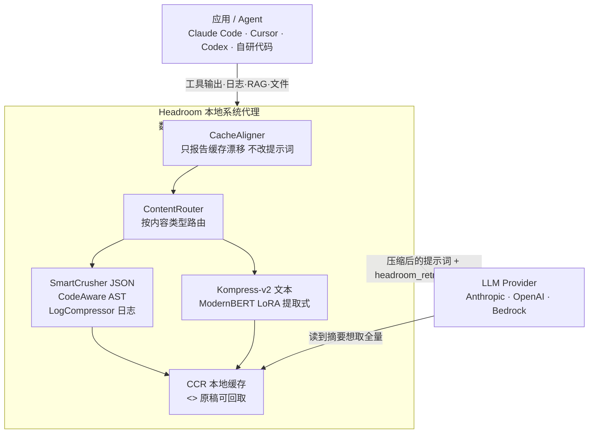

# Headroom 解读：给 Agent 的上下文装一个压缩层，压缩不丢判断依据

Agent 会话里最吵的从来不是对话，是工具输出。一次`文件搜索`能带回来 17k token，一条构建日志动辄上万 token，可模型真正要看的往往就一行`FATAL`。这些字节不是信息，是运输成本——进上下文前每 token 都要计费，还挤占上下文窗口，让更关键的内容放不下。

`headroomlabs-ai/headroom`（Apache 2.0，Python）就是装在这道运输环节上的压缩层：在工具输出、日志、RAG 结果、文件、对话历史进模型之前，先按内容类型各压一道。仓库自己的数字是：编码 Agent 少 20% token，JSON 类输出少 60–95%，答案不变。压缩在本地跑，不上传任何提示词或文件内容。

第一次看它，容易把重点放在"省了多少 token"上。换个测试视角，它做的其实是另一件事：**让"被压缩过的证据"仍然够模型做判断**。这跟测试里"有输出不等于能拿来做结论"是同一类问题——压缩可以丢，判断依据不能丢。

## 仓库地图：四层职责

仓库 95MB，Rust 与 Python 混写，`main` 分支 0.41.0（2026-10-14 发布）。按测试工程熟悉的职责切，是这么四层：

| 层 | 落点 | 测试工程里的对应物 |
| --- | --- | --- |
| 命令入口 | `headroom proxy` / `wrap` / `deploy` / `doctor` / `perf` / `dashboard` / `learn`（PyPI `headroom-ai`） | 测试工具的命令入口，`doctor` 相当于环境自检，`perf` 相当于基准 |
| 核心机制 | `headroom/_core`（Rust）+ `headroom/transforms/`：CacheAligner、ContentRouter、SmartCrusher、CodeAwareCompressor、Kompress | 被测系统的内部管线 |
| 对接层 | `headroom/providers/`（claude/copilot/codex/grok/…）、`withHeadroom()`（Anthropic/OpenAI SDK）、LiteLLM LangChain 等适配器 | 被测系统的外部接口适配 |
| 可执行形态 | library（`compress()`）、proxy、MCP server（`headroom_compress`/`headroom_retrieve`/`headroom_stats`） | 同一引擎的三种投递方式 |
| 数据与配置 | CCR 缓存（本地 SQLite）、Sqlite+HNSW 向量存储、CLI 配置 | 被测系统的数据与配置层 |

## 它对付的问题

**一条核心原则带队，另两条围绕它。** 三条都从 README 和文档里能核实：

**1. 压缩按内容类型走，不做一刀切。** `ContentRouter` 先判断内容形状，再路由到对应压缩器。JSON 走 `SmartCrusher`（统计字段方差，不是按关键词列表；数组里异常值、统计范围之外的项、首尾边界都保留），源码走 `CodeAwareCompressor`（AST 感知，保留 import、函数签名、类型；函数体按需压缩），日志走 `LogCompressor`，搜索结果走 `SearchCompressor`。Git 状态这类人类可读的结构化输出，直接无损透传——它很早就知道"这条路径不能动"。

**2. 压缩可逆，原稿不丢。** 这是 CCR（Compress-Cache-Retrieve）的核心：压缩出的 `<<ccr:hash>>` 标记背后，原稿缓存在本地，模型需要全量时可以调 `headroom_retrieve` 取回。等于告诉模型"你看到的是摘要，想看原本随时能拿"——压缩不必承担"必须是最终答案"的风险。

**3. 不动已缓存的静态前缀，只压新字节。** `CacheAligner` 只报告动态前缀漂移（日期、会话上下文），从不改提示词；live-zone 压缩只压新产生的工具输出和最新一轮，冻结的缓存前缀保持字节一致，这样提供商的 prompt cache 还能命中。省 token 和吃缓存命中率，是它两件事一起做。

### 三个机制在测试侧尤其有代表性

**SmartCrusher 的"保留异常值"，就是测试里的"保留失败样本"。** 它压 JSON 数组时，靠字段方差统计把统计正常范围之外的项和首尾边界保留下来，拒绝把它当成普通值丢。这在语义上等于 grep 一个 10k 行日志时不丢那行 `FATAL`——压的是重复，护的是异常。

**`headroom learn` 就是从失败会话里挖测试用例。** 它离线分析失败的 Agent 会话，把纠正写成 `CLAUDE.local.md`（默认，gitignored）/`AGENTS.md`，还能识别 loop（重复工具调用，比如 RTK 反复拉取被截断的输出）。对测试侧，这一步天然像"把失败样本沉淀成回归规则"——只是对象从代码换成了 Agent 的会话轨迹。

**Kompress 是提取式，不是生成式。** `chopratejas/kompress-v2-base` 是 150M 参数的 ModernBERT + LoRA（4.4M 可训练参数，2.9%），输出永远是输入的子序列、按原顺序保留——没有 decoder，不重写内容。默认阈值 0.5 下 F1 0.920、must-keep recall 0.989。这个"提取式"很关键：它不发明文本，只决定哪个 token 该留。

## 架构分层

一套压缩管线，三种投递方式（library / proxy / MCP），所有模式走同一条 pipeline：`Setup → Pre-Start → Post-Start → Input Received → Input Cached → Input Routed → Input Compressed → Input Remembered → Pre-Send → Post-Send → Response Received`。



> 图与正文结论一致，不画文字没讲的模块：`headroom learn`（失败会话→规则）和跨 Agent 记忆挂在管线侧，core 编排只管生命周期与策略。

## 安装与上手：三步跑通

安装命令来自仓库 README 的 "Get started (60 seconds)" 一节，三条路对应三种用法，按需选一条即可：

```bash
# 1 — 安装
uv tool install --python 3.13 "headroom-ai[all]"   # 独立环境装 CLI，推荐
pip install "headroom-ai[all]"                     # Python 包，会带上 headroom 命令
npm install headroom-ai                            # 仅 TypeScript SDK，不含 CLI

# 2 — 选一种工作方式
headroom deploy                # 一键本地部署，顺带写好 Agent 配置
headroom wrap claude           # 包住某个编码 Agent（claude/codex/cursor/aider/…）
headroom proxy --port 8787     # 透明代理，改一行配置就能用，不改业务代码
# 或者：from headroom import compress   # 当库内联调用

# 3 — 自检并看效果
headroom doctor                # 确认路由与压缩通路正常
headroom perf                  # 基准
headroom dashboard             # 实时省了多少（需要 proxy 在跑）
```

几个容易踩的坑，README 里也写了：`headroom` 命令只随 PyPI 包装，npm 的 `headroom-ai` 是 TypeScript SDK，装完没有 CLI；`headroom wrap` 每次开新会话都要先执行一次，它会起本地代理、装 Serena 做语义导航，再把 Agent 流量导到 Headroom 上；不想用了用 `headroom unwrap <tool>` 还原，配置层面可回滚。

装好先跑一轮 `headroom doctor`，再拿真实的日志或工具输出跑 `headroom savings`，比照 README 里的四个基准场景，得到属于这份流量的数字。

## 命令与证据：可脚本化契约用表

安装命令已经在上一步给全，这里只留"能当验收用"的那几条：

| 命令 | 对应测试动作 |
| --- | --- |
| `headroom doctor` | 环境自检，确认路由与压缩通路正常，类似 `pytest` 前的 smoke check |
| `headroom perf` ／ `headroom dashboard` | 基准与实时看板，量省了多少、慢在哪 |
| `headroom learn --verbosity --apply` | 从历史会话学语气级别并落地，dry run 先看再改 |
| `headroom unwrap <tool>` | 卸载 wrap 的还原动作，保证可回滚 |

## 落点与限制

**能干什么、不能干什么，README 自己写得很清楚。** 好用的场景是长会话、重工具输出的 Agent；短对话、散文、已经很密的内容几乎不压缩，`min_input_words` 以下的块原样返回。省多少强烈依赖输入冗余度，README 给的四个场景数字（code search 21%、SRE incident 57%、codebase 42%、issue triage 30%）是 seeded offline benchmark，换自己的流量就是另一组数。压缩的代价是：无 AVX2 的旧 x86 环境要降级到非 ONNX 路径，Intel macOS 没有预编译 ONNX Runtime，首次装要自己接系统 runtime——这些在文档里都标了。

要不要用，看你的 Agent 会话是不是“重输出、长上下文、要反复看工具结果”。如果只是偶尔问两句，没必要为它上代理。

仓库：<https://github.com/headroomlabs-ai/headroom>
模型：<https://huggingface.co/chopratejas/kompress-v2-base>
文档：<https://docs.headroomlabs.ai/docs

`#Agent` `#上下文工程` `#token优化` `#MCP` `#上下文压缩` `#测试工程` `#开源解读`

---

