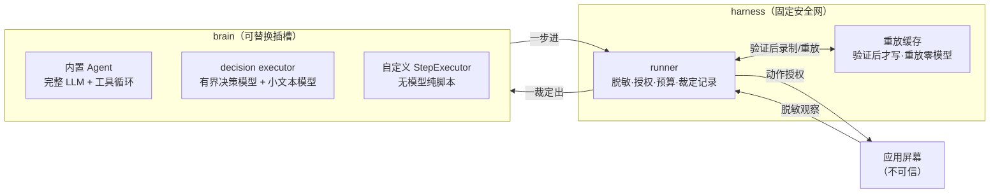

# e2e 解读：让 AI 去跑 E2E 测试，还要它可复现、可控成本、不泄密

AI 进测试，最诱人的画饼是把自然语言目标丢给模型，等它把页面点完。但测试工程师的第一反应通常是：模型每跑一遍都要花钱、结果能不能复现、它会不会把密码喂给模型、页面一变它是不是就翻车。这四个问题不解决，AI 驱动的 E2E 永远只能停留在 demo。

`tester-army/e2e` 是目前最接近"把这四个问题都收住"的开源方案：**描述一个自然语言目标，Agent 驱动应用去达成，再用定位器和断言在同一份测试里验收结果**（README 原话 "Describe a goal in natural language and an agent drives the app to reach it. Check the result with locators and assertions in the same test."）。它不强迫你把整条流程都交给模型——没有 Agent 步骤的测试根本不需要模型（README 原话 "Tests without agent steps need no model"）。仓库当前 11.5k stars、594 forks、886 commits，版本 0.21.2，Apache-2.0，还处在冲向 1.0 的活跃开发期。

仓库是 pnpm monorepo，`packages/` 下有 11 个包。按测试工程师熟悉的职责，可以把它们排成一张分层表，每一层对应一个真实 npm 包：

| 层 | 源码包 | 对应测试职责 |
|---|---|---|
| SDK / 运行器 / CLI | `e2e` | 写用例、跑套件、定位器与断言、报告 |
| Web 执行引擎 | `@e2e-dev/web` | Chromium / Firefox / WebKit（经 Playwright） |
| 移动执行引擎 | `@e2e-dev/mobile` | iOS 模拟器 / Android 模拟器（经 agent-device） |
| PR 报告 | `@e2e-dev/github` | 把结果发成 PR 评论 |
| 托管执行器 | `@e2e-dev/kernel` / `lightpanda` / `limrun` / `eas` / `smol` / `testmu` | 云端浏览器 / 设备，花哨但非核心 |
| 有界决策执行器 | `@e2e-dev/decision` | 不靠完整 LLM Agent 也能跑 `act`/`assert` |

先交代一句立场：下文所有结论都回指到仓库里的源码或文档，下面只摆能核实的东西。

## 它先想清楚的一件事：模型不该全程在场

看 `docs/core-concepts.mdx` 的第一段，它会给你一份整篇文章的信息密度最高的一张表——一个测试混用**三种步骤**，每种要不要调模型，划得干干净净：

| 步骤 | API | 调不调模型 |
|---|---|---|
| 目标 | `agent.act` | 调，除非缓存重放 |
| 断言 | `agent.assert` / `waitFor` / `extract` | 调 |
| 定位器 | `screen` + `expect` | 不调 |

这个划分本身就是设计理念的浓缩：**模型只在"屏幕内容预先猜不到"的地方出场**。定位器是确定性的——你知道那个按钮的角色和名字，就不该让模型去猜它在哪。模型的价值被限定在最窄的缺口里：目标是一句自然语言、结果要人读屏幕判断。其余所有"确定能点到的控件"都用确定性定位器钉死。

配套的是**原子目标**纪律（core-concepts 里给了正反例）：每个 `act` 只做一件「一个结果、一个检查能确认」的事，做完必须被下一个检查确认，才轮到下一个目标。目标是"一个 Checkout"，而下单前的那些开屏、滚动、关横幅、填表单，都是达成目标路上的动作，**不是目标**。文档原话把分工交代得很清楚：

> You control the order of the goals. The agent picks the actions.

这句话是整套设计的底层分工：测试工程师负责给目标排秩序、写确定性检查，Agent 只负责"在给它的那个目标里挑动作"。模型不拥有流程，只拥有动作选择。

再补一条从仓库自己的 AGENTS.md 里挖出来的硬规矩，这条几乎就是设计哲学本人的签名档：

> Agentic assertions must be model-portable: assert on meaning (`toContain`) and pair each agentic step with a deterministic locator check.

官方原话，**agentic 断言要模型可移植（按意义断言），并且每个 agentic 步骤都必须配一个确定性定位器检查**。这是作者自己给自己定的规则，也是"presence ≠ working"在仓库里的落点——目标"达成"了不算数，必须有一个后面的定位器断言真正验证过才算。

## 设计理念：把模型行为当成必须被验收的产物

拆这一节之前先立个框架。测试工程师对"不可复现"有天生的敌意。一个每次都不同、随机成功/失败的用例是负资产。e2e 的设计理念基本可以概括成一个判断：**模型驱动的步骤一旦被确认成功，就该被固化成一个确定性的回归，而不是每次都重新让模型来一遍**。

这个理念最硬的表现，是一条写到 README 里的因果链：

> An agent step that a later assertion verifies records its actions, and the next run replays them with no model calls until the app changes.

翻译过来就是**重放缓存（replay cache）**：一个 `agent.act` 的步骤，先被**后面的检查**验证通过，才会被记录成动作序列；下一次跑，运行器直接重放这些动作，**一个模型调用都不花**，直到应用变化。

它本质上是把「AI 自动测试」里最不可控的一环——模型每次现场发挥——折叠成了一个旧概念：**回归测试**。跑通了、被验证了，就沉淀成确定性的动作序列，此后每次 CI 都以零模型成本重放。只有当某个控件找不到、最终状态对不上，Agent 才从当前屏幕接手（run summary 里叫 `handed off`）。运行摘要长这样（cache.mdx 里的示例）：

```text
           AI  4.1k tokens · 2 model calls · anthropic/claude-sonnet-4.5
        Cache  4 replayed · 1 handed off · 1 missed
```

一口能把"这次跑下来究竟调了几次模型、重放了几步、交给 Agent 接手了几步"讲清楚。模型不是每跑必调的——大部分步骤在缓存里，只有新动作或页面漂移才触发真实的模型调用。

设计上最讲究的地方在于**"什么时候才写缓存"**。它是苛刻的：

- 只有在 `act` 之后有一个**后面的验证步骤通过**，这份录制才会在 attempt 结束时写下（`step.cache.write: saved`）。
- 没有检查通过 → `unconfirmed`（文档直接建议你去补一个定位器断言或 `agent.assert`）。
- 重放失败、或无检查确认就崩了 → `evicted`（这条录制被删）。
- 还给了 `kept` / `no-change` / `not-written` 几个状态，把"没变化/超限/存储失败"都区分开。

这一条把测试里最忌讳的"**跑通了就当成没问题**"用缓存状态机堵死了：**录制只在"后来确认过"以后才生效**。对应到传统测试工程，就是把"用例通过 ≠ 断言有意义"做成了运行时的硬约束，而不是靠人提醒。

再往下看，它连"**什么样的检查才算数**"都订了清单（cache.mdx 的表格）：

| 算验证 | 不算验证 |
|---|---|
| `expect(locator).toHaveText(...)` 等定位器匹配器 | `expect(value).toBe(...)` 对普通值 |
| `expect(browser).toHaveURL(...)` 等引擎断言 | `expect.poll(...)` |
| `locator.waitFor()` / `browser.waitForURL()` | `locator.textContent()` 等读取 |
| `agent.assert(...)` / `agent.waitFor(...)` | `agent.extract(...)`、另一个 `act`、attempt 通过 |

注意最后一行最反常规（但合法）：`agent.extract` 读取数据、**另一个 `act`**、乃至**整个 attempt 通过**，都**不算**验证。一条很锐利的取舍：读取不证明结果、同类 `act` 不证明这个 act、测试整体通过也不足以给单独某步背书。必须有一个针对**这一步结果**的、独立的检查真的通过。

## 核心机制：一条可复现、可控、不泄密的 Agent 步骤

把三个设计原则拼到一起，一个 `agent.act` 的实际执行流程就清楚了。文档 `agent-steps.mdx` 把一次 Agent 步骤拆成了"谁做什么"：

**执行器（executor）**选动作、返回裁定；**运行器（runner）**负责脱敏屏幕、授权并执行每个动作、执行预算、填密码、写报告。内置 Agent 是默认执行器，你也可以在 `agents` 配置里换成一个自定义的。

这个分工是整套安全设计的地基。看三个硬机制：

**(1) 模型看到的是脱敏后的语义树，不是原始页面。** `act` 的第一条 prompt 拿到指令 / 参数 / 已完成步骤 / 一份**脱敏的屏幕文本快照**（角色、名称、文本、状态）。没有原始 HTML、cookies、headers、环境值。密码字段被掩码，已在屏幕上的配置密码变成 `<secret:name>`。更硬的是：**一次密码填充之后，本次 attempt 再也不给模型发截图**（security.mdx 原话 "After a secret fill, the model gets no screenshots for the rest of the attempt"，因为应用可能把值显示在任何地方）。

**(2) 模型的工具是闭式 schema，跑之前先授权。** AGENTS.md 写得很白：

> Every model tool call is parsed into a closed schema and authorized immediately before dispatch. Nothing runs on a refusal: an unknown tool name or an undeclared field goes back to the model as the call's error.

每个工具调用先被解析进一个封闭 schema，dispatch 前立即授权；未知工具名或未声明字段直接作为该调用的错误打回。任何违反规则的动作（比如导航到一个 `file:`）直接失败 `POLICY_DENIED`。没有来源白名单——Agent 可以跟着应用跳去别的站点，但只能用这个步骤自己的密码。

**(3) 执行器是个可替换的插槽，"大脑"是 socket，安全网是固定的。** 看 `packages/e2e/src/agent/executor.ts`，接口注释原话是一个非常有画面感的定义：**"The brain socket: one step in, one verdict out."**——一步进、一个裁定出。而预算那行注释写得最清楚：

> Step budgets, read and reported by the executor, enforced by the harness.

预算由执行器读和报，但**由 harness 强制执行**。还有个细节特别能说明信任分工：`RUNTIME_CODES` 这个常量，注释原话是说执行器**不能发明这些退出码**——"the harness rejects a runtime code it did not itself record"。也就是执行器可以携带、但绝不能自己造出 harness 不认识的硬停止码。

这一步的裁定是三值的：`passed` / `failed` / `blocked`，只有失败和阻塞才带错误码，错误码决定退出码。这份退出码契约（agent-steps.mdx 原表）：

| 被什么阻塞 | 错误码 | 退出 |
|---|---|---|
| 应用拒绝的凭据 / 未配置凭据 | `AUTH_CREDENTIAL_INVALID` / `AUTH_CREDENTIAL_UNAVAILABLE` | 2 |
| 环境挂了 | `ENVIRONMENT_UNAVAILABLE` | 3 |
| 产品外的种子数据 / 前置缺失 | `SEED_DATA_MISSING` / `TEST_SETUP_FAILED` | 2 |
| 预算用尽 / 超时 | `STEP_BUDGET_EXHAUSTED` / `STEP_TIMEOUT` | 1 |
| 工具集做不了这个操作 | `AUTOMATION_UNSUPPORTED` | 1 |

对测试工程师来说，这几乎是现成的：**模型驱动步骤也被收敛成一套确定性的退出码语义**，CI 能像判断普通 pytest 退出码一样判断一套 AI 测试。

## 架构分层：可换的"大脑" + 一条信任边界 + 一个缓存键

三层视角看 e2e 的分工，核心就一条：**换哪个模型/哪种决策，都不该动摇"应用不可信、模型只配受控工具"这条底线**。security.mdx 开头原话是：

> e2e trusts the code you write and treats everything the app shows as untrusted. App content can't grant the model tools, credentials, or a larger budget.

当作不可信。应用内容不能授予模型工具、凭据或更大的预算。** 这是整个架构的信任分工。放一张图：



图里那条横线划在"执行器选动作"和"harness 收动作"之间：模型可以换（内置 Agent / 有界决策模型 / 无模型脚本化执行器），但脱敏、授权、预算、裁定记录永远在 harness 里。这个"可换大脑 + 固定安全网"才是它把"可复现"和"不泄密"同时做到的架构原因。

把最底下那个 `@e2e-dev/decision` 单独拎出来说。它代表一条完全不同的降本思路——**不是让一个完整 LLM Agent 去跑，而是用一个只返回"选择"的决策模型**。看 `docs/decision-models.mdx`：

- 每一轮，决策模型从目标 / 最近动作 / 最新语义树里，选一个**操作**，再选一个**元素**。
- 它**从不写自由文本**——要填字段值时，由一个小文本模型去写，执行器原样打出那段字符串。
- 模型输出永远不会成为选择器 / URL / 密钥（原话 "Model output never becomes a selector, a URL, or a key"）。
- 支持 `minProbability` / `minConfidence` 门控：低于阈值的动作被拦、更弱的完成检查被拒、更弱的断言判成 inconclusive（`AUTOMATION_UNSUPPORTED` / `blocked`）。

这是一条拿"模型的自由发挥空间"来换确定性 + 成本的路线：决策模型只能做选择题，文本模型只负责写值，两者互不越界。对追求"AI 有界、成本可控、结果可解释"的测试团队，这层思路几乎可以直接搬。

最后一个架构细节是**缓存键**。什么决定一次重放会不会命中（cache.mdx "What must match"）：**test、target、指令、参数、agent**。改动任何一项就 miss。反过来——**换模型不会 miss**，引擎升级如果让某个节点解析结果不同，会在重放时 miss。这个"模型无关"的键设计非常讲究：它意味着缓存沉淀的是**这个页面行为**，不是某个模型的幻觉；换一个更便宜的模型，重放照样成立。为了容纳每轮都会变的数据（时间戳、新邮箱），给了 `unique()` 包装——把变化值包起来，缓存键保持稳定，重放时换入当前值。

## 落点 / 前提与限制

这套设计对测试团队最实际的启示，反而不是"怎么用"，而是它把 AI 测试里的三个老问题各自收住了一截：

**① 可复现靠缓存，不靠模型重温。** 验证过的动作固化成零模型成本的重放，页面变了再让 Agent 接手。对应到工程判断：**AI 自动测试的目标不是"每次重新推理"，而是"推理一次、验证一次、然后固化"**。

**② 成本靠"少调模型"控，不靠换便宜模型。** 定位器零模型、`waitFor` 屏没变不调、重放零模型、决策模型只做选择题——所有设计都在把模型调用压到"必须"的份上。README 里那句 "Tests without agent steps need no model" 直接把下限拉到零。

**③ 不泄密靠"信任边界 + 闭式工具"，不靠依赖模型守纪律。** 应用不可信、运行器脱敏、工具调用跑前授权、密码填充后停发截图、缓存条目不含 prompt/截图/密钥值。这一层是 e2e 和大多数野蛮生长 AI 测试 demo 的分水岭。

限制也要摆清楚。仓库自己写明了是**处在冲刺 1.0 的活跃开发期，API 和配置在小版本之间都可能变**（README 状态区原话 "APIs and config can still change between minor releases"）。缓存可信度有一次完整的梳理（security.mdx 的 cache trust 一节，明确说缓存条目不是签名的、会以你的权限重放，要按测试代码一样审）。同时**运行是永不沙箱的**——测试 / 配置 / 引擎 / 工具都以你的 OS 权限跑，源码明确要求不受信的 PR 代码放到外部沙箱去。`--no-cache` 可以临时关掉缓存去评估一个新模型，`e2e cache ls/stats/clear` 提供检视手段。

仓库地址：`https://github.com/tester-army/e2e`（文档在 `docs/*.mdx`，源码从 `packages/e2e/src/agent/executor.ts` 进去最顺）。它的核心思想翻译成一句话：**AI 驱动测试的护城河不是模型多强，而是把模型行为驯成一个可复现、可控成本、不泄密的确定性回归。**

---

## 爆款标题候选

- 让 AI 去跑 E2E，还要求它可复现、不泄密：这个开源框架是怎么做到的
- 它不是让模型每次重新推理，而是推理一次、验证一次、然后固化
- 11.5k stars 的 AI 测试框架：模型只在"屏幕猜不到"的地方出场
- 密码一次填充就断掉整个屏幕流：这个框架把"应用不可信"做成了架构
- 比"用什么模型"更重要的问题，它用一张缓存键表回答了

## 标签

`#测试工程` `#AI-Agent` `#AI测试` `#开源项目解读` `#E2E自动化` `#工具链`