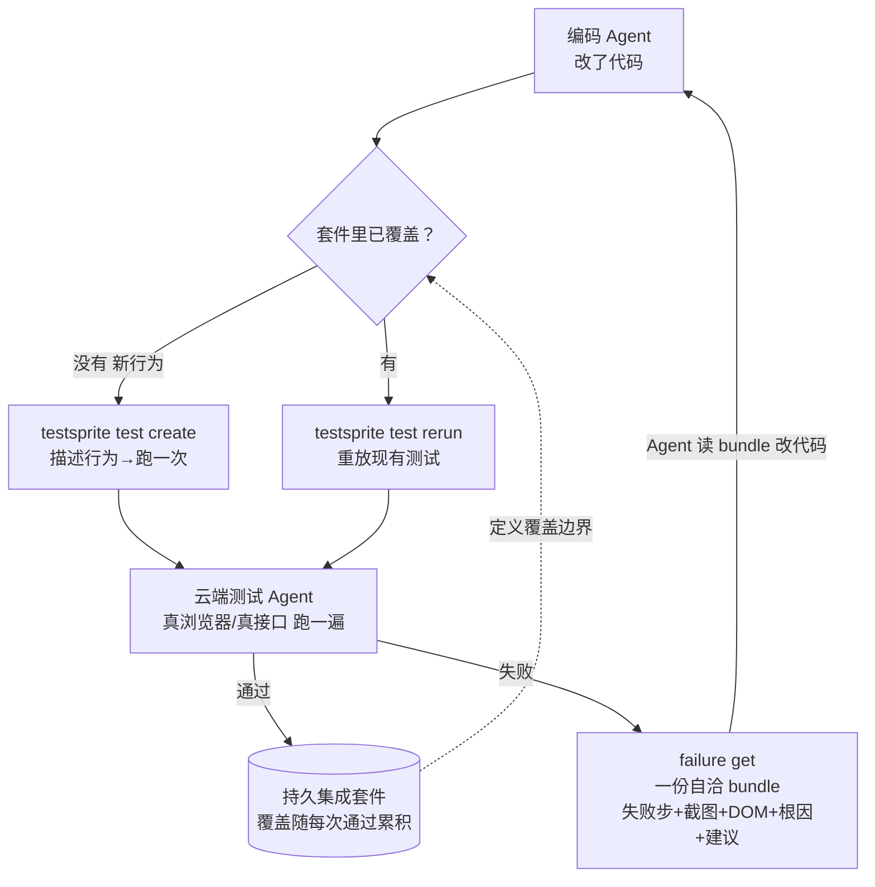
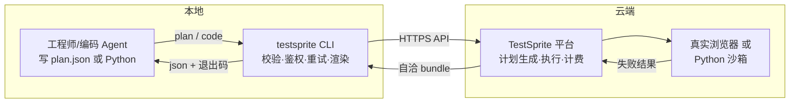
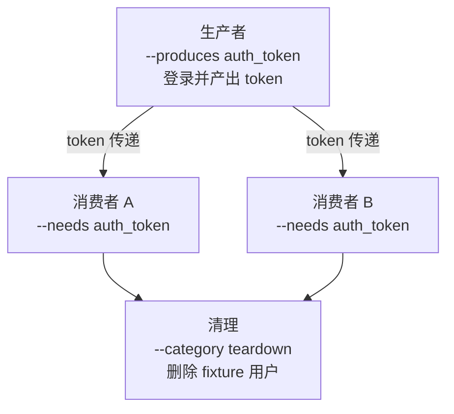

# testsprite-cli 解读：终于有人给「Agent 写代码」这件事配了个验收层

Agent 替人写代码这几年最尴尬的地方，不是写得不够快，而是**没人验收**。模型把功能「写好了」，怎么证明它真的能用、没把某个旧流程弄坏？大多数团队靠的是看 diff、跑单测、然后祈祷。项目一多，测试和 Agent 之间永远隔着一层「谁来确认」。

`testsprite-cli` 正好把这层补齐了：它是测试平台 TestSprite 的官方命令行工具，定位写得很直白——**agentic coding 时代的验证层**（README 原话 "The verification layer for the agentic coding era"）。这句话的落点在于它把「验证」这件事做成了编码 Agent 自己就能跑完的一环，而不是测试团队事后补的一道工。

仓库里实际有什么，先给个地图感。它是 TypeScript 写的原生 CLI，打包成 npm 包 `@testsprite/testsprite-cli`（当前 0.15.0）。对应到测试工程师熟悉的职责，仓库内部是一个传统 CLI 的干净分层：

| 层 | 源码位置 | 对应测试职责 |
|---|---|---|
| 命令入口 | `src/index.ts` | 注册所有子命令、全局选项、退出码映射 |
| 业务命令 | `src/commands/` | project / test / tunnel / schedule / ci / agent / auth |
| 通用机制 | `src/lib/`（一百多个文件） | HTTP、轮询、重试、鉴权、隧道、频率控制 |
| Agent 对接 | `skills/` | 装进各种编码 Agent 的「验证技能说明书」 |
| 计划格式 | `schemas/plan.schema.json` | 测试计划文件的 JSON 约束 |
| 命令参考 | `DOCUMENTATION.md`（150KB） | 命令级使用手册 |

依赖少得反常：运行时只有 `commander`、`undici`、`valibot`、`yamux-ts` 四个。下面只摆仓库里能核实的东西。

## 它对付的几个问题

README 的 launch 视频标题给了三个「编码 Agent 撞上的硬墙」：写完代码没人验、验证结果 Agent 读不懂、验完一次就丢了。`testsprite` 的三条设计就是冲着这三堵墙去的。

**① 对着线上产品测，不对 mock 测。** README 里反复强调 "against the live product, not mocks"——真实浏览器、真实点击、真实接口。后端测试跑在一个锁定沙箱里，只给 Python 标准库加 `requests`、`pytest`、`numpy`、`scipy`（skills/testsprite-verify.skill.md 里逐条列了），不许 import 项目自己的源码模块。目的很硬：测的是「外面那个用户在真实环境里能不能用」，不是测代码内部能不能被 mock 糊过去。

**② 输出是给 Agent 读的，结构稳定。** 每个命令都有 `--output json`，退出码是一份可脚本化的契约。最狠的是 `test failure get`：它把「失败的那一步 + 相邻几步 + 截图 + DOM 快照 + 测试源码 + 根因假设 + 建议修改点」打包成**一个自洽的 bundle**，全部挂同一个 `snapshotId`。README 原话——CLI 拒绝从两次不同的 run 里拼数据（"refuses to stitch data from two different runs"），因为「拼出来的上下文」会让 Agent 基于幻觉推理。这是它把「测试结果」从给人看的报告，改造成了给 Agent 吃的确定性输入。

**③ 是循环，不是一次性。** create → run → failure get → fix → rerun，每跑一轮的结果都沉淀进项目持久的测试套件里，不是跑完就扔。文档里那句 "a lasting record of every requirement it has ever gotten right, far bigger than any context window" 点破了一个工程真相：Agent 的上下文窗口再大也有上限，但沉淀下来的测试套件不会丢——覆盖是复利的。

整条验证闭环可以从 README 的官方 mermaid 图看到，核心就一句话：Agent 每次改完代码，先问「这个行为套件里有没有」，然后再决定新建还是重跑。把这句话画成测试工程里的回归闭环就是这样：



## 核心机制：一个纯语言描述的测试计划

进细节之前，先看它怎么定义一个「要测什么」。前端测试不写浏览器代码，只用一份 JSON 计划（`--plan-from` 读入，`.testsprite` 目录下常驻）。源码里的 `schemas/plan.schema.json` 约束格式：`name` 必须是一句「主语+动词+结果」的可断言行为陈述，`planSteps` 是一串 `action`（用户动作）和 `assertion`（用户结果）的数组。skills 里给了一个完整例子，比如测「改长订房日期后结账总额跟着变」：

```jsonc
{
  "projectId": "prj_abc",
  "type": "frontend",
  "name": "Booking date range change updates the estimated total",
  "planSteps": [
    { "type": "action", "description": "Navigate to the homepage" },
    { "type": "action", "description": "Open a listing" },
    { "type": "action", "description": "Change the date range to a longer stay" },
    { "type": "assertion", "description": "Verify the estimated total updates to reflect the new dates" }
  ]
}
```

写计划的人描述**用户意图**，不写选择器、不猜 DOM。执行哪一步、怎么定位元素，交给云端测试 Agent 语义化判断。这正是 VISION.md 里那句 "The cloud is a black box on purpose"：Agent 只描述意图、读结果，永远不需要知道测试是怎么被驱动的——只要知道真实用户体验到了什么。这点和 E2E 测试「面向用户行为、不面向实现细节」的老原则是一脉的，只是把「人写 step」换成了「人写意图、Agent 补执行」。

为了「计划能被稳定执行」，skills/testsprite-verify.skill.md 里订了一整套作者侧的纪律。下面三条对应到测试用例设计上，几乎每条都能在传统测试规范里找到影子：

| 计划编写纪律（skills 原文） | 对应的测试工程原则 |
|---|---|
| 一步一个动词，`and`/`then` 分成两步 | 用例步骤原子化，步骤含糊=执行器乱猜 |
| 断言「东西真的能用」，不只「元素存在」 | presence ≠ working，断言要指向具体区块与布局 |
| 测试数据自包含，能用计划创建就创建 | 用例独立性，别依赖外部残留状态 |

其中第二条展开来说：文里举了个反例，`` 的 `src` 404 了照样能过「元素存在 / 有 alt」的断言。所以它要求断言指向「面板/区块」这类具体区域，并对 CSS 敏感的改动要求同时断言布局几何（几列、横排、卡片间距），否则样式表丢了、三张卡片变竖排堆叠也能误报通过——这条规则把「presence ≠ working」讲透了。

后端测试则是直接写 Python 脚本，跑在云沙箱里，通过 HTTPS 打被测接口。有个藏在 skills 里的坑：脚本必须**在文件结尾真正调用**你的 `test_*` 函数，因为执行器是自上而下跑文件、不会像 pytest 那样自动收集测试函数——一个只定义了没调用的测试会「静默通过」，断言根本没执行。这种细节只有真踩过的人才会写进说明里。

## 架构分层：薄客户端 + 云黑盒 + 可插拔的 Agent 适配层

架构上它的定位非常收敛——VISION.md 明确写了 "A thin, well-behaved client"：CLI 只负责校验输入、处理鉴权、重试、轮询、渲染，**不重新实现平台**。测试执行、计划生成、浏览器自动化、计费都在 TestSprite 服务端。这是它只有 4 个运行时依赖、却能支撑这么一大套命令的原因。

从测试工程师的视角，这个「薄客户端 + 云执行」的分工可以分成三层来看。它把传统测试框架里最容易失控的三块——执行环境、浏览器驱动、资源计费——全部上收进云端，本地只留「描述 + 取结果」两个薄动作：



三个机制在测试侧尤其有代表性：

**隧道：测本机应用。** 前端测试能通过隧道打到开发者自己机器上的服务。`testsprite test run <id> --local 3000` 会把本机回环地址（localhost/127.0.0.1/::1，明确拒绝 LAN 地址和 RFC1918，不当地网逃逸口）隧道化给云端测试运行器。隧道用 `yamux-ts` 做多路复用。细节上很注意边界：没有 `--local` 的本地环境在调度前就被拒（exit 6，不计费），5 个活跃隧道绑定是上限（超出报 exit 11 且不自动重试）。这对「本地改、云端验」的日常开发循环是个很实际的补充——不用为了验一次把服务部署上去。

**后端测试的依赖波次。** 多后端测试共享状态时，用 `--produces <var>` / `--needs <var>` / `--category teardown` 声明生产者→消费者→清理图，运行引擎按波次调度。文档特别警告别自己手搓 `run A && run B` 去假装排序——会丢掉引擎的变量传递，还会和并发运行打架。这是把「测试用例之间的依赖」当成一等公民在做，对应到测试里就是「fixture 的生命周期由编排器管，不由人手排」。依赖流形如下：



**跟 8 个编码 Agent 对接。** `testsprite setup` 会探测项目在用哪个 Agent，然后往对应配置里装一份 skill 文件。源码 `src/lib/agent-targets.ts` 里登记了 8 个目标：claude、cursor、cline、windsurf、antigravity、kiro、copilot、codex，各自有独立的落地路径和封装方式（own-file 直接接管整个文件，codex 是塞进 AGENTS.md 的受管段落）。这套东西让「验证」不是靠人记，而是变成 Agent 自己的能力和习惯。

## 一个更硬的工程主张：验证压过了模型大小

README 的 "Proved in public" 里放了一个最出格的数据：在 CoderCup 这个公开排行榜上，用 TestSprite 当裁判、所有模型做同一个 App 时，**场上最便宜**的模型交付了**最正确**的 App——89%，成本是全场最贵模型的一半。

这个结论把「模型越贵代码越可信」的直觉倒过来打：当验证环节足够可靠，模型本身的能力差距可以被验收层抹平大半。不是说贵模型没用，而是「验证」这个变量第一次被放到和「模型大小」同等重要的位置。

配合上一条一起看，`testsprite` 的整套设计其实是同一件事的两面：能力越大，越需要一个稳定、可复现、Agent 自己就能闭环的验收层，否则写得多快都只是把负债堆得更快。

## 怎么落 / 前提与限制

这个工具是闭源平台的官方 CLI，仓库本身开源（Apache-2.0）但**跑真测试需要注册 TestSprite 账号拿 API key**（有免费档）。这不是一个脱离服务端就能独立跑的测试框架——VISION.md 明确把它划出范围了。对一个已经在用编码 Agent、又受够了「跑完没人验」的团队，起点很低：

```bash
npm install -g @testsprite/testsprite-cli
testsprite setup            # 配 API key，自动给当前 Agent 装验证 skill
# 然后就剩三个命令循环
testsprite test create --plan-from ./checkout.plan.json --run --wait
testsprite test failure get <test-id> --out ./.testsprite/failure
testsprite test rerun <test-id> --wait
```

主要命令和退出码契约，用测试工程师最熟悉的两个维度整理一下：

**常用命令速查：**

| 命令 | 干什么 | 对应测试动作 |
|---|---|---|
| `test create --plan-from plan.json` | 从前端计划建测试 | 写用例 + 首跑 |
| `test create --code-file foo.py` | 从 Python 建后端测试 | 写接口用例 |
| `test plan generate/accept` | 平台提议用例，人审阅后接受 | 智能生成用例 |
| `test run --wait` | 跑一次并等终态 | 执行用例 |
| `test rerun` | 重放已通过用例 | 回归 |
| `test failure get` | 拉自洽失败 bundle | 定位失败根因 |
| `test artifact get` | 拉运行日志/截图/视频 | 查证据 |
| `ci init github` | 写 PR 门禁 | CI 接回归 |
| `tunnel start --local` | 打通本机到云端 | 联调本地环境 |

**退出码契约（可脚本化的一部分）：**

| 退出码 | 含义 | 用途 |
|---|---|---|
| 0 | 全部通过 | 成功判定 |
| 1 | 失败 / 阻塞 / 取消 | 失败判定 |
| 5 | 前置条件不满足（如无 key、无 URL） | 环境问题 |
| 6 | 被拒绝且不计费（如本地环境漏 `--local`） | 防浪费 |
| 7 | 超时 / 不支持 | 卡死判定 |
| 11 | 频率上限 / 隧道绑定上限 | 限流 |
| 12 | 余额不足 | 计费 |
| 13 | 功能未开放（FEATURE_GATED） | 权限 |
| 14 | CLI 版本过旧被拒 | 升级提示 |

对测试开发方向的人，这个仓库的参考价值不在怎么用，而在它把「给 Agent 做验收」这件事工程化得有多讲究：把测试结果塑形成单一自洽的 bundle、让依赖波次显式化、把「计划能不能可靠执行」当成一等约束写进文档。这些取舍和测试基建里「结果可回查、失败可复现」的追求是同一脉的——只是它把服务对象换成了编码 Agent。

仓库地址：`https://github.com/TestSprite/testsprite-cli`（文档在 `DOCUMENTATION.md`，源码从 `src/index.ts` 进去最顺）。

---

## 爆款标题候选

- 验证能力压过了模型大小：这个 Agent 时代验证层开源了
- 给编码 Agent 配了个验收层：TestSprite CLI 把「谁确认代码能用」还给了机器
- 4 个依赖的 CLI，如何让最便宜模型交付最正确的 App
- 它拒绝用两次测试的数据拼结果：Agent 测试被判成「黑盒」之后
- 别写 mock 了：这个开源 CLI 让 Agent 直接对着线上产品验证

## 标签

`#测试工程` `#AI-Agent` `#Agent%E2E` `#开源项目解读` `#工具链`