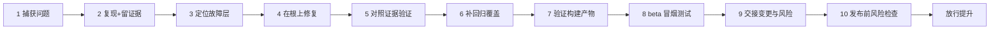
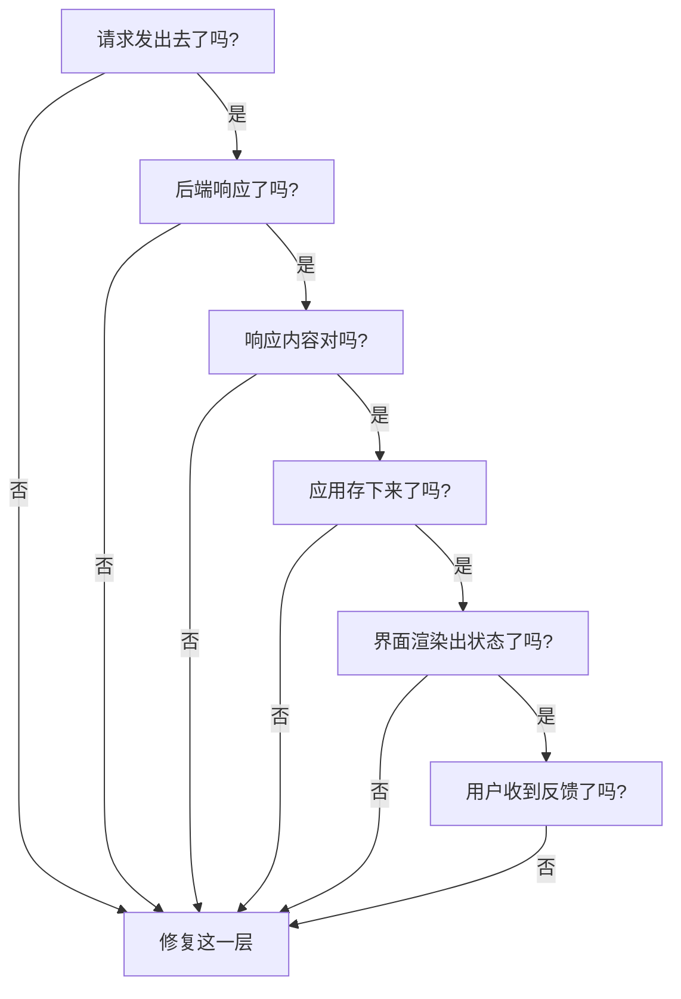

# 找到 bug 只是最轻的一步：一条从 bug 报告到 beta 构建的证据链

测试行业里流传一句很戳人的话：**找到 bug 是最容易被记住的部分，也是工作量最小的部分。**

真正费神、也真正值钱的，是找到之后的那一连串事——证明故障真正出在哪一层、确认修复真的治对了地方、检查即将上线的那个包真把修复装进去了、再带着足够的证据交出去，让别人不用重做就能批准发布。

这句话来自 Julia Pottinger。她在 QA 这行干了十几年，自己还做应用和游戏，这篇文章是她在 2026 年 10 月 20 日发布的，讲一套从 bug 报告一路走到 beta 构建的发布工作流。这篇把它完整翻译过来，再从一个做 AI 和测试的视角聊聊，哪些点适合自己带的团队也补上。


## 全文翻译

### 开篇：bug 报告的重量

找到 bug 是别人记得住的部分。它也是这份工作里最轻的一小部分。

更费劲、更有价值的是后面这些：证明故障真正住哪里、确认修复确实治好了它、检查即将上线的那个构建确实包含了这个修复、再带着足够的证据交出去，让批准发布的人不用重做你做过的事。

第四步最容易悄悄咬到团队。你在自己机器上验证过的构建，常常并不是真正上线的那个东西，所以你在 debug 构建上签字放行的修复，实际上还没被任何人真正验证过。

这是 Julia 最在意的一段 QA 工作，因为它决定一个版本是靠证据发出去，还是靠烧香碰运气。一个停在"我找到了"的测试员，只做了这份工作的一小部分。能把团队往前推的版本，是"我找到了、我们弄懂了、我们修对了层、我在要上线的那个包里验证过、这里有签字的证据"。

这件事现在比以前更关键。团队发版更快，还越来越依赖 AI 来起草代码、测试甚至 bug 报告。2024 年的 DORA 软件交付状态报告发现：AI 采纳提升了个人产出，却把软件交付的稳定性和吞吐量拖了下来。**没有判断的速度，只是更快地瞎猜。**下面的工作流保留了速度，补上了证据。

### 工作流的形状

一条 bug 报告和一条 beta 构建，是同一条线的两头，不是两件分开的活。每一站都有一个任务、留一份证据，证据不存在就不进下一站。



| 阶段 | 任务 | 留下的证据 |
|---|---|---|
| 报告 | 把问题捕获下来，让下一个人冷启动就能上手 | 带步骤、预期与实际、环境、附件的 bug 报告 |
| 复现 | 证明故障以可重跑的形式存在 | 一个失败的测试、录屏、日志、查询结果或 trace |
| 定位 | 找到故障真正发生的层，而不是它表现出来的层 | 一个具名的层（请求、后端、响应、存储、渲染、反馈） |
| 修复 | 改根因，不改症状 | 一个限定在故障层的 diff |
| 验证 | 以当初捕获它的方式，确认那个故障消失了 | 修复后证据与修复前证据一一对应 |
| 防护 | 留下覆盖，让 bug 没法悄悄回来 | 一个对层的测试、约束、告警或检查清单项 |
| 构建 | 确认要上线的产物确实含修复 | 对产物的版本、构建号、签名、配置检查 |
| 冒烟 | 跑一遍真实测试员会拿到的那种 beta | 在安装版构建上做一轮简短构建验证 |
| 交接 | 把放行人需要的一切交给他 | 一份交接说明：改了什么、测了什么、风险、建议 |
| 发布风险 | 在提升前对整个构建按下暂停 | 风险检查：回滚路径、可观测性、负责人、被点名的缺口 |

### 第一步：把问题捕获清楚

一份好的 bug 报告，**让下一步变得明摆着**。

如果开发读你的报告就知道去哪找、不用追问三个问题，那就写成了。要是他还要问"什么设备"或"登录的是什么角色"，这份报告就让团队白花了一天。

怎么写一份开发能冷启动就动手的报告——步骤、环境、预期与实际、严重度、证据——本身就是一门手艺。Julia 在一篇讲"怎么写 bug 报告并分流缺陷"的文章里给了完整骨架和可复制的模板，还有个引导式工具，把每个字段带着填一遍。

对发布工作流，要强调的就一件事：**证据**。一份没有证据的报告，逼着下一个人从头再造一遍故障；修一个没人能复现的 bug，就是带着代码的瞎猜。

### 第二步：动修复之前，先复现

如果复现不了，**直接说清楚**，并把试过什么如实记下来：设备、数据、步骤。

一句诚实的"我在三台设备、这几个账号下都没复现出来"是真信息。它告诉团队这 bug 是偶发、环境相关、还是已经没了，这会改变他们对待它的方式。

能复现时，**在一行代码改动前先把证据抓下来**。这是赶工时大家最爱跳的一步，跳过的结果，就是团队凭希望接受一个修复。取决于 bug 类型，修复前证据可能是：一个失败的自动化测试、一段坏流程的录屏、出错那一刻的日志窗口、显示坏状态的数据查询结果、失败请求的网络 trace、一条控制台报错、一张截图对比。

要点：把"坏了"具体什么样，落成一个能重跑的形式，这样检查修复时比对的是具体东西，而不是"当时感觉好像"的记忆。

### 第三步：找到故障真正发生的那一层

大多数 bug 在界面上露出来，**但很多根本不在那里开始**。一个永不停转的转圈动画，可能是前端状态 bug、后端超时、缺了重试、权限失败、API 返回的数据形状和应用预期不匹配、缓存过期、或测试环境永远没有的坏生产数据。

把这些全压平成"页面坏了"，等于把开发指到错误的文件，修复也就落进了错误的地方。

所以动手修之前先把层分开。沿着请求从"点击那一下"走到"屏幕上那个像素"，在每一站问一个能不能答得上来的是非题：



遇到的第一个"否"，就是要修的那一层，它**通常不是症状出现的地方**。这就是"修 bug"和"给 bug 化妆"的区别。

要是后端返回了畸形响应、你拿界面上的加载保护去"修"，转圈停是停了，真正的缺陷照常发出去。Julia 在另一篇讲数据质量 bug 的文章里点过同一条：数据问题经常伪装成界面 bug。

### 第四步：对照原证据验证修复

修完之后，**重跑那条证明 bug 的路径**，用当初捕获它的同一方式检查。

- 故障出现在日志里，就读新日志。
- 是重复行，就跑同一条查询，确认现在只有一行。
- 是真机性能卡顿，就在那台真机上再测一次，而不是在从来不快模拟器上。

别因为代码改了、单测绿了就接受修复。绿的单测只告诉你这个单元符合开发的预期，不告诉你用户能看见的 bug 没了。

**让验证与你捕获的故障对得上，'代码改了'和'问题没了'之间的缺口就合上了。**

Julia 说自己保留一小份验证记录，让验证可重复、而不是凭感觉：

```
FIX VALIDATION（修复验证）
  Bug（bug）:                <指向原始报告的链接>
  Root cause（根因）:        <一行：真正哪一层坏了，怎么坏的>
  How I reproduced before（修复前怎么复现）:  <精确路径 + 修复前证据>
  How I checked after（修复后怎么检查）:      <同一条路径，和当初捕获的方式一致>
  Before evidence（修复前证据）: <trace / 日志 / 查询 / 录屏>
  After evidence（修复后证据）: <同一个产物，现在是干净的>
  Re-tested on（复测环境）:   <设备 / 系统 / 浏览器 / 账号>
  Result（结果）:             <fixed 已修复 / partially fixed 部分修复 / not fixed 未修复>
```

"修复后怎么检查"这一行，必须照抄"修复前怎么复现"。如果 bug 出现在网络 trace 里，证明它没了的唯一方式就是一份干净的网络 trace，而不是开发一句"现在应该没问题了"。

### 第五步：留下一点防护

每个该修的 bug，都该**教给系统一点东西**，让它别悄悄回来。这就是"把质量做进去"而不是"事后测出来"的核心：不是摘掉缺陷，而是让下一个人靠近它时，回归立刻现形。

最省钱的方式是从源头堵住，那是另一门纪律。这里 bug 已经存在了，任务就是确保它回不来。放什么防护，取决于 bug 住在哪一层：

- 逻辑坏了 → 单元测试
- 响应形状或状态码漂移 → API 或契约测试
- 坏数据当初能被写进去 → 数据库约束
- 布局或用户流程坏了 → UI 回归或视觉测试
- 只在真机上出现的故障 → 真机冒烟测试
- 想在用户报告前就在生产里抓到 → 告警或可观测性检查
- 最稳妥的修复是"人记得去看" → 发布清单上的一行

不是每个测试都该自动化，也不是每个 bug 都配一条全链路端到端测试。每个缺陷都硬挂一条，套件就会慢慢变慢、变脆，直到红灯不再传达任何信息、团队干脆不听——那是另一个问题，Julia 在讲 flaky tests 的文章里专门处理过。

对发布工作流，规则就这一条：**把覆盖瞄准真正坏掉的那一层。** 逻辑 bug 配一条快的单元测试，而不是一条十五秒的浏览器测试——后者会先在你的流水线里变黄。

留下的覆盖要小、要稳、要有意义，让它失败时，人们真的会注意。

### 第六步：验证构建产物，而不是只看代码

这一步**把'发布工作流'和'调试过程'分开**，也最常被跳过。

你机器上通过的构建，常常不是上传做 beta 的那个：签名配置不同、环境文件不同、开了代码精简的 release 变体、版本号是旧的。QA 应该清楚交接的究竟是哪个产物，并确认它是对的。

发布这件事让 Julia 在意那些不风光的问题：

- 这是哪个构建？
- 它指向哪个环境？
- 在什么设备上测的？
- 加载了什么数据？
- 修复是在真要上线的那个产物上验证的，还是在开发的 debug 构建上？

这些在计划会上听上去都不吸引人，但每一个都救过一次发布会。屏幕可以看着正常，产物却和你团队测的构建表现不一样。

对移动端发布，要对着产物本身跑构建验证清单：

```
BUILD VERIFICATION（构建验证，跑在真实产物上）
  [ ] 版本名和版本/构建号都升了，且和你预期一致
  [ ] 产物按它要去的渠道正确签名
  [ ] 烧进的是 release 配置，不是 debug 或 staging 环境
  [ ] 后端指向这个渠道该去的环境
  [ ] 崩溃符号/映射到位，生产崩溃回来可读
  [ ] 你检查的这个产物，就是要被上传的那个
```

最后一项**绊倒的团队比该有的多**。

iOS 上，你要跟构建配套的 dSYM 文件（从 App Store Connect 里该构建的元数据拿），否则每条崩溃报告都回来一堆裸内存地址。

Android 上，如果用 Android Gradle 插件 4.1 或更高版本打 App Bundle，Google Play 会直接从 bundle 里取 R8 反混淆映射，但只有这个版本将来的崩溃会被还原，所以映射必须在现在要发的这个产物里。

发布前确认这些，是"可调试的 beta"和"黑箱"的差别。

### 第七步：装上 beta 并冒烟

如果需求是"修好它并出一个 beta"——**导出完成不等于活干完了**。把真实的 beta 构建装起来，就是测试员会拿到的那个，在告诉任何人"它好了"之前先快速冒烟一遍。

ISTQB 术语表把冒烟测试定义为"覆盖组件或系统主要功能的测试套件，以判断是否正常、再开始计划中的测试"，这里的要求正好是这个标准。

不是重跑整个套件，是确认这个构建要不要任何人花时间：

```
BETA SMOKE PASS（beta 冒烟，装在真实安装版上，不是你的开发构建）
  [ ] 应用能启动，过了开屏和登录
  [ ] 核心导航能用，没有明显大毛病
  [ ] 你刚修的那条路径，在这个构建上真的能用
  [ ] 最重要的既有流程还活着（修复没砸到邻居）
  [ ] 启动日志干净，没有立即报错的错误或崩溃
  [ ] 屏幕上的构建号，和你交接的那个对得上
```

最后一项听着琐碎，却真能抓到错。Julia 见过一个"已验证"的 beta，结果发现是昨天的构建——因为传错了产物。从跑着的应用里读版本号只要五秒，却封上了这个洞。

Julia 给出一份真实的修复验证记录长这样（姓名和 ID 已隐去）：

```
Ticket（工单）:    QA-1042  [BE] 针对含特殊字符(. _ + -)邮箱的搜索失败
Severity（严重度）:High（高）
Fix built（修复构建）:   release 2026.06.r2
Validated（验证）:   在 QA 重跑了邮箱搜索套件（正常 / 特殊字符 / 边界用例）
             → 全部通过；补了一条回归检查，防止它悄悄再坏
QA sign-off（QA 签字）: 验证已修复，可放行
```

这一步对有状态和钱的场景最重要：游戏、内购和订阅、以及任何依赖后端环境正确的场景。

### 第八步：交接，让别人不用重做就能批准

交接的时刻，**是你的工作变成别人信心的时刻**，所以又短又具体。放行人单凭你的说明就该能信任它。

"看起来不错"不是交接，它逼着对方把你知道的全重新推一遍。

Julia 站在批准这一侧时，签字放行 beta 前，她要看到的东西精确如下。缺一样就不会批，而是先要：

```
BETA HANDOFF（beta 交接）
  Original bug（原始 bug）:      <指向这份构建要修的报告的链接>
  Reproduction（复现）:          <修复前证据：trace / 日志 / 查询 / 录屏>
  Root cause（根因）:            <一行：真正哪一层坏了，怎么坏的>
  Files / area changed（改动的文件/区域）:<修复碰到的系统部分>
  Tests added/updated（新增/更新的测试）: <留下的回归覆盖，以及在哪跑>
  Build number（构建号）:        <精确产物：版本 + 构建 + 渠道>
  Tested on（测试环境）:         <设备 + 系统，或浏览器 + 版本 + 分辨率>
  Known risks（已知风险）:       <还可能咬到的东西，以及概率>
  NOT tested（未测的）:          <你刻意没覆盖的>
  Recommendation（建议）:        <放 beta / 暂缓 / 带这个条件放>
```

最后三行是大家最容易丢的，却**最有价值**。"已知风险"和"未测的"不是认怂。正是它们让放行人做真决定，而不是盲猜。

一份只列"过了什么"的交接，等于悄悄请放行人默认其余都覆盖了——而那个默认，就是发布会走样的地方。给出证据和缺口，对方能下真决定；藏住缺口，递过去的仍是烧香。

Julia 见过这套纪律被正式化，且真能跑起来。在一家每周发布的零售大平台上，发布不推进，直到一张书面签字调查问卷填好并清空为止。问卷问的都是无聊的事：改了什么、测了什么、在什么上测的、已知风险是什么、有没有退路。

评审的人有疑问，就把团队拉进一个短会问掉；没有，发布会就进入回归。

这和上面的交接是同一个本能，只是放大到整个团队：没有人凭着"看起来不错"批准，大家都是凭答案批准。周更的节奏容不下任何更松的做法，因为一份含糊的交接拖慢的不是这一次发布，是堆在它后面的每一次。

同款交接填好的样子（作者给的示例）：

| 字段 | 示例 |
|---|---|
| 原始 bug | QA-1184：慢网络下结账转圈挂住 |
| 复现 | 前 trace 显示请求超时且没有重试 |
| 根因 | 后端请求没有超时或重试；界面一直等 |
| 改动文件/区域 | 结账网络客户端、重试策略 |
| 新增/更新测试 | 重试路径的 API 测试；结账流程的冒烟步骤 |
| 构建号 | Build 482，版本 3.4.0，TestFlight 渠道 |
| 测试环境 | iPhone 14 / iOS 18 和 Pixel 8 / Android 15 |
| 已知风险 | 极差网络下重试多几秒；可接受 |
| 未测 | 平板布局；结账中途断线再连 |
| 建议 | 把 Build 482 放给外部测试员；离线场景下个迭代再处理 |

### 第九步：点发布前，跑风险检查

交接告诉放行人某个 bug 发生了什么。风险检查是**他们真正要回答的那个更大的问题**：这个构建作为一个整体，放在真人面前安全吗？

这是提升前的一次短暂停顿，抓的是跟你的修复无关、却跟发布翻车有关的事：

```
RELEASE-RISK CHECK（发布风险检查，提升 beta 前）
  [ ] 这个构建里每一个改动都有交代，不止头条修复
  [ ] 没有高风险的东西悄悄搭车（偷偷升的依赖、翻转的开关）
  [ ] 修复没砸到隔壁流程（你查过最明显相邻的那个）
  [ ] 数据和迁移安全：首次启动不跑破坏性操作
  [ ] 有退路：回滚、kill switch、或随时能关的特性开关
  [ ] 可观测性到位：崩溃和关键错误真的能到达你手里
  [ ] 已知风险写在放行人和 on-call 都看得到的地方
  [ ] 有人负责盯着发布后的这个构建，不只是发出去
```

倒数第二行是把"感觉安全"和"真的安全"分开的那条。绿色流水线能让整个团队觉得没事，产品却在悄悄出错，所以发布前 Julia 一直问那个朴素的问题：**发这个，什么会让我们不舒服？**

> 如果答案是"我们不确定修复在不在构建里"，或"我们没有回滚的路"，那不是发布。那是带版本号的瞎猜。

### AI 该在哪、不该在哪

AI 确实能给其中一部分提速。它能把一墙日志概括成可能出错的层、从你的笔记起草一份 bug 报告初稿、补上你漏掉的测试用例、读一个 diff 标出风险部分、帮你起草一份待完善的回归测试。

用得好，它从又慢又机械的步骤里省出时间，让你多花点力气在判断上。

Julia 守的那条线是：**AI 能在各步骤之间移动，但不拥有那条证据链。**

| AI 能 | 你拥有 |
|---|---|
| 建议出故障的层 | 对照真实证据确认它 |
| 起草回归测试 | 决定它是不是测对了东西、是否稳定 |
| 概括发布证据 | 签你的名，表示"这放心发" |

AI **抬高的是你的产出，不是你的判断**，上面那套验证纪律，就是把这些多出来的产出变成一条站得住脚的发布。Julia 在另一篇"QA 是 AI 辅助开发的管控层"里把这个观点讲得更完整——短版本就是：证据链那一截，始终是你自己的。

### 发布的思维

质量工作不只是找 bug。是**一步步把不确定性变成证据**，直到没有任何东西需要猜。bug 报告是第一个被说出口的不确定性，一条能带着信心交接的 beta 构建是最后一个。

所以当有人说"修好它、发个 beta"，让那句话成为工作流的起点，而不是终点。把 bug 一路带到头：复现它、找层、修根、对照捕获的证据验证、留下防护、验证产物、冒烟构建、把风险点名交接出去、提升前跑发布风险检查。

这就是"告诉团队'问题修好了'"和"递给他们一个能凭证据发布、而不是烧香碰运气的版本"之间的差别。

（原文完）

---

## 测试技术视角：这套工作流好在哪

翻译了一遍，把原文的十步摊开，能看出作者真正在做的事不是列流程，而是在给"测试"这个词换一个更重的定义。

**它把测试从"找 bug"，重定义成"让 bug 的存在变得可证明、可验证、可复现、可交接"。**

几个单独想说的点：

**第一，证据链是一条连续的线，不是散点。** 原文里的十步，每一步都产一件"给下一个人看"的东西：报告是给开发的、trace 是给修 bug 的、修复记录是给验证的、交接说明是给放行人的。整条链的逻辑是——每一步都在把上一步的"主观判断"变成客观可回查的产物。这跟质量上常见的"测试报告 = 贴一堆截图"是两种物种。截图是证据的原材料，不是证据本身；证据是"我复现了它、我确认它没了、我在要发的包上确认的"这三件事能被别人独立复核。

**第二，"验证产物、不验证代码"是容易被忽视、却最能救命的一条。** 原文反复强调：你机器上测过的 build，和真上传做 beta 的 build，经常不是同一个。签名配置、环境文件、release 变体开没开代码精简、版本号新旧——任何一环不同，就能让"已修复"变成"没验证"。做过移动端发布的人看到 dSYM 和 R8 映射那两段，应该会点头：崩溃报告变成一堆裸内存地址的痛，经历过一次就忘不掉。这条对团队的实际贡献，是把"我测过了"从口头承诺，变成对特定产物的核对动作。

**第三，交接清单敢写"未测的"，这是被低估的专业。** 大多数交接只报喜，隐藏缺口。原文反着来，把"Known risks"和"NOT tested"当交接里最有价值的三行之二。这背后的判断很对：放行人的责任是做决定，而做决定的前提是想清楚不知道什么。敢于列"没测平板布局"、并给出"下个迭代处理"，比怯生生地说"应该都覆盖了"专业太多。这也是给测试提了个醒——你的价值不只是挡 bug，更是让业务方在知情的前提下做判断。

**第四，把回归防护对准"真正坏掉的层"。** 逻辑 bug 配单测，而不是配一条十五秒的浏览器测试；响应形状漂移配契约测试；坏数据配数据库约束。反例是常见病：团队习惯"每个 bug 都补一条 E2E"，结果套件越来越慢、越来越脆、红灯失去信息量。作者这条"瞄准失效层"的规则，适合贴在任何团队的测试规范第一条。

## 畅谈：它跟 AI 时代的测试有什么关系

看到原文里那句"DORA 报告发现 AI 提升了个人产出、却拖低了交付稳定性和吞吐量"，忍不住多说了几句。这句跟当下很多测试团队的真实处境对得上：AI 写代码快，但没人敢说 AI 写的代码稳；AI 生成的测试绿得快，但没人能保证它测对了该测的东西。

作者给的态度才是关键——**AI 能帮你过流程，但证据链必须是你自己的。**

这话翻译成测试工作的话就是：AI 可以帮你概括一墙日志、起草一份 bug 报告初稿、给你补漏掉的用例、把 release 证据整理成表格。它可以当加速器。但它不该替你回答"这个包能不能发"——因为那需要签名，签名的前提是你真的验证过证据，而不是浏览过 AI 生成的摘要。

这跟圈里常说的"AI 负责把重复、机械、可模板化的部分吃掉，人类负责判断和验收"是同一个东西。区别只在于，判断不是拍脑袋——是要有可回查的证据垫底。AI 时代测试的生存位置，不是跟 AI 比谁产出多，而是比谁能把 AI 的产出变成"敢签字的证据"。谁掌握这条证据链，谁就在 AI 提速的世界里握着那个"稳"的开关。

发散到业务侧：这套工作流不是大厂专属。小团队、慢发布、甚至一个人兼开发和测试的场景，也能只挑三段来用——修前留一份 trace、修后用同一路径验证、交接时写三行已知风险和未测项。成本极低，却直接决定你是凭证据发版，还是碰运气发版。

原文链接：`juliapottinger.com/from-bug-report-to-beta-build-practical-qa-release-workflow/`

#QA #测试 #发布流程 #回归测试 #证据链 #质量保障 #敏捷开发 #AI辅助开发