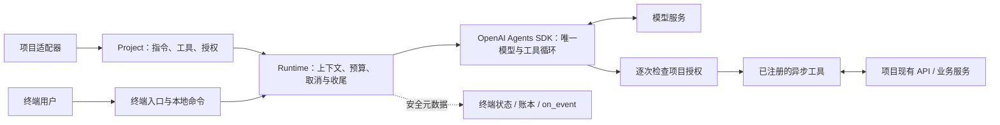
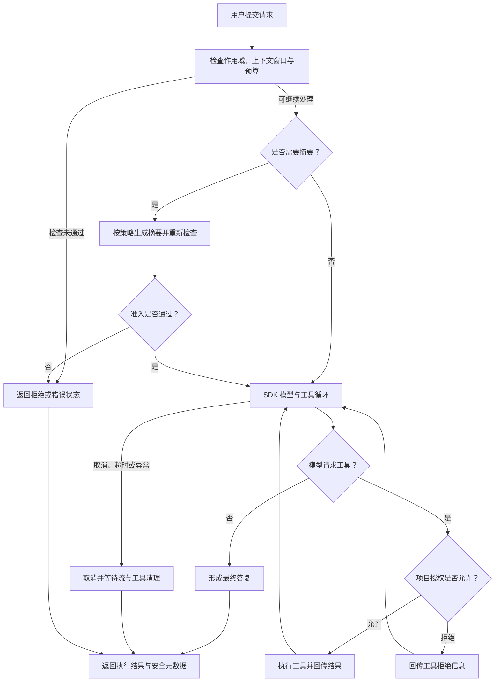

# Agent Entry CLI 解读：给现有 Python 项目一个主 Agent 终端入口

一个已有的 Python 项目，往往已经具备知识检索、评测、状态查询或其他业务服务。想给它接一个能对话的 Agent，通常要做的事是：把这些服务组织成可调用的工具，再处理连续提问、取消、上下文压缩、授权与执行记录。每个项目都各自实现一遍这套终端和会话管理，代码重复，还容易把交互逻辑跟业务规则耦合在一起。

**Agent Entry CLI 的定位，就是把这类通用入口能力拆成独立 Python 包，让项目继续拥有自己的业务实现和权限判断。** 项目负责提供根目录、指令、异步工具和授权回调；库负责终端、会话生命周期和安全执行元数据。多个项目可以复用同一个入口，各自保留不同的工具和规则。

## 它的"独立"指的是什么

"独立"不是指离群索居，而是业务解耦 + 入口可复用，具体落在三件事上：

- **业务独立：** 包不导入特定应用的 Core，不把评测、知识库或运维平台的流程固化成公共 API。示例适配器可以调用原应用，正式业务状态和审批仍由原应用负责。
- **入口可嵌入：** 既能跑 `agent-entry --plugin ...`，也能在自有 Python 程序里调用 `run_cli(project)`；需要无界面执行时用 `Runtime`。
- **职责明确：** 模型/工具循环复用 OpenAI Agents SDK；本库负责项目接入、上下文准入、取消收尾和元数据展示；项目负责真实业务操作、权限、幂等与结果核实。

当前是 Alpha 阶段，首个后端依赖 OpenAI Agents SDK，模型服务需要单独配置。下面这张表能一眼看清"项目自己管什么、这个包给什么"：

| 接入任务 | 项目通常需要自行处理 | 本包提供 |
|---|---|---|
| 启动项目主助手 | 终端输入、输出和命令处理 | 感知项目的终端与可嵌入入口 |
| 持续多轮对话 | 窗口检查、摘要、恢复和用量跟踪 | 统一生命周期与显式摘要检查点 |
| 添加业务工具 | 把服务 API 暴露给模型，并核对业务权限 | 异步 `Tool` 与逐次调用的项目授权回调 |
| 处理中断和后续输入 | 流清理、队列、失败后的状态恢复 | 取消收尾、暂停队列与明确的执行状态 |
| 排查 Agent 执行 | 对应模型调用、工具阶段、上下文和用量 | 带执行 ID 的元数据、状态展示与 `on_event` 回调 |

协作方式是这样的：



项目适配器负责连接真实业务与权限；本库负责入口与生命周期；SDK 负责模型与工具循环。`on_event` 是项目接出观测数据的接口，目前还没内置外部观测平台。

## 和 Codex、Pi、OpenCode、Claude Code 有什么区别

要先把比较的前提说清楚：下面的对比聚焦**产品定位、接入方式和项目需要承担的职责**，不是模型能力、速度或安全性的排名。这里的 Pi 指 Pi Agent harness，Claude 指 Claude Code，都不是普通聊天产品。外部能力依据 2026-10-24 查阅的官方资料，具体接口以所用版本为准。

| 工具 | 主要定位 | 扩展与程序化接入 | 更适合的需求 |
|---|---|---|---|
| Codex CLI | 面向软件开发的 Agent，可检查代码、修改文件和运行命令 | Codex SDK / App Server、非交互执行，以及扩展能力 | 直接开展代码开发、审查和工程自动化；需要复用 Codex harness 构建应用 |
| Pi | 精简、可扩展的终端 Agent harness | 扩展、Skills、提示模板、交互/JSON/RPC 及 TypeScript SDK | 希望在可定制 harness 上组织自己的 Agent 工作流 |
| OpenCode | 开源 AI 编程 Agent，提供终端等使用入口 | 自定义工具、MCP、权限配置及 JS/TS SDK | 使用已有编程工具链，并通过 OpenCode 的服务和扩展接口集成 |
| **Agent Entry CLI** | **为现有 Python 项目提供终端主助手入口** | `Project`、异步 `Tool`、`authorize`、`run_cli`、`Runtime`、显式 Python 插件 | 已有业务服务和规则，希望直接注册 Python 函数，并复用一套范围明确的终端与会话控制 |

这些工具都能做自定义集成，尤其 Pi 已提供可嵌入 SDK，Codex、OpenCode 和 Claude Code 也提供程序化入口；"能接业务工具"和"能嵌入应用"不是这个项目的独有能力。它通过 OpenAI Agents SDK 接模型服务，运行时不封装、不启动那几家的 CLI，也不依赖它们的 SDK。

它的具体选择是：**把已有 Python 业务函数作为工具入口，把项目授权回调作为逐次业务检查的入口，终端随库一起复用。** 如果你的目标是复用某个现成 harness 的工具生态和执行能力，那几家的官方 SDK 或扩展机制也应该纳入选型。

### 设计取舍

| 维度 | Agent Entry CLI 的当前做法 | 对使用者的影响 |
|---|---|---|
| 默认操作能力 | 默认纯聊天；业务工具显式注册，没有内置文件编辑或 shell 工具 | 需要项目自己提供可执行能力，安装后不会自动成为编程助手 |
| 集成边界 | 可信 Python 插件或进程内 `Project`；不自动发现并执行项目插件 | 可直接复用现有 Python 服务；其他语言通常需要自行提供适配 API 或进程隔离 |
| 权限与写操作 | 声明写工具默认拒绝；每次调用都交给项目策略检查 | 适合承接已有业务门禁；仍需项目实现真实鉴权、幂等和外部状态核实 |
| 安全隔离 | 插件与宿主进程共享用户权限，只读声明不构成沙箱 | 需要隔离时应另选经过验证的沙箱、容器或操作系统方案；不可信代码需单独处理 |
| Loop 与 Harness | SDK 拥有唯一模型/工具循环，本库增加预算、取消、清理与日志约束 | 避免业务项目分别实现终端循环；仍受 SDK 和插件取消协作能力的约束 |
| 上下文与恢复 | 指令、工具 schema、历史和预留共同参与窗口判断；显式保存摘要并校验项目作用域 | 可保留任务目标和约束；检查点不等于完整对话回放，也不能恢复工具授权 |
| 可观测性 | 展示阶段、循环次数、耗时、工具状态和已知/未知用量；提供元数据回调 | 方便项目侧排查和对接观察系统；没有内置完整遥测平台或计费系统，私有推理不进入界面/日志 |
| 模型与协议 | 当前使用 OpenAI Agents SDK 的 Chat Completions / Responses 后端 | 兼容端点需要实际验证；不能把可填写模型名理解为已适配所有供应商 |
| 产品完整度 | 当前提供本地终端、单次请求和嵌入式接口 | 没有内置 IDE、云端任务平台、多 Agent 调度、MCP 客户端或 Skills 加载体系 |
| 成本与维护 | 复用库的通用交互能力；模型调用和业务适配仍由项目承担 | 需要维护插件、权限策略、回归与供应商兼容；不承诺更低 token、价格或更高性能 |

选自建入口，就要接受相应的维护责任。它的价值在于让业务划分与 Python 集成方式更贴合项目，而不是替你把所有工程工作都做完。

## 能用来做什么

| 场景 | 交互示例 | 仓库支持情况与项目职责 |
|---|---|---|
| 知识查询助手 | "查找部署时间窗口，并给出笔记文件与行号。" | 提供只读笔记搜索示例，执行有范围限制的查询；真实知识源与访问控制由项目接入 |
| 评测流程助手 | "查看这个评测工作区目前处于哪个阶段。" | 只调用已安装 CLI 查询状态；不代为审批或执行评测 |
| 运维/服务状态助手 | "查询服务健康状态，说明哪些检查未通过。" | 可通过异步工具连接现有只读 API；实际监控、工单和运维系统尚未内置 |
| 受控业务操作入口 | "在项目规则允许的条件下执行某项操作。" | 可注册 `side_effect=True` 的工具并提供 `authorize`；业务鉴权、确认、幂等、补偿和审计需项目实现，不提供通用审批 UI |
| Agent 行为与接入验证 | "观察工具循环、取消、上下文压缩和用量缺口。" | 可用 `Runtime`、执行账本和 `on_event` 验证协议及生命周期；业务效果、数据集、Oracle/Judge 与评测报告需另外建设 |

表中"可接入"表示接口支持该用途，不表示已经交付对应的业务系统。

## 什么时候选它

- **已经有 Python 服务、领域工具和业务规则，缺一个统一的对话入口：** 可以考虑它，让原项目继续负责业务和授权。
- **主要需求是写代码、改文件、跑工程命令或审查仓库：** 优先评估 Codex、Pi、OpenCode、Claude Code 等现成工具，它们已经有对应的工作流。
- **需要深度复用某个成熟 harness 的会话、工具和生态：** 先评估其官方 SDK、RPC 或服务端接口，再决定是否要另建入口。
- **需要不可信代码隔离、完整 IDE/云端产品、多 Agent 调度或统一观测平台：** 当前它不能独立满足，需要选已有方案或额外建设。

它也可以跟编程 Agent 配合：用现成工具做开发调试，用它承载项目自身的业务助手。两种入口各自遵循实际注册的工具与项目权限。

## 一次请求怎么执行



回到 SDK 的箭头代表同一个内层循环。终端可以排队下一条请求；失败或取消后队列暂停，清理未完成时禁止新模型轮次。默认无策略时只允许已声明的读工具，写工具拒绝；配置策略后，每次读写调用都检查策略。未知的写结果由项目核实，不自动重放。

## 接入一个项目

推荐先接通只读工具，再接业务写操作。一个完整的最小插件长这样，保存为业务项目根目录的 `project_agent.py`：

```python
from pathlib import Path
from agent_entry_cli import Project, Tool

def build_project(root: Path) -> Project:
    async def project_info() -> str:
        """返回当前绑定项目的目录名称，不读取文件正文。"""
        return f"当前项目：{root.name}"

    return Project(
        root=root,
        instructions="你是项目主助手。需要项目事实时调用工具，并说明证据来源。",
        tools=(Tool(project_info),),
        commands={"project-info": lambda: f"当前项目：{root.name}"},
    )
```

在业务项目已有的 uv 环境中添加本地包，再按序做四件事：用 `/tools` 核对工具声明、`/context` 核对窗口、`/project-info` 检查本地接入、最后提问"调用工具告诉我当前项目名称"。前三项只验证本地接入，最后一项才验证真实模型调用工具。实际模型兼容性和业务正确性需要各自验收。


插件只会通过 `--plugin` 显式加载，不会有隐式自动加载。也可以用 `run_cli(project)` 嵌入自有程序，或用 `Runtime` 接入无界面的任务服务。

## 安全与使用边界，记住四条

1. **插件是可信代码，不是沙箱。** 声明只读并不能证明它实际只读；需要隔离时另选经过验证的沙箱、容器或操作系统方案。
2. **异步工具必须配合取消。** 不配合的代码可能阻止进程退出；终端保留同一个事件循环，可显示中断结果，并在清理未完成时阻止新的模型轮次。
3. **默认只在内存里存原始聊天。** 显式摘要采用尽力脱敏，不是完整的数据防泄漏系统；恢复的摘要不会授权工具，也不会重放写操作，未知写操作需由项目侧核实。
4. **用量上限在供应商响应后结算，可能超额。** 它不构成计费保证。

这套东西最打动人的一点，是它把"给项目接 Agent"从每个项目各造一套轮子，收敛成一份范围明确的终端与会话控制；真正的业务、权限、证据判断，仍然留在项目手里。对一个已经有一套 Python 业务服务的团队来说，这可能正是从"能聊"走到"能干活"中间缺的那一格。

## 标签

`#Agent` `#Python` `#CLI` `#开源项目解读` `#OpenAI-Agents-SDK` `#会话控制` `#工具链` `#技术解读`