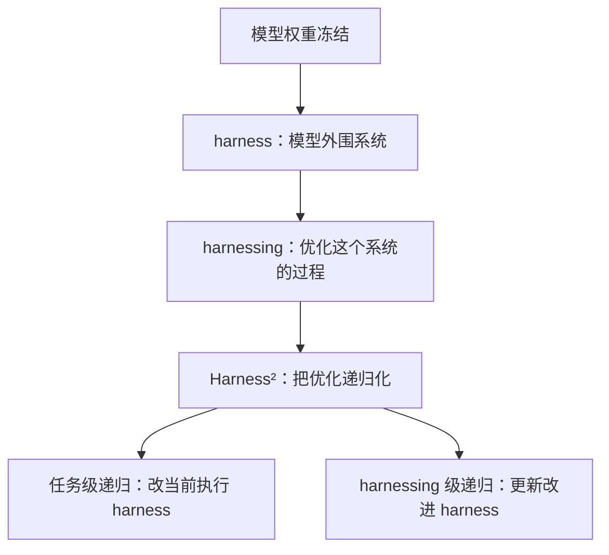
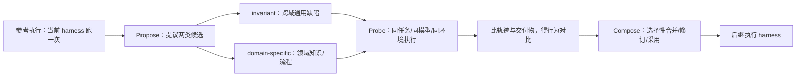

# Harness² 解读：让 Agent 的 harness 递归地改进自己

模型权重冻结，但把模型外面那层"让它能干活"的系统——提示词、工具、记忆、技能、子代理——在测试时递归地改到更好。这是 Google Research 的开源项目 **Harness²**（论文 arXiv:2610.14224，仓库 `google-research/harness2`）做的事。它不训练模型，不喂标注答案，只用行为对比决定改不改 harness，改完还把经验存下来指导下一次改进。

先给落点：**Harness² 是把"优化 Agent 外围系统"这件事本身做成递归的框架。** 仓库 Apache 2.0、Python 实现，当前约 19.6k stars / 1.9k forks。下面只摆 README 和论文里能核实的东西。

## 先分清三个词，别被名字误导

"harness2 vs harness"这个问题，如果当成"官方有一个 v1 产品，Harness² 是它的 v2"，就错了。Google 侧没有名为 `google-research/harness` 的仓库（HTTP 404），文章里也没有"上一代产品"的说法。官方仓库就叫 harness2。正确的对比语义分两层：

**概念层：harness / harnessing / Harness²。** README 第一句原话区分了两个概念：

> A harness is the system around a model ... Harnessing is the process of optimizing that system.

- **harness**：模型周围让它能当 Agent 行动的系统（prompts、tools、memory、skills、orchestration）。
- **harnessing**：优化这个系统的过程。
- **Harness²**：把 harnessing 变成**递归**的——既改当前任务的执行 harness，又从改进过程里抽出经验，反过来让下一次改进更聪明。

**可测层：base harness vs Harness² 改进后的 harness。** 论文里"base harness"指 stock 配置：在 OpenCode 下是组件树，在 Codex 下是 AGENTS.md，常驻文件里除了基准指令全是空的，按需组件目录里只有一个"命名了这个杠杆"的占位文件。Harness² 在测试时递归改造它。论文用这个对比产出量化数字（见后文）。

## 它对付的问题：没有标准答案，怎么判断 harness 改对了

传统评测要么有 ground-truth 标签，要么在训练集上离线搜 harness。Harness² 面对的是 open-world 任务流 `q1...qN`，**没有参考答案、没有标注验证反馈**，每个任务还互不共享执行状态。

它的核心命题是：**在不知道答案对不对的情况下，也能靠"行为对比"判断一个 harness 改动该不该留。** 做法是三个相互咬合的机制：Propose 提议、Probe 探针、Compose 合成，组成一个 contrastive step（论文图 3）。

**Propose**：先让当前 harness 得到一次参考执行 e0——它只暴露"harness 实际怎么行为"，不判断交付物对不对。然后提议两个候选：invariant 候选针对跨域可能复现的 Agent 通病（规划、工具使用、上下文管理、委派）；domain-specific 候选针对领域知识、流程和约束。

**Probe**：在**匹配条件**下执行候选——同一任务、同一模型、同一环境——把候选的轨迹和交付物跟参考执行对比，得出 behavioral contrast。这就是它的"验证信号"。

**Compose**：有证据支持的改动才被选择性合并、修订或被采纳；每个决策都绑在具体观察上。关键在论文里写得很直白：**它无 ground-truth，用 contrastive behavioral contrast，而不是标签**——这是它区别于 AHE（离线 harness 演进）的第一分界线。

## 递归的两个挡位：并行和串行

任务级递归用预算 `k` 控制探索多少：

- **并行递归**：k 次参考执行 → k 组 invariant + k 组 domain 候选分别 probe → k 个独立 compose 会话。`k` 控制**宽度**。k>1 时一个 agentic selector 对比匿名交付物挑一个提交（不接触它们各自的 harness，也不合成新内容）；k=1 时退化成单步 contrastive step，跳过选择。
- **串行递归**：k 步 chained contrastive steps，每步携带前一步的 harness 和累积证据。`k` 控制**深度**。

论文图 5 给的效果：并行递归在 WB-code 从 k=1 的 76.5 升到 k=5 的 80.8，WB-office 从 79.5 到 83.4。对比之下 ReasoningBank 和 Harness Scaling 的增益更小或不一致——Harness Scaling 在 k=2 到 k=3 时两个域都下降。**Harness² 两种递归在 k=2 时，都超过所有基线在 k=5 时的表现。** 也就是说，不是因为"探索次数多"才赢，而是机制本身更有效。

## 第二层递归：改进 harness 积累经验

任务级递归只改了当前任务的执行 harness。**harnessing 级递归**在任务结束后干两件事：

1. **反思改进过程**：把完整改进记录（参考执行、候选 harness、probe、compose 决策、选中结果）拿出来，抽"哪些改动解决了哪些缺陷、在什么条件下、带来什么后果"的教训。
2. **更新改进 harness**：把采纳的 harness 和**有证据支撑**的教训存进 harness improvement library（带索引）。教训只在被行为对比支持时保留——"选了个输出"本身不足以证明可迁移。`EXPERIENCE.md` 记录情境/教训/证据 + 可执行 harness。

跨任务的关键设计：**下一任务仍然从公共执行 harness ℋ0 开始，但由更新后的改进 harness 引导。** 所以经验不污染执行路径，只让"怎么改"越来越准。

## 八个可编辑组件 + 命令行速查

执行 harness 沿用 AHE 的文件级分解并 +1，暴露 **8 个组件**，每个组件作为运行时的一个文件挂载：

| 组件 | 运行时角色 | OpenCode 下的形态 |
|---|---|---|
| system prompt | 常驻行为基座 | always-on 文件 |
| guardrails | 行为边界 | always-on 文件 |
| memory | 既有记忆 | always-on 文件 |
| tool guidance | 工具使用说明 | always-on 文件 |
| skills | 按需能力 | 通过 skill 工具按需加载，脚本随行 |
| scripts | 独立脚本 | 通过 shell 运行 |
| subagents | 委派能力 | 通过 task 工具调用 |
| middleware plugin | 工具循环内插件 | TypeScript 插件 |

每个 rollout 上限 200 个模型轮次、3600 秒（WorkBuddy-Bench 用容器超时的两倍），任务之间无记忆。常驻文件在 stock 配置里是空的，占位文件的作用就是让编辑器"发现这里有个杠杆"。

仓库 CLI 是一次一个基准的流水线：

| 命令 | 作用 |
|---|---|
| `harness2-setup <bench>` | 配置某个基准 |
| `harness2-check --bench <bench>` | 校验运行环境 |
| `harness2 --bench <bench> --k 1 --mode parallel ...` | 跑改进 + 执行（`--k` 预算、`--mode parallel|sequential`） |
| `harness2 --substrate cx` | 用 Codex 当执行器（默认 OpenCode） |
| `harness2 --dry-run` | 只预览不改动 |
| `harness2-judge` | 打分 |
| `harness2-report` | 出报告 |

本地没有凭据也能试：`harness2-demo --output runs/demo --k 2`。安装：Linux + Python 3.12 + uv，`uv pip install -e '.[render]'`。

## 数据：一个改进步，弱模型反超强模型

论文在 WorkBuddy-Bench / JobBench / LAB（Harvey 法律基准）上，用 GLM-5 与 Gemini 3.5 Flash × OpenCode 与 Codex 共 4 个 executor–harness 配置评测：

- **单步改进在全部 3 个基准、全部 4 个配置里都提升**：最高 GLM-5 在 WorkBuddy +11.5 点、JobBench +4.5 点、LAB Partial +11.8 个百分点（引言 Fig.1）。
- **并行递归 k=5 再额外 +3.9 (WB) / +4.2 (JobBench) / +6.7 pp (LAB Partial)**。
- **弱模型反超强模型**：单步把 GLM-5 抬到 WorkBuddy OpenCode 75.7 / Codex 75.3，超过 Gemini base 的 72.4 / 74.5。一个更弱的模型配上改进过的 harness，可以打过一个更强模型的原始 harness。
- **基线胜负**：ReasoningBank 在 coding 任务上最多比 base 低 6.6 点；Harness Scaling 在 12 个 benchmark–configuration 对里有 7 个不如 base；Harness² 在 WorkBuddy Avg. 和 JobBench Score 的所有 4 个配置都超过所有基线；只有 LAB Partial 下，Meta-Harness 在 Gemini+Codex 配置领先。

**Ablation（Gemini 3.5 Flash / OpenCode / k=1）**，三个组件各有贡献：

| 去掉的组件 | WorkBuddy 掉分 | JobBench 掉分 |
|---|---|---|
| library（经验库） | 3.1 | 1.8 |
| scoping（分角色编辑器） | 2.9 | 3.7 |
| composition（合成） | 1.6 | 1.9 |

"scoping"掉的分比 library 还高：**把 invariant/domain 两个分角色编辑器换成两个通用编辑器**，候选数量、证据、预算全不变，只是没人按指定 scope 读轨迹——结果掉 2.9/3.7。这说明"让编辑器针对性看轨迹"不是装饰，是机制本身。

## 落点与限制

能做什么：不训练、不改权重、无 ground-truth，即可在测试时把一个任务的开环 harness 递归改进到可用，并把经验跨任务复用。仓库完全开源、可本地 demo。它的设计重心是把"模型能力外的工程"从手写改成自动演进。

不能做什么（论文 Appendix F 写得明确）：递归改进要额外执行和编辑器会话，`k` 越大推理成本越高——并行只能降延迟，消不掉额外计算；论文只刻画了有限预算内的 trade-off，没给出全局最优分配。行为对比和模型判断**不保证正确**，也不保证改动跨任务迁移；它对执行波动和共享模型偏差敏感。

落到收束：**Harness² 把"Agent 好不好用"从模型权重问题重构成"外围 harness 问题"，再用行为对比 + 两层递归把这层外围系统自动化。** 对做 Agent 基建的团队，它给的是"模型冻结也能持续进步"的一条可落线路。

仓库地址：<https://github.com/google-research/harness2>；论文：<https://arxiv.org/abs/2610.14224>。

`#Harness` `#递归自改进` `#Agent工程` `#google-research` `#开源项目解读` `#论文解读` `#技术解读`