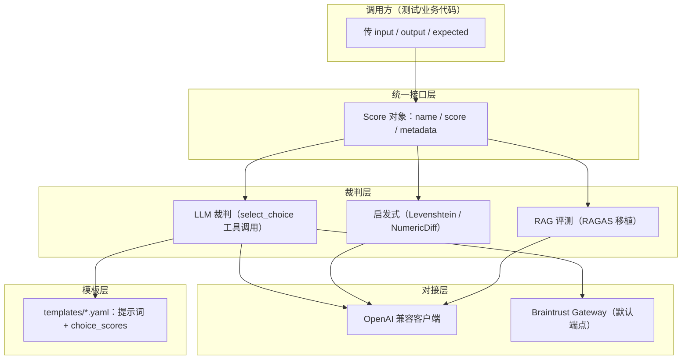
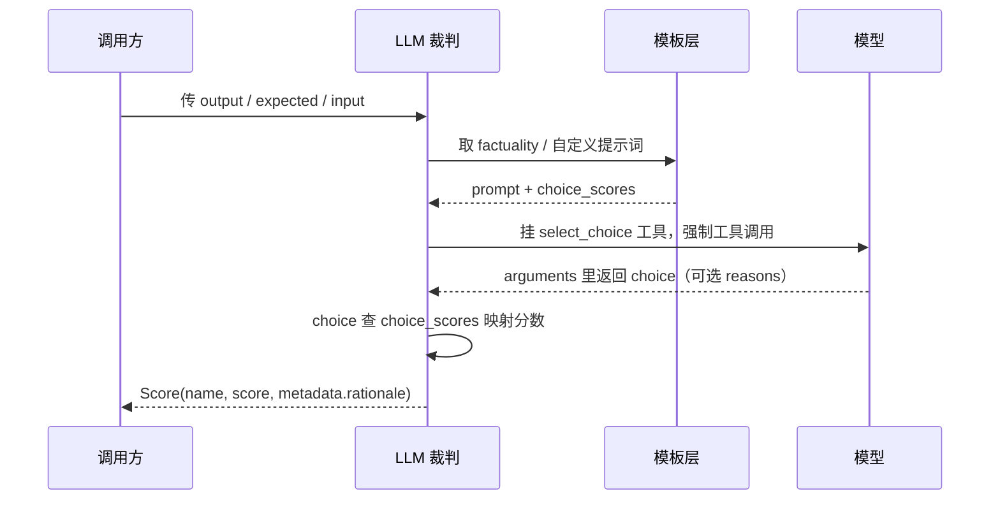

# autoevals 解读：把 AI 输出的评分做成一条 0 到 1 的流水线

测一个 AI 输出，最麻烦的不是"叫一个大模型来打分"，而是打分结果怎么落地：同样一个答案，不同评测方法给的分能不能互相比较？模型判出来的分怎么解析？出错了能不能一条一条调？`braintrustdata/autoevals` 这个仓库，把这些杂事统一到了一个"传入 `input` / `output` / `expected`，返回一个 0 到 1 的 `Score`"的接口后面。

仓库 MIT 协议，主要语言 Python（同时提供 TypeScript 包，两个包共用一个版本号），当前约 1067 star / 94 fork，版本 0.4.1。下面只摆源码和 README 里能核实的东西。

## 仓库里实际有什么

先给地图，免得一头扎进代码。仓库核心是 `js/` 与 `py/autoevals/` 两套同构实现，外加 `templates/` 里一群评测提示词模板：

| 职责 | 真实位置 | 对应测试语境 |
|---|---|---|
| 评测结果统一对象 | `js/score.ts` / `py/autoevals/score.py` | 断言返回的结构 |
| 模型当裁判（LLM-as-judge） | `js/llm.ts` / `py/autoevals/llm.py` | 主观题人工评审，换成模型 |
| 评测提示词模板 | `templates/*.yaml` | 评审打分标准 |
| 启发式打分 | `js/string.ts`、`number.ts` / `py/autoevals/string.py`、`number.py` | 编辑距离、数值差 |
| RAG 评测 | `js/ragas.ts` / `py/autoevals/ragas.py` | 检索系统的准确/忠实度 |
| 客户端/网关对接 | `js/oai.ts` / `py/autoevals/oai.py` | 依赖注入、接口封装 |

README 把评测方法分成四大类：`LLM-as-a-judge`（事实、安全、翻译、SQL 等）、`RAG`（忠实度、上下文相关度等，从 RAGAS 移植）、`启发式`（Levenshtein、数值差、精确匹配）、`组合`（JSON 校验、列表包含）。这些名字看着多，底层都收敛到同一个 `Score` 接口。

## 它对付的问题：三类"评测落地难"

README 里有一段专门叫"Why does this library exist"，把难点讲得很实，三件事：

1. **归一化难**。不同尺度的指标要压到 0 到 1，这一步最容易出错。`js/number.ts` 的 `NumericDiff` 写得很直白：
   ```ts
   score = output === 0 && expected === 0 ? 1
         : 1 - Math.abs(expected - output) / (Math.abs(expected) + Math.abs(output))
   ```
   两个 0 给满分，否则按相对差归一——分母是两边绝对值之和，分数对"差多少"和"差相对多大"同时敏感。
2. **模型打分结果的解析难**。LLM 输出的格式不稳定，要一条一条 debug、传播错误、调提示词。autoevals 把解析这类脏活收进库内。
3. **统一接口难**。在这套库之前，没有现成方案能让你把同一组 `input`/`output`/`expected` 直接喂给一堆不同的评测方法并逐一对齐结果。

三条其实是一件事：把"评测"从散落的脚本变成可替换、可比较、可排错的组件。

## 核心机制：LLM 裁判通过 `select_choice` 工具调用给出分数

模型当裁判时，autoevals 没有让模型自由发挥输出一个数字，而是强制它走一次**函数调用**。看 `js/llm.ts` 的 `buildClassificationTools`：它给模型挂了一个名为 `select_choice` 的函数，参数是个 `choice` 字段，`enum` 就是本次评测允许的选项；再用 `tool_choice` 强制只许选这个工具。

解析在 `parseResponse` 里（`js/llm.ts`）：拿到工具调用的 `arguments`，取出 `choice`，去 `choiceScores` 这个映射里查分。查不到就抛错——宁可失败也不猜分数。可选 `useCoT` 时，提示词会要求模型先写 `reasons` 再选 `choice`，理由进 `metadata.rationale`，分数照旧取 `choice`。

这套设计的关键在：**分数不是模型直接"说"出来的，而是模型从枚举里"选"出来的**。选项和分数的映射关系写在模板里，可以单独调。看 `templates/factuality.yaml`，事实性评测不是非黑即白，给了部分分：

| 选项 | 含义 | 分数 |
|---|---|---|
| A | 答案是标准答案的子集且一致 | 0.4 |
| B | 答案是标准答案的超集且一致 | 0.6 |
| C | 与标准答案细节完全一致 | 1 |
| D | 与标准答案冲突 | 0 |
| E | 有差异但不影响事实性 | 1 |

也就是说，"答得全但不准"和"准但不全"在事实性上（A/B）拿的是中间分，不是一刀切 0/1。这个把"主观判断题拆成枚举 + 分数映射"的写法，是这套库和普通"让大模型打个分"的分水岭。

## 架构分层：一块积木，两种接线

从代码看，它是典型的"核心尽量薄、接口尽量齐"结构，分层清楚：



四层各管一件事：对接层决定"打哪个模型、走哪条路"，模板层决定"怎么问、选项怎么算分"，裁判层决定"用模型还是用规则"，接口层保证"返回的东西能直接存、能互相比"。

依赖方向是单向的：对接层在底层，模板层只被 LLM 裁判引用，裁判层只向上返回 `Score`，接口层不反向依赖任何裁判。换裁判不碰接口，换模型不碰模板。

完整走一遍 LLM 裁判的闭环：



## 落点与前提

autoevals 的取舍很清楚：它不做评测编排，不管理数据集，只负责"给一条输出打分"这一件事。要跑回归、要对比多轮结果，需要配合它公司的 Braintrust SDK（`Eval` 的 `scores=[Factuality]`）或自己拼流程。

几处限制先摆出来：

- **默认走 Braintrust Gateway**。README 写明，没设 `OPENAI_BASE_URL` 就查 `BRAINTRUST_AI_GATEWAY_URL`，再不行回落到 `https://gateway.braintrust.dev`。公网默认端点意味着默认行为依赖外部网关，离线或想完全自控时得显式注入自己的 OpenAI 兼容客户端。
- **LLM 裁判要联网、要跑模型**。主观题清单发一次请求，跑起来有 token 成本，不是"白嫖"的规则断言。
- **默认模型是 `gpt-5-mini`**（README 与 `oai.ts` 文档均如此声明），想换模型要显式传 `model` 或 `init({ defaultModel })`。
- **提示词解析失败宁可抛错**。`parseResponse` 遇到未知 `choice` 直接报 `Unknown score choice`，不会偷偷给 0 分糊过去——对排错是好习惯，但要求模板和模型行为都稳定。

对测试开发而言，这套库的参考价值不只在"拿来打分"，更在于它把两件事做成了工程：一是**把 LLM 裁判的结果降维成受控的函数调用**，杜绝自由文本解析；二是**把分数定义从代码里抽到 YAML 模板**，评审标准改起来不用动逻辑。如果确实接受 Braintrust 生态、或愿意自己注入客户端，`pip install autoevals` 就能把"模型主观题评分"接进现有评测脚本。

仓库地址：<https://github.com/braintrustdata/autoevals>