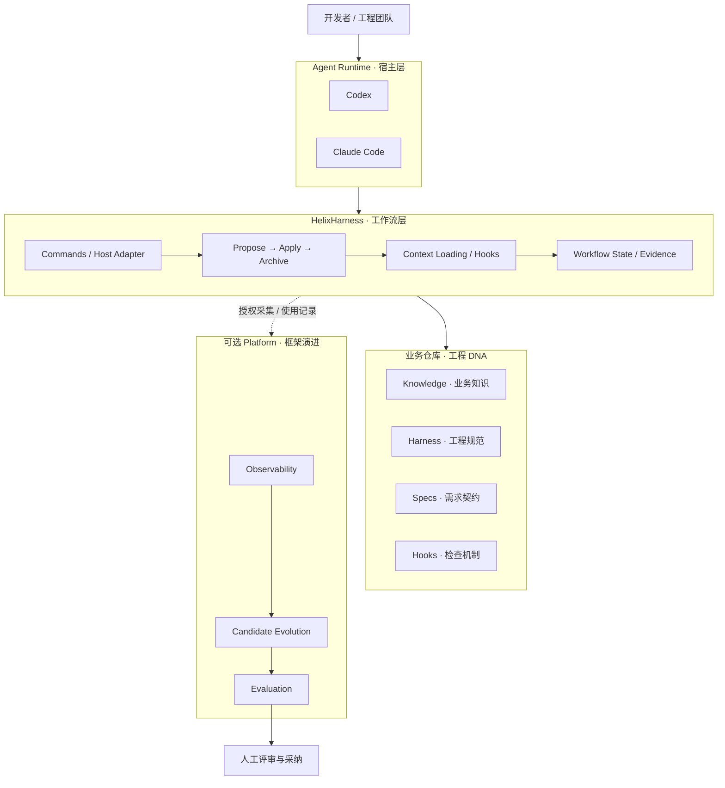
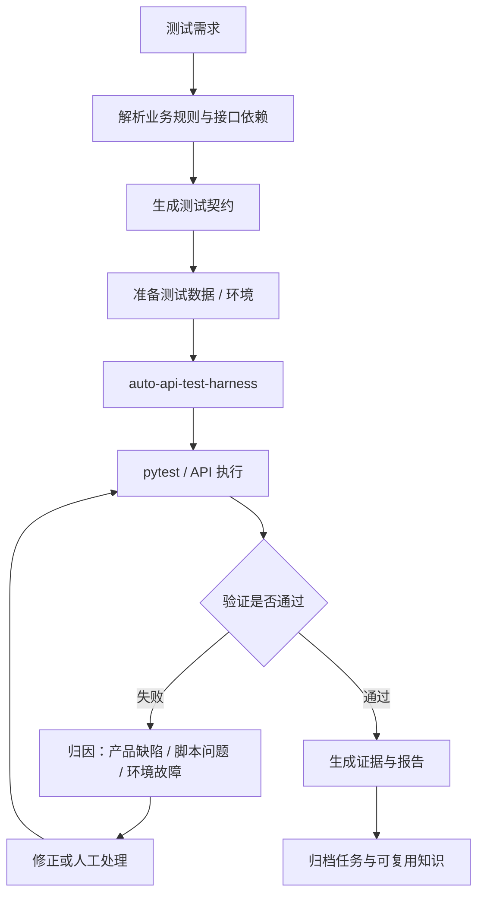
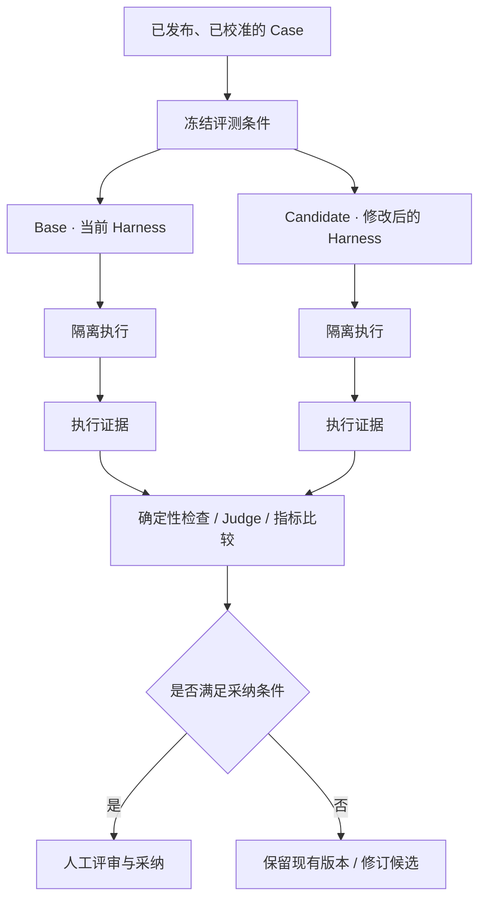

# HelixHarness：滴滴开源了一套 AI Coding Harness，Agent 研发开始有了工程规范和质量闭环

> 开源项目技术解读 · 架构分析 · Agent 工程化 · QAT CLI 设计参考

最近，滴滴开源了 [HelixHarness](https://github.com/didi/helixharness)。

这个项目并不是又一个替代 Codex、Claude Code 的 Coding Agent，也不是单纯的提示词或 Skills 集合。

它解决的是另一个问题：**当 Coding Agent 已经具备写代码、运行命令、修改文件的能力，怎样让它遵守团队的工程规范，按照既定流程完成研发，并且留下可验证、可复用的结果？**

HelixHarness 给出的方案，是在现有 Coding Agent 之上建立一套项目级 Harness，把业务知识、工程约束、需求契约、检查机制和经验归档串联起来。

根据官方 README，项目提供九个公开命令，支持 Codex 和 Claude Code，覆盖单仓库与多仓库研发，还提供独立的框架观测、版本评测和受控自进化平台。

## 一、HelixHarness 究竟是什么？

要理解它，先区分三个概念。

| 概念 | 负责什么 | 典型例子 |
|---|---|---|
| Agent Runtime | 模型调用、对话、工具执行、上下文与会话 | Pi、Codex、Claude Code |
| Agent Harness | 约束、工作流、任务状态、质量检查、完成标准 | HelixHarness |
| 业务能力层 | 具体业务逻辑与专业工具 | API 测试、知识检索、Agent 评测 |

Runtime 决定 Agent 能不能干活，Harness 决定 Agent 应该怎样干活、做到什么程度才算完成。

以接口测试为例。普通 Coding Agent 接到“帮忙测试用户注册接口”，可能直接读取接口文档、生成测试代码，再运行一次 pytest。

但是测试工程真正需要处理的远不止这些：接口是否存在上下游依赖？登录态从哪里获取？已有框架采用什么数据驱动规范？测试环境是否允许写入？哪些异常码必须覆盖？测试执行失败以后如何定位？没有通过的用例能否计入已完成？

这些问题不应该每次都依赖一段临时 Prompt。

HelixHarness 的设计思路，是把此类规则存放在项目仓库中，通过索引和工作流，让 Agent 在合适的阶段加载并执行。

这也是 Harness 与普通 Skills 集合的重要区别：前者不仅告诉 Agent 有哪些能力，还定义使用这些能力的条件、顺序、约束和验收要求。

## 二、项目架构：插件与平台相互独立

HelixHarness 的仓库主要分为两个子项目：

- `helixharness/`：面向开发者，承载 Agent 插件、命令、宿主适配和运行时测试。
- `helixharness-platform/`：面向框架维护者，承载观测、版本评测及受控的框架改进能力。

除此之外，还有 `examples/` 和 `docs/`，用于提供示例项目、验收要求、配置和工作流文档。

根据公开文档整理的逻辑架构：



这张架构图有三个需要注意的地方。

**第一，HelixHarness 不负责替代底层 Agent Runtime。** 模型调用、工具执行、交互界面仍由 Codex 或 Claude Code 这样的宿主提供。它主要增强的是宿主之上的工程行为。

**第二，插件运行不依赖平台。** 即使没有部署 Web 服务，开发者也可以使用 Propose、Apply、Archive 完成工作流。平台离线或没有配置数据上报，不应阻断正常研发。

**第三，平台的评测对象是 Harness 本身。** 它关注修改工作流、命令、上下文策略以后，Agent 的工程行为是否改善，而非直接充当通用业务代码评分平台。

## 三、核心机制：从需求到归档的三阶段工作流

HelixHarness 将日常研发组织为三个阶段：

**Propose（需求与验收）→ Apply（实现与验证）→ Archive（归档与积累）**

### 1. Propose：把自然语言需求变成可执行契约

开发者输入一个需求：

```text
/helix:propose search-empty-state "搜索结果为空时展示空状态，并提供清除筛选按钮"
```

Agent 不会只根据这句话直接修改代码。它需要读取相关工程约束与项目知识，确认需求范围、验收条件，形成 `spec.md` 和 `tasks.md`。

这里的 Spec 并不是简单复述需求，而是后续执行与验收的共同依据。

放到接口测试场景中，可以理解为将“测试订单创建接口”转化为可检查的测试契约：

| 契约内容 | 测试工程中的对应要求 |
|---|---|
| 测试范围 | 订单创建及相关查询接口 |
| 前置条件 | 用户、登录态、商品、库存 |
| 测试场景 | 正常、异常、边界、业务状态流转 |
| 验收条件 | 必需用例覆盖、断言通过、无阻断缺陷 |
| 交付工件 | 测试脚本、执行日志、测试报告 |

后半部分是对 QAT CLI 的设计映射，不代表 HelixHarness 原生提供这些测试契约字段。

### 2. Apply：执行不等于完成

Apply 根据确认后的 Spec 和 Tasks 组织实现，并要求完成相应的测试、评审和验证。

一个关键区别在于，任务的执行进度和最终验收状态是两回事。

代码已经生成，不能直接说明需求已经完成；测试脚本执行结束，也不能说明测试已经通过。

实际工程里经常遇到几种情况：Agent 生成的测试代码语法正常，但断言与业务规则不符；pytest 命令成功启动，却因为未收集到测试用例而没有真正执行；接口返回 HTTP 200，但业务状态并不正确。

因此，QAT 可以采用更严格的完成判定：

```text
测试任务完成
  = 用例生成检查通过
  + 实际收集到有效测试
  + 必需场景达到覆盖要求
  + 测试执行满足通过标准
  + 测试证据完整
  + 报告通过校验
```

这是一条建议的测试工程规则，实际还需要定义跳过、预期失败、环境故障、部分通过等状态的处理方式。

### 3. Archive：保留验证依据，也保留工程经验

Archive 负责核对完成条件，把需求和证据从活动区迁入归档区。

HelixHarness 还允许把经过验证的稳定知识，在人工确认后沉淀到项目文档中。

例如某项需求执行过程中，发现订单状态从“待支付”进入“已取消”以后，不允许再次支付。只要这一规则经过确认，就可以整理为项目知识，供之后的需求继续使用。

这不是让模型自动修改所有业务知识，而是把经验的采纳权留给开发者。

官方还明确说明：如果实现经过评审后再次改变，归档时需要识别变化。选择不重新评审可以记录人工确认，但不能将变化后的内容标记为已经评审。

从质量工程角度看，这属于证据一致性管理：**验证的对象必须与最终交付的对象一致。**

## 四、九个命令，以及 Agent 如何恢复任务

| 命令 | 功能 |
|---|---|
| `/helix:init` | 初始化项目知识与工程约束 |
| `/helix:propose` | 明确需求，生成 Spec 和 Tasks |
| `/helix:apply` | 实现需求，执行测试与评审 |
| `/helix:archive` | 核验结果并归档 |
| `/helix:bug-fix` | 修复尚未归档的单仓需求 |
| `/helix:ut` | 生成与维护单元测试 |
| `/helix:update` | 检查与更新插件 |
| `/helix:status` | 只读查询任务进度和阻塞 |
| `/helix:config` | 管理统计授权与上报设置 |

这些命令位于 Codex 或 Claude Code 的对话界面中，并不是直接在 Shell 中运行的可执行程序。

其中一个有代表性的能力是 `--loop`：

```text
/helix:propose task-filter ./requirements/task-filter.md --loop
```

它可以串联 Propose、Apply、Archive，并在需要人工决策或发生真实阻断时停止。中断以后，可以使用相同的需求名称继续运行。

在业务仓库中，主要任务工件采用这样的目录结构：

```text
your-project/
└── docs/
    ├── harness/
    ├── knowledge/
    ├── specs/
    │   ├── active/
    │   │   └── feature/
    │   │       ├── spec.md
    │   │       ├── tasks.md
    │   │       └── verify-report.md
    │   └── completed/
    └── eval/
        └── feature/
            └── eval-log.json
```

`eval-log.json` 只有在相应统计功能开启后才要求生成。

任务执行不应该完全依赖当前对话里的记忆。即使换了会话，也能通过磁盘上的工作流状态、Spec、任务进度与验证证据恢复工作。

对长期运行的测试 Agent 而言，这是比单纯保存聊天记录更明确的任务恢复机制。

## 五、按需加载上下文：控制 Agent 读取哪些工程知识

HelixHarness 使用项目索引来组织上下文读取。

它不会要求 Agent 每次启动时都读取整个项目知识库，而是通过 `docs/harness/index.md` 与 `docs/knowledge/index.md` 判断当前任务需要什么。

索引采用三列结构：

```markdown
| 文件/目录 | 定位 | 加载时机 |
|---|---|---|
| invariants/biz.md | 业务不变量 | 涉及业务规则/状态流转时 |
| infrastructure/database.md | 数据库规范 | 涉及数据表/SQL/DDL 时 |
| api/index.md | 接口总览 | 涉及 HTTP 接口/REST/RPC 时 |
```

加载过程还有几个约束：

- Propose 阶段根据需求、已确认决策和 Spec 选择知识。
- Apply 阶段在每个任务开始前重新判断上下文需求。
- Archive 阶段主要根据实际实现和验证报告选择知识，不重新加载 Harness 约束目录。
- 会话内通过目录修改时间快照复用未变化的内容。
- 未登记到索引的文件不属于标准加载集，不允许绕过索引凭猜测读取。

这些行为来自仓库中的 `loading-protocol.md`。

这套方式属于规则驱动的上下文选择，与向量数据库检索不是同一个机制。

对于规模不大的工程知识库，索引式读取具有可检查、易维护的特点。但它也依赖索引质量。如果新增的业务规则没有更新索引，Agent 就可能无法通过标准流程读到它。

因此，应用到测试项目时，需要为索引完整性、失效索引和知识变更增加检查。

## 六、从单仓库到 Workspace：跨项目任务如何协作

真实研发任务很少只涉及一个文件或一个服务。例如一个搜索筛选功能，既需要修改后端查询接口，也需要调整前端筛选控件；接口回归测试还可能依赖鉴权服务和测试数据准备。

HelixHarness 通过 Workspace 提供多仓库协调能力。

```text
workspace/
├── api-service/
└── web-console/
```

在 Workspace 中初始化参与仓库：

```text
/helix:init --workspace --repos ./api-service ./web-console
```

随后可以创建跨仓需求。Workspace 记录参与仓库及其依赖关系，各仓仍保留独立的 Spec、任务和验证依据。

对于测试 Agent，有一个可以进一步延伸的方向：将跨仓协调转换为**跨测试引擎的依赖调度**。

例如一个完整的接口自动化任务，可以经过以下流程：



这张图是针对测试工程的扩展方案，不是 HelixHarness 原有工作流的源码表示。

它说明一个方向：独立测试框架仍负责具体执行，Agent Harness 负责把多个能力组织成有前置条件、失败分支和退出标准的工程流程。

## 七、HelixHarness Platform：评测对象从模型变成了 Harness

很多 Agent 评测关注模型回答是否正确、工具调用是否成功，或者最终代码能否通过测试。

HelixHarness 的配套平台提出了另一类评测对象：**同一个 Agent，在不同版本的 Harness 约束下，工程表现发生了什么变化？**

假设对工作流做了一个改动：要求 Agent 在生成接口测试之前，必须先读取接口依赖关系。

这条规则可能带来两种结果。一种是有效测试覆盖增加，遗漏的前置条件减少；另一种是读取了大量不相关上下文，导致 Token 消耗增加，任务时间延长，却没有改善测试结果。

到底是哪一种，不能只通过观察一次运行判断。

HelixHarness Platform 采用基准版本（Base）和候选版本（Candidate）对比的方式，将框架版本和测试场景冻结，再使用独立执行环境开展评测。



官方指南对真实版本评测设置了明确条件，例如可复现的 Git 提交、已发布且校准的 Case、模型配置以及独立 Worker。

其中还有一个工程细节：评测配置可以记录 Token 预算，但当前正式评测默认并不强制以 Token 预算作为中断上限。超时、工具调用和磁盘预算具有独立控制。

这意味着预算记录与真正的资源限制不能混为一谈。

### 自进化不是自动发布

平台可以根据使用证据形成改进假设，生成隔离的候选修改，再进入版本评测。但是否采纳修改，由人决定。

官方 README 也强调，平台 Demo 使用合成演示数据和 Mock 执行，截图不能作为真实模型改进效果的证明。

因此，公开资料能够支持的结论是：HelixHarness 已经定义并提供了框架观测、受控评测与候选改进的工程路径。但不能据此认定它已经在真实企业场景中取得了某个具体比例的质量提升。

## 八、与 Superpowers、OpenSpec 有什么区别？

HelixHarness README 专门比较了 Superpowers 和 OpenSpec。三者均试图规范 Agent 研发过程，但主要关注点不同。

| 对比维度 | Superpowers | OpenSpec | HelixHarness |
|---|---|---|---|
| 主要定位 | 研发 Skills 与方法 | 规范驱动变更 | 项目 Harness 工程体系 |
| 关注流程 | 设计、TDD、执行、评审 | Proposal、Specs、Design、Tasks | Propose、Apply、Archive |
| 项目知识 | 通过相关技能和上下文使用 | 围绕规范及变更组织 | 专门组织 Knowledge/Harness 索引 |
| 验证关注点 | 开发方法与执行检查 | 规范与变更一致性 | 需求、执行、证据、归档 |
| 框架自身评测 | 非核心定位 | 非核心定位 | 提供可选配套平台 |
| QAT 借鉴方向 | 测试任务 Skills | 测试 Spec 管理 | 工作流状态、证据门禁及持续评测 |

这是基于三个项目公开定位所作的设计层面对比，不是独立运行后的性能排名。

对于专业测试 Agent 产品，这些方式并不互斥。测试方法可以组织为 Skills；测试任务的范围、覆盖条件与验收依据可以记录为 Spec；整个任务的状态、验证和归档则由 Harness 管理。


## 结语

HelixHarness 的定位很明确：底层 Coding Agent 已经具备执行能力，团队需要的是一套可管理、可检查、可持续改进的工程流程。

它把项目知识、工程约束、需求契约、验证证据和后续经验积累放进了同一套研发体系。

对专业测试 Agent 而言，这种设计有直接的应用空间。

QAT 可以继续使用 Pi 处理对话、工具调用和会话，用独立测试框架执行具体任务，把任务契约、执行状态、质量门禁、证据归档交给专业 Harness。

一个测试 Agent 能生成 pytest 脚本，并不代表它完成了测试工程。

真正的完成标准，需要由可检查的测试证据决定。

---

## 参考资料

- [HelixHarness 官方中文 README](https://github.com/didi/helixharness/blob/main/README.zh-CN.md)
- [HelixHarness 使用指南](https://github.com/didi/helixharness/blob/main/docs/user-guide.zh-CN.md)
- [上下文按需加载协议](https://github.com/didi/helixharness/blob/main/helixharness/reference/loading-protocol.md)
- [GitHub 源代码仓库](https://github.com/didi/helixharness)

> 资料范围说明：本文以公开 README、用户指南和上下文加载协议为主要依据。架构图为基于公开资料的逻辑抽象，QAT 部分为设计建议；未进行 HelixHarness 本地运行、完整源码调用链审计或真实版本评测，因此不包含运行数据和性能收益。


#HelixHarness #AIAgent #AgentHarness #AI 测试 #测试自动化 #开源项目
