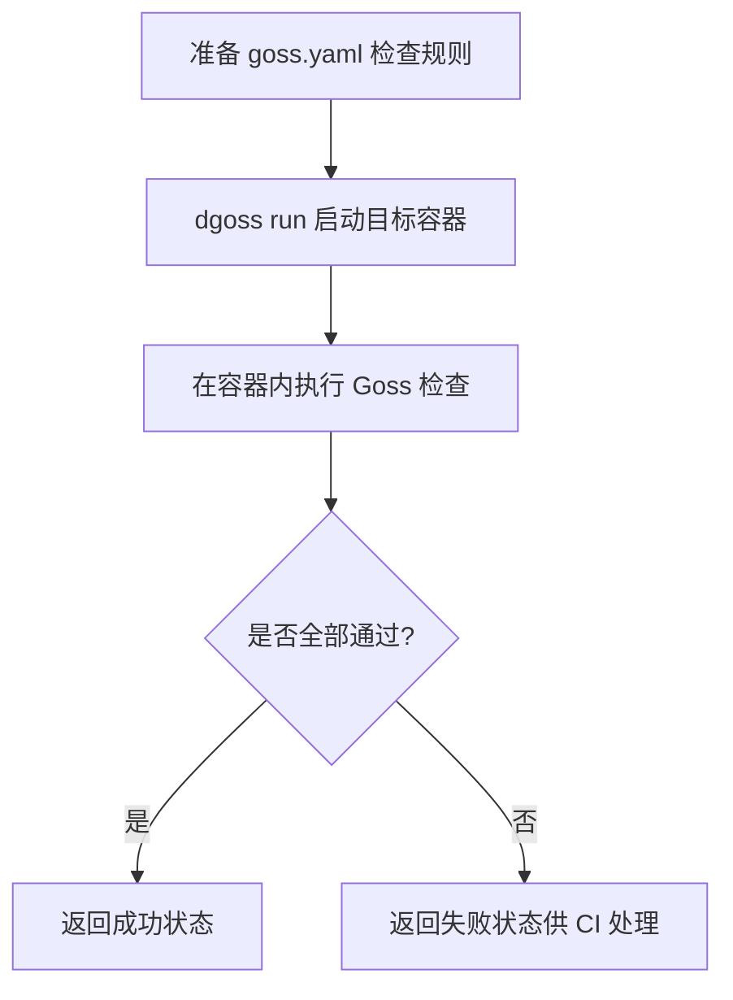

# Goss：用一份 YAML 检查服务器和 Docker 容器，部署完成后到底能不能用？

部署一套服务，接口返回 200，进程也在运行，但实际调用时仍然报错。原因可能是配置文件缺失、依赖服务没启动、端口没有监听，或者运行环境与预期不一致。

这些问题不一定需要编写完整的自动化测试框架才能发现。开源工具 [Goss](https://github.com/goss-org/goss) 提供了一种比较轻量的处理方式：将服务器应该满足的条件写进 YAML，运行时逐项检查，再把结果交给部署脚本或 CI 判断。

它适合解决服务部署前后的一类具体问题：**软件安装了，运行环境是否也处于预期状态？**

## 一、Goss 是什么，能检查哪些问题？

Goss 是一个基于 Go 开发的服务器配置验证工具，也是 Serverspec 的一种替代方案。它不要求你先搭建 Python 测试工程、编写 pytest 用例或者部署独立测试服务。

官方采用单个可执行文件的交付方式，支持从当前系统状态生成检查项，再使用 `goss validate` 执行验证。

截至 2026 年 11 月 3 日，GitHub Releases 页面显示最新版本为 **v0.4.10**，发布于 2026 年 7 月 26 日。具体版本请以[官方 Releases](https://github.com/goss-org/goss/releases) 为准。

Goss 能检查的对象包括：

| 检查对象 | 具体检查内容 |
|---|---|
| 文件 | 是否存在、权限、文件类型、内容 |
| 软件包 | 是否安装、安装版本 |
| 服务 | 是否运行、是否设置开机启动 |
| 进程 | 指定进程是否运行 |
| 端口 | TCP/UDP 端口是否监听 |
| HTTP | 响应状态码、响应头、响应内容 |
| DNS | 域名能否解析、解析结果 |
| 命令 | 执行结果、退出码、标准输出 |
| 系统配置 | 内核参数、挂载点、用户和用户组等 |

这些检查组合起来，可以表达一份相对完整的服务运行环境要求。

例如，一套 Nginx 服务上线之前，需要确认 Nginx 软件包已经安装、配置文件存在、服务正在运行、80 端口处于监听状态。这些条件可以放在同一份配置中统一检查。

## 二、一份 YAML，就能描述服务器应该是什么状态

下面是一份 Nginx 环境的示例检查文件。**需在安装并使用相应服务管理器的 Linux 环境中执行；不是实测结果。**

```yaml
package:
  nginx:
    installed: true

file:
  /etc/nginx/nginx.conf:
    exists: true
    filetype: file

service:
  nginx:
    enabled: true
    running: true

port:
  tcp:80:
    listening: true

process:
  nginx:
    running: true
```

这份 YAML 没有复杂的测试逻辑，每一项都在描述预期状态。

`package.nginx.installed` 要求软件包已经安装；`file` 检查配置文件；`service` 和 `process` 分别验证服务管理器状态以及进程状态；`port` 检查本机是否监听 80 端口。

将文件保存为 `goss.yaml` 后，可以执行：

```bash
goss validate --format documentation
```

Goss 会读取 YAML，访问本机对应的系统资源，将实际状态与配置中的预期状态逐项比较。

执行成功时，`validate` 返回退出码 0；发现失败项时，返回非 0。CI 或 Shell 脚本可以利用退出码决定是否继续部署。

这里有一个容易忽略的问题：**所有检查通过，并不等于业务系统已经通过验收。**

例如，Nginx 进程运行正常、80 端口也已监听，仍可能出现反向代理配置错误、上游服务不可用或者业务接口返回错误数据。

Goss 检查的是配置文件声明的条件。想要覆盖 HTTP 返回内容、外部依赖和业务规则，需要增加相应检查，或者交给其他测试工具。

## 三、Goss 为什么能减少环境检查脚本的维护？

在实际部署脚本里，类似检查并不少见。

```bash
systemctl is-active nginx
test -f /etc/nginx/nginx.conf
ss -lnt
```

这几个命令可以判断一部分状态，但如果想把它们变成稳定的自动化检查，还需要处理退出码、输出解析、失败提示等问题。

Goss 提供了统一的资源描述格式和验证命令，省去了为每一种常见系统资源分别编写检测脚本的工作。

### 1. 从已有环境生成检查项

Goss 支持使用 `add` 和 `autoadd` 创建 YAML 检查项。例如：

```bash
sudo goss autoadd sshd
```

官方示例中，这条命令可以基于当前环境发现与 `sshd` 有关的服务、进程、端口、用户等资源，并生成对应的检查项。

这里需要区分两个概念：

- 当前状态：工具实际扫描到的资源属性。
- 预期状态：项目部署后必须满足的要求。

两者并不总是一致。

假设现有服务器中的配置就有问题，直接使用 `autoadd` 生成检查文件，可能会把错误配置一起保存下来。今后验证时，错误状态反而可能通过检查。

因此更合理的使用方式是：**通过 `autoadd` 生成初稿，再根据部署要求审核和修改 YAML。**

官方文档也明确说明，`add` 和 `autoadd` 生成的参数需要人工修改才能满足不同测试要求。

### 2. 不同环境共用检查规则

服务器的配置通常不完全一致。开发、测试和生产环境可能采用不同端口、文件位置或服务参数。

Goss 支持模板和变量文件，可以将变化的参数抽出来，让检查项与环境配置分开维护。

例如，测试的对象都是 HTTP 服务，但不同环境的访问地址不同，就可以使用变量来减少重复编写 YAML 的工作。

对于相对复杂的项目，也可以把不同模块的检查项分成多个文件，通过 `gossfile` 引用，再使用 `goss render` 合并生成完整配置。

但规则拆分之后，需要特别关注 YAML 的结构。同一个资源类型如果在文件中重复声明为顶层键，可能导致前面的检查项被覆盖。官方文档专门给出了这个错误示例。

## 四、Docker 容器也能测试：dgoss

Goss 官方提供了 `dgoss`，这是围绕 Goss 编写的一层容器测试封装。

假设一个 Docker 镜像构建成功了，接下来需要检查镜像内部的软件、文件和服务状态。传统做法可能是先启动容器，再通过 `docker exec` 执行一系列命令。

`dgoss` 把这些操作组织到一起。



> 根据官方 dgoss 文档整理的执行流程示意，不代表已经完成容器实测。

例如，官方提供了使用 Jenkins 容器的示例：

```bash
dgoss run \
  -e JENKINS_OPTS="--httpPort=8080 --httpsPort=-1" \
  -e JAVA_OPTS="-Xmx1048m" \
  jenkins:alpine
```

执行之前，需要在当前目录准备对应的 `goss.yaml`，并安装 `dgoss` 及其需要的 Goss 可执行文件。

根据官方说明，`dgoss run` 会启动指定容器，将 Goss 检查文件提供给容器内部的验证过程，执行检查并输出结果。它还支持使用 `goss_wait.yaml`，先等待指定条件满足，再执行正式检查。

`dgoss edit` 则用于进入容器交互式环境，辅助生成和编辑检查文件。

因此，**`dgoss` 更适合验证一个镜像运行起来之后，内部环境是否符合交付要求。**

### 容器启动慢，不能立即判断失败

例如 Jenkins、数据库或者需要执行初始化任务的服务，进程启动后不一定立即可用。

如果容器刚启动便检测 HTTP 接口，可能因为应用还没准备好而报错。

`dgoss` 支持通过 `goss_wait.yaml` 处理这种情况。先等待服务准备就绪，然后运行 `goss.yaml` 中的正式检查，可以减少因启动时机造成的误报。

需要注意，等待检查也可能失败。应设置合理的超时时间，并在失败时保留容器日志和检查结果，方便区分启动过慢、配置错误以及服务异常。

## 五、把环境检查放进 CI，能解决什么问题？

对于使用 Jenkins、GitHub Actions 或其他 CI 系统的项目，Goss 可以作为部署验证的一道检查。

一个可行的流程是：

1. **构建应用或镜像**：完成代码构建与制品生成。
2. **部署到目标环境**：启动服务，准备配置文件和依赖资源。
3. **执行 Goss 检查**：验证软件包、文件、服务、进程、端口及必要的 HTTP 响应。
4. **处理验证结果**：失败时停止后续步骤，记录失败项；通过后继续运行接口和业务测试。

例如，Jenkins 流水线可以增加一个简单阶段：

```groovy
stage('Environment Validation') {
    steps {
        sh 'goss validate --format junit > goss-results.xml'
    }
    post {
        always {
            junit(
                testResults: 'goss-results.xml',
                allowEmptyResults: true
            )
        }
    }
}
```

这是一个集成示例，不是已经执行通过的流水线。

它要求 Jenkins Agent 已安装 Goss，当前目录存在 `goss.yaml`，并且 Agent 运行在需要验证的目标环境中。否则，Goss 检查的可能只是 Jenkins Agent 所在机器，而不是实际部署目标。

还需要考虑命令失败时报告文件是否生成、Jenkins 是否正确收集 JUnit XML，以及远程主机检查怎样执行。

Goss 官方支持 `junit`、`json`、`documentation` 等输出格式，`validate` 命令也支持失败重试。

对测试工程而言，Goss 比较合适的位置是**环境验证层**，而不是代替 API 自动化测试。

环境检查通过后，pytest 或其他接口测试框架再继续验证业务接口、数据状态、权限规则及异常处理，分工会更清楚。

## 六、Goss 还能提供 HTTP 健康检查接口

Goss 有一个 `serve` 命令，可以把 YAML 定义的检查项作为 HTTP 健康检查接口暴露出来。

例如：

```bash
goss serve --listen-addr 127.0.0.1:8080
```

然后请求：

```bash
curl http://127.0.0.1:8080/healthz
```

根据官方文档，当检查通过时，HTTP 接口返回 200；检查失败时返回 503。默认检查结果具有 5 秒缓存时间，可以通过参数调整。

这种方式适合需要持续查询环境状态的部署或运维系统。

但要控制检查内容和访问权限。一些检查可能执行系统命令、读取配置或者连接外部服务，因此不能简单地把健康检查接口暴露到公网。

同时，健康接口返回 200 的含义取决于 YAML 配置。如果只检测一个进程存在，那么 200 只能说明这一项成立，并不能说明完整业务正常。

## 七、Goss 与 pytest、Ansible 是什么关系？

如果已经使用 Python 和 pytest 建立了自动化测试框架，是否还需要引入 Goss？

关键在于检查对象。

| 工具 | 更适合处理的问题 |
|---|---|
| Goss | 当前服务器或容器状态是否满足预期 |
| pytest | API、业务逻辑、数据处理等功能是否符合要求 |
| Ansible | 安装软件、下发配置、启动服务和管理主机 |

三者可以组合使用，并不需要互相替代。

例如，Ansible 完成 Nginx 安装和配置，Goss 验证安装结果与运行状态，pytest 再对后端业务接口发起请求。

当然，pytest 也能通过 SSH 或系统命令实现这些检查。是否引入 Goss，主要看项目是否存在大量重复的系统资源验证，以及团队是否愿意维护另一份 YAML 规则。

如果只有一两个简单检查，使用现成 Shell 命令可能更省事；如果有多套服务器、容器镜像或持续部署任务，集中管理检查规则更有意义。

## 八、使用之前，还需要注意三个限制

**第一，Goss 主要面向 Linux。**

官方明确将 macOS 和 Windows 的支持标记为 Alpha。虽然 GitHub Releases 提供 macOS 构建产物，但不能据此认定所有资源检查能力都与 Linux 一致。

如果在 Mac 上开发，目标是验证 Linux 容器，可以考虑使用 `dgoss`，而不是默认认为在 macOS 上直接执行所有检查都能获得相同结果。

**第二，`command` 资源能够执行系统命令，需要控制权限。**

Goss 不只是读取静态配置。它还支持运行命令，并比较退出码、标准输出和标准错误输出。

因此，检查文件应该作为受控的代码资产进行审核。对来源不明的 Goss 配置，不宜直接在生产服务器上以高权限执行。

**第三，自动生成规则不代表自动理解需求。**

`autoadd` 能发现资源，却无法判断现有状态是否正确。哪些服务必须启动、哪些端口应该关闭、哪些文件权限是合规的，仍然需要人工根据部署规范确定。

这也是 Goss 在工程中的使用前提：有明确的预期状态，才能进行有效的验证。

## 九、测试工程里可以从哪里开始用？

对于已经有接口自动化、容器部署和 CI 的团队，可以从三个小场景尝试。

**场景一：测试环境初始化检查。**

在执行接口回归之前，检查依赖服务是否启动、配置文件是否存在、目标端口是否监听，避免环境问题被误判为业务功能缺陷。

**场景二：Docker 镜像交付检查。**

使用 `dgoss` 检查构建后的镜像，验证必要软件、配置文件及启动后的资源状态，减少人工进入容器排查的操作。

**场景三：部署后检查。**

将 Goss 放在服务部署完成之后、完整业务回归之前。如果基础资源检查失败，就先定位环境问题，暂不进入后续测试。

这三类场景可以分别试点，无需一次性将所有环境检查迁移到 Goss。

Goss 的主要作用很明确：把一部分原本散落在部署脚本、人工检查清单和测试前准备过程中的服务器状态检查，集中写成可以重复执行的规则。

对于需要频繁部署服务、维护 Docker 镜像以及管理多套测试环境的团队，它提供了一种可选择的实现方式。引入之后能减少多少维护工作，还需要结合现有脚本数量、环境复杂度和实际验证结果判断。

---

## 参考来源

- [Goss GitHub 官方仓库](https://github.com/goss-org/goss)
- [Goss Releases 版本记录](https://github.com/goss-org/goss/releases)
- [Goss 官方文档](https://goss.readthedocs.io/en/stable/)
- [Goss 命令行参考](https://goss.readthedocs.io/en/stable/cli/)
- [Goss YAML 配置说明](https://goss.readthedocs.io/en/stable/gossfile/)
- [dgoss 官方使用说明](https://github.com/goss-org/goss/blob/master/extras/dgoss/README.md)

## 待核实项

当前文章依据官方仓库、使用文档及版本记录整理，但未在实际 Linux、Docker 或 Jenkins 环境执行示例。因此，文章中的运行命令、JUnit 集成及启动等待方案仍需在目标环境中验证。

#Goss #Docker #测试开发 #自动化测试 #DevOps #CI/CD
