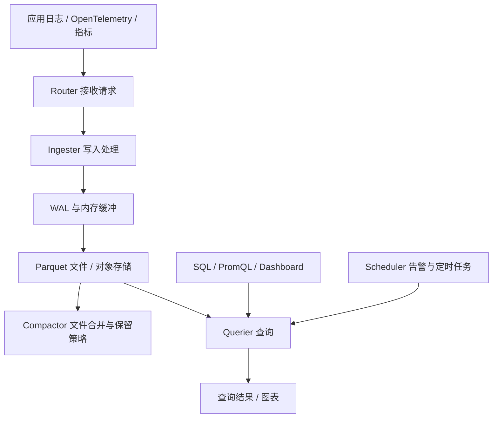
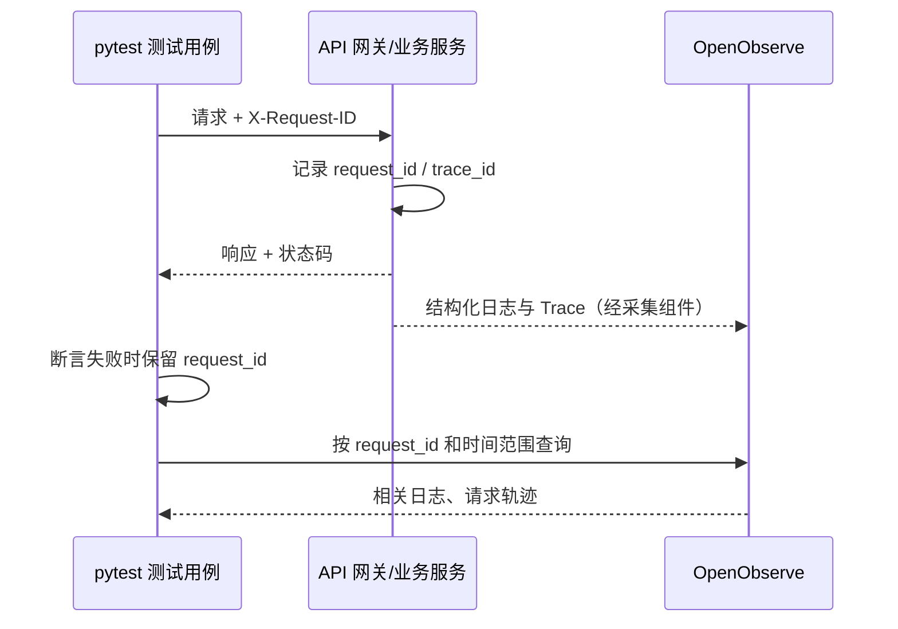

# OpenObserve：把日志、指标和链路追踪放在一起，测试排障可以少切几个系统

接口自动化测试失败后，测试报告通常只能告诉你：哪个接口失败、响应码是多少、断言哪里没通过。

但如果接口返回 500，异常发生在数据库查询、Redis、消息队列还是下游服务，测试报告往往无法直接回答。

[OpenObserve](https://github.com/openobserve/openobserve) 是一个开源可观测性平台，支持集中收集日志、指标和分布式链路追踪。它提供 SQL、PromQL 查询、Dashboard 和告警能力，也能接入 OpenTelemetry 数据。

对测试开发而言，它的应用方向：**用请求标识和时间范围，把失败用例、应用日志、性能指标以及跨服务调用记录关联起来，减少故障排查时切换系统、翻找日志的工作。**

> 资料核对日期：2026 年 11 月 3 日。GitHub Releases 页面当时标记的最新版本为 **v1.1.2（2026 年 10 月 20 日发布）**。本文命令是依据官方资料整理的示例，未在真实业务环境执行；产品性能与成本效果也未经独立测试。

## 一、OpenObserve 解决的是哪类问题？

假设一次接口回归中，订单提交接口偶发超时。单看 pytest 或 Allure 报告，可以确认请求耗时超过阈值，但通常还需要回答几个问题：

- 相同时间段还有多少请求变慢？这是单个请求还是系统性退化？
- 请求走过哪些服务？耗时集中在哪一段？
- 对应服务有没有异常日志？CPU、内存或请求错误率是否同步上升？

这些信息分散在不同地方：应用日志在容器或日志系统中；指标在 Prometheus 一类系统中；跨服务耗时在追踪系统中。OpenObserve 试图让这些数据进入统一的查询与展示平台。

| 数据类型 | 记录什么 | 测试定位时的用途 |
| --- | --- | --- |
| Logs（日志） | 异常堆栈、请求字段、业务处理结果 | 找具体错误及上下文 |
| Metrics（指标） | 请求次数、错误率、耗时分布、资源使用量 | 判断故障影响范围及变化趋势 |
| Traces（链路追踪） | 一个请求跨服务经过的 Span 和耗时 | 定位耗时集中在哪个调用环节 |

日志告诉你发生了什么，指标帮助判断问题是否普遍，Trace 记录一次请求内部的调用过程。三者并非自动就能关联：**应用需要在日志里保留 trace_id 或 request_id，采集配置也必须正确。** 如果这些字段缺失，再统一的后台也无法可靠还原单次请求。

官方还列出了浏览器真实用户监测（RUM）、会话回放、日志处理管道、告警和 LLM 观测等能力。不过对一般测试项目，先跑通日志接入与检索，更容易判断有没有必要继续接入指标和追踪。

## 二、先用 Docker 跑起来，再发送一条测试日志

OpenObserve 官方仓库给出单容器运行方式。以下示例沿用官方镜像地址，补充了明确的数据目录与本机回环地址绑定，方便本地试用：

```bash
docker run -d \
  --name openobserve \
  -p 127.0.0.1:5080:5080 \
  -v "$PWD/openobserve-data:/data" \
  -e ZO_DATA_DIR=/data \
  -e ZO_ROOT_USER_EMAIL='root@example.com' \
  -e ZO_ROOT_USER_PASSWORD='请替换为本机测试密码' \
  public.ecr.aws/zinclabs/openobserve:latest
```

这里使用 `latest` 只是便于首次体验；CI 和团队共享环境应固定镜像版本或摘要，避免升级导致结果变化。示例密码应自行替换，不能直接用于公网或生产环境。首次访问 `http://localhost:5080`，使用启动时设置的账号登录。

服务起来后，向 `qa_demo` 这个日志流写入一条 JSON 记录：

```bash
curl -u 'root@example.com:请替换为本机测试密码' \
  -H 'Content-Type: application/json' \
  'http://localhost:5080/api/default/qa_demo/_json' \
  -d '[{"level":"error","service":"order-api","test_case":"test_create_order","request_id":"req-demo-001","message":"downstream request timeout","duration_ms":3021}]'
```

这是演示性数据，`downstream request timeout` 只是一条人为构造的日志，不能证明业务系统真的发生了超时。随后进入 Web UI 的 Logs 页面，选择 `qa_demo`，按 `request_id` 或 `test_case` 查询。

建议实际操作时依次确认三个结果：

1. 容器处于运行状态，浏览器能够登录；
2. 写入 API 有正常响应，且没有记录级错误；
3. Logs 页面在相应时间范围内能查询到 `req-demo-001`，字段值与发送内容一致。

**HTTP 写入成功不等于检索结果一定符合预期。** 时间范围、字段类型、流名称及采集处理规则都可能影响最终查询。如果看不到记录，先检查 API 响应内容和页面时间过滤条件，再排查应用日志。

## 三、它如何处理写入与查询？

OpenObserve 由 Rust 实现。官方架构说明把高可用部署分为五种节点职责：Router、Ingester、Compactor、Querier 和 Scheduler。单节点部署把这些能力放在同一个运行实例中；不必为了本地试用先搭建完整集群。



*流程图表达的是职责关系，不是逐条数据必须按箭头经过所有节点。Compactor 负责整理文件，查询也可能读取尚未上传的本地数据。*

### 写入侧：先接收，随后整理成适合查询的文件

根据官方架构文档，Ingester 接到 HTTP 或 gRPC 数据后，会处理字段、时间戳和写入规则，并使用 WAL（预写日志）与内存缓冲暂存数据。之后数据转换为 Parquet 列式文件，供后续存储与查询。

Parquet 的特点是按列组织数据，适合只读取分析所需字段的场景。与“把全部原始文本逐行扫描”相比，这种布局可能降低特定查询的读取量；实际收益还与字段选择、压缩、数据分布和查询条件有关。

Compactor 负责合并小文件、执行数据保留策略和更新文件列表。文件数量过多会增加管理与扫描成本，合并过程则需要额外计算和 I/O。这是存储效率与后台处理开销之间的取舍。

### 查询侧：先找到候选数据，再执行查询

Querier 接收查询请求后解析 SQL，结合时间范围确定需要读取的文件。在集群模式下，可将任务分配给多个 Querier，最终合并查询结果。

这解释了为什么**时间范围和字段设计会直接影响排障体验**。测试平台若记录了 `env`、`service`、`test_run_id`、`request_id`、`trace_id`、`status_code` 等字段，查询时就能缩小范围；如果只存一整段无结构文本，后续定位要依赖字符串搜索与人工辨认。

不能据此推断 OpenObserve 对任何数据量都更快。官方 README 提到低存储成本和高性能，但这些是项目方给出的宣传及基准测试结果。是否适合现有项目，仍应以自身日志规模、保留天数、查询延迟、资源消耗与费用测量为准。

## 四、接入自动化测试，最有用的是请求关联字段

OpenObserve 不会自动知道某条日志属于 pytest 的哪个用例。要实现关联，需要测试端与服务端约定标识。

可以考虑下面的流程：



这是建议的集成设计，并非 OpenObserve 原生提供的 pytest 插件工作流。

测试侧可以使用如下 Python 片段生成标识：

```python
import uuid
import requests

request_id = uuid.uuid4().hex
response = requests.post(
    "http://localhost:8000/api/orders",
    json={"item_id": 123, "count": 1},
    headers={"X-Request-ID": request_id},
    timeout=10,
)
print("request_id:", request_id)
print("status_code:", response.status_code)
```

这里的订单接口只是占位示例，不能直接在 OpenObserve 容器上运行。应用或网关必须明确支持并传递 `X-Request-ID`，日志采集器也要把它送进 OpenObserve。否则，测试端打印 ID 并不会自动建立关联。

对接 Allure 时，可以在失败附件中保留请求 ID、接口、环境、开始时间和错误响应。之后根据这些信息查询日志；若后端接入 OpenTelemetry，且日志中保留 `trace_id`，还可以继续查看跨服务 Span。处理敏感数据时，应避免把鉴权令牌、个人信息和完整请求体直接写入日志。

## 五、接口性能测试也能用，但不要把监控图表当成压测结果

运行 Locust、JMeter 或其他压测工具时，通常有两类数据：

- 负载生成端：并发用户数、请求吞吐量、响应时间分布、失败率；
- 被测系统端：进程资源、服务错误率、数据库耗时、下游请求及 Trace。

OpenObserve 可以承载后者，也可以接收经过处理的压测指标。把两类数据放在相同时间窗口下观察，能帮助判断响应时间上升时，被测服务内部发生了什么。

例如，p95 响应时间变差时，同时观察数据库调用 Span、服务端错误率与 CPU 使用量。若三者在时间上相关，只能形成故障线索；还需要通过重试、对照实验或配置检查确认原因，不能把曲线同时上涨直接写成因果结论。

LLM/Agent 测试也有类似需求。官方文档列出了 LLM 观测能力，但如果要衡量回答质量、意图识别准确率或业务规则遵循情况，还需要额外的评测数据集、真值标签和判分器。OpenObserve 更适合记录请求、Token、耗时、错误和调用过程；它不能代替评测框架判断回答是否正确。

## 六、部署方式和费用，别只看“单二进制”和“140 倍”

官方提供单节点、本地磁盘或对象存储以及高可用集群等部署模式。单节点适合试用和中小规模场景；高可用模式依赖 Kubernetes、对象存储、PostgreSQL 与 NATS，并把采集、查询、文件整理及任务调度分到不同节点。搭建与维护成本也会随之增加。

| 选择 | 更合适的情况 | 需要承担的成本 |
| --- | --- | --- |
| 单节点 + 本地磁盘 | 本地验证、小规模测试环境 | 单点故障、备份与磁盘容量管理 |
| 单节点 + 对象存储 | 需要更可靠的文件存储，暂不做完整集群 | 对象存储费用、读取延迟、单节点可用性 |
| HA 集群 | 多业务共享、可用性和扩容要求较高 | K8s、NATS、PostgreSQL、对象存储及运维复杂度 |

GitHub 仓库公开的许可证为 **AGPL-3.0**。同时，官方文档区分了社区版与 Enterprise 专属功能，例如部分高级权限管理、跨集群搜索和审计能力。评估商用或二次开发时，应核对目标版本的授权条款及功能清单，不能把全部官网功能都当作社区版免费能力。

官方 README 对存储成本的描述是“最高降低 140 倍”，其对比对象、数据规模及计算条件不一定符合你的环境。选型时至少对照五项：写入量、保留周期、压缩后存储量、典型查询延迟、CPU/内存与对象存储费用。

## 七、给测试工程的一个小规模试点方案

不需要第一天就把系统的日志、指标和 Trace 全部迁移过来。可以挑一套经常排障的测试环境，先验证三个问题。

1. **数据能否准确进入平台**：人工构造 20～50 条具有不同 `request_id`、级别、时间和服务名的测试日志，检查写入成功数与实际可查询数是否一致。
2. **失败用例是否能够回查**：选择一个可控的接口错误场景，记录用例 ID 与请求 ID，确认能找到对应应用日志；有 Trace 时再检查跨服务 Span 是否齐全。
3. **查询与维护成本是否可接受**：记录检索耗时、日志量、容器资源占用，以及保留策略与删除后的实际存储变化。

做完这三项，才能判断它是否比现有的日志方案更适合团队。对于已有成熟 ELK、Grafana、Loki、Tempo 或 Prometheus 体系的团队，引入 OpenObserve 还涉及数据迁移、查询语法、权限与监控告警的调整，并不一定能减少总成本。

如果当前最大的问题是“测试失败后，很难从一次请求追踪到应用错误”，那优先工作也许不是更换平台，而是让网关、应用、测试报告和采集器共享同一组请求标识。OpenObserve 可以承接这些数据；关联字段和采集质量决定了它能帮助你定位到什么程度。

---

## 参考来源

- [OpenObserve GitHub 官方仓库](https://github.com/openobserve/openobserve)
- [OpenObserve Releases：v1.1.2](https://github.com/openobserve/openobserve/releases)
- [官方文档首页](https://openobserve.ai/docs/)
- [数据接入总览](https://openobserve.ai/docs/ingestion/)
- [使用 curl 写入日志](https://openobserve.ai/docs/ingestion/logs/curl/)
- [Getting Started：自托管与样例数据](https://openobserve.ai/docs/getting-started/)
- [架构与部署模式](https://openobserve.ai/docs/architecture/)
- [Enterprise 功能说明](https://openobserve.ai/docs/features/enterprise/)

## 待核实项

- 本文未部署 OpenObserve，也未执行上述命令；目标操作系统、Docker 版本与镜像兼容性需要现场验证。
- 尚未验证 pytest/Allure 到 OpenObserve 的完整关联方案，示意流程需要应用及采集端配合。
- 没有对存储成本、查询性能或 HA 稳定性进行独立对照测试，未采用项目方宣传数字作为实测结论。

#OpenObserve #测试开发 #可观测性 #OpenTelemetry #接口自动化 #性能测试
