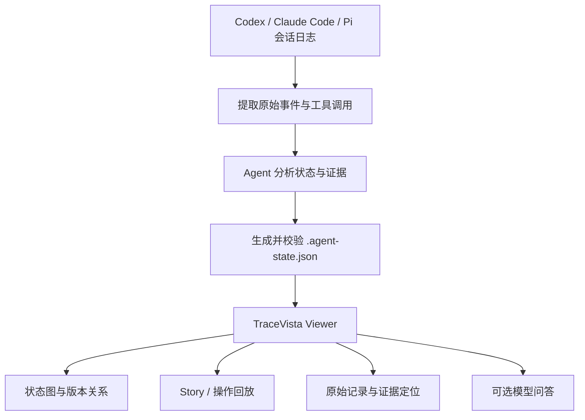

# TraceVista：把 Agent 执行日志变成决策地图，代码为什么这样改有迹可循

让 Codex、Claude Code 或 Pi Agent 连续运行几十分钟，可能得到一份可以运行的代码，也可能留下几百条工具调用和大量终端输出。

代码改了什么，可以看 Git Diff；测试有没有通过，可以看报告。但如果想弄清楚 Agent 为什么放弃上一版实现、某次测试失败后改了哪些内容、最终选择是否有证据支撑，就不得不重新翻阅执行记录。

开源项目 **TraceVista** 尝试处理这个问题：将 Agent 执行记录转换成可交互的状态图、工作过程和证据记录，让使用者从最终结果追溯到具体操作。

它面向的是 **Agent 工作结果的复核**，并不替 Agent 自动证明代码正确。项目提供在线示例，也支持转换自己的 Codex、Claude Code 和 Pi 会话日志。

> 资料核对日期：2026 年 11 月 3 日。下文依据项目仓库、README、Skill 说明及转换文档整理，未在本地执行转换、性能测试或浏览器验收。

## Agent 交付了代码，却不一定交代清楚过程

以接口测试 Agent 为例。用户要求它修复一个接口测试失败问题，Agent 可能先修改请求参数，再排查鉴权，随后发现根因是测试数据失效，最后重写了 fixture。

最终提交的代码只留下最后一版。Git 提交历史也不一定记录 Agent 在同一轮会话中尝试、回滚或放弃的方案。要确认修复是否合理，需要回答几个问题：

- 它观察到的第一次失败是什么？
- 哪个结果让它改变处理方向？
- 最终测试通过，是同一环境下的真实验证，还是只看到了某段工具输出？
- 它是否改动了与问题无关的测试断言？

这些信息通常分散在对话、工具调用、测试日志和源代码变更中。TraceVista 的设计目标是把它们组织到可以逐层查看的结构中。

## 三个主要组成部分：日志、转换 Skill 和 Viewer

TraceVista 在仓库中将主要能力分为两部分：负责转换轨迹的 `skills/tracevista-skill`，以及呈现地图、故事和对话的 `viewer`。连接二者的是 `.agent-state.json` 文件。



这里有一个关键区分：**从日志中提取事件** 与 **判断这些事件代表什么决策** 是两件事。

项目 Skill 中的 Python 脚本负责提取时间线、保留事件标识、构建和校验 JSON；调用 Skill 的 Agent 需要根据原始记录撰写状态分析、工作阶段和说明。官方文档明确表示，这些脚本使用 Python 3.10+ 标准库，不自行调用模型；结构性解读由调用它的 Agent 编写，再由构建及校验脚本检查。

因此，最终看到的“为什么改方向”仍属于基于记录生成的解释，不能直接当成 Agent 内部决策原因的完整还原。好处是项目同时保留原始事件，让读者可以核对解释与证据是否一致。

## 机制一：把线性日志整理成可以追踪的状态变化

官方 Viewer 提供四层内容：

| 层级 | 能看到什么 | 对测试复核有什么帮助 |
| --- | --- | --- |
| System states（系统状态） | 不同代码或成果版本及其关系 | 查看从哪个版本改到哪个版本、是否回退 |
| Work phases（工作阶段） | 尝试的方案、方向变化和阶段结果 | 观察修复策略如何变化 |
| Actions（动作） | Explore、Plan、Edit、Execute、Verify、Diagnose | 识别操作类型和验证动作 |
| Raw records（原始记录） | 会话消息、工具输入输出、评审意见 | 对照真实输出检查摘要是否准确 |

例如，某 Agent 第一次修改后测试失败，再调整代码并通过测试，Viewer 可以按照执行顺序呈现动作，也可以按版本关系查看分支、回退和最终版本。

这两种关系不能混为一谈：**执行顺序只说明先后，版本关系用于描述成果如何演变。** 先执行的命令不一定导致后面的代码变化；一次测试失败也不能单独证明某次修改不正确。

项目转换规范要求区分成功产生的系统变化、验证结果及新获取的信息。这个约束对测试复盘尤其重要：执行过 `pytest` 不等于运行成功；看到工具调用也不等于变更已落实到工作目录。

## 机制二：每条解释尽量能回到原始证据

TraceVista 不仅展示状态图。选中节点后，还可以沿工作阶段进入操作，再查看原始消息、命令和输出。官方将这种方式称为从概览逐层展开，并提供 Map、Story 和回放模式。

它也支持连接模型进行上下文问答，例如询问“为什么放弃上一个方案”。文档描述的 Smart context 会先读取节点摘要和原始事件索引，再选择需要展开的记录，回答中附上指向节点与事件的引用。

这解决的是阅读成本，而不是证据真实性。模型可能把一次试探解释成明确决策，或者给不完整的输出附上过于肯定的结论。因此，遇到关键判断，仍应点开对应原始记录；对于未记录的思考和缺失的工具输出，应保留“不知道”。

转换文档要求保留原始事件 ID、文本、调用与结果对应关系，并禁止补写日志中没有的推理、时间戳和结果。对 Agent 评测来说，这比生成一份看起来流畅的总结更重要。

## 如何体验：先看在线示例，再转换自己的会话

不需要安装就可以先打开官方 Viewer：

https://tracevista.pages.dev/

官方主页提供 Pi、Claude Code、Codex、OpenHands 等轨迹示例。可以先进入一个示例，从结果概览开始，打开失败尝试，找到对应的操作和原始证据，判断是否能够解释最终版本的选择。

要转换自己的日志，README 提供的方式是将仓库里的 Skill 安装给当前编码 Agent，再让 Agent 生成符合格式的 `.agent-state.json`：

```text
Install skills/tracevista-skill from https://github.com/Superone77/TraceVista
```

然后向已安装 Skill 的 Agent 发出类似指令：

```text
Use tracevista-skill to convert [trajectory file or folder]
into a complete .agent-state.json, then open
https://tracevista.pages.dev/ and import it.
```

这两段是项目提供的自然语言使用方式，**不是直接在 Shell 中执行的命令**。实际能否自动安装、打开页面和导入文件，还取决于宿主 Agent 的 Skill、浏览器和文件操作能力。

官方文档还列出了 Codex 的 `$tracevista-skill` 与 Claude Code 的 `/tracevista-skill` 调用方式。转换脚本覆盖 Claude Code、Codex、Pi 会话，以及部分公开 Agent 评测轨迹格式；不应默认任意 JSONL 都能直接导入。

### 想自行运行 Viewer

README 给出了以下本地步骤，要求 Node.js 24+、pnpm 11+：

```bash
git clone --depth 1 --branch main https://github.com/Superone77/TraceVista.git
cd TraceVista
npm install -g pnpm@11
pnpm install --frozen-lockfile --ignore-scripts
pnpm dev
```

按官方说明，在浏览器打开 `http://localhost:8875`，导入生成的 `.agent-state.json`。可以进一步运行：

```bash
pnpm test
pnpm build
```

`pnpm test` 用于执行项目提供的小型测试夹具检查，`pnpm build` 生成独立 Viewer。官方示例数据另有仓库和版本固定机制，不能用“Viewer 本地构建成功”代替“所有公开案例都验证成功”。

## 放进测试工程：更适合追查 Agent 的错误操作

对自动化测试 Agent，TraceVista 最有价值的切入点是 **失败用例之后的操作复核**。

假设 Agent 收到“修复接口测试失败”的任务，进行了如下工作：

1. 执行接口用例，发现断言失败。
2. 修改请求参数，再次执行仍失败。
3. 更换测试数据后通过。
4. 输出“问题已修复”的总结。

复核时可以沿着状态图查看每一次修改对应的验证，检查最后的结论是不是有真实测试结果支撑。如果 Agent 为了通过测试而放宽了断言，也可以从操作记录中找到检查线索。

但这里不能跳过代码审查：TraceVista 本身不保证断言合理，不验证业务规则，也不提供用例覆盖率结论。它补充的是“执行过程怎样发生”的可读证据，最终质量判断仍需要代码差异、测试报告和业务预期共同支持。

同样的思路可用于 Agent 评测框架。除了最终成功率、成本和耗时，还可以针对失败样本复核：

| 评测问题 | 可从轨迹中寻找的依据 | 仍需外部验证的部分 |
| --- | --- | --- |
| Agent 是否进行了验证 | Verify 动作与工具结果 | 测试命令是否覆盖目标需求 |
| 是否出现无效尝试 | 多轮修改和失败记录 | 该尝试在当时是否合理 |
| 失败后有没有改变方案 | 工作阶段与版本分支 | 新方案是否真的修复根因 |
| 最终结论是否夸大 | 总结与原始日志对照 | 实际交付物的正确性 |

这里的表格是建议的评审方式，不是 TraceVista 已经内置的一套自动评分标准。

## 使用前要留意的几个前提

**轨迹不完整，地图也不会完整。** 未记录的工具调用、外部系统修改、隐藏推理或缺失的测试结果，无法通过可视化补回来。转换规范也明确要求不得凭空重建缺失内容。

**摘要需要复核。** 决策节点和阶段说明可以由 Agent 根据日志生成，其解释质量取决于原始数据以及生成过程。项目提供来源引用和校验脚本，但不能把结构校验等同于语义正确性验证。

**日志可能包含敏感信息。** 原始会话往往包括文件内容、执行命令、环境细节、API 返回甚至密钥。官方说明 `.agent-state.json` 可包含原始记录和附件。上传、分享或连接外部模型前，需要审核并处理敏感字段；使用线上 Viewer 不应被理解成自动完成脱敏。

**它不等同于实时可观测平台。** TraceVista 主要围绕已有 Agent 会话轨迹的转换、浏览和解释工作。需要持续采集线上 Agent 的请求量、Token 成本、延迟和运行告警时，还应使用适合在线遥测的工具。

## 可以从一次失败的 Agent 会话试起

如果项目里已经有 Codex、Claude Code 或 Pi 生成测试代码，适合挑选一段包含失败、修正和最终验证的完整会话，转换为 TraceVista 格式。

检查重点可以保持简单：状态图是否遗漏关键版本，测试失败能否定位到原始输出，生成的原因说明有没有超出记录，最终交付是否仍需人工补充证据。

TraceVista 把原本只能顺序阅读的 Agent 日志变成可以按状态、动作和证据查看的材料。这能帮助评审人员更快定位需要核对的环节，但它不代替评审，更不能用一张漂亮的决策图给 Agent 的输出背书。

对于逐步把 Coding Agent 引入测试开发流程的团队，先让一次失败过程可回查，再谈更复杂的 Agent 质量评测，会更容易发现工具记录、验证证据和结论之间的缺口。

---


## 参考来源

- [TraceVista 官方 GitHub 仓库](https://github.com/Superone77/TraceVista)
- [TraceVista 中文 README](https://github.com/Superone77/TraceVista/blob/main/README.zh-CN.md)
- [TraceVista Skill 使用说明](https://github.com/Superone77/TraceVista/blob/main/skills/tracevista-skill/SKILL.md)
- [原始会话转换规范](https://github.com/Superone77/TraceVista/blob/main/skills/tracevista-skill/references/conversion.md)
- [TraceVista 在线 Viewer 与示例](https://tracevista.pages.dev/)

## 待核实项

- 尚未在本地安装并运行 Viewer，也未使用自己的 Agent 会话完成转换和界面检查。
- 对复杂或大量会话数据的转换耗时、内存消耗及摘要准确性，缺少独立测试结果。
- 线上导入的浏览器端数据处理、模型连接和持久化行为，涉及敏感日志时需要结合部署方式及安全文档单独确认。

#TraceVista #AIAgent #Codex #测试开发 #Agent评测 #可观测性
