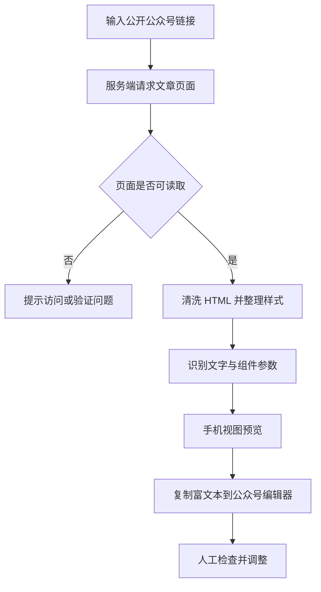

# 样格：从公众号文章提取排版样式，少一点手工试错

看到一篇排版舒服的公众号文章，想把类似的标题、配色和段落间距用到自己的内容里，通常得反复截图、取色，再去编辑器调整。文章不长，排版却可能耗掉不少时间。

开源工具「样格」（WeChat Style Extractor）提供了另一种做法：输入公开公众号文章链接，尝试提取其中的排版参数，在页面里预览效果，再将富文本复制到公众号编辑器。它适合需要参考现成版式的内容创作者，也能为经常发布技术文章的人减少一些重复操作。

## 输入一个链接，能拿到什么

样格的项目说明列出了几类信息：正文与标题的颜色、字号、行高和间距，以及内容中的标题、图片、列表、表格等组件规则。页面还提供接近手机阅读场景的文章预览，并支持复制富文本。

举个实际用途：技术文章里经常有二级标题、引用说明、命令片段和配图。希望让这些元素保持一致时，可以找一篇自己认可的排版样本，查看它使用的颜色和文字规格，再决定哪些参数适合自己的文章。这样比逐项凭感觉调节更有依据。

但这里的“提取”并不等于生成一个经过验证、适用于所有文章的完整主题包。README 明确说明：统计采用启发式识别，未识别到的项目不会展示，预览则会使用默认值。因此页面中看到的数值，更适合作为排版起点，而不是原文样式的精确清单。

## 它怎样处理公众号页面

从项目公开说明和依赖配置来看，样格围绕服务端抓取 HTML、清洗页面内容、整理样式，以及前端预览展开工作。它使用 `cheerio` 和 `juice` 等依赖；前者用于处理 HTML，后者可用于将样式内联到元素。项目说明还提到保留懒加载图片和 CSS 背景图，并尝试保留网格、定位、阴影、列表与表格等排版特征。

可以把预期处理过程理解为：



这张图根据官方功能说明归纳工作过程，并非运行跟踪结果。尤其是最后一步：微信编辑器是否保留某个布局效果，要以实际粘贴后的效果为准。

安全处理也有明确限制。官方说明称，解析接口只允许访问 `https://mp.weixin.qq.com`，同时限制跳转域名、响应大小和读取时间。这些设置有助于约束服务器抓取外部页面时的风险，但不能据此认定工具已经通过完整的安全审计。

## 两种使用方式

不想安装开发环境，可以先访问项目提供的在线体验站：

https://wechat-style-extractor.godkey810.chatgpt.site/

按页面提供的入口粘贴公开的公众号文章链接，查看识别出的参数及预览，再尝试复制到公众号编辑器。体验站是否能成功解析指定文章，仍受微信访问限制、文章自身样式和站点运行状态影响。

有本地运行需求，可以使用官方仓库。README 要求 Node.js 22.13 或更高版本，提供了以下启动步骤：

```bash
git clone https://github.com/sennkuwu/wechat-style-extractor.git
cd wechat-style-extractor
npm install
npm run dev
```

项目还提供 `npm run build` 用于构建，以及 `npm test` 用于运行已有测试。仓库配置中列出的依赖包括 Next.js、React、cheerio、juice 和 vinext；这些是项目声明的技术选型，不代表本文已经在本地完成安装、构建与兼容性验证。

## 排版参考和直接复刻，有一条需要注意的线

实际使用中，最容易产生误会的是“预览正常”和“发布后正常”之间的差距。

例如，一篇文章使用了特殊定位、复杂表格或者带背景图的卡片。工具即使能在自己的预览页展示这些元素，复制到公众号编辑器之后，某些 CSS 属性、图片加载方式或嵌套结构仍可能发生变化。项目 README 对这一点有明确提醒：内联样式不能保证编辑器完整保留原始排版。

对经常写文章的人，更稳妥的做法是从版式中选择几个稳定的元素，逐步建立自己的规范：

1. 先选一篇排版样本，记录正文、二级标题、引用块和配图间距等关键参数。
2. 用自己的短文测试，覆盖标题、列表、代码、表格和图片，而非仅看纯文本预览。
3. 复制到公众号编辑器后，在手机预览中核对字体大小、换行、空白、图片与卡片样式。
4. 对失效的样式做简化，保留能稳定使用的参数，再应用到后续文章。

这是一套建议的验证方法，并非项目已经自动提供上述完整测试流程。

此外，样式规则可以参考，文章内容、插画、品牌标识及原图不能因此随意搬运。项目也明确将用途限定为分析排版与生成原创模板，并提示尊重相关版权。

## 适合怎样的工作流

样格更适合承担“观察和提取样式”的环节。例如，Markdown 写技术正文，配图单独制作，再把确认过的字号、配色、行距应用到发布模板。这样的流程能让工具各司其职，也减少每次换文章都重新挑排版的麻烦。

如果团队多人维护同一个公众号，还可以把认可的几个标题和正文参数写成发布规范。新文章不必照搬原文视觉效果，只需在编辑器中使用相同的文字层级、颜色和留白习惯。

它目前并不等同于一套完整的 Markdown 自动发布工具，也没有证据表明它能对任意公众号文章实现一比一复刻。把它当作排版参数的参考器，按需选取、再到实际编辑器里核对，定位更准确。

对内容创作来说，比较有用的结果也许很朴素：看中一种排版之后，不必从零猜测每个字号和颜色；把精力留给文章本身，并逐渐形成一套自己能够重复使用的视觉规范。


## 参考来源

- 项目 GitHub 仓库：https://github.com/sennkuwu/wechat-style-extractor
- 项目 README：https://github.com/sennkuwu/wechat-style-extractor/blob/main/README.md
- 项目依赖与命令配置：https://github.com/sennkuwu/wechat-style-extractor/blob/main/package.json
- 项目在线体验站（官方 README 提供）：https://wechat-style-extractor.godkey810.chatgpt.site/

资料核对日期：2026-11-04。文中功能说明依据公开仓库资料；没有执行本地安装、抓取真实文章、粘贴公众号编辑器或发布实测。

## 待核实项

- 体验站对不同公众号文章的当前解析成功率及微信安全验证出现频率。
- 复杂卡片、代码块、背景图等内容复制到公众号编辑器后的实际保留情况。
- 对文章图片素材的远程加载与后续可用性表现。

#公众号排版 #开源工具 #内容创作 #Markdown #效率工具
