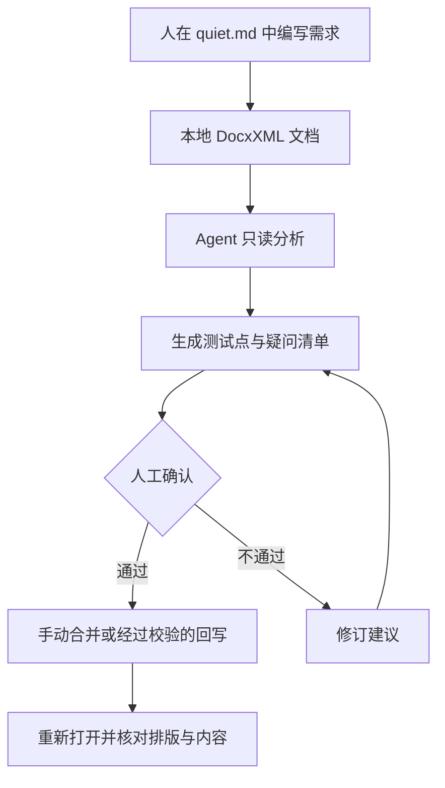

# quiet.md：本地富文本编辑器与 Agent 共用文件的另一种方式

在飞书里写完需求，想交给终端里的 Agent 整理测试点，通常还要考虑怎么导出、怎么保留格式、修改后怎么放回去。换成 Markdown 文件，工具读取方便了，复杂表格、分栏和富文本排版又可能不完整。

[quiet.md](https://github.com/s1dashu/quiet-md) 试图让这两种习惯在同一个本地文档库里共存：人通过原生富文本编辑器写文档，内容以可直接访问的 DocxXML 文件保存在电脑上，其他程序也可以读取这些文件。它目前是 Beta 版本，适合先用非关键文档试一试。

## 先看它能做什么

quiet.md 是一款面向 macOS 和 Windows 的本地笔记应用。界面使用 Rust 和 GPUI 绘制，不依赖 Electron 或 WebView；无需注册账号，没有内置云端文档服务。默认文档库是一个普通文件夹，而非只能通过应用访问的私有数据库。

日常编辑能力包括标题、待办事项、引用、代码块、LaTeX 公式、合并单元格的表格、分栏、图片与附件。可以使用 Markdown 快捷输入，也能用斜杠菜单插入内容。文档可按树形结构组织，支持置顶、收藏、搜索和回收站；支持导入 Markdown、飞书 DocxXML，导出 Markdown。macOS 还支持 PDF 导出与打印，Windows 当前版本尚未支持这两项。

这里有一个需要分清的地方：**它的名字带有 md，不表示笔记默认存成 `.md` 文件。** quiet.md 的主要存储格式是飞书 / Lark 的 DocxXML，也就是 XML 文本文件。Markdown 是导入导出格式之一。

| 关注点 | quiet.md 当前做法 | 使用时要考虑什么 |
| --- | --- | --- |
| 编辑体验 | 原生富文本编辑器 | 不必将复杂表格全部改写成 Markdown |
| 文件存储 | 本地 `docs/*.xml` 与 `assets/` | 可以备份、版本管理，但也要管理附件和索引 |
| 与飞书交换内容 | 支持 DocxXML、复制粘贴保留结构 | 不等于支持飞书云端协作功能，也不能假定所有复杂块无损互转 |
| 与 Agent 配合 | 文件可由本地程序直接访问 | Agent 是否正确理解并安全改写 DocxXML，需要验证 |
| 跨设备 | 可借助外部同步工具 | 冲突合并和版本恢复不由应用云服务负责 |

## 为什么本地文件对 Agent 有用

以需求评审为例，测试工程师可能在编辑器里写下需求背景、接口字段、业务限制和待确认问题。接下来，希望 Agent 根据这些材料生成测试点、检查需求冲突，或者把补充建议写回同一份文档。

云文档一般需要账号、授权与专门接口才能让程序稳定访问。普通本地文件则可以走文件系统：先读取，再分析，最后按约定写入。quiet.md 选择 DocxXML 作为存储格式，让程序有机会处理更完整的富文本结构，而不只是纯 Markdown 段落。

但**“Agent 能读文件”与“Agent 能可靠修改文档”是两回事**。XML 可以直接读取，并不意味着把一段文本替换进去后，原有表格合并关系、行内对象、附件引用和文档索引仍然正确。尤其当编辑器和 Agent 同时写同一份文件时，还可能出现覆盖问题。

因此，更稳妥的初始流程是让 Agent **只读取文档，生成独立的建议文件**，由人确认后再手动合并。确实要自动回写时，建议使用应用已提供的格式读写能力，或者建立严格的结构校验、备份和回滚步骤；不要把“XML 是纯文本”理解成随意修改都安全。



这个流程是一种建议用法，并非项目已经内置的 Agent 协作工作流。官方说明的是本地文件可由其他工具访问；具体 Agent、权限控制和回写策略仍要由使用者自行配置。

## 文件究竟怎样保存

官方 `docs/FORMAT.md` 给出了文档库结构。默认位置为 macOS 的 `~/Documents/Quiet.md`，也可以用环境变量 `QUIET_MD_HOME` 指定其他目录。

```text
Quiet.md/
├── format.json
├── index.json
├── index.json.bak
├── docs/
│   └── <id>.xml
├── assets/
└── trash/
```

单篇正文存放在 `docs` 目录，图片和附件在 `assets`。文档层级、置顶状态等元数据由 `index.json` 管理。因此，备份和同步时不能只复制 XML 正文，也要考虑索引与资源文件。

官方文档描述了几项避免数据损坏的措施：文件先写入临时文件，再通过重命名替换；保存索引前留一份 `.bak`；索引解析失败时保留损坏文件并尝试从备份恢复。如果索引与备份都不可用，正文文件仍可能保留，但文档树关系等信息会丢失。

这套设计能降低部分中断写入风险，却不能直接推导出“多设备同步不会冲突”。例如，两台电脑离线编辑同一篇文档，再由网盘同时上传，仍需要检查同步工具实际怎样处理冲突副本。

另一个细节是格式兼容。官方说明，读取未知 XML 元素时会尝试保留原始内容，核心模块中有往返读写测试 `fixture_round_trips`。这有助于降低导入后丢块的风险，但并不保证所有飞书云端组件都能在本地呈现，或者从本地修改后仍能原样导回飞书。

## Rust + GPUI 的性能数据，应该怎么读

quiet.md 强调大文档编辑时的响应速度。官方在 2026 年 11 月 3 日使用 Apple M5 Pro、48 GiB 内存、macOS 26.5，以及 Release 构建，对一篇 1,001,307 字符、549 章的混合文档进行测试。连续插入 100 个字符、退格 100 次、滚动 100 次，统计应用内部每帧处理耗时。

| 操作 | 帧处理 P50 | 帧处理 P95 |
| --- | ---: | ---: |
| 连续输入 | 5.06 ms | 5.78 ms |
| 连续退格 | 4.99 ms | 5.55 ms |
| 连续滚动 | 2.08 ms | 4.14 ms |

P50 是中位数，P95 表示 95% 的测量值不超过该数值。120Hz 屏幕单帧间隔约 8.33ms，所以这些数字说明：在作者使用的测试机器和文档下，所测操作的内部帧处理通常落在这一时间预算内。

**它们不是“从敲键盘到屏幕显示”的完整响应时间，也不是与飞书、Obsidian 或 Notion 的同条件对比。** 官方性能文档明确说明，记录的是调用 `window.draw` 期间的内部处理时间，不包含实际屏幕呈现延迟。滚动测试的最大值达到 9.23ms，也说明不能用 P95 推出每一帧都低于 8.33ms。

项目提供了样例文档生成器与回放脚本。对于想复核性能数据的读者，可以参照官方 `docs/PERFORMANCE.md`，固定源码提交、构建方式、机器、主题、文档规模和重复次数，再比较数据。如果实际业务文档里有大量图片、复杂嵌套表格，还需要另建测试集。

从架构说明看，应用把编辑器核心与界面层分开：`crates/core` 处理文档模型、DocxXML 转换、编辑操作和撤销；上层 GPUI 负责键鼠事件和呈现。可见内容通过虚拟化列表渲染，减少长文档中无需显示的部分反复参与布局。这能解释设计方向，但不能仅凭架构就保证所有设备、所有文档都快。

## 从测试工程的角度，怎么用它

与其立即迁移整个知识库，更适合选一个能清晰验收的小场景。比如把一份包含接口字段表、业务规则、代码片段和测试清单的文档放进 quiet.md，完成以下检查：

1. **导入与编辑**：导入原始 Markdown，检查标题、代码块、表格、勾选项和中文排版；对不支持的样式记录变化。
2. **文件可追溯**：保存后检查 XML 与附件是否生成；关闭重开，核对正文、层级与图片引用。
3. **Agent 只读分析**：让本地 Agent 读取该文件，输出独立的需求疑问和测试点，并与原始需求逐项核对，不直接覆盖源文件。
4. **变更与回滚**：在备份副本上编辑、导出 Markdown，再检查字段、表格内容、代码片段是否缺失。需要持续使用时，再接入 Git 或同步工具。
5. **失败场景**：在临时文档库中验证索引损坏、写入失败、外部文件修改、多设备同步冲突时，应用会怎样提示和恢复。

前面这些是建议的试用检查项，不代表已经执行或通过。

如果目标是为自动化测试项目维护用例和接口文档，还有一个现实限制：当前应用以 DocxXML 为主存储，而现有测试脚手架、静态站点和知识库可能只接收 Markdown。它更适合作为**人工编辑入口或原始资料库**，在实际工作流验证稳定之前，不宜直接替换已建立的 Markdown 文档生产流程。

## 现在如何开始

到 [GitHub Releases](https://github.com/s1dashu/quiet-md/releases) 下载对应平台的安装包，并核对页面提供的 SHA-256。macOS 需要 Apple Silicon 和 macOS 13 及以上，Windows 需要 x64 和 Windows 10 2004 及以上。Intel Mac 尚无预编译安装包，官方提供源码构建路线。

macOS 解压后把应用拖入“应用程序”；Windows 使用安装程序。首次打开空文档库时，应用会加入一套入门指南。建议先创建临时文档库，放入不含敏感信息的测试文档，再决定是否用于正式资料。

截至 2026 年 11 月 5 日查询，官方 Releases 列出的最新版本是 **v0.1.4**，新增了应用内更新和深色模式。需要注意，v0.1.4 的自动更新检查属于联网行为，因此“默认不联网”不能等同于“任何情况下绝不发起网络请求”；自动检查可在设置中关闭。Windows 安装包目前尚未代码签名，PDF 导出、打印及全局快捷键暂未支持。项目仍处 Beta 阶段，功能和行为可能继续调整。

quiet.md 的方向很清楚：为习惯富文本的人提供本地编辑体验，同时让文件保留在可以被普通工具访问的位置。对测试开发来说，最适合先验证的是文档能否稳定往返、Agent 能否准确提取需求、修改后是否能够复核和恢复。确认这几个条件，再谈让它承接持续维护的测试知识库。

## 备选标题

1. 飞书文档写得顺手，却想让 Agent 直接处理？看看 quiet.md 的方案
2. quiet.md：笔记保存在本地 XML，富文本编辑与自动化工具如何配合
3. 一款 Rust 原生笔记工具，为什么选择兼容飞书 DocxXML
4. 从需求文档到测试点：quiet.md 能接入怎样的 Agent 工作流
5. quiet.md 的百万字性能数据，该怎样理解和复核

## 参考来源

- [quiet.md 官方仓库与 README](https://github.com/s1dashu/quiet-md)，查询日期：2026-11-05。
- [官方 Releases](https://github.com/s1dashu/quiet-md/releases)，查询日期：2026-11-05；重点核对 v0.1.4 说明。
- [存储格式说明 FORMAT.md](https://github.com/s1dashu/quiet-md/blob/main/docs/FORMAT.md)，查询日期：2026-11-05。
- [性能测试说明 PERFORMANCE.md](https://github.com/s1dashu/quiet-md/blob/main/docs/PERFORMANCE.md)，记录的测试日期：2026-11-03。
- [架构说明 ARCHITECTURE.md](https://github.com/s1dashu/quiet-md/blob/main/docs/ARCHITECTURE.md)，查询日期：2026-11-05。

## 待核实项

- 本文未在 macOS 或 Windows 实际安装运行 quiet.md；导入导出效果、稳定性、快捷键表现与同步冲突处理，均需要在目标设备和真实样本文档上验证。
- Agent 自动回写 DocxXML 的可靠性尚未验证，文中流程为建议设计，并非 quiet.md 已集成的功能。

#quietmd #开源工具 #本地笔记 #Agent #测试开发
