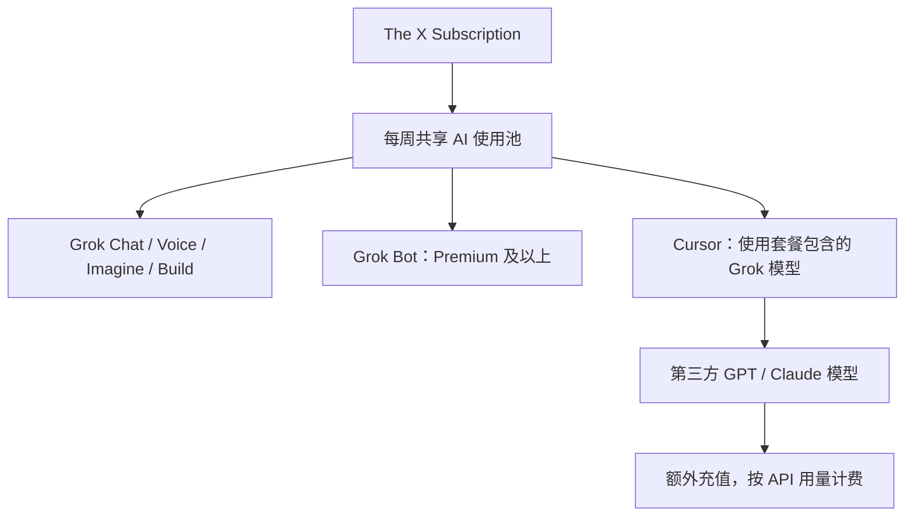

# X Plus、Premium 与 ChatGPT Plus：2026 年订阅权益、成本与开发者选型分析

> **信息核对日期：2026-11-08**。文中美元价格以官网标价为准，可能不含税费、地区定价、应用商店附加费用。权益、模型和限额会调整，最终以账号结账页与产品仪表盘为准。本文把官方已确认的权益与个人使用场景判断分开讨论。

最近越来越觉得，ChatGPT Plus 这 20 美元花得没以前值了。

以前五小时额度用完，偶尔还能靠重置次数继续用。现在听说以后不再赠送重置次数，模型的额度也感觉没以前耐用了。尤其是用来分析代码、研究技术方案，或者连续跑几个复杂任务，没折腾多久就提示达到使用上限。

20 美元一个月，说贵倒也不算贵，但问题是，花了钱却总得惦记着剩余额度，多少有点影响使用体验。

于是最近一直在考虑，要不要换个 AI 订阅。

Claude Pro 也是 20 美元，Claude 在编程和长文本处理方面一直有不错的口碑，但又担心账号风控和封号问题。换过去之后能不能稳定使用，也是个顾虑。

其他产品也看了一圈，发现 X 的订阅体系最近有了不少变化。除了 Grok，还把 Cursor 的 AI 编程能力整合进了会员套餐。

这就有点意思了。同样是每月二三十美元，到底是继续订阅 ChatGPT Plus，换成 Claude Pro，还是干脆选择 X Plus / Premium？

这次就把几个套餐的价格、使用额度、AI 模型、编程能力和附加权益放在一起比较一下。重点不看宣传里堆了多少功能，而是看看这些权益究竟能用多少、有哪些额外成本，以及对于日常编程和技术研究来说，哪个更划算。

## 一、先说结论：比价格更重要的是实际工作流

如果主要目的是**复杂技术研究、写作、文件分析、编程问题讨论和跨任务协作**，ChatGPT Plus（20 美元/月）仍是更直接的选择。如果既要使用 X 平台的蓝标和内容工具，又希望以 Grok 为主要 AI、以 Cursor 为主要代码 Agent，新版 The X Subscription Premium（30 美元/月）值得考虑。如果只是想在 X 上发内容、获得蓝标并试用 Grok 和 Cursor，则可以从 X Subscription Plus（8 美元/月）开始。

一个容易忽视的组合是 **ChatGPT Plus + X Subscription Plus**：两者月付标价合计 28 美元，比单买 X Subscription Premium 的 30 美元还少 2 美元。它不是所有功能都强于后者，但为两个不同的 AI 工作流保留了选择权。

最不该做的，是把「30 美元包含 Grok、Cursor、X」直接理解成三份互不影响、额度完整的独立会员。Grok 与 Cursor 在新版订阅中**共享每周 AI 使用池**；Cursor 的 GPT、Claude 等第三方模型并不由订阅费包办，符合条件的计划需通过额外充值按 API 价格使用。[1][2][3]

## 二、为什么现在容易把 X Premium 认错？

2026 年 10 月，官方推出 **The X Subscription**，整合 Grok、Cursor 和 X 的订阅权益。原 X Premium 是社交平台会员，新 X Subscription 则是 AI + 编程 + 社交组合订阅。名字相近，产品实际不同。[1]

### 2.1 旧体系：X Premium（适用于保留旧套餐的用户）

| 旧订阅 | 官网起始月付 | 官网起始年付 | 定位 |
|---|---:|---:|---|
| Basic | $3 | $32 | 社交平台基础增强功能 |
| Premium | $8 | $84 | 蓝标及更丰富的发布、社交工具 |
| Premium+ | $40 | $395 | 高档 X 平台功能 |

以上为旧体系 X 官方帮助中心披露的网页起始价格，不代表所有国家、渠道都相同。[4]

### 2.2 新体系：The X Subscription（当前新用户重点关注）

| 新订阅 | 月付 | 年付 | 与 Plus 相比的共享 AI 额度 | 主要用途 |
|---|---:|---:|---:|---|
| Free | $0 | $0 | 有限 | 轻度体验 Grok、Cursor 与普通 X |
| Plus | $8 | $80 | 基础 | 入门 AI + 蓝标和创作工具 |
| Premium | $30 | $300 | 4 倍 | 高阶 Grok、Cursor 和完整 X Premium+ |
| Super | $100 | $1,000 | 15 倍 | 重度 AI、编程及视频创作 |
| Ultra | $200 | $2,000 | 50 倍 | 高强度使用场景 |

数据来自官方定价说明。[1][5] 注意：**4 倍、15 倍、50 倍指共享用量相对 Plus 的倍数，不等于提问次数或可生成视频条数的固定倍数**。不同模型、工具和操作的消耗并不一样。[2][5]

例如，“X Premium 每月 30 美元”讲的是**新体系**；“X Premium 每月 8 美元”通常讲的是**旧体系**。阅读旧测评、对比截图或分享订阅建议时，必须先确认讨论的是哪套体系。

## 三、Plus 和 Premium：到底多花 22 美元买到什么？

| 维度 | 新 X Plus：$8/月 | 新 X Premium：$30/月 | 是否值得升级 |
|---|---|---|---|
| Grok Chat / Voice / Imagine / Build | 有 | 有，且更大共享用量 | 使用频率高才值得 |
| Grok API 访问 | 官方定价页列入 | 继承 Plus 及更高权益 | 访问不等于无限免费调用 |
| Cursor 编程助手 | 有基础额度 | 有更大额度与更多 Agent 能力 | 取决于是否日常使用 Cursor |
| AI 使用池 | 基础 | Plus 的 4 倍 | 仍需看操作实际消耗 |
| Grok Bot | 不包含 | 包含 | 需要自动化 AI 队友时有价值 |
| 最新 Grok 模型、响应速度 | 受档位限制 | 官方列出最新模型和更快响应 | 对重度研究者有价值 |
| 代码托管、AI 代码审查、云 Agent | 以 Plus 具体可用功能为准 | 官方明确列入 Premium | 对开发流程更有价值 |
| X 蓝标 | 有（须符合规则并连接个人账号） | 有 | 单为蓝标不必升 Premium |
| X 创作者工具、分析 | 有 | 继承并增强 | 中轻度创作 Plus 通常可先试 |
| X 广告 | 时间线广告减少 | 多数界面可无广告滚动 | 不是所有广告场景一律消失 |
| 回复优先级 | 有权益 | 更高回复加权 | 不能保证曝光或互动结果 |
| X Premium+ 权益 | 不完整 | 官方明确包含完整权益 | 依赖 X 平台的用户更受益 |
| Cursor 中的 GPT / Claude 第三方模型 | 不应视作订阅内免费权益 | 可用，但单独按 API 列表价计费 | 核算实际成本的关键 |

官方定价页提供 Plus、Premium 的主要差异；是否可用还会受账号资格和功能上线节奏影响。[1][3]

### 3.1 共享 AI 额度：这是套餐最关键的限制

新版 X Subscription 不是「Grok 一份独立额度 + Cursor 一份独立额度」，而是共享一个使用池：

官方说明额度每周刷新，可以查看剩余额度；超额后可等待刷新或通过充值继续使用。每种产品的调用成本不一样，不能把共享池粗暴换算成固定的“每周几百次对话”。[1][2]

**例子**：假设一周同时高频用 Grok 做调研、用 Cursor 的 Grok 模型做项目级修改，两者都会消耗同一个池子。研究阶段使用过多，可能挤占后续编码阶段的可用额度。实际是否触顶取决于任务复杂度、模型和官方计费规则。

### 3.2 别把 Cursor 权益理解成所有模型随便用

Cursor 产品能接触多家模型，不代表 X Premium 为所有这些模型买了包月套餐。官方明确指出，**新体系 Premium 及以上可以在 Cursor 使用第三方模型，但它们从首次使用就按 API 列表价通过充值结算**。这对习惯在 Cursor 中使用 Claude 或 GPT 的开发者影响很大。[1][2]

因此判断 Premium 是否划算，应先弄清楚自己的模型偏好：

- 主要使用套餐覆盖的 Grok 模型：组合订阅价值更高。
- 大量使用 Claude / GPT 编码：仍可能产生单独模型账单。
- 主要在 Pi、Codex CLI 或自建 Agent 中编码：Cursor 权益是否可以充分利用，需要看实际接入方式，不应假定能直接转移到现有 CLI 或 API 调用。

## 四、ChatGPT Plus 20 美元提供什么？

OpenAI 官方帮助中心确认，ChatGPT Plus **20 美元/月**，包括高峰时段优先访问、更高模型限额、高级推理访问、更快响应，以及语音、图片生成、文件上传与分析、可用时的深度研究等功能。可用模型、具体上限随时间和账户而变。**ChatGPT Plus 不包含独立 API 账单**。[6]

从需求出发，可以把 ChatGPT Plus 看作偏向通用智力劳动的工作空间：

1. **复杂推理与技术方案**：处理架构权衡、调试策略、流程设计、项目拆解和多步分析。
2. **研究与材料整合**：围绕外部资料进行检索、对照和深度研究；实际可用能力以账号为准。
3. **文档和数据处理**：上传文件，归纳、分析、改写、校对，减少工具切换。
4. **开发协作**：讨论代码、生成测试方案，并使用账户支持的编码工具；Codex 的具体权限和额度应以对应产品页面为准。
5. **长期任务组织**：根据账户当前可用的项目、记忆或任务功能组织工作，而非把所有工作塞进单次对话。

这些能力并不意味着 ChatGPT 在任何任务上都优于 Grok，也不保证 Plus 有无限模型额度。订阅价值最终由**任务完成质量、稳定性、用量限制、迁移成本**决定。

## 五、X Premium 与 ChatGPT Plus 横向评测

以下是**产品定位和选型分析**，不是同一批测试集上的模型能力跑分；未执行统一的真实环境基准测试，因此不宣称某家模型在所有任务中绝对领先。

| 对比问题 | ChatGPT Plus：$20/月 | X Premium：$30/月 | 选择依据 |
|---|---|---|---|
| 核心价值 | ChatGPT 高级模型与工具 | Grok + Cursor + X Premium+ | 是否需要捆绑内容 |
| 技术研究 | AI 研究、推理、文件分析 | Grok 研究与 AI 创作 | 使用自己的资料试测 |
| 代码工作流 | ChatGPT / Codex 等可用工具 | Cursor 本地和云代码 Agent | 习惯 CLI 还是 IDE |
| 默认模型生态 | OpenAI 模型与工具 | 重点为 Grok 模型 | 平常实际用哪类模型 |
| 第三方模型费用 | Plus 不等于 OpenAI API 免费 | Cursor 第三方模型另付费 | 把 API 费用单列 |
| 图像生成 | 提供 | 提供 | 对比真实输出与限额 |
| 视频创作 | 视独立产品与账户权益 | Imagine；较高等级提供特定高级视频能力 | 关注分辨率、时长、额度 |
| X 蓝标、低广告 | 无 | 有 | 是否需要经营 X 账号 |
| AI 限额 | 根据 OpenAI 账号与模型 | Grok/Cursor 共享每周池 | 两种额度口径不可直接相加 |
| 账户迁移 | 单独 ChatGPT 订阅 | 可能涉及 Grok、Cursor、X 合并 | 已有账号需谨慎 |

### 5.1 技术文章写作

如果流程是「整理代码实验 → 参考外部资料 → 搭建论证 → 写完整文章 → 校正事实和表达」，ChatGPT Plus 通常更符合单一工作区的使用思路。Grok 与 X 的优势则在于把调研、发布和 X 平台互动放得更近。

但 X 蓝标本身不会自动提升文章技术质量，更不应把平台内流量工具等同于可信数据来源。写架构评测仍需要引用原始仓库、官方文档和可复现结果。

### 5.2 开发者编码

决定订阅的关键问题是：**代码主要在什么环境中完成？**

- 主要在 Cursor IDE 内工作、频繁使用 Grok 模型：X Premium 的统一使用池可能带来成本优势。
- 主要在终端使用 Pi、Codex CLI 等工具：优先核查各自已有授权和模型计费机制，不要为了一个尚未接入的 Cursor 权益付费。
- 如果项目依赖 GPT、Claude 等特定模型：比较总调用成本，而非只比较两家订阅标价。

### 5.3 AI Agent 和自动化项目

做 Agent 工程时，要区分三类费用：

1. **人机交互订阅费**：ChatGPT Plus / The X Subscription。
2. **程序通过 API 调用模型的成本**：按接口和令牌计费，不能默认为会员赠送。
3. **运行与维护成本**：云端执行、CI、存储、日志、评测、第三方服务等。

即使订阅 $30 看起来提供了多个产品，也不意味着自建 Agent 可以拿一个订阅凭证无限跑生产任务。应以官方 API、授权和计费条款为准。

## 六、实际价格：月付、年付和组合方案

### 6.1 月付成本

| 方案 | 每月标价 | 按 12 个月月付的年度支出 | 适合谁 |
|---|---:|---:|---|
| X Subscription Plus | $8 | $96 | X 创作者 + 轻度 Grok/Cursor |
| ChatGPT Plus | $20 | $240 | 通用 AI 和知识工作主力 |
| X Subscription Premium | $30 | $360 | Grok/Cursor/X 组合深度使用 |
| ChatGPT Plus + X Plus | $28 | $336 | 双生态、重视灵活性 |
| ChatGPT Plus + X Premium | $50 | $600 | 两边均高频且有明确需求 |

### 6.2 X 年付的对比

| X 方案 | X 官方年付价 | 折算月均 | 相比连续 12 个月月付节省 |
|---|---:|---:|---:|
| Plus | $80 | 约 $6.67 | $16 |
| Premium | $300 | $25 | $60 |
| Super | $1,000 | 约 $83.33 | $200 |
| Ultra | $2,000 | 约 $166.67 | $400 |

以上只基于 X 官方公布的年付价计算。[5] **ChatGPT Plus 的表中 $240 是 12 个月月付累计，不代表官方提供 $240 的年度 Plus 套餐**。计算未包含税费、汇率、额外 API 消耗和可能的促销折扣。

### 6.3 一个容易被忽略的组合

如果 ChatGPT Plus 按月续订 12 个月（$240），X Plus 采用年付（$80），则全年总计 **$320**，折合每月约 $26.67，比 X Premium 年付 $300 多 $20，但拿到的是两套互补产品的使用权，而不是 X Premium 的更高共享池。这里并无绝对赢家：

- **选 X Premium 年付**：更重视统一 Grok/Cursor 的高用量和完整 X Premium+。
- **选 ChatGPT Plus + X Plus**：更重视 ChatGPT 作为主力，并保有 X 基础创作者权益。
- **先按月试用**：还不确定自己的实际额度消耗、编码工具迁移程度时，不应仅为了年付折扣过早锁定。

## 七、建议用一周真实任务验证，而不是看宣传页决定

如果是工程师或技术内容创作者，可以做一个轻量试用表：

| 测试任务 | 操作要求 | 观察指标 |
|---|---|---|
| 技术研究 | 对同一个开源项目总结机制并核查来源 | 事实错误、引用准确性、耗时 |
| Bug 诊断 | 给同一段错误日志与最小复现 | 定位准确度、建议可执行性 |
| 代码重构 | 同一仓库、同一目标、同样测试条件 | 测试通过率、改动范围、人工返工 |
| Agent 设计 | 同一约束设计多 Agent 工具接入方案 | 兼容性、边界条件、可维护性 |
| 技术写作 | 同一组笔记产出文章初稿 | 逻辑、事实、人工修改工作量 |
| 配额观察 | 连续记录一周高峰工作时段 | 额度耗尽、速度、额外充值 |

评价时不要只看模型回答是否流畅。更可量化的是**是否能完成任务、能否通过现有测试、花多少时间修改、是否出现额外账单**。对于 QAT 一类多阶段工程项目，尤其要测从需求分析到测试报告生成之间的连续性，而不是只测一个问题。

## 八、按不同使用场景给出购买建议

### 场景 A：只需要一个 AI 主力工具

**优先 ChatGPT Plus。** 前提是主要任务是研究、分析、写作、文件处理和技术方案讨论，而不是持续依赖 Cursor IDE 或 X 创作者特权。它的价值来源于日常工作的集中，而非单看订阅包含了多少产品名字。

### 场景 B：X 内容创作者，AI 只是辅助

**先选 X Plus。** $8/月已覆盖蓝标、较少广告、创作者工具，以及 Grok/Cursor 基础使用池。若未来经常用完额度，再依据仪表盘升级。

### 场景 C：Cursor IDE 是主力，Grok 也是主力

**评估 X Premium。** 共享池升级到 Plus 的 4 倍，并包含 Grok Bot、更多代码和云 Agent 能力、完整 X Premium+。但如果 Cursor 工作经常调用 Claude/GPT，需把额外 API 费用纳入预算。

### 场景 D：正在做 AI Agent / 测试自动化 / CLI 开发

先画清调用链：模型在哪里运行、通过谁计费、需要什么 SDK/接口、是否涉及 CI 无人值守调用。单纯订阅“含 Cursor”，不等于现有独立 CLI 和自建 Agent 自动获得相同授权。已经有较成熟 ChatGPT 工作流的用户，可以从 **ChatGPT Plus + X Plus** 起步；只有明确发现 Cursor/Grok 高用量价值时，才升级 X Premium。

### 场景 E：频繁使用 AI 视频、云 Agent，额度很快耗尽

可以再看 Super / Ultra，但这类支出应建立在稳定的真实使用数据上。仅凭“最高 50 倍额度”不足以判断投资回报：重点是实际单位任务成本、限制、速度和业务价值。

## 九、订阅前必须检查的八个问题

1. **是旧 X Premium，还是新 The X Subscription？** 名字相似但内容和价格不同。
2. **页面显示的是月付还是年付？** 年付折算月均不等于按月扣款。
3. **计价地区和支付渠道？** 可能涉及当地税、汇率、App Store 或 Google Play 价格。
4. **X 账号是否为个人账号？** 新订阅的 X 权益需要关联符合条件的个人 X 账号，组织管理账号存在限制。[3]
5. **Grok 和 Cursor 共享池够不够？** 查看现有消耗和额度刷新时间。[2]
6. **是否要用 Cursor 中的 GPT / Claude？** Premium 及以上可以使用，但第三方模型要单独支付。[1]
7. **旧订阅要不要切换？** 官方称旧订阅可保留；账号合并和新方案切换可能不可逆，切换前看清适用规则。[2]
8. **是否误把会员和 API 包月混为一谈？** ChatGPT Plus 不包含 OpenAI API 费用，X Subscription 也有其自身使用池和单独计费边界。[6]

## 十、最后的判断

在 2026 年的新体系下，X Premium 的价值已不只是一枚蓝标：它真正的卖点是 **Grok + Cursor + X** 的组合。但如果你不会重度使用 Cursor 的 Grok 模型，或者平时更多通过终端、其他模型供应商和独立 API 开发，那么捆绑权益未必比 ChatGPT Plus 更划算。

**我更建议的决策顺序是：**

- 先确定自己的主力工作流，而不是被“原价三合一”吸引。
- 再估算一个月内 Grok、Cursor、ChatGPT 和外部 API 的真实使用量。
- 最后决定是单买 ChatGPT Plus、单买 X Premium，还是组合 ChatGPT Plus + X Plus。

对于以工程实践、AI 评测和技术写作为主的用户，**ChatGPT Plus 仍可以作为主力；X Plus 适合轻量补充；X Premium 则要等到 Grok/Cursor 成为高频生产工具后再买。** 这是一项基于使用场景的购买建议，不是模型性能的客观排名。

---

## 官方来源与复核入口

以下链接均为官方网页，适合作为日后价格、功能更新时的复核清单：

1. [The X Subscription 发布公告（2026-10）](https://x.ai/news/x-subscription) —— 整合方案、定价、共享池、第三方模型收费说明。
2. [The X Subscription 概览文档](https://docs.x.ai/x-subscription/overview) —— 共享使用池、账号与迁移规则。
3. [X Help Center：What is The X Subscription?](https://help.x.com/en/using-x/x-subscription) —— X 个人账号福利与资格说明。
4. [X Help Center：旧 X Premium FAQ](https://help.x.com/en/using-x/x-premium-faq) —— 旧 Basic、Premium、Premium+ 起始价格。
5. [The X Subscription 官方定价](https://docs.x.ai/x-subscription/pricing)；[实时价格页](https://x.ai/pricing) —— 月付/年付、额度倍数、Grok Bot 档位。
6. [OpenAI Help Center：什么是 ChatGPT Plus？](https://help.openai.com/zh-hans-cn/articles/6950777-what-is-chatgpt-plus) —— ChatGPT Plus 定价、主要工具及 API 另计费。
7. [X Premium 用户迁移说明](https://docs.x.ai/x-subscription/x-premium) —— 旧 X Premium 迁移和权益对应。

> **版本维护备注**：本文以 2026-11-08 可查阅的官方资料写成。未来若名称、价格、额度、资格或功能改变，应优先更新第 2、3、6、9 节以及对应来源，不要机械沿用本文结论。
