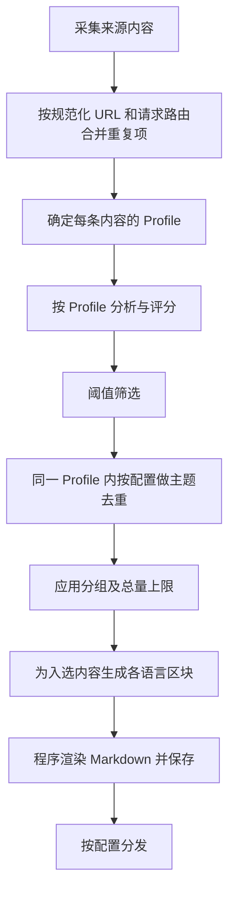

# 用 Horizon 做技术晨报：新闻看变化，长文看方法

订阅模型厂商博客、开源项目更新和技术社区之后，收集信息并不难。麻烦的是，同一个发布消息出现好几遍，一篇工程长文又被压成几句结论。读完一份摘要，仍然不知道哪些变化需要关注，哪些方法可以拿来验证。

**Horizon 是 Thysrael 开源的 AI 信息聚合项目。** 它从 RSS、GitHub、Hacker News 等来源收集内容，按配置评分、筛选和去重，再生成包含摘要、背景或技术方案的日报。输出可以保存为 Markdown，也能按配置接入邮件、Webhook 等渠道。

它有一个适合技术阅读的设计：新闻和长文可以使用不同的处理规则。前者关注发生了什么变化，后者保留问题、方案与适用条件。

资料核对范围为截至 2026 年 11 月 14 日读取的仓库文档与源码，固定版本为 `3239500`。未安装或运行 Horizon；团队案例、组合配置与验收设计均为模拟示例，不代表真实部署结果。

## 一份日报，可以有不同的阅读方式

普通订阅聚合主要把信息放到一起。把全文交给模型总结，可以再省一道阅读工序。Horizon 在中间增加了持续执行的选择规则：什么内容进入哪套流程，分数达到多少才留下，留下后写成什么形式。

项目把这套规则称为 **Profile**，可以理解为一份可复用的编辑规范。

内置的 `tech-news` 面向新闻、发布和事件，生成摘要与必要背景，按需补充影响和社区讨论。`tech-blog` 面向技术长文，输出背景、方案和启示。仓库还提供 `finance-news` 与 `ai-creator`，分别用于财经信息和 AI 创作素材。

每个 Profile 由四个文件组成：

| 文件 | 负责的事情 |
| --- | --- |
| `profile.json` | 定义内容输入预算、输出区块和区块可用工具 |
| `match.md` | 描述哪些内容适用，供自动匹配使用 |
| `analysis.md` | 定义分析要求与评分标准 |
| `enrichment.md` | 规定入选内容各区块的写法 |

信息源、模型、筛选阈值、日报篇数和推送渠道则留在运行配置里。这样，同一套长文阅读规则可以复用，不必把私人订阅和密钥一起塞进 Profile。[1]

源码的职责也沿着这个过程划分：`src/main.py` 读取命令参数与配置，`src/orchestrator.py` 编排采集、分析和筛选；`src/scrapers/` 对接来源，`src/ai/` 负责模型处理及日报渲染，`src/services/` 提供分发实现。`profiles/` 和 `data/config.example.json` 分别承载编辑规则与运行配置示例。[2][3]

每条内容最终只进入一个 Profile。来源可以直接指定，也可以让 AI 从全部或指定候选 Profile 中选择。候选列表的含义是选一个，并不是把同一篇文章交给所有 Profile 各处理一次。

## 模拟案例：给智能客服团队做技术晨报

假设一个团队正在维护电商智能客服，技术人员需要关注模型工具调用、检索增强生成，以及推理服务的工程变化。

团队的阅读任务很具体：从外部动态中找出可能影响模型选型、服务配置和回归范围的材料。晨报负责提供线索，业务影响仍由工程人员确认；自动生成测试用例、创建工单或决定发版，不属于这里使用的 Horizon 原生能力。

模拟方案先保留两类内容：

- 发布与技术动态使用 `tech-news`，关注变化、背景和相关讨论。
- 工程长文使用 `tech-blog`，保留原问题、方案，以及方法成立的条件。

这两类内容不能只靠同一个分数判断。内置 `tech-blog` 的评分规则重视技术深度、证据和可迁移经验，并未直接定义该客服团队的业务相关性。即使一篇文章得到高分，也不代表团队应该更换模型。[4]

若业务相关性是硬要求，可以复制内置 Profile，再修改评分提示词。复制目录、修改 `profile.json` 的唯一 ID，并把信息源指向新 ID，是项目文档给出的扩展方式；使用现有区块类型和工具时，通常不需要修改 Python。[1]

模拟团队可以保留既有分析输出要求，加入业务相关性规则：

**模拟提示词片段，非仓库原文：**

```text
阅读对象：维护电商智能客服的研发与测试人员。
优先关注工具调用、检索、推理服务及版本兼容性。
评分理由须指出与上述任务的具体关系。
区分作者实测、产品声明和推测；缺少条件时明确说明。
不得把外部文章的结果改写成本团队的验证结果。
```

这段提示词表达了期望，不保证模型每次都遵守。它需要和人工选出的相关、无关样本一起验收。

## 先用小配置，确认日报是否合适

项目要求 Python 3.11 或以上。[11] README 提供本地、Docker 和 Agent Skill 等使用方式。选择本地方式时，文档中的安装命令如下，仅作引用，未在本次研究中执行：[5]

```bash
git clone https://github.com/Thysrael/Horizon.git
cd horizon

# 使用 uv 安装（推荐）
uv sync
```

配置可以从向导开始：

```bash
uv run horizon-wizard
```

也可以按 README 复制 `.env.example` 和 `data/config.example.json`。密钥放在环境变量或 `.env` 中；`ai.api_key_env` 填变量名，不填密钥明文。模型名称与服务地址需按实际服务配置，示例中的模型名不构成选型推荐。[5][6]

对上述模拟团队，可以先从少量来源开始。以下是**自行组合的配置片段**，字段和来源取自仓库示例，需合并到完整配置中；未验证这些外部订阅当前的可访问性：

```json
{
  "sources": {
    "rss": [
      {
        "name": "Simon Willison",
        "url": "https://simonwillison.net/atom/everything/",
        "category": "ai-tools",
        "profile": "tech-news"
      },
      {
        "name": "vLLM Blog",
        "url": "https://vllm.ai/blog/rss.xml",
        "category": "llm-inference",
        "profile": "tech-blog",
        "content_extractor": "trafilatura"
      }
    ]
  },
  "processing": {
    "profiles_dir": "profiles",
    "default_profile": "tech-news",
    "profile_settings": {
      "tech-news": {"threshold": 7.0, "topic_dedup": true},
      "tech-blog": {"threshold": 4.0, "topic_dedup": false}
    }
  },
  "digest": {
    "max_items": 8,
    "category_groups": {
      "ai": {"limit": 4, "categories": ["ai-tools"]},
      "engineering": {"limit": 4, "categories": ["llm-inference"]}
    },
    "default_group": "other",
    "default_group_limit": 2
  }
}
```

这里暂用内置 Profile，便于先理解默认结果；采用自定义 Profile 时，需要同步替换来源的 `profile` 和 `profile_settings` 中的 ID。

新闻阈值 `7.0`、长文阈值 `4.0` 沿用了仓库配置示例。它们对应不同评分标准，不能解释成新闻天然比长文重要。模拟方案中的总量 `8`、分组限额 `4` 与 `2` 则是人为设置的阅读预算，没有经过效果优化。[7]

限额是上限，不是保底配额。合格内容不足时，日报可以少于 8 条；两个组各限 4 条，也不保证两个组都能选满。源码按评分排序应用分组限制，再截取总量，因此不同 Profile 的评分尺度仍可能影响最终份额。[3]

README 的运行入口是 `uv run horizon [OPTIONS]`，其中 `--hours N` 用于指定最近 N 小时的采集窗口。下面取文档参数组合为一个 **24 小时运行示例，未执行**：

```bash
uv run horizon --hours 24
```

默认日报保存到 `data/summaries/`。`--data-dir` 会改变状态目录及默认配置位置，`--config` 只改变配置文件位置；二者不要混用成同一种含义。[6]

## 两条内容进入后，应该留下什么

假设采集窗口内出现两条虚构材料：一条 SDK 工具调用行为变更公告，一篇推理服务调优长文。它们只是说明处理路径的模拟输入，不对应某次真实发布。

Horizon 的主要流程如下。图为依据源码整理的示意，不是运行记录。[3]



SDK 公告进入 `tech-news` 后，预期先得到评分、理由、简短摘要和标签。通过筛选后，再生成摘要及所需背景。对客服团队而言，人工阅读时应能找到变更点、适用版本和原文；涉及工具调用的改动，再转成自己的兼容性验证任务。

项目允许背景区块声明 `web_search` 或 `history_search` 工具。不过，允许搜索不等于每条新闻必定搜索。历史搜索读取的是本地旧日报，不是互联网历史资料库；目录里没有旧日报，就没有可供检索的历史内容。[1]

推理调优长文进入 `tech-blog` 后，默认输出 `background`、`solution`、`takeaway` 三个区块，分别承载背景、方案和启示。这三个内置区块的工具列表都是空的，不能假定它会顺手上网验证文章结论。[8]

针对这条模拟长文，合格结果应保留测试条件，例如模型、硬件、请求分布，以及优化作用于哪个环节。若原文没有这些信息，晨报应保留缺失状态，不能把结论补齐成通用建议。把这些条件加入验收要求，是业务方案设计，不是已经观测到的模型表现。

`tech-blog` 对长文采用首、中、尾抽样，分析和内容补充阶段分别设有字符预算；超过预算时，模型拿到的是选取片段。正文提取失败也可能退回 RSS 摘要。如果遗漏的恰好是实验限制，生成内容就需要回到原文补查，不能当成模型逐字读完全文的证明。[1][8][9]

## 去重少一点，信息反而可能更完整

同一则发布公告被多个来源转发，合并有助于减少重复阅读。但两篇讨论相同主题的工程文章，可能分别给出成功方案与失败条件，不能只因标题相近就删掉一篇。

模拟配置因此给新闻开启主题去重，给长文关闭主题去重。项目的主题去重在已确定的同一个 Profile 内进行；关闭它，也不会关闭前面按规范化 URL 和请求路由进行的合并。[1][3]

主题去重还依赖模型判断，源码对部分调用或解析失败采用保留原条目的处理方式。配置了去重，仍可能看到重复报道。反过来，只看到一条也不能证明合并正确，验收时要检查被合并的材料是否确实属于同一事件。

最终 Markdown 由程序根据已生成的内容区块渲染，不再额外调用模型做一轮整篇总结。这能避免排版阶段再次改写全部内容，但前面的评分、去重和区块生成仍需检查。[1][10]

## 验收日报，要回到原文

对这个模拟团队，第一轮验收不宜只看排版。可以准备一组固定材料，人工标注用途后，再逐项对照：

| 验收对象 | 模拟验收要求 |
| --- | --- |
| 版本变更公告 | 能定位原文和适用版本；没有版本信息时不编造 |
| 相同事件的重复报道 | 合并后保留关键差异；去重失败不被当成无重复 |
| 同主题、不同方案的长文 | 关闭主题去重后，不因主题相近而误删 |
| 带实验数据的文章 | 保留输入、环境和限制，不把外部数据当成本团队结果 |
| 内容数量 | 不超过配置上限；不足时不为凑数生成新闻 |
| 业务建议 | 与来源事实分开，由工程人员确认后再转入回归任务 |

项目文档说明，搜索支持的内容会引用工具返回的来源，并拒绝未由工具返回的引用标识。这个约束有助于检查引用从哪里来，但仍要核对引用是否支持正文，不能据此宣布事实已经验证。[1]

成本也要按处理阶段看。篇数限制发生在内容补充之前，可以减少入选后的生成工作；候选内容在这之前已经经过分析，自动路由、主题去重和搜索也可能增加调用。不能把日报只有 8 条理解成只付出 8 次摘要成本。本次未测量单次费用、漏报率、摘要准确率或节省时长。

模拟方案预期减少重复阅读，并让技术线索更容易进入评审。是否达到这个目标，要记录有多少入选内容确实被团队使用、哪些重要变化漏掉了，以及人工复核花了多少时间。再调阈值和来源，比继续堆订阅更有依据。

## 日报可以短一点

如果目的只是浏览标题，已有订阅工具可能就够了。需要长期执行不同的筛选标准、控制阅读量，并按内容类型整理材料时，Horizon 的 Profile 才更有用。

日报只留下几条也没关系。留出时间读完其中一篇长文，比给收藏夹再加一批链接，更符合这个模拟团队的阅读任务。

收藏夹已经很勤奋了，阅读不必继续替它加班。

---

资料来源（均引用本次读取的固定提交 `323950050b079d054a009aa02198d89aae48e8da`）：

1. [Profile 文档：路由、评分、工具、抽样与输出](https://github.com/Thysrael/Horizon/blob/323950050b079d054a009aa02198d89aae48e8da/docs/profiles.md)
2. [CLI 入口 `src/main.py`](https://github.com/Thysrael/Horizon/blob/323950050b079d054a009aa02198d89aae48e8da/src/main.py)
3. [流程与筛选实现 `src/orchestrator.py`](https://github.com/Thysrael/Horizon/blob/323950050b079d054a009aa02198d89aae48e8da/src/orchestrator.py)
4. [长文评分规则 `profiles/tech-blog/analysis.md`](https://github.com/Thysrael/Horizon/blob/323950050b079d054a009aa02198d89aae48e8da/profiles/tech-blog/analysis.md)
5. [中文 README：快速开始与功能说明](https://github.com/Thysrael/Horizon/blob/323950050b079d054a009aa02198d89aae48e8da/README_zh.md)
6. [配置指南](https://github.com/Thysrael/Horizon/blob/323950050b079d054a009aa02198d89aae48e8da/docs/configuration.md)
7. [运行配置示例 `data/config.example.json`](https://github.com/Thysrael/Horizon/blob/323950050b079d054a009aa02198d89aae48e8da/data/config.example.json)
8. [长文区块与输入预算 `profiles/tech-blog/profile.json`](https://github.com/Thysrael/Horizon/blob/323950050b079d054a009aa02198d89aae48e8da/profiles/tech-blog/profile.json)
9. [内容抽样实现 `src/processing/content.py`](https://github.com/Thysrael/Horizon/blob/323950050b079d054a009aa02198d89aae48e8da/src/processing/content.py)
10. [日报渲染 `src/ai/summarizer.py`](https://github.com/Thysrael/Horizon/blob/323950050b079d054a009aa02198d89aae48e8da/src/ai/summarizer.py)
11. [Python 要求与命令入口 `pyproject.toml`](https://github.com/Thysrael/Horizon/blob/323950050b079d054a009aa02198d89aae48e8da/pyproject.toml)

项目地址：https://github.com/Thysrael/Horizon

#Horizon #AI工具 #开源项目 #测试开发 #信息管理
