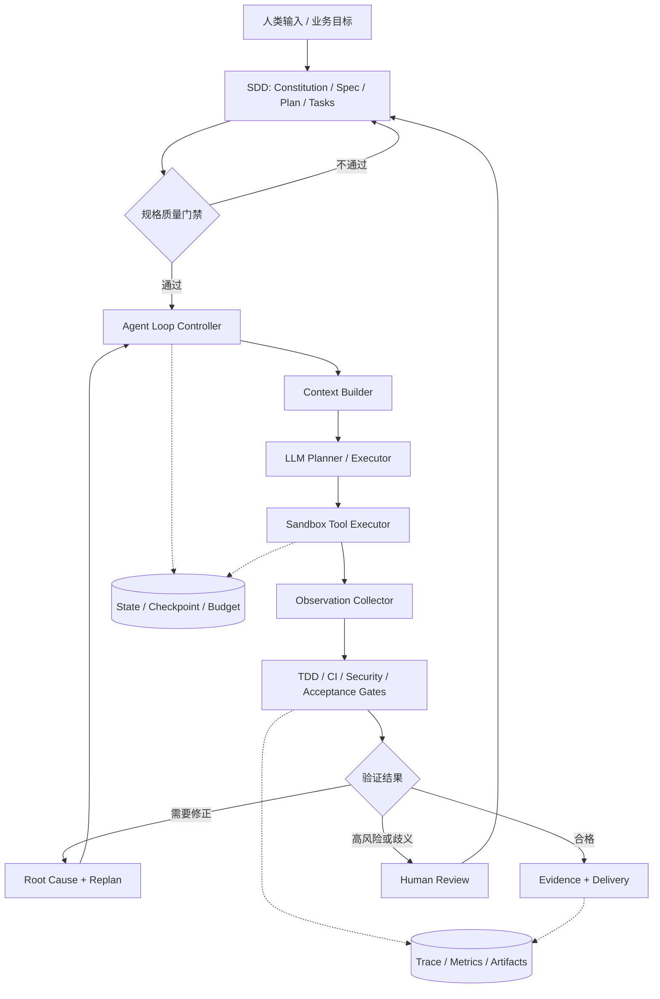
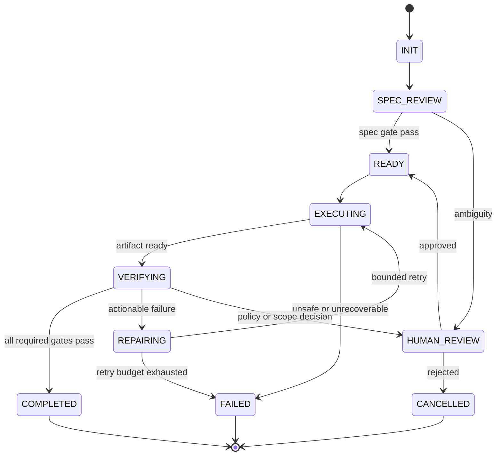

# Agent Loop × SDD × TDD：从 AI 编码到可验证工程闭环

> **核心观点：Agent Loop 负责推进，SDD 负责约束意图，TDD 负责构造可执行反馈；状态机、质量门禁、上下文治理和可观测性让三者从方法论进入工程实践。**
>
> “思考→行动→观察→复盘→再思考→再执行”

## 一、首先厘清：这三套东西分别解决什么

| 维度 | Agent Loop | SDD（Specification-Driven Development） | TDD（Test-Driven Development） |
|---|---|---|---|
| 核心问题 | 下一步做什么、做完怎么反馈 | 要实现什么、边界和约束是什么 | 什么证据能证明行为符合期望 |
| 主要对象 | 任务、工具、状态、观察结果 | Constitution、Spec、Plan、Tasks | 测试列表、断言、测试运行与重构 |
| 失败信号 | 工具错误、超限、环境异常、停滞 | 需求歧义、冲突、规格漂移 | 断言失败、测试不稳定、覆盖遗漏 |
| 主要风险 | 无限循环、虚假完成、上下文膨胀 | 文档形式化、过期、规格错误 | 只验证已知行为、为通过测试而投机 |
| 工程补强 | 状态机、预算、Checkpoint | 追踪矩阵、版本与审查门禁 | 独立测试、分层、CI 和变异测试 |


Agent Loop 可以采取如下六阶段认知模型：**思考 → 行动 → 观察 → 复盘 → 再思考 → 再执行**。它是解释性框架，而非所有 Agent Runtime 必须照搬的固定内部实现。TDD 的 Red–Green–Refactor 则是可以嵌入其中的更小循环。

## 二、重新整理为五层工程架构



五层职责应当分开：

1. **Intent Layer（意图层）**：业务目标、范围、限制、风险、验收标准。
2. **Specification Layer（契约层）**：长期约束与单特性规范，建立追踪关系。
3. **Execution Layer（执行层）**：Agent 决策、工具调用、任务调度与状态持久化。
4. **Verification Layer（验证层）**：单测、集成、契约、E2E、静态、安全与人工审查。
5. **Evidence Layer（证据层）**：测试报告、Diff、审查意见、追踪数据、成本与结论。

工程边界：**LLM 提供建议和代码，不直接充当不可质疑的验收裁判；工具结果和独立校验规则是重要事实来源。**

## 三、SDD：从“有文档”升级到“有契约”

### 3.1 产出物及权威边界

```text
project/
├── constitution.md           # 项目级不变量与约束
├── specs/
│   └── feature-user-create/
│       ├── spec.md            # 行为、边界、非功能验收标准
│       ├── plan.md            # 技术设计、数据模型、权衡
│       ├── tasks.md           # 可执行任务与依赖
│       ├── traceability.md    # REQ -> AC -> TASK -> TEST 追踪
│       └── decisions.md       # 关键决策及其理由（按需）
├── tests/                     # 可执行验收和回归测试
└── .agent-runs/               # 内部运行状态；敏感内容不提交
    └── <run-id>/
        ├── state.json
        ├── events.jsonl
        ├── evidence.json
        └── summary.md
```

以上为**建议目录**，不是必须安装的框架。小型变更可以只保留 `spec.md` + `tasks.md` + tests，不必制造文档负担。

`constitution.md` 约束技术栈、依赖政策、安全底线、审查要求和原则；`spec.md` 描述外部可观察行为及验收；`plan.md` 决定如何实现；`tasks.md` 将方案拆成可提交、可回滚、可测试的增量。

### 3.2 Constitution 不应成为死板的规则清单

建议将约束分成三层：

| 级别 | 示例 | 变更机制 |
|---|---|---|
| MUST | 不可泄露密钥、不绕过鉴权 | 人工批准 + 自动门禁 |
| SHOULD | 优先沿用已有依赖和风格 | 允许记录理由的例外 |
| MAY | 目录命名、注释形式 | 团队自行选择 |


### 3.3 Spec 应当可验证

每条验收条件建议包含 `AC-ID`、场景、前置条件、输入、期望结果、反例、优先级、测试类型；例如：

```markdown
# Feature: 创建用户

## 目标
管理员创建用户，系统完成唯一性校验并初始化工作空间。

## AC-001 正常创建
Given 管理员具备用户创建权限
When 提交合法用户名和邮箱
Then 返回 201；用户数据存在；创建工作空间成功
And 响应中不出现密码或密码哈希

## AC-002 重复邮箱
Given 邮箱已存在
When 再次提交该邮箱（忽略大小写）
Then 返回 409；不新增用户；不创建新工作空间

## AC-003 越权
Given 非管理员已认证
When 调用创建用户接口
Then 返回 403；不得产生数据库或文件系统副作用

## NFR-001 性能
在明确的负载、数据量、硬件和测试环境下，定义 P95 阈值。
```

`spec.md` 要求“不暴露内部路径”，但 `plan.md` 的创建用户响应包含 `workspacePath`，属于**跨文档冲突**。这应由规格一致性检查拦截，而不是让 Agent 自行猜测谁优先。

### 3.4 追踪矩阵是检查“有没有漏”的关键

| Requirement | Acceptance | Task | Test | 证据 | 状态 |
|---|---|---|---|---|---|
| REQ-01 | AC-001 | TASK-01/03 | test_create_success | CI run link | PASS |
| REQ-01 | AC-002 | TASK-03 | test_duplicate_email | CI run link | PASS |
| REQ-02 | AC-003 | TASK-02 | test_forbidden | CI run link | PASS |

**检查规则**：每个 P0/P1 AC 必须至少有一种有效验证方式；每个 Task 必须关联明确 AC 或明确技术维护目标；每次改动标出哪些 AC 与测试受影响。不要把“关联数量”误当成“覆盖质量”。

## 四、Agent Loop：把自由循环变为可控状态机

### 4.1 状态、转移与终止

建议状态集合：`INIT → SPEC_REVIEW → READY → EXECUTING → VERIFYING → (REPAIRING | HUMAN_REVIEW | COMPLETED | FAILED)`；另外支持 `PAUSED/CANCELLED`。



建议设置四类硬约束：`max_iterations`、`max_tool_calls`、`max_cost` 和 `deadline`，以及重复错误指纹检测；满足其一时优先停机并产出证据，而不是靠 Prompt “请不要无限循环”。

### 4.2 关键状态结构

```json
{
  "run_id": "run-001",
  "feature_id": "feature-user-create",
  "state": "VERIFYING",
  "spec_revision": "git-sha-or-hash",
  "task_id": "TASK-03",
  "attempt": 2,
  "iteration": 8,
  "budget": { "max_iterations": 20, "max_tool_calls": 80, "max_cost_usd": 5.0 },
  "last_error_fingerprint": "test_duplicate_email:409",
  "artifact_refs": ["tests/report.xml", "diff.patch"],
  "updated_at": "2026-11-15T11:10:00+08:00"
}
```

`spec_revision` 和代码 `commit_sha` 应共同用于防止恢复时继续执行过时计划。`state.json` 应原子写入（临时文件 + rename）；事件日志采用 append-only；外部副作用任务必须设计幂等键或补偿操作。

### 4.3 Agent 任务调度伪代码

```python
from dataclasses import dataclass

@dataclass
class Budget:
    max_iterations: int = 20
    max_retries_per_task: int = 3


def run_feature(spec, tasks, runtime, budget=Budget()):
    assert validate_spec(spec).ok, "Specification gate failed"
    state = runtime.load_or_initialize(spec, tasks)

    for _ in range(budget.max_iterations):
        task = state.next_ready_task()
        if task is None:
            break

        if task.attempts >= budget.max_retries_per_task:
            return runtime.stop_with_evidence("retry_exhausted")

        proposal = runtime.agent.propose(task, state.relevant_context())
        permission = runtime.policy.check(proposal)
        if not permission.allowed:
            return runtime.require_human_review(permission.reason)

        observation = runtime.sandbox.execute(proposal)
        result = runtime.verifier.check(task, observation, spec)
        runtime.save_checkpoint(task, observation, result)

        if result.passed:
            state.complete(task.id, result.evidence)
        elif result.retryable:
            state.retry(task.id, result.failure_category)
        else:
            return runtime.stop_with_evidence(result.reason)

    if state.all_required_tasks_done() and runtime.final_gate(spec).passed:
        return runtime.complete_with_evidence()
    return runtime.stop_with_evidence("incomplete_or_budget_exhausted")
```

这里的 `runtime` 是**抽象接口**，代码展示控制流而非可直接执行的完整 SDK。必须把 `final_gate` 独立于 Agent 自述完成状态。

### 4.4 失败分级和恢复策略

| 失败类型 | 判断信号 | 优先处置 | 是否应自动重试 |
|---|---|---|---|
| 瞬时工具故障 | 超时、429、临时网络断开 | 指数退避与抖动 | 是，限次数 |
| 编译/断言失败 | 稳定复现、明确堆栈 | 最小范围定位修复 | 是，限次数 |
| 规格缺失/冲突 | AC 相互矛盾、关键行为不明 | 停止实施，澄清规范 | 否 |
| 环境与依赖问题 | 版本不匹配、不可用服务 | 记录环境、恢复依赖 | 有条件 |
| 越权或危险操作 | 访问生产库、删除或外传数据 | 阻断并人工审批 | 否 |
| 同一失败反复出现 | error fingerprint 重复 | 变更策略或升级人工 | 不继续盲试 |

## 五、TDD：从“生成测试”转向“可信验证”

### 5.1 Red–Green–Refactor 的正确位置

1. **RED**：先写测试并执行，确认因期望行为尚未实现而失败；失败不能只是测试环境坏了。
2. **GREEN**：编写最小实现让该测试通过，保留此前通过的测试。
3. **REFACTOR**：在保持外部行为前提下调整设计，再运行必要验证。

SDD 的 AC 不会自动变成高质量测试，模型可能生成与实现相互迎合的断言，造成 **self-confirmation**。因此建议“Agent 产出测试草案 + 独立验收断言 + 人工审核高风险案例”。

### 5.2 测试金字塔及必要门禁

| 测试层 | 目标 | 典型工具 | 问题 |
|---|---|---|---|
| Unit | 分支与纯逻辑 | pytest / Vitest / Jest | 是否准确覆盖业务行为 |
| Integration | 数据库、队列、文件系统 | Testcontainers、真实测试服务 | Mock 是否掩盖集成问题 |
| Contract | API 输入输出兼容 | OpenAPI、Pact、JSON Schema | 是否影响现有消费者 |
| E2E | 关键完整路径 | Playwright | 不稳定与运行成本 |
| Security | 越权、密钥、依赖 | SAST、Secret Scan、依赖扫描 | 是否触犯硬性红线 |
| Non-functional | 性能、可靠性 | k6 / Locust 等 | 阈值是否有环境和负载依据 |

不建议把测试覆盖率 80% 或 P95 小于 100ms 当成通用默认验收标准。阈值必须依据系统目标、服务等级、硬件、数据规模和测试环境约定。覆盖率可以反映未执行代码，但不能单独证明断言有效。

### 5.3 一条可复现的 pytest 示例

```python
# tests/test_user_service.py
import pytest

@pytest.mark.parametrize("email", ["A@EXAMPLE.COM", "a@example.com"])
def test_email_normalization(email, service):
    user = service.create_user(username="alice", email=email)
    assert user.email == "a@example.com"


def test_duplicate_email_is_rejected(service):
    service.create_user(username="alice", email="a@example.com")
    with pytest.raises(DuplicateEmailError):
        service.create_user(username="bob", email="A@EXAMPLE.COM")
    assert service.count_users() == 1
```

*依赖项目提供 `service` fixture 与 `DuplicateEmailError`，用于说明测试契约，并非可单独运行的完整应用。实际还需要检查无工作空间副作用、数据库唯一约束与并发冲突。*

**反作弊验证**：检查测试断言是否独立于被测实现、故意注入错误能否使测试失败、失败案例是否覆盖状态回滚；必要时采用变异测试或隐藏验收测试。最重要的原则是：**不能因为 Agent 写的测试全部通过，就认定 Spec 全部实现。**

## 六、人机意图对齐：从“图优于文档”走向双向一致性
“认知 → 草稿 → 图 → SDD”，这在需要多人讨论架构时很有价值，但不适合作为不可颠倒的标准。小型功能可能直接从文字规则进入实现，复杂系统则往往需要文本、流程图和原型**相互迭代**。

同样，“AI 只能处理结构化文本”“人看图速度是文本 6 万倍”都不适合作为未经限定的工程事实：多模态模型可以处理图像；图形理解效果依赖模型、图像清晰度、任务类型，且不存在可直接泛化的单一速度倍数。

推荐采用 **双向一致性**：

```text
业务目标 / 访谈 / 样例
         ↓
   规格 + 架构图（交替修订）
         ↓
   契约与接口 / 数据模型
         ↓
   tasks + tests + implementation
         ↓
   变更反推规格、图和验收测试
```

图帮助人理解关系，文本利于精确搜索和差异比较，测试负责校验行为。推荐将 Mermaid 源码纳入版本控制；架构图更新应与相关 `plan.md` 或 ADR 同步，而不是让两种表达各自发展。

## 七、Context Engineering：决定 Token 成本和成功率的关键

不要将全部项目材料永久注入上下文。合理的上下文选择规则：

- 固定但精简：任务目标、硬约束、已确认 AC、允许执行的工具和停止条件。
- 按需检索：受影响文件、相关接口契约、失败日志的关键片段。
- 状态摘要：已完成任务、未解决阻碍、上次验证证据、代码修订版本。
- 保留原始引用：摘要可以压缩，但重要判断必须能追溯原始证据。
- 排除噪音：无关历史、重复输出、海量完整日志和过时 plan。

优先使用确定性程序处理低价值中间数据（JSON 解析、差异比较、测试汇总、文件过滤），只把异常和决策所需的信息交给模型。这能减少重复输入，但**不能保证任意场景都省 Token**，应通过实验测量。

建议统一记录：`input_tokens`、`output_tokens`、`cache_read_tokens`（如提供）、`tool_calls`、`total_cost`、`elapsed_seconds`、`retries`、`task_status`。不同平台缓存计价和 token 口径不一致，跨模型对比须先归一化。

## 八、安全与执行隔离

**最低安全控制**：

1. 默认在隔离工作区执行；运行前固定 commit / 文件快照。
2. 分离只读操作、仓库内写操作、外部写操作和高危操作权限。
3. 生产数据库、外部发布、删除大量文件、上传敏感数据必须人工批准。
4. 工具输入采用 allowlist、路径规范化和工作目录沙箱，防止路径穿越。
5. CI 中启用 Secret Scan、依赖审计、基础静态分析；第三方检索文本不得提升为系统指令。
6. 记录每次操作的任务 ID、工具参数摘要、结果、耗时与证据，避免日志存储密钥及个人信息。
7. 明确 git diff 上限、文件修改范围；拒绝意外大规模格式化和无关重写。

对于数据库与文件系统跨资源写入，不能假设天然原子性。考虑“先创建待完成状态 → 幂等写入 → 成功标记 → 失败补偿”，并对 crash recovery 做真实测试。

## 九、质量门禁与完成定义（Definition of Done）

| Gate | 检查内容 | 未通过处理 |
|---|---|---|
| G0 | 规格无关键歧义，AC 可验证 | 暂停规划 |
| G1 | Plan 不违背 Constitution，接口与数据模型一致 | 修订设计 |
| G2 | Tasks 覆盖 AC，依赖合理 | 补任务 |
| G3 | RED 可证明、GREEN 通过、回归无退化 | 修复或回滚 |
| G4 | 安全、契约、核心集成、必要 E2E 通过 | 阻断交付 |
| G5 | Diff 审查、证据齐全、残留风险已确认 | 人工决定 |

建议所有结论具有三态：`PASS` / `FAIL` / `NOT_VERIFIED`。**没有运行测试是 NOT_VERIFIED，不允许自动解释成 PASS**。对于 Flaky 测试，重跑通过不等于问题消失；应独立记录、归类与治理。

完成报告至少记录：提交版本、规格版本、完成 AC、未完成 AC、测试命令与结果、环境信息、风险、修改文件清单、人工审批与最终状态。

## 十、最小可行实现：不重复造一个庞大的 Agent 平台

### 路线 A：轻量流程约束（最推荐作为起点）

现有 Coding Agent + Markdown 模板 + 现有测试工具 + Git + CI。让 Agent 依序完成 `spec → plan → tasks → tests → code → verification`，每个阶段有人类确认或自动校验。优点是改动小、成本低、迁移容易；缺点是状态恢复和自动监控较弱。

### 路线 B：外部 Workflow Controller

使用一个简单 Python/TypeScript 控制器执行状态转换、预算限制、Checkpoint、测试命令与证据归档。模型负责受限的规划与代码生成。适合需要重复执行、长任务恢复或统一质量报告的团队。难点是工具权限、幂等性、错误分类和跨环境一致性。

### 路线 C：完整 Agent Runtime

自建多 Agent 协同、分布式任务、队列、长期记忆、审计与可视化。扩展能力较强，但基础设施、长期维护、安全面和故障形态均显著增多。**除非已有明确规模瓶颈，不建议直接从路线 C 起步。**

| 维度 | A：轻量约束 | B：控制器 | C：完整 Runtime |
|---|---|---|---|
| 实施复杂度 | 低 | 中 | 高 |
| 过程一致性 | 中 | 高 | 高（取决于实现） |
| 自动恢复 | 弱 | 中高 | 高（实现充分时） |
| 维护成本 | 低 | 中 | 高 |
| 适用场景 | 个人/小团队、试点 | 持续工程交付 | 高并发与多团队平台化 |

上述为定性工程判断，非测得的产品性能排名。

## 十一、建议按四个阶段落地

### Phase 0：建立基线

选取 10–20 个历史任务，覆盖新增功能、缺陷修复、边界条件、跨模块和高风险变更。记录人工/现有 Agent 开发过程中的完成时间、修改范围、缺陷、人工审查与 token 成本。样本数为试点建议，不足以支持统计学上的普适结论。

### Phase 1：先做规格和验证

引入简化 `constitution.md`、`spec.md`、`tasks.md`、AC-ID、测试关联；强制 PR 报告中有 `PASS/FAIL/NOT_VERIFIED`。检查至少一个复杂业务边界是否被可靠识别。

### Phase 2：增加可控 Loop

引入最大迭代、失败指纹、断点、沙箱和 human gate。演练断网、测试失败、工具超时、规格冲突、Agent 假称完成等场景。

### Phase 3：量化迭代

收集独立验收通过率、人工返工时间、token/完成任务、失败恢复率，并与 Phase 0 基线按任务类型分组比较。收益未达到阈值时，不应继续扩展平台功能。

## 十二、如何验证“方法有用”而不是“流程很好看”

推荐主指标：**独立验收成功率**。辅助指标如下。

| 指标 | 计算口径 | 风险提示 |
|---|---|---|
| 任务完成率 | 独立验收通过任务 / 总任务 | 不采用 Agent 自报完成 |
| 首轮通过率 | 第一次验证即通过任务 / 总任务 | 需固定任务难度 |
| 返工率 | 发生实质性修复的任务 / 总任务 | 文档小修改不等于返工 |
| 人工干预率 | 需要人类接管的任务 / 总任务 | 要按合理审批与失败救援区分 |
| 规格覆盖率 | 有可信验证的 AC / 全部必须 AC | 必须核验断言质量 |
| 单次成功成本 | 总模型及工具费用 / 验收成功任务数 | 比单纯 token 总量更有用 |
| 恢复成功率 | 可恢复失败中成功恢复数 / 可恢复失败数 | 不可恢复故障需单列 |
| 变更范围偏离率 | 未经计划批准的文件修改数量 / 修改文件数量 | 修改大小与业务风险亦需考虑 |

建议采用 A/B 配对实验：同一类任务采用常规 Agent Coding 与 SDD+TDD+门禁方案分别处理，尽可能控制模型、测试环境、初始代码版本和任务难度，且使用**独立于 Agent 实现的验收测试**。对照实验中需防止同一任务的答案或日志泄漏到另一组。

### 可行性结论

- **方法论可行性：高。** 三者分别补足任务推进、意图结构化与行为验证的不同缺口，能够形成互补。
- **技术实现可行性：高（轻量方案）/中（控制器）/有条件（完整平台）。** 核心依赖现有 Git、CI、测试框架和代码 Agent 即可开始。
- **组织落地难点：中高。** 真正昂贵的不是创建 Markdown，而是有效验收标准、业务边界知识、稳定测试环境和持续维护。
- **最值得投入的部分：** 可测试的 AC、跨产出物一致性、独立验证、失败分级、证据报告。
- **最应避免的部分：** 全量文档模板、无限自动重试、为了流程而建平台、测试全绿就宣布成功。


## 十三、可直接复用的 Agent 指令模板

```text
角色：受约束的软件实现 Agent。
目标：按用户批准的规格实现功能，并输出可核验的完成证据。

输入：constitution.md、spec.md、plan.md、tasks.md、当前代码版本。
规则：
1. 先检查规格歧义、冲突和任务依赖；遇重大歧义停止并报告。
2. 每次选择一个有界任务；只修改所需文件，不引入无关改动。
3. 按 Red-Green-Refactor 执行；RED 需证明是期望行为未实现。
4. 保留测试命令、退出码、关键失败片段和变更摘要。
5. 失败先分类；允许有限次数、改变策略的重试，禁止盲目重复。
6. 禁止绕过鉴权、删除验证、硬编码秘密或擅自扩大范围。
7. 对未运行、无权运行或环境缺失的测试标记 NOT_VERIFIED。
8. 只有所有强制门禁通过后，才能标记 COMPLETED。
9. 对高风险或外部副作用操作，先申请人工批准。
10. 最终给出 AC 追踪结果、文件修改、测试证据、残留风险。
```

## 十四、建议阅读与依据


- GitHub Spec Kit（官方）：https://github.com/github/spec-kit ；SDD 过程、Constitution、Spec、Plan、Tasks 与实现收敛。
- GitHub Spec Kit Quickstart：https://github.github.com/spec-kit/quickstart ；澄清、清单、跨文档分析、实现与收敛阶段。
- Anthropic, *Building effective agents*：https://www.anthropic.com/research/building-effective-agents ；Agent/Workflow 区分、Evaluator–Optimizer 模式、环境反馈与停止条件。
- Martin Fowler, *Test Driven Development*（2023-12-11）：https://martinfowler.com/bliki/TestDrivenDevelopment.html ；测试先行、Red–Green–Refactor 与持续重构。
- OWASP Password Storage Cheat Sheet：https://cheatsheetseries.owasp.org/cheatsheets/Password_Storage_Cheat_Sheet.html ；密码存储参数应依据技术条件与安全指南选取。

---

**最终判断：** 不需要先建设一个复杂的 Agent 平台。应先把“需求可验证、任务有边界、执行可追踪、测试有证据、失败能停机、交付可复核”六件事做到位。只有当简单流程确实无法满足规模或恢复需求时，再引入更完整的 Runtime。
