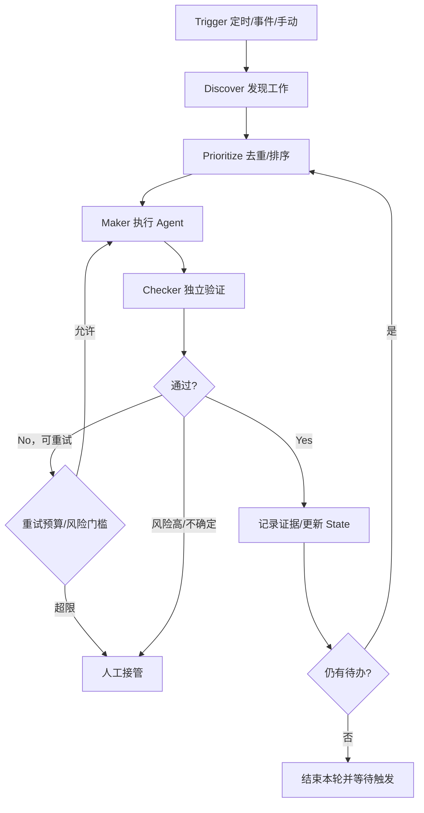
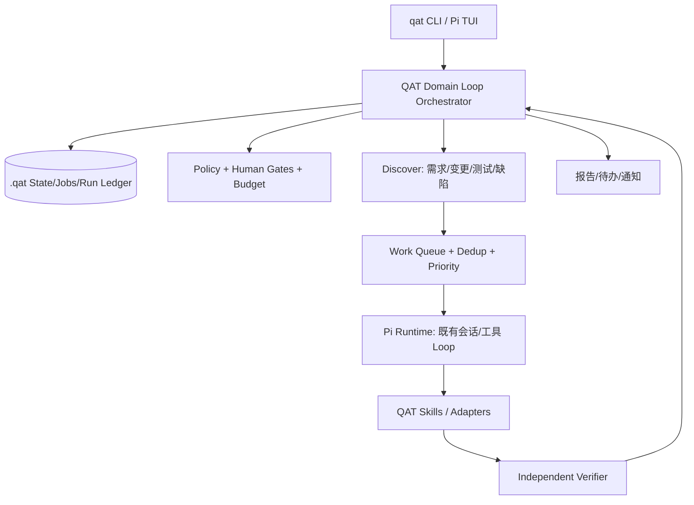
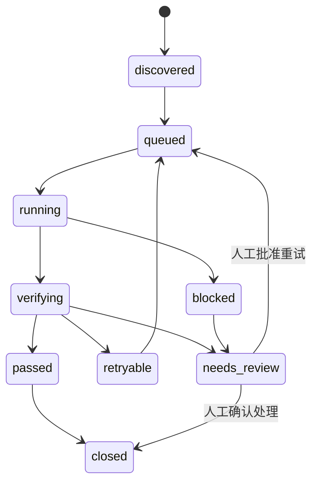

# Loop Engineering：从 Prompt Engineering 到可验证的 Agent 持续闭环

> **核心判断：** Loop Engineering 不是再造 Claude Code、Codex、Pi，也不等同于普通 `while` 循环。它试图将 Agent 从“人不断输入下一条提示词”升级为“定期发现工作 → 执行 → 独立验证 → 持久化状态 → 决定下一步”的工程系统。对于 QAT，最值得引入的是 **状态、验证、熔断、人审及观测**，而不是照搬另一套运行时。

- 项目：<https://github.com/cobusgreyling/loop-engineering>
- 官方主页：<https://cobusgreyling.github.io/loop-engineering/>
- 许可证：MIT
- 调研日期：2026-11-15
- 事实标识：**[官方]** 表示仓库文档明确描述；**[建议]** 表示本文的方案、示例设计或推演，未经 QAT 源码验证。

## 一、项目讲的是什么

项目主张：**Stop prompting. Design the loop. Get a score.**（别只优化下一条 Prompt，设计完整的执行闭环，并用指标评估它。）

传统模式：

```text
人提出需求 → Agent 执行 → 人检查 → 发现问题 → 人再发 Prompt → 重来
```

Loop Engineering 模式：

```text
Trigger → Discover → Prioritize → Agent Execute → Independent Verify
  ↑                                             ↓
  └──── State / Replan ← Human Gate / Result ←──┘
```

在 GitHub 项目维护中，待处理的工作包括 PR CI 失败、Issue 分类、依赖升级、变更日志、合并后清理等。传统方式需要开发者反复登录检查；Loop Engineering 提供可持续运行的巡检及受控处理模式。

**区别的关键：**

| 类型 | 关注范围 | 典型终止条件 |
|---|---|---|
| Prompt Engineering | 一次提示的输入与输出 | 获得预期回复 |
| Agent 内部工具循环 | 单次会话中的模型—工具交互 | 模型停止或任务完成 |
| Goal Loop | 有限目标的多轮执行与验证 | 验收通过或达到预算/重试上限 |
| Loop Engineering | 跨时间、跨会话、可持续发现工作 | 本轮无待办、下次触发、人工接管或熔断 |

Loop Engineering 不是“自动化越多越好”，而是“多大自主权建立在多少验证证据之上”。

## 二、核心架构与生命周期



### 六个核心部件

1. **Trigger**：Cron、GitHub 事件、手动触发；明确周期与暂停条件。
2. **Discover**：主动读取 Issue、PR、CI 等工作源，不把“再问用户一句”作为唯一入口。
3. **Maker**：负责执行的 Agent，遵守权限和变更范围。
4. **Checker/Verifier**：独立验收，不直接相信 Maker 的“已经完成”；优先使用测试、Schema、Diff、CI 等客观证据。
5. **State**：保存待办、最近执行、结果、阻塞、人类决策，使任务跨会话延续。
6. **Guardrails/Observability**：限制成本、重试、权限和高风险修改；保留可审计轨迹。

### Maker / Checker 是最重要的工程边界

- Maker 可以提出“修复成功”，但无权自己最终判定通过。
- Checker 应尽可能运行确定性工具，而不是只让同一模型重读自己的输出。
- 代码变更建议使用独立 Git Worktree 和实际的测试命令。
- 不可客观验收的任务应标为 `needs_review`，而不是偷偷放行。

### State 不等于对话历史

项目提供 `STATE.md`、`LOOP.md`、`loop-budget.md`、`loop-run-log.md` 等文件，分别保存实时工作状态、运行规范、成本预算、追加式运行日志。每次运行应先读取上次状态，完成后更新并清理已解决项目。不要把完整聊天记录当作长期状态数据库。

## 三、八种 Loop 模式（官方）

| 模式 | 典型用途 | 参考频率 | 起步安全策略 | 相对成本 |
|---|---|---|---|---|
| Daily Triage | 每日仓库健康检查、Issue/PR/CI 摘要 | 每日～每 2 小时 | L1 报告 | 低 |
| Thin Loop | 极简低开销的 GitHub 事件巡检 | 事件 + 每日 | L1 快照 | 很低 |
| PR Babysitter | 跟踪 PR、审查、检查失败 | 5–15 分钟 | L1 观察 | 高 |
| CI Sweeper | 分析 CI 失败并提出/尝试修复 | 5–15 分钟 | 谨慎 L2 | 很高 |
| Dependency Sweeper | 依赖补丁/漏洞处理 | 每 6 小时～每日 | 限制范围的 L2 | 中 |
| Changelog Drafter | 生成版本更新说明草案 | 每日或 Tag | L1 草案 | 低 |
| Post-Merge Cleanup | 合并后清理与检查 | 每 1–6 小时或每日 | L1 非高峰 | 低 |
| Issue Triage | Issue 分类、去重、排优先级 | 每 2 小时～每日 | L1 建议 | 低 |

> 注意：表中是模式推荐配置，不代表每个模式都已在参考仓库实现完整无人值守。官方 `LOOP.md` 记录：Daily Triage 已通过 Actions 运行；PR Babysitter 是手动触发；Dependency Sweeper 主要依赖 Dependabot；CI Sweeper 是部分实现。应区分 **模式文档存在** 和 **生产级自主化已验证**。

## 四、L0–L3 自主等级

| 等级 | 名称 | 允许行为 | 升级前必须有的证据 |
|---|---|---|---|
| L0 | Draft | 只有设计和约束 | 目标、范围、非目标明确 |
| L1 | Report | 发现、分类、汇报、更新状态；不自动修复 | 可持续采集工作、输出可靠 |
| L2 | Assisted | 小范围受控变更，Checker 验证后人工审批 | 可靠的独立验证、权限限制、人工交接 |
| L3 | Unattended | 仅在明确的低风险白名单内自主处理 | 预算、熔断、真实运行记录、风险门槛、可靠的验证与回滚 |

**起步原则：** 第 1 周只做 L1 报告；实测验证准确后再试 L2；不要用一份静态文档或一次漂亮的 Audit 分数证明 L3 安全。项目的 Loop Ready 分数越来越强调近期真实运行证据。

## 五、项目提供的工具

| 工具/子命令 | 作用 | 使用边界 |
|---|---|---|
| `loop init` | 生成模板、Skills、状态及预算文件 | 脚手架，不等于自动调度已启用 |
| `loop doctor` | 一站式健康检查 | 适合作为日常入口 |
| `loop status` | 查看状态 | 以实际状态文件为准 |
| `loop audit` | Loop Readiness 评分及改进建议 | 不是业务验收通过率 |
| `loop sync` | 检查 LOOP 和 STATE 漂移 | 变更规则及启用调度前执行 |
| `loop cost` | 估算执行成本 | 估算不等于实际账单 |
| `loop context` | 迭代次数、重复错误、预算熔断 | L2+ 必备的运行安全措施 |
| `loop gate` | 对自动合并等动作执行 denylist/allowlist | 必须嵌入实际动作前置检查 |
| `loop-worktree` | 每次修复独立工作区 | 减少不同 Loop 的改动冲突 |
| `loop-sandbox` | 在临时 Worktree 中执行并生成 Patch | **不是** OS 级网络/文件系统沙箱 |
| `loop-mcp-server` | 按需获取模式、Skills、状态 | 减少一次性塞入大量文档 |
| `loop-drill` | 演练安全/升级机制 | L3 前验证门禁的一环 |

## 六、安装与使用：完整操作手册

### 6.1 环境准备

**[官方]** 通过 npm 包 `@cobusgreyling/loop` 的统一 CLI 使用，不需要预先 clone 仓库。

```bash
# 建议先确认环境
node --version
npm --version
npx --version
git --version

# 可选：先查看 CLI 帮助
npx @cobusgreyling/loop --help
npx @cobusgreyling/loop init --help
```

**[建议]** 如果机器不允许执行未知 npm 包，先检查 npm 包信息、版本、依赖和发行来源；选择固定版本部署，不建议在重要 CI 流程里无审计地执行最新版本。

```bash
npm view @cobusgreyling/loop version
npm view @cobusgreyling/loop dist.tarball
```

### 6.2 推荐：新建测试仓库，第一次运行

```bash
mkdir loop-lab && cd loop-lab
git init
printf '# Loop Lab\n' > README.md
git add README.md && git commit -m 'init loop lab'

# 初始化：以 Codex 为例
npx @cobusgreyling/loop init . --pattern daily-triage --tool codex

# 安全和一致性检查
npx @cobusgreyling/loop doctor .
npx @cobusgreyling/loop status .
npx @cobusgreyling/loop audit . --suggest
npx @cobusgreyling/loop sync .

# 计划频率和成本预估
npx @cobusgreyling/loop cost --pattern daily-triage --level L1 --cadence 1d
```

`--tool` 官方脚手架支持：`claude`（默认）、`grok`、`codex`、`opencode`。Pi、Hermes、OpenClaw、Cursor、Windsurf **不是该参数的原生脚手架目标**；需要自行移植 Skills、状态文件与运行触发器。模板以实际运行输出为准，不要假设所有平台都生成完全相同的文件。

### 6.3 选择模式与工具

```bash
# Claude Code
npx @cobusgreyling/loop init . --pattern daily-triage --tool claude

# OpenCode
npx @cobusgreyling/loop init . --pattern daily-triage --tool opencode

# 先看官方支持的模式与参数
npx @cobusgreyling/loop init --help
```

已有仓库请先 `git status` 并创建分支，避免初始化模板覆盖自己的规范。可保留一个独立 `loop-lab` 与真实项目对照。

### 6.4 如何实际触发一轮

**Codex：** 初始化后查看终端输出的 *first-run command*，在 Codex 中使用生成的任务指令；需要周期执行时，通过 Codex Automations 配置。**仅运行 init 不会自动常驻轮询。**

首次运行的安全指令示例（不是固定的官方内建命令）：

```text
执行一次 daily-triage：先读 LOOP.md 与 STATE.md，检查当前仓库 Issue、PR、CI（仅限可用数据）；输出高优先级事项与观察列表；更新状态和运行日志。仅报告，不修改业务代码，不合并 PR，不触发发布。无法访问的来源明确写为 unknown。
```

**Claude Code：** 官方 Quickstart 示例：

```text
/loop 1d Run $loop-triage. Read STATE.md. Merge findings into High Priority and Watch List. Update Last run. Do not edit code.
```

**OpenCode：** 官方示例是通过 Cron/systemd 触发一次无头执行：

```bash
opencode run "Run loop-triage. Read STATE.md first. Update High Priority and Watch List. No auto-fix in week one." --agent loop-triage
```

应先手动验证 `opencode run` 与生成的 `--agent` 是否匹配，再配置系统调度。切勿未经检查就让系统自动执行修改类操作。

### 6.5 验证首次输出

核查以下要点：

- `STATE.md` 是否真正记录了优先级、观察列表、阻塞与最近执行时间。
- `LOOP.md` 是否写清目标、非目标、数据源、频率、权限、退出条件。
- `loop-run-log.md` 是否记录实际运行及结果，而不是只有初始化模板。
- 不具备 GitHub 数据源权限时是否报告“未知”，而不是伪造 PR/CI 状态。
- 是否未发生自动改代码、自动合并、意外网络副作用。

完成后审阅 Diff，再决定是否提交模板和状态文件。

### 6.6 成本、重试熔断和门禁

```bash
# 官方：计划成本估算
npx @cobusgreyling/loop cost --pattern daily-triage --level L1 --cadence 1d

# 官方：修复型模式通常会生成 ledger；存在时启用熔断检查
npx @cobusgreyling/loop context --check --ledger loop-ledger.json

# 官方：审计 readiness
npx @cobusgreyling/loop audit . --suggest
```

`context --check` 官方说明：退出码 `0` 可继续，`2` 需升级人工。触发项包括最大迭代次数、重复相同错误、连续失败及 token 上限。注意：普通的 `daily-triage` 初始化未必创建 `loop-ledger.json`；应仅在实际存在和配置后使用。

高风险自动合并前的门禁配置示例（请先确认当前版本 Schema）：

```yaml
# gate.yaml
version: 1
denylist:
  - "src/auth/**"
  - "**/*.env"
  - "**/secrets/**"
autoMergeAllowlist:
  - "docs/**"
maxFiles: 5
```

```bash
npx @cobusgreyling/loop gate check --action auto-merge --paths docs/README.md
```

**重要：** `gate.yaml` 的规则不是安全魔法；必须在真实执行自动合并之前调用 gate，才具有执行意义。官方说明拒绝/升级人工时退出码为 `2`。

### 6.7 L2 隔离改动和安全提醒

```bash
# 每次修复独立 worktree
npx @cobusgreyling/loop-worktree create --run-id pr-217-fix-1 --pattern pr-babysitter
# 在返回的工作目录中修改并验证，失败时标记
npx @cobusgreyling/loop-worktree mark --run-id pr-217-fix-1 --status rejected
npx @cobusgreyling/loop-worktree list
npx @cobusgreyling/loop-worktree cleanup --older-than 24h

# 更短命的隔离执行，产生 patch 供人工审阅
npx @cobusgreyling/loop-sandbox run --shell -- bash -c "echo 'demo' > demo.txt"
npx @cobusgreyling/loop-sandbox review
```

不要把 Git Worktree 当成真正的安全沙箱：官方明确指出 `loop-sandbox` 内的进程仍有操作系统级文件和网络访问能力；不可信命令需要额外的容器、权限、网络限制。

### 6.8 常见问题排查

| 现象 | 优先核对 | 处理方式 |
|---|---|---|
| `npx` / 安装报错 | Node/npm、代理、registry、npm 包 | 先 `npm view`、查看报错及兼容性 |
| `init` 成功却没定时运行 | 只有脚手架，没有 Scheduler | 按目标工具配置 Codex Automations / Cron / Actions |
| `doctor` 得分不高 | 未运行、无证据、STATE 与 LOOP 不一致 | 先手动运行一次，再审计、同步 |
| `sync` 报状态漂移 | STATE/LOOP 修改不同步 | 更新运行规范与实际状态 |
| Loop 总在反复修同一问题 | 缺少熔断与外部验证 | 限制次数、错误签名去重、人工接管 |
| 每次运行 Token 很高 | 频率过高、全仓扫描、日志进入上下文 | 优先事件驱动、增量查询、只传摘要/引用 |
| PR/CI 信息不准确 | GitHub 权限、数据源与时间范围 | 明示数据源失败；不得把猜测标记为发现 |

## 七、对 QAT 的定位：不再造一套 Agent Runtime

### 7.1 已知 QAT 方向（设计依据）

- 产品：独立测试 CLI，`qat` 入口。
- 底层：Pi Runtime 负责会话、Agent Loop、Tool Execution、Streaming 和 TUI。
- QAT 负责领域能力：QA Agent Profile、Skills、Extensions、Workflow、Adapters、Evaluation。
- 初始化目录坚持精简：`需求/`、`笔记/业务规则/`、`测试用例/`、`API自动化/`、`测试报告/`、`.qat/`。
- 已有相关子项目方向：API 自动化、Agent 评测、知识库搜索。

**边界：** 本文没有访问 QAT 的本地源码，因此以下是基于既定设计的增量方案，不是已完成的源码架构审计；文件路径、API 名称和命令均为 **[建议]**。

### 7.2 最重要的区别

- Pi 运行时内循环：模型如何思考、用工具、获取返回结果。
- QAT 质量业务外循环：测试项目下一步要做什么、谁执行、凭什么判定通过、何时复查。



### 7.3 QAT 应新增哪些能力

| 能力 | 具体内容 | 最小实现 | 不建议做什么 |
|---|---|---|---|
| Work Discovery | 发现需求改动、失败测试、未处理阻塞 | 文件变更扫描 + pytest 结果读取 | 初期连接所有平台 |
| Task Ledger | 任务 ID、状态、优先级、去重键、证据 | `.qat/tasks.jsonl` | 一开始就部署数据库平台 |
| Loop State | 保存当前迭代和运行状态 | `.qat/state.json` + 可读 Markdown 摘要 | 只依靠聊天记忆 |
| Maker | 调用 Pi 和已有测试 Skills | 复用现有 Pi 入口 | 再写一套 LLM Tool Loop |
| Verifier | 独立检查产物、测试、评测 | pytest/Schema/人工审批 | Agent 自己说成功就完成 |
| Policy | 白名单、人工门禁、最大次数 | `.qat/policy.yaml` | 上来就自动修改需求/合并 |
| Observability | 运行时长、Token、错误及成功率 | `.qat/runs/*.json` | 每条日志都丢回模型上下文 |
| Scheduler | 手动 → 定时 → 事件驱动 | 先系统 Cron/Jenkins 适配 | 建复杂常驻 Gateway |

### 7.4 一条真实业务闭环（优先做）

**场景：API 回归失败持续跟踪。**

1. Jenkins/本地 pytest 产生 JUnit XML 或 Allure 测试结果。
2. QAT 读取失败用例，按 `项目+环境+用例标识+错误签名` 去重。
3. 新失败建立 Work Item，连续失败则更新同一任务。
4. Pi Agent 读取最小必要日志、最近变更、业务规则，形成假设及建议。
5. Verifier 重跑失败用例及依赖检查，保留客观结果。
6. 如无法自动确认，生成待人工 Review 的缺陷候选，而非直接断言产品 Bug。
7. 写入 `.qat` 状态和 `测试报告/`，下一轮仅重新检查未解决项。
8. 连续重复失败、预算超限、环境不稳定则熔断并请求人工处理。

**价值：** 减少重复查看相同 CI 故障，保持问题状态连续，避免每次重新上传完整日志，且可以给出从发现到验证的证据链。

### 7.5 不改变现有 PMO 一级目录

```text
xxx迭代/PMO/
├── 需求/
├── 笔记/
│   └── 业务规则/
├── 测试用例/
├── API自动化/
├── 测试报告/
└── .qat/
    ├── state.json              # 当前项目/迭代状态
    ├── tasks.jsonl             # work item 追加/变更事件
    ├── policy.yaml             # 各 loop 权限与门禁
    ├── loops.yaml              # 已启用的 loop 定义
    ├── runs/                   # 每轮执行证据/摘要
    └── cache/                  # 可再生成的中间产物
```

**原则：** 用户看到的 PMO 目录保持简洁；内部文件按需生成，不为了架构完整性一次性创建所有子目录。运行日志不得写入敏感 Cookie、令牌、个人信息或完整生产数据。

### 7.6 最小配置示例（[建议]，非现有 QAT 命令/配置）

```yaml
# .qat/loops.yaml
version: 1
loops:
  - id: api-regression-watch
    enabled: true
    trigger:
      mode: manual        # 首期只支持手动；后续可为 cron/event
    discover:
      source: junit_xml
      path: 测试报告/junit.xml
    maker:
      skill: api-failure-analysis
    verifier:
      type: pytest
      command: "pytest tests/ -q --junitxml=测试报告/recheck.xml"
    policy:
      level: L1
      max_attempts: 2
      max_runtime_minutes: 20
      allow_code_changes: false
      require_human_for: [requirement_change, production_write, merge]
    output:
      state: .qat/state.json
      report_dir: 测试报告/
```

**安全补充：** `verifier.command` 必须来源于本地可信配置或白名单，不能让外部 Issue 文本拼接 Shell；实际实现需要超时、工作目录、环境变量和权限限制。

### 7.7 推荐的领域任务状态机



任务必须包含：`id`、`source`、`fingerprint`、`status`、`owner`、`attempts`、`last_seen_at`、`evidence_refs`、`verifier_result`。同一错误再出现时更新旧任务，不应该重复生成无限多的待办。

### 7.8 推荐 QAT CLI 交互（[建议]，尚未实现）

```bash
qat init                  # 沿用现有项目初始化
qat loop list             # 可用/已启用的质量闭环
qat loop run api-regression-watch
qat loop status
qat loop audit            # 检查本项目 loop 的 readiness
qat loop pause api-regression-watch
qat loop resume api-regression-watch
qat tasks list --status needs_review
qat runs show <run-id>
```

从 `run`、`status` 两个命令先做最小闭环，其他命令应根据真实使用再增加；不要第一版就实现 Scheduler/Gateway/分布式队列。

## 八、分阶段实施路径

| 阶段 | 目标 | 交付内容 | 通过条件 |
|---|---|---|---|
| P0：最小手动闭环 | 从测试结果生成可跟踪任务 | JUnit XML 解析、去重、State、Markdown 报告、`qat loop run/status` | 同一失败两次运行不生成重复 Work Item |
| P1：Maker/Checker 分离 | 分析与验证有证据链 | Pi Skill、独立 pytest 结果采集、审查状态 | 未经客观验证不能自动标记 passed |
| P2：定时巡检与保护 | 不依赖人工反复启动 | Cron/Jenkins 触发、锁、重试、超时、预算、暂停 | 故障重复/超额可熔断且没有并发重复执行 |
| P3：扩展真实测试生命周期 | 由 API 回归延伸到需求、用例、报告 | 变更发现、规则差异分析、用例缺口、质量周报 | 可追溯到原始需求及测试证据，人工确认生效 |
| P4：可观测与评测 | 验证产品价值 | 成本、成功率、误报率、人工节省时间、bad case 回流 | 对照组验证收益，不靠主观“更智能”判断 |

### 推荐优先级

**第一优先：** `JUnit/Allure → 失败发现 → 去重 → 状态 → Pi 分析 → pytest 验证 → 报告`。

**第二优先：** 需求变更与测试用例覆盖缺口闭环（必须人工审核业务语义）。

**第三优先：** 项目周期提醒、进度跟踪、风险汇总与外部协同系统接入。

等一个简单闭环在真实迭代里连续运行稳定，再考虑并行子 Agent、复杂调度及远程网关。

## 九、价值评估与指标

不要把“模型输出看起来专业”作为主要成效指标。建议记录：

| 指标 | 定义/计算 | 价值 |
|---|---|---|
| 工作发现召回率 | 真正需处理事项被发现数 / 人工确认需处理总数 | 是否漏事 |
| 误报率 | 无需处理的告警数 / 全部告警数 | 是否制造噪音 |
| 重复告警率 | 重复创建 Work Item / 总创建数 | 状态去重能力 |
| 验证覆盖率 | 有独立客观验证的完成项 / 所有标记完成项 | 防止 premature success |
| 自动处理成功率 | 经 Checker 确认通过的自动处理数 / 自动处理总数 | 真实自动化效果 |
| 人工接管率 | 需人工判定工作项 / 所有工作项 | 风险与业务复杂度 |
| 单任务 Token/成本 | 总消耗 / 有效处理工作项数 | 成本效率 |
| 平均恢复时间 | 失败首次发现到客观恢复的时长 | 是否减少排障周期 |
| 人工处理时间 | 对照实验中的人工投入分钟 | 真正节省多少工作 |

**试点评估建议：** 用同类型迭代对比“原有人工巡检”和“QAT L1 巡检”，至少记录 1–2 个完整迭代。重点考察误报率和漏报率，而不是一开始追求 100% 自主执行。

## 十、风险和反模式

1. **Agent 自证完成。** 任何自动变更都必须经过独立、可回查的 Checker。
2. **循环失控。** 配置最大执行次数、重复错误签名、总时长、Token 预算和 kill switch。
3. **成本上涨。** 高并发/高频 Loop 会放大 Token 开销；先做增量扫描和轻量发现，再按需召唤大模型。
4. **长对话污染。** 状态保存为小而清晰的事实对象，历史细节通过引用读取。
5. **错误的自动化权限。** 初期只读和建议，生产写入、资金、权限、需求变更、自动合并必须人工 Gate。
6. **环境问题被误判为产品缺陷。** 将基础设施失败、测试数据失败、Flaky、稳定复现的产品故障区别标记。
7. **不安全的命令执行。** Worktree 不是容器级权限隔离；执行器要有目录、网络、进程、环境变量边界。
8. **伪造状态与指标。** 未验证的数据必须标记 `unknown`/`unverified`，不得被自动提升为 `passed`。
9. **一开始设计过大。** 遵守 QAT“大道至简”：不搭新平台、不重复 Pi Runtime、不新建过多业务目录。

## 十一、与现有技术的关系

| 方案 | 解决的主要问题 | 与 QAT/Loop Engineering 的关系 |
|---|---|---|
| Pi Runtime | 单次 Agent 执行、会话、工具编排 | 继续复用，不重复实现 |
| Skills | 专项任务能力与规范 | 作为 Maker/Discover 的领域能力 |
| Pytest / Allure | 实际测试执行与报告 | 优先充当确定性 Checker |
| Jenkins / Cron | 定时触发与外部执行器 | 可以直接做 Loop Trigger |
| Agent Eval Harness | Agent 输出质量评测 | 为文本/语义质量补充评测证据 |
| RAG / 知识库 | 获取业务规则、历史缺陷与测试资料 | 辅助分析，但引用必须可回查 |
| Loop Engineering | 跨运行的持续发现、验证、状态、治理 | 作为架构方法论和可选工具参考 |

### 是否直接把官方工具嵌入 QAT？

**推荐：先参考设计、不强依赖官方 CLI 作为 QAT 的运行时。**

原因：QAT 的运行核心是 Pi；官方 `loop init --tool` 尚无 Pi 目标；直接引入全套 Node 工具会产生另一套模板、状态文件、运行协议和维护成本。更现实的路线是：以官方 `LOOP.md` / `STATE.md` 为设计参照，在 `.qat/` 中实现最小状态与闭环，必要时仅在独立试验仓库调用 `loop audit` 检查成熟度。

## 十二、落地验收清单

- [ ] 手动执行一轮可以从真实 JUnit XML 发现失败。
- [ ] 连续执行不会重复创建同一故障。
- [ ] 不可验证的任务不得自动通过。
- [ ] 有清晰的运行日志、状态及证据引用。
- [ ] 任务重试有最大次数和重复错误熔断。
- [ ] 定时运行可随时暂停且不会发生并发冲突。
- [ ] 人工审批会被记录且可覆盖 Agent 的建议。
- [ ] 生产敏感数据不进入日志/模型输入。
- [ ] 一轮无待办时可低成本退出。
- [ ] 对照人工流程测量误报、节省工时和成本。

## 十三、结论

Loop Engineering 最重要的启示不是“把 Agent 一直跑起来”，而是：**如何让它知道下一步该做什么、凭什么认为任务完成、何时停止、哪里需要人决定。**

对 QAT 的最佳切入点也不是复制一个通用 Loop 平台，而是选一个高频且可验证的测试痛点——例如自动化回归失败跟踪——建立一个小而完整的业务外循环。稳定后逐渐扩展到需求、用例、测试报告和整个迭代生命周期。

> **最小闭环优先于完整框架；验证证据优先于模型自信；真实节省的人工时间优先于功能数量。**

## 官方资料与来源（2026-11-15 核对）

1. [项目 README](https://github.com/cobusgreyling/loop-engineering/blob/main/README.md) — 定位、模式、统一 CLI。
2. [中文 README](https://github.com/cobusgreyling/loop-engineering/blob/main/README.zh-CN.md) — 中文项目介绍。
3. [QUICKSTART](https://github.com/cobusgreyling/loop-engineering/blob/main/docs/QUICKSTART.md) — 安装、初始化、工具兼容、Doctor、Guard、Gate、Sandbox。
4. [LOOP.md](https://github.com/cobusgreyling/loop-engineering/blob/main/LOOP.md) — 参考仓库自身的 Loop 部署与已知成熟度（注意其中自动化状态标注日期 2026-08-28）。
5. [Loop Design Checklist](https://github.com/cobusgreyling/loop-engineering/blob/main/docs/loop-design-checklist.md) — Maker/Checker、State、预算、人类接管和 L0–L3。
6. [Pattern Registry](https://github.com/cobusgreyling/loop-engineering/blob/main/patterns/registry.yaml) — 模式注册表。
7. [官方安装包](https://www.npmjs.com/package/@cobusgreyling/loop) — 实际可用版本与安装来源。
8. [Security](https://github.com/cobusgreyling/loop-engineering/blob/main/docs/safety.md) — 安全约束。

> 版本提示：本文件命令根据 2026-11-15 可读取的上游文档整理，未在用户 Mac/QAT 本地实际运行；未来上游更新时，以 `npx @cobusgreyling/loop --help` 与 GitHub 文档为准。QAT 的配置和命令均为拟议接口，不应误当作已实现功能。
