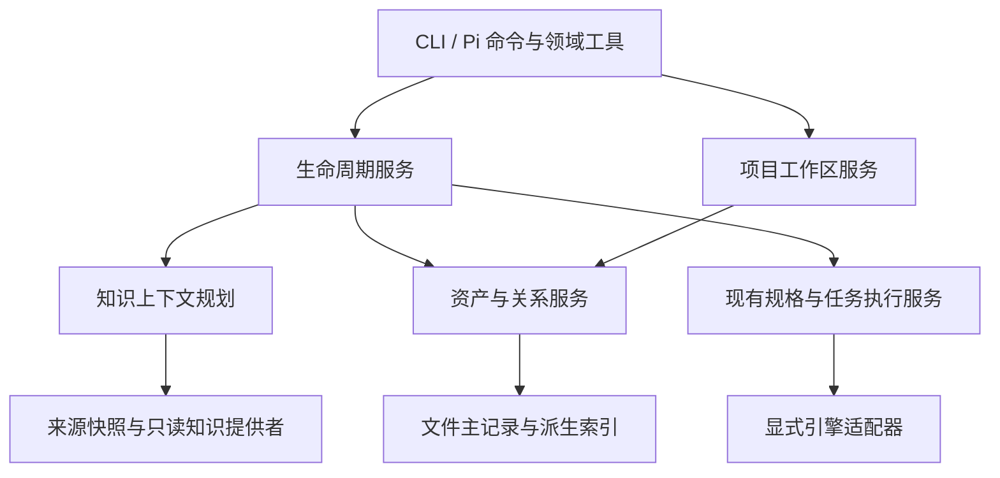

# QAT 非平台化测试助手开发实施方案

> 这是待实施方案。新命令、工具、类型、目录和测试路径均为设计约定，除明确引用“已有”外，不表示当前可用。本文没有启动开发、真实模型调用、业务执行、知识发布或产品发行。
>
> 配套：[价值评估与扩展设计](2026-11-03-QAT-knowledge-driven-lifecycle-design.md)；[开发任务清单](2026-11-03-QAT-implementation-backlog.md)。当前运行方式仍以 [README](../README.md)、[插件契约](../plugin-spec.md) 和当前规格为准。

## 1. 产品目标、首版边界与实施原则

### 1.1 要交付的产品行为

用户新建目录，打开 QAT 后建立项目与首个迭代，导入需求资料，绑定已授权业务知识；此后用自然语言完成需求评审、测试分析、用例维护、工时评估、执行组织、报告和交接。

业务知识、测试资产和本次证据形成明确关系。换会话可以继续，换需求版本能找到需要修改的资产，换执行引擎仍保留项目与用例身份。项目资料可独立阅读、导出和带走。

### 1.2 第一版和后续范围

| 阶段 | 必须交付 | 延后事项 |
| --- | --- | --- |
| MVP：知识到用例 | 项目/迭代、导入与来源、只读知识检索、评审草稿、结构化用例、来源校验、Markdown/CSV 导出、项目状态 | 真实服务执行、复杂 OCR、多引擎并行、外部知识写入 |
| V0.2：持续维护 | 关系追溯、需求差异、资产陈旧检查、回归候选、工时计划、交接包 | 自动缩减高风险回归、复杂图数据库 |
| V0.3：执行到报告 | 独立引擎绑定、结果导入、API 实际执行适配验收、报告统计、缺陷回归 | 一次接齐 API/UI/性能/评测全部引擎 |
| V0.4：能力扩展 | 模型/Agent 评测、UI、性能、代码知识，按实际成熟度逐个接入 | 中央平台、实时协作、统一账号与调度集群 |
| 持续演进 | 知识审核发布、团队模板、估时校准、Agent 自身质量回归 | 未经试点验证的自动自主发布或风险接受 |

版本号是建议的产品里程碑，不要求现在修改 package.json。首版不应为了实现所有目录而创建大量空功能模块。

### 1.3 固定实施原则

1. 保留当前 Native Pi 唯一宿主、Agent Loop、TUI 和会话，不再选型或重写主 Agent。
2. 业务对象、状态和版本由确定性服务管理；模型负责分析、解释和候选生成。
3. 用例生成之前准备依据；执行之前核对判据；报告之前取得真实结果。
4. 每个切片都有可以演示的用户结果、失败行为与回归检查。
5. 已有工程独立维护，QAT 仅接稳定的顶层能力，不复制 Python 内部逻辑。
6. 新能力按需注册，不自动发现未知扩展、执行脚本或提升权限。
7. 先同条件比较人工和通用 Pi + skills，再决定继续投入。

## 2. 当前代码基础与必须正视的兼容约束

### 2.1 复用清单

| 已有代码 | 复用职责 | 本轮设计增加 |
| --- | --- | --- |
| `bin/qat.ts` | 管理命令解析、配置诊断、启动 Pi | init/project/release 等确定性子命令入口 |
| `src/bootstrap/settings.ts` | 配置分层、读取范围、独立 Pi 目录 | 不增加项目 YAML 自授权；必要时注入只读项目标识 |
| `extensions/qat-core/index.ts` | 安全、领域、工具、欢迎页装配 | 注册新增领域工具，保留统一授权路径 |
| `extensions/qat-safety/index.ts` | 文件边界、保护路径、模型限制 | 为新的基线、状态、审核存储注册保护路径 |
| `testing-workbench.ts` | 当前目标与工作计划摘要 | 引用 Workspace 事实，减少重复存储 |
| `artifact-store.ts` | 文本产物回执、摘要、不可变历史和 CAS | 复用文本报告；新增主资产快照与二进制导出职责需分开 |
| `context-manifest.ts` | 已读取候选内容的阶段/预算/摘要选择 | 前置 Context Planner；保留既有 manifest 语义 |
| `task-spec.ts` / `domain-session.ts` | 确认规格、执行前提、执行选择 | 从已核对用例编译执行候选，不允许模型确认 |
| `task-store.ts` / `adapters/contracts/control-store.ts` | 真实任务、授权引用及可信控制数据 | 不与项目索引混成可删除缓存 |
| `experience-store.ts` / `knowledge-review.ts` | 候选经验、审核、发布阻塞 | 复用候选/本地审阅，外部发布独立变更 |
| `adapters/mcp/project-adapter.ts` | 既有独立项目接入 | 增强来源定位与版本信息，逐个新增能力 |
| `adapters/process` | 当前隔离 API 引擎调用 | 保留 hermetic，真实执行另建受验收路径 |

### 2.2 四个会直接影响实现的事实

**一，当前 ArtifactStore 默认输出到 reports，面向受限文本且有大小限制。** 不能把任意项目目录交给现有工具就宣称支持全资产管理；不能直接用它写 XLSX/XMind。应新增固定职责的资产快照和二进制导出服务，分别验证边界。

**二，当前 TaskSpec 与 ContextSource 的 ref 有严格格式限制。** 不能把任意含空格、中文标题、绝对路径或外部 URI 直接塞进去。第一期为来源生成 ASCII 内部引用，显示名称单独保留。外部来源需经授权材料化和摘要核对后映射，不能静默放宽 parser。

**三，现有 ContextManifest 是已筛选内容的清单，不是检索引擎。** 新增检索与适用性逻辑放在它前面，不能把已有函数误认为已具备知识规划。

**四，当前 API 调用是 hermetic，知识发布明确阻塞，真实质量门禁未通过。** 完成项目工作区不会自动放开这些能力，也不以工程测试替代真实业务验收。

## 3. 目标模块与源码组织

### 3.1 建议的新增内部模块

以下目录按阶段创建，先不新增 workspace 包、数据库服务或进程常驻服务。

```text
extensions/qat-workflow/
├── workspace/
│   ├── service.ts
│   ├── initialize.ts
│   ├── project.ts
│   ├── release.ts
│   └── status.ts
├── assets/
│   ├── store.ts
│   ├── baseline.ts
│   ├── source-import.ts
│   └── projection.ts
├── knowledge/
│   ├── provider.ts
│   ├── local-provider.ts
│   ├── wiki-provider.ts
│   ├── planner.ts
│   └── qualification.ts
├── traceability/
│   ├── relations.ts
│   ├── impact.ts
│   └── debt.ts
├── lifecycle/
│   ├── review.ts
│   ├── cases.ts
│   ├── estimate.ts
│   ├── report.ts
│   └── handoff.ts
├── utilities/
│   ├── document-diff.ts
│   ├── case-export.ts
│   └── result-import.ts
└── project-tools.ts
```

这是一张职责地图，不是第一天创建全部空文件的要求。文件过小可合并，同一文件承载多项职责时再拆分。统一类型与 schema 放 `adapters/contracts`；装配入口只编排依赖，避免把所有实现继续堆进 `index.ts`。

### 3.2 服务依赖方向



知识服务不调用执行器；执行器不修改业务规则；报告服务不重新发请求补足证据；工具层不能直接写入审核和批准状态。

## 4. 项目目录与数据权威边界

### 4.1 用户看到的目录

沿用配套设计中的 sources、knowledge、assets、automation、releases、runs。初始化第一期只创建需要的目录及说明，其余在首次使用时创建。

`project.yaml`：可编辑的项目业务元信息与逻辑 binding；不含可执行路径、凭据或审批。

`releases/<release>/scope.yaml`：工作范围草稿、需求选择、已知依赖。确认后的范围单独冻结快照。

`assets/cases/*.yaml`：可读、可编辑的用例工作文件。修改会产生待核对候选，已确认基线不因手工修改而自动改变。

`sources`：保留用户输入原件；被正式引用时取得可核对的来源快照。原件后续修改形成新 revision。

### 4.2 内部状态的职责

建议在 `.qat` 下按用途划分，路径在实施规格中固定：

| 拟新增位置 | 内容 | 是否可直接删除重建 |
| --- | --- | --- |
| `.qat/state/workspace/` | 项目登记、当前迭代、操作记录和版本 | 否 |
| `.qat/state/assets/` | 经服务接收的不可变对象版本与快照 | 否 |
| `.qat/state/reviews/` | 审阅状态、确认摘要和事件 | 否；不能随共享恢复审核权力 |
| `.qat/state/operations/` | 文件提交操作的 prepared/committed 状态 | 未完成操作不可删除 |
| `.qat/indexes/catalog.sqlite` | 来源、资产、关系的派生查询表及 FTS | 可从受支持主记录重建 |
| `.qat/cache/` | 可再生成的提取或导出中间数据 | 是，但须说明成本 |

项目工作文件和冻结快照的含义不同：工作文件是待更新内容，冻结快照是某次范围/审阅/执行所绑定的版本。查询结果必须返回哪一层，避免两个“最新版本”互相覆盖。

所有新权威路径通过 `SafetyController.reservePaths` 登记，普通模型 edit/write 不能修改；新增领域服务也需校验操作权限和最终输入。只保护路径仍不是 OS 沙箱。

### 4.3 分享、导入与恢复

共享的是资料、候选知识、用例及资产版本，不是执行许可。导入包先作为不可信数据落入 staging，验证 schema、摘要、范围和重复 ID，再由本地人员决定纳入哪个项目。

包含远端“已审核”说明的记录可以保留历史 provenance，但不能自动恢复当前本地审批和工具权限。备份恢复只恢复数据，执行时仍核对当前有效授权。

## 5. 核心数据模型与最小 schema

### 5.1 通用约定

- `schemaVersion` 与业务 `revision` 分开；前者表示结构，后者表示对象变化。
- ID 由服务生成或显式校验，不让模型自己决定去重键和执行身份。
- 所有 accepted 记录有 `digest`；摘要采用仓库既有 canonical/fingerprint 规则。
- 对象引用包含 `id + revision + digest`；只用 ID 不足以绑定执行或报告。
- 墙钟时间统一 UTC RFC3339；界面按用户时区显示。版本范围不默认 semver，业务版本可使用显式集合。
- 空值使用 null 或明确状态，不能用 0、空字符串掩盖未知。
- 控制 schema `additionalProperties: false`，大小/数量限制沿用既有约束风格，具体限额在实现规格固定。

### 5.2 对象清单

| 对象 | 最小字段 | 状态或关键约束 |
| --- | --- | --- |
| Project | projectId, name, domain, templateVersion, revision, bindings, minimumReaderVersion, minimumWriterVersion | active/archived；路径不是身份；版本防护只约束支持此合同的包 |
| Release | releaseId, projectId, label, selectedSourceRefs, scopeRef, baselineRef | draft/baselined/closed；基线更新产生新版本 |
| SourceRevision | sourceId, revision, originalName, snapshotRef, rawDigest, extractorVersion, extractionRef, extractionDigest, status | parsed/partial/unsupported/error；原文和提取文本分开摘要 |
| Requirement | requirementId, sourceLocator, content, acceptanceRefs, scope | draft/clarified/reviewed；未澄清验收条件可空 |
| Rule | ruleId, condition, expectedBehavior, exceptions, applicability, sourceRefs | candidate/reviewed/conflicted/retired |
| ReviewIssue | issueId, type, sourceRefs, description, consequence, question, resolutionRef | open/resolved/deferred；不凭模型推断 resolved |
| TestCase | caseId, revision, title, preconditions, dataRefs, steps, expected, basisRefs, automation | draft/needs-clarification/reviewed/retired |
| Relation | relationId, fromRef, toRef, type, basisRefs, origin, reviewState | proposed/confirmed/stale/rejected；两端必须存在 |
| Estimate | estimateId, scopeRef, workPackages, assumptions, dependencies, actuals | proposed/revised/closed；人时与等待分开 |
| ExecutionBinding | kind=qat-execution, selectionRef, specRef, attemptRef, engineResultRef | 只对应 QAT 真实发起的执行；不新增另一套执行状态机 |
| ExternalResultImport | kind=external-import, importRef, producer, resultDigest, evidenceRefs, verificationState | 外部运行结果导入，不要求或补造 QAT task/spec/attempt |
| ReportManifest | scopeRef, caseSelectionRef, runRefs, metricDefinitions, sourceRefs, digest | draft/reviewed；不能重写权威 verdict |
| Handoff | scopeRef, assets, done, pending, unresolvedRuns, nextActions | 不包含授权和未经处理的完整聊天 |

Requirement、Rule 第一版可以存为统一 Asset 的不同 kind，不需要分别建立复杂的 CRUD 框架。

### 5.3 TestCase 类型草案

以下是目标 TypeScript 形状示例，最终需要同源生成/导出 JSON Schema 并纳入现有验证方式：

```typescript
type AssetRef = {
  id: string;
  revision: number;
  digest: string;
};

type CaseDraft = {
  schemaVersion: 1;
  projectId: string;
  title: string;
  module: string;
  basisRefs: AssetRef[];
  preconditions: string[];
  dataRefs: AssetRef[];
  steps: Array<{
    action: string;
    expected: string | null;
    basisRefs: AssetRef[];
    oracleState: "specified" | "human-confirmed" | "unknown";
  }>;
  risk: { priority: "P0" | "P1" | "P2"; reason: string };
  automation: {
    suitability: "suitable" | "manual" | "needs-assessment";
    engineBindingId: string | null;
    reason: string;
  };
  unknowns: string[];
};
```

`caseId/revision/digest/reviewState` 由服务包装，不由模型提交 accepted 记录。`oracleState=unknown` 时 expected 应为空，或使用独立的候选建议字段，不能写成已确定的验收预期。

执行用例还需要观察器、必需证据和执行前提；不能因为 CaseDraft 有 expected 就直接编译可执行 TaskSpec。由执行准备阶段补足映射，校验失败则保持不可执行。

### 5.4 派生数据库表

第一期复用 Node `node:sqlite` 的项目既有实践，无需为了项目管理引入服务端数据库。C01/W-002 即建立最小资产 catalog 与重建能力，C02 增加来源和搜索索引，C04 才增加关系索引；不能等到 C04 才让项目状态和资产查询可用。建议表包括：

| 表 | 主要键/索引 | 用途 |
| --- | --- | --- |
| schema_migrations | version | 仅管理该派生数据库结构 |
| asset_revisions | project_id, asset_id, revision，唯一 digest | 版本与主记录位置 |
| source_locators | source_id, revision, locator_id | 原文/提取文本片段定位 |
| release_selections | project_id, release_id, baseline_revision | 固定本次资产选择 |
| relations | project_id, from_id, from_revision, to_id, to_revision, type | 影响传播和覆盖查询 |
| applicability | project_id, asset_id, version_label, state | 版本和资格过滤 |
| search_documents / search_fts | project_id, module, asset_id | 本地全文候选检索 |

查询使用参数化 SQL，写入事务、忙等待与并发策略参照已有存储。若运行时 SQLite 未启用 FTS5，doctor 明确检测并降级精确搜索；MVP 不以向量索引或 FTS 可用为必要条件。

## 6. 文件、索引与并发一致性

### 6.1 接收一版资产

不能假设文件写入和 SQLite 更新是一个跨存储事务。建议使用短操作记录完成恢复：

1. 校验输入 schema、范围和 expected revision/digest。
2. 为本次操作预留不可复用 operation ID，记录 expected 与待提交摘要。
3. 固定路径创建不可变版本文件，校验字节和摘要；不覆盖旧版本。
4. 在同一权威提交记录中切换 head，标记操作 committed。
5. 更新派生索引和人类可读投影；失败标记 projection/index stale，不撤销已提交版本。
6. 返回真实对象引用、保存路径和索引状态。

恢复只核对未完成的文件操作；绝不自动重放外部测试执行。第一期可使用进程内写队列加文件锁/独占创建处理单工作区并发，不先实现通用事务框架。

### 6.2 并发与人工编辑

对象级 CAS 冲突返回当前 revision/digest 与可查看差异的引用；模型不能重试并覆盖新内容。相同 payload 的重复接收是否复用版本，在规格中固定，不能靠模型猜测。

用户手工编辑工作 YAML 后，QAT 检测摘要变化，给出 reconcile 预览。验证通过才生成新候选版本；缺少审核时不会改变已冻结范围。

工作区第二个进程提交时，要么能成功取得明确锁并重新核对 CAS，要么返回 busy；不能双方都创建同一个 revision。只读 status 不应抢占长期写锁。

## 7. CLI、交互命令与模型工具

### 7.1 CLI 设计

以下均为**拟新增命令**，需要分别实现 parser/help/schema/test 后才能使用：

| 命令草案 | 功能 | 模型调用 |
| --- | --- | --- |
| `qat init --template test-project --dry-run` | 预览固定模板与冲突 | 无 |
| `qat init --template test-project` | 建立当前目录项目结构 | 无 |
| `qat project status --json` | 项目、迭代、资料、资产、未决与可用能力 | 无 |
| `qat release create <id>` | 创建迭代草稿 | 无 |
| `qat release select <id>` | 切换工作迭代并清除旧执行选择 | 无 |
| `qat case review <id> --revision <n> --digest <sha>` | 操作者核对当前用例版本并记录审阅 | 无；不产生执行许可 |
| `qat release baseline <id> --selection <file>` | 操作者核对范围及用例选择，冻结本次基线 | 无；不产生执行许可 |
| `qat source import <path> --kind requirement` | 导入显式文件并形成来源清单 | 无；语义理解另在 Pi 中进行 |
| `qat case export --release <id> --format markdown` | 导出选定用例版本 | 无 |
| `qat project reconcile --dry-run` | 核对人工变更和待恢复文件操作 | 无 |
| `qat project index rebuild` | 仅重建派生索引 | 无 |
| `qat project backup --output <path>` | 生成经清单约束的备份包 | 无 |

新增参数归属于各子命令 parser；避免把所有选项塞进当前顶层 parseArgs。`qat -- [Pi 参数]` 的语义不变，管理命令和模型消息仍不混用。

### 7.2 Pi 交互命令

建议保留较少入口：`/qat-project`、`/qat-release`、`/qat-sources`、`/qat-cases`、`/qat-impact`。它们用于状态、选择和人工审阅，复用与 CLI 相同服务。

其中 `/qat-cases review` 与 `/qat-release baseline` 是操作者专用操作，不注册为模型工具。确认界面绑定当前 scope/selection 的 revision 和 digest，以及每条 case 的固定版本；操作者身份沿用既有受信入口约定，不把模型传入的 reviewer 字段当成确认来源。

业务确认仍使用现有 spec/domain 机制；新增资产审核不应冒充执行批准。MVP 不做必须记忆几十条命令的交互，常规工作由自然语言触发。

### 7.3 模型可见工具

| 拟新增工具 | 允许操作 | 关键返回 | 明确不允许 |
| --- | --- | --- | --- |
| `qa_project` | status、read、提出当前范围草稿 | 项目/迭代引用、缺口、能力状态 | 改可信 binding、扩大根目录、恢复授权 |
| `qa_sources` | list、read、对已导入来源的片段读取 | 来源版本、片段定位、摘要和解析状态 | 任意 URL 抓取、越界文件读取 |
| `qa_knowledge` | search、fetch，按任务提交检索请求 | 候选依据、来源、冲突与缺口 | 审批或外部知识发布 |
| `qa_review` | save_draft、read | 评审问题与依据 | 模型自确认产品澄清 |
| `qa_cases` | validate、save_draft、read、export | 结构化用例、校验问题、产物回执 | 自审核、隐式执行 |
| `qa_traceability` | propose_relation、query、impact | 关系候选、受影响资产、未知范围 | 将推断关系自动标 confirmed |
| `qa_estimate` | calculate、save_draft | 分项计算、假设、范围 | 把估计当作团队排期承诺 |
| `qa_report` | assemble、validate、render | 本次结果引用、统计与报告回执 | 编造运行、修改权威结果 |

这是一张规划清单，注册数量按阶段增加。第一切片只需要 project/sources/knowledge/cases 与现有 artifact 工具；review 可以先用固定结构产物，无需马上单独注册工具。

工具请求统一执行 `finalToolInput` 及服务校验。使用 `SafetyController.allowDomainTool` 显式激活，声明为领域工具不免除业务检查。

### 7.4 权限与体验分层

| 动作 | 用户意图与权限表达 | 实施要求 |
| --- | --- | --- |
| 只读状态/检索 | 当前已批准读取范围 | 不反复确认；越界不读 |
| 初始化 | 用户显式 init 或交互选择建立项目 | 固定模板创建，冲突不覆盖 |
| 保存草稿/导出 | 用户请求对应产物，落在受控产物范围 | 类似现有 artifact 服务，只写允许内容与路径 |
| 修改项目业务元信息 | 显式操作/受控字段和 CAS | 不改变执行路径、凭据和授权 |
| 确认规则/用例/范围 | 操作者核对当前 revision/digest | 模型只能提出候选 |
| 真实执行/压测/数据写入 | 当前有效业务许可、scope、规格、最终输入 | 继续复用现有门禁，不能靠 init 获得权限 |

这些是新增产品操作的授权设计，必须先写进规格再实现；不是允许临时绕开现有门禁。

## 8. 知识检索与上下文实施

### 8.1 KnowledgeProvider 最小接口

建议统一 `search(scope, taskKind, query, filters)` 与 `fetch(sourceRef, locator)` 两个只读操作，返回：

- 稳定来源身份、版本、原文及摘录摘要。
- 原文与提取文本的定位信息。
- 适用项目/模块/版本、审核状态和有效期。
- 检索策略、候选分数（只表示相关性）、查询时刻。
- 证据不足、来源不可用、冲突和截断原因。

第一期实现 local-provider 和既有 wiki-provider。若外部 KB 暂缺版本/资格字段，保留 null 并降低其作为确定判据的资格，不由 QAT 自动补造“当前生效”。

### 8.2 Context Planner 流程

1. 从服务读取当前 Project/Release 和任务阶段，不以模型输入覆盖可信 scope。
2. 获取本次强制需求来源、用户显式来源和相关知识候选。
3. 先权限及适用性过滤，再检索/排序，避免其他项目内容进入模型后再过滤。
4. 来源摘要与当前字节核对；区分 rawDigest、extractionDigest 和 excerptDigest。
5. 处理冲突、退役、过期和待确认来源；候选风险线索可保留但标识资格。
6. 按任务构造候选 ContextSource，调用现有 `selectContext`。
7. 保存检索摘要、选中/遗漏理由和 manifest；范围或版本变化后重新核对。

外部知识映射到受控内部文本快照再注入，ref 例如 `.qat/state/assets/sources/src-id/r2/extracted.md`，对应当前项目下真实存在的相对路径，不引入尚未支持的虚拟 URI 解析。显示名称保存原始中文文件名。快照自身摘要与原件摘要分别记录，避免把摘录 SHA 当成原件 SHA。源码级联调必须验证现有 DomainSession 对该受控快照的读取及摘要校验；若还有路径约束，先修投影方案，不临时放宽 parser。

### 8.3 检索策略迭代

| 阶段 | 实现 | 开启条件 |
| --- | --- | --- |
| K0 | 显式文件、关键词/ID 精确检索、分类过滤 | MVP 默认可用，无外部模型依赖 |
| K1 | 既有 KB 检索 + 本地精确检索合并去重 | KB 配置和来源读取可核实 |
| K2 | 语义检索/重排、术语词典与关系扩展 | 固定中文业务检索集证明召回和净耗时收益 |

FTS5 是本地全文检索候选，中文分词与短 ID 需单独评测；它不是完整 RAG。官方提供 tokenizer 及全文查询机制，具体取舍由项目数据验证。[技术参考](https://www.sqlite.org/fts5.html)

### 8.4 引用校验的限度

确定性检查能够验证引用存在、范围正确、字节和版本一致、定位片段存在；不能单靠这些证明文本语义支持生成结论。关键预期做人工核对，非关键内容可抽样人工与模型辅助评分。

只有通过语义核对的比例才叫“引用支持正确率”；文件存在率或 SHA 校验率单独命名，不混淆指标。

## 9. 需求评审与用例生成实施

### 9.1 需求评审

输入：当前需求引用、业务范围、已知规则、历史缺陷、评审检查清单。

固定输出结构：问题 ID、类型、原文定位、问题说明、受影响行为、建议澄清问题、候选测试点、依据类别、状态。分类覆盖规则完整性、歧义与冲突、边界和状态、权限数据、依赖失败、可观察性与非功能目标。

模型负责提出问题；确定性服务校验字段与来源。重要性需给业务理由，不能只凭语言强烈程度评为 P0。

澄清通过操作者录入 resolution，形成新决策/规则候选。没有责任人确认时保持 open/deferred，不自行填“产品已确认”。

### 9.2 用例增量生成

1. 固定本次 requirement/rule 版本与用例选择。
2. 查询可复用用例、相关缺陷和方法资源。
3. 模型提出 reuse/revise/add/retire 四类候选；稳定 ID 由服务匹配或生成。
4. 校验前置、步骤、预期、依据、数据引用、重复和未知条件。
5. 人工核对关键用例与推断关系；接受后建立新资产版本。
6. 按已选择版本导出，不自动覆盖其他迭代的选择。

重复检测第一期用规范化标题/步骤及确定性规则给候选；相似度用于建议，不能自动合并两个不同边界的用例。

### 9.3 导出顺序与二进制处理

先完成 C03 的用例审核与范围冻结：用例审核绑定当前 case revision/digest；迭代基线记录 scope、来源选择和 case selection 的固定摘要。用例修订不删除旧审核事件，但新 revision 回到待核对；基线变化形成新版本并清除旧执行选择。关键预期仍未知的用例可以出现在明确标识的草稿/待确认导出中，不可作为已核对的可执行用例。

导出默认指定 draft 或 baseline 模式；草稿带未审核/未知标记，基线导出固定 baseline revision 与资产版本，不采用工作目录中未经核对的新字节。执行准备只接受明确冻结且符合前提的选择。

先 Markdown/CSV，再根据团队使用选择 XLSX/XMind。CSV 要处理引号、换行、UTF-8 以及表格公式注入；不把保护后的展示字符串回写原始业务数据。

XLSX/XMind 需要固定 exporter 与二进制回执：schema、MIME、文件大小、sha256、asset selection、导出器版本。样本在真实读取软件中验证内容、层级和 ID 保留；不以 ZIP 结构有效替代可用性。

二进制写入独立受控服务，不放宽现有 ArtifactStore 的文本与路径限制。MVP 不承诺这些格式双向往返。

## 10. 关系追溯、变更分析与回归选择

### 10.1 最小关系集合

`requirement → rule`（derived_from）、`case → requirement/rule`（verifies）、`case → bug`（regresses）、`script → case`（implemented_by 的具体方向需在 schema 固定）、`run → case revision`（observed_in）、`new revision → old revision`（supersedes）。

实现时统一方向并测试反向查询；不要因界面名称改变底层边方向。上文是业务关系说明，最终关系类型与方向表需在对应规格中冻结。

先明确一张规范方向表，建议采用：

| type | from → to |
| --- | --- |
| derived_from | 派生对象 → 来源对象 |
| verifies | 用例 → 需求或规则 |
| regresses | 用例 → 历史缺陷 |
| implements | 脚本 → 用例 |
| observes | 运行结果 → 用例版本 |
| supersedes | 新版本 → 被替代版本 |

该表是实施建议的规范方向；与概念图有差异时按此表编写 schema，迁移不得静默改已有关系。

### 10.2 变更传播算法

1. 取两份来源快照，确定性生成章节、段落与字段差异。
2. 模型给出候选变化类型和受影响规则，记录置信描述与来源，不能自行标已确认。
3. 从变更源按关系反向查询依赖对象，记录每条影响路径。
4. 显式确认关系产生 must-review 候选；推断或语义关系产生 suggested-review；未关联对象记 unknown。
5. 查询范围、关系覆盖、来源资格及可用引擎，形成回归候选清单。
6. 用户确认范围后再生成本次 case selection；不直接触发执行。

遍历按 project 和版本约束，保留 visited 防环。配置深度/节点上限时，截断必须进入 unknown 清单。第一版只做建议，不自动删减核心回归。

### 10.3 陈旧状态

保存的是 `validForBaseline` 或 `needsReviewForRelease` 等适用性状态。旧运行事实和旧报告不可变。需求变化不会把过去 passed 改成 failed；只标明当前版本还没有相应验证。

### 10.4 测试债查询

输出需求无用例、关键预期未知、缺陷无回归、脚本指向旧 case、运行不覆盖当前选择、报告基线过期。每项带证据和处置建议，不用不透明总分替代逐项风险。

## 11. 工时评估与项目进度

第一版是透明的工作包估算器，不做自动绩效和人员考核。

工作包最小字段：类型、工作量说明、O/M/P 人时、复用假设、依赖、可并行性、等待项、责任人可空。计算 `(O + 4M + P) / 6` 作为参考中心值，区间来源和假设单独展示。

项目状态显示业务对象事实：资料完整性、未解决评审问题、用例审核与版本、执行状态、缺陷和交付阻塞。不能把 LLM 说“完成 80%”直接存成项目进度。

实际投入支持人工补录，区分主动工作、机器运行与等待。后续按相近任务比较估算偏差，不混用不同难度项目的均值。

## 12. 独立工程接入实施

### 12.1 接入顺序

先完成知识只读与文件结果导入，再接成熟 API，随后模型/Agent 评测，UI 和性能逐项推进。代码知识用于更可靠的影响分析。11 月 4 日确认 Jev 是 TypeSafe 决策模型，作为可选语义辅助能力安排独立评测，不成为其他模块的阻塞。

| 集成对象 | 第一步 | 第二步 | 达到“可用”的证据 |
| --- | --- | --- | --- |
| llm-wiki-kb | 复核现有 search/fetch 的来源边界 | 版本、资格、定位与冲突元数据 | 固定检索集及真实来源匹配；写入仍关闭 |
| auto-api-test-harness | 保留 hermetic 并打通 case/result 映射 | 单独设计 live 执行入口和环境/数据治理 | 隔离真实服务演练、权威断言、取消清理和报告 |
| agent-eval-harness | 复核已有状态/执行 adapter 合同 | 绑定 dataset/rubric/judge 与原生报告 | 同版本可复核结果、用量、失败与重启行为 |
| 其他模型评测工程 | 盘点与 agent-eval 的职责重叠 | 按实际边界注册另一个插件或统一顶层能力 | 没有双重提交、重复计费或冲突结果权威 |
| UI 工程 | 固定 suite/device/browser 绑定 | 映射断言、截图、trace、失败与重试 | 真实 UI 场景演练及首次失败保留 |
| 性能工程 | 只读导入历史结果和负载计划 | 明确目标、流量上限、阶段停止、资源和清理 | 获授权隔离目标上的实际运行与停止确认 |
| 代码知识工程 | 绑定 repo/commit 只读搜索 | 变更/调用关系和业务对象候选映射 | 定位精确、版本正确、漏项和推断公开 |
| Jev | 已确认是决策模型，先验证“用例预期—来源”判断 | 显式辅助模型策略后接一个 advisory 校验点 | 保留主模型固定策略、确定性授权与真实 verdict；无收益可停用 |

### 12.2 各集成的固定交付物

每个插件接入应交付接口盘点、manifest、输入/输出 schema、可信配置示例、错误映射、结果 fixture、权限与依赖说明、生命周期能力表、故障测试、一次真实验收记录。

QAT 主仓库保存 adapter 和合同，领域仓库保存其内部实现。需要改独立工程时单独提交变更，不在主仓库 vendor 一份代码。

manifest 遵守当前 `mcp_stdio` 边界；process adapter 使用现有独立合同，不能把已有 process 支持误述成 manifest 接受任意 transport。MCP 官方定义工具 schema 和调用机制，业务持久化、幂等与取消确认仍由实际工程提供。[技术参考](https://modelcontextprotocol.io/specification/2025-11-25/server/tools)

### 12.3 用例到执行规格的编译

执行准备器接收 case selection、engine binding、环境与数据引用，生成 TaskSpec 草稿：

- 需求/规则来源转为可读取且校验摘要的 sourceRefs。
- 用例预期转为断言，并补足可用观察器及证据类型。
- unknown Oracle、冲突来源、缺少前置数据/清理能力时输出 blocker。
- executionPlan 输入、scope 和 digest 由可信服务绑定。
- 操作者确认并选择当前规格，业务批准仍独立校验。

不允许用 CaseDraft 的审核状态绕过现有 `requireConfirmed` 和 policy 检查。原会话恢复不自动重新选择执行规格。

### 12.4 统一执行视图

在现有 attempt/task 的上层增加只读 RunView，连接 project/release/case selection/engine result。使用判别联合：`kind=qat-execution` 必须绑定真实 TaskSpec/attempt（插件任务存在时关联 task）；`kind=external-import` 绑定不可变导入记录、实际生产者、原始结果摘要、来源声明及核实状态，不要求存在 QAT spec/task/attempt，缺少时为 null，禁止补造。两类视图都不另建 queued/running/cancelled 的独立业务状态。

RunView 同时展示执行观察（known/unknown）、任务状态、测试结论、执行模式（hermetic/live/manual-import）和证据资格。导入类型的任务状态允许 unknown/null，仅在可核对时引用生产者状态；报告按来源类型分别统计。超时/kill 不自动变为业务取消成功；结果导入必须声明为外部导入而非 QAT 本轮执行。

UI 重试保留首次失败、每次 attempt 与最终结果。性能报告保留负载、持续时间、吞吐、错误、分位延迟、采样窗口和环境；LLM 评测保留数据集、规则、judge、模型和随机性限制。

## 13. 报告、缺陷、交接与知识回流

### 13.1 报告装配

先确定性生成 ReportManifest 和统计，再由模型写解释性文案。manifest 固定 scope/case selection/run/result 版本和指标定义。缺少权威证据的内容进入 unverified，不填补为 passed。

报告分别提供测试执行明细与面向协作者的管理摘要。异构测试结果按维度展示，只有口径可比时才聚合。零分母为 N/A。

技术格式检查复用既有 completion 机制；业务判据和报告真实性另做验证。HTML 可复用 `qa_html_render`，不是通过页面生成证明业务验收。

### 13.2 缺陷到回归

从失败证据提出缺陷草稿：环境、版本、步骤、期望依据、实际观察、证据和最小复现。用户确认后才进入外部缺陷管理系统；本地草稿不自动向团队外发。

缺陷确认后提出 regression case 与原缺陷关系。修复版本重新执行产生新结果，不覆盖原失败记录。缺陷状态以实际系统或责任人确认结果为准。

### 13.3 交接和候选经验

交接包应在不读取聊天正文的情况下说明范围、来源、当前资产、未决问题、原任务状态、风险与下一步。对未知运行先核对原任务，不重新提交。

经验回流复用现有候选与审核。外部 KB 发布作为独立后期 change，完整提供目标/身份、版本、幂等、回执、核对和撤回；没有这些时继续 `not-published`。

## 14. 公共工具迭代计划

| 工具 ID 草案 | 首期输入 → 输出 | 需要的测试 | 阶段 |
| --- | --- | --- | --- |
| doc.extract | 已授权文件 → 提取文本、定位、状态 | HTML 清洗、编码、表格、截断/失败 | MVP |
| doc.diff | 两来源版本 → 确定性差异与定位 | 调序、空白、真实变更、长文件 | MVP/V0.2 |
| case.validate | case draft → 结构/引用/未知预期问题 | 缺字段、过期引用、无依据预期 | MVP |
| case.export | 版本选择 → Markdown/CSV 回执 | 换行、引号、ID、公式字符 | MVP |
| json.diff | 两份 JSON → 有路径的差异 | 数组顺序、数值、空值、大输入 | V0.2 |
| data.mask | 明确规则与文件 → 脱敏副本与摘要 | 不回显敏感值、保留结构、未匹配规则 | V0.2 |
| api.contract.diff | 两版 OpenAPI → 契约变化候选 | 引用、必填、类型、枚举、兼容边界 | V0.3 |
| result.import | 固定引擎报告 → 受校验原始引用与索引 | 版本不符、伪造路径、统计不一致 | V0.3 |
| data.boundaries | 类型/范围约束 → 候选边界数据 | 端点、精度、组合、可重复性 | 按需求 |
| case.binary.export | 版本选择 → XLSX/XMind | 文件结构、软件打开、内容/层级 | MVP 后按需 |

这些 ID 是内部能力标识草案，不要求一一映射成模型工具。先通过领域服务调用；高频确有独立价值时才注册给模型。

工具优先复用现有依赖。新增导出、提取或文档库须核对许可证、维护状态、锁定版本和体积；本方案没有替这些尚未选定的包作兼容承诺。

## 15. 测试、评测与验收矩阵

### 15.1 工程验证

| 层 | 样例 | 验收要点 |
| --- | --- | --- |
| 单元 | schema、CAS、适用性、指标分母、关系遍历 | 反例和边界覆盖真实风险，不只镜像实现 |
| 存储集成 | 中途失败、提交后索引失败、重建、双进程写 | 没有丢版本或误恢复权威状态 |
| 来源集成 | 修改原件、提取不完整、中文文件名、短 ID | 原始/提取/摘录摘要与定位不混用 |
| 权限集成 | 模型改 `.qat`、跨项目检索、模板越界、恶意文档 | 不能通过资料或草稿提升权限 |
| 引擎合同 | 超时、断连、重复提交、零断言、未知/取消 | 结果诚实、幂等/恢复按真实能力处理 |
| CLI/打包 | 全新目录 init、安装包模板可用、无模型 status | 安装后与源码行为一致，管理命令不调用模型 |
| Pi 交互 | 新会话、resume、reload、少工具模式、项目状态 | 保留原生行为，不恢复授权或重放任务 |

已有工程命令继续保留，**在实施相应代码后运行，本轮未运行这些测试**：

```bash
npm run typecheck
npm run build
npm test
npm run verify:native
npm run verify:package
```

针对每个 change 先跑相关测试，再执行其必要的完整检查。不要为纯文档变化重跑有外部依赖的业务套件。

### 15.2 产品质量评测集

建议新增离线样本组：来源版本冲突、需求歧义、历史缺陷迁移、用例无依据预期、需求变更影响、报告统计、跨会话交接。每组包含正常、缺资料、冲突和过期资料样本。

先用约 20～30 个高价值样本建立人工 rubric；样本规模为计划值，不代表统计充分。关键业务点使用人工金标，模型评分仅辅助。

固定记录模型、prompt、工具、知识版本、数据集和预算。模型仍遵守仓库现有固定模型策略，不能为评测擅自换模型。真实/付费采集需要当前明确授权。

### 15.3 试点门槛

| 维度 | 建议门槛 |
| --- | --- |
| 正确性 | 关键预期无编造、报告不伪造通过、已知关键风险不劣于人工基线 |
| 来源 | 关键结论能定位有效来源；抽检引用支持正确率目标 ≥95% |
| 变更 | 关键受影响资产逐项核对；总召回目标约 ≥90%，公开精度和未知范围 |
| 效率 | 最终交付净主动工时相对人工中位数目标降低约 20% |
| 领域优势 | 对比同条件通用 Pi + skills，在维护、追溯或接手上有稳定收益 |
| 持续性 | 至少完成两个版本的维护，并观察后续主动复用 |

这些阈值需要试点前确认，尚不是产品达成指标。时间包括准备、交互、审核、修改、故障处理；单纯模型生成耗时不作为效率结论。

## 16. OpenSpec 变更拆分与任务依赖

建议按独立可验收变更递进，避免一个超大 change 横跨数月。每个 change 都有 proposal/design/tasks/specs 与验证证据，不在本轮创建虚假的“已通过”目录。

| Change 草案 | 范围 | 依赖 | 验收演示 |
| --- | --- | --- | --- |
| C00 product-pilot-baseline | 试点资料、人工/通用 Pi 基线、评价口径 | 无 | 已知该证明什么 |
| C01 project-workspace | 初始化、Project/Release、状态、模板、存储最小层 | C00 | 新目录建立项目、可重复恢复 |
| C02 source-context | 导入、来源快照、只读知识、上下文规划 | C01 | 真实资料与引用进入任务 |
| C03 grounded-review-cases | 评审、规则/用例候选、人工核对、导出 | C02 | 带有效依据的可用测试产物 |
| C04 asset-change-impact | 关系、差异、陈旧资产、回归候选、测试债 | C03 | 新版需求影响可解释 |
| C05 planning-handoff | 估时、进展、交接与团队模板 | C03；交接增强依赖 C04 | 换会话与换同事可接手 |
| C06 execution-report | 用例到规格、结果导入、API 执行适配与报告 | C03/C04；live 子项另验收 | 权威执行和报告可追溯 |
| C07 evaluation-adapter | 模型/Agent 评测能力与业务资产绑定 | C06 的结果视图；可先做只读盘点 | 数据集/规则/结果可比较 |
| C08 ui-performance | UI 与性能分别单独变更 | C06；各引擎前提 | 对应领域真实验收 |
| C09 code-knowledge | 代码搜索与影响候选 | C04 | 绑定 commit 的定位和影响说明 |
| C10 knowledge-publication | 候选审核与外部发布/撤回 | 来源与候选稳定；外部合同具备 | 发布回执可核对、可撤回 |

单个 change 过大时再按用户切片拆分，例如 C06 分“结果导入与报告”和“真实 API 执行”。新增 plugin 不等于所有发布/发行门禁都已通过。

## 17. 工作量、协作方式与阶段交付

### 17.1 首轮投入预算

以下是有效工程人日的粗估，假设开发者熟悉仓库、基础构建健康、既有引擎具备盘点条件，不含完整新建 UI/性能框架。可与配套设计的 31～51 人日对应，不叠加计算。

| 工作包 | 人日区间 | 主要不确定性 |
| --- | --- | --- |
| 试点与基线 | 2～4 | 资料完备程度和人工评分投入 |
| 工作区/迭代/最小存储 | 5～8 | 原有数据兼容及打包模板 |
| 来源/知识/评审/用例 MVP | 8～12 | KB 元数据缺失与业务资料质量 |
| 关系/变更/测试债 | 6～10 | 关系覆盖和误报复核成本 |
| 结果/报告/首个成熟引擎 | 6～10 | 真实执行生命周期缺口 |
| 试点修正/交接/文档 | 4～7 | 团队习惯与培训支持 |
| 合计 | 31～51 | 不含后续全部插件及外部知识发布 |

仅 MVP 的准备至知识到用例约 15～24 人日，已包括最小 catalog/重建、操作者用例审核和迭代基线冻结；不应把这些基础任务额外漏算。若先只支持 Markdown/HTML 和显式来源、CSV 导出，可进一步缩小切片。估时和高级团队模板在首轮预算内只能做最小版本，完整历史校准另估。

自然周期按实际每周投入换算，不把工程人日直接当承诺日期。真实服务接入若缺持久任务或取消确认，需要外部工程追加工作，完成盘点后再更新预算。

### 17.2 建议的协作职责

| 角色 | 责任 |
| --- | --- |
| 产品/测试负责人 | 决定首个场景、关键判据、验收和业务风险 |
| QAT 开发 | 工作区、资产、工具、适配与工程验证 |
| 业务知识维护者 | 审核规则、澄清冲突、维护适用性 |
| 领域引擎维护者 | 顶层能力合同、真实状态与原始证据 |
| 试点测试人员 | 真实使用、记录投入和问题、人工评分 |

一个人可以承担多个角色，但需保持“模型提出”与“人确认”的事实区别。估算需包含人工审阅成本，不能把它当免费资源。

### 17.3 每阶段交付包

每个阶段交付：代码、schema/配置样例、用户可操作的演示、匹配测试/评测、已知限制、迁移/回滚说明和下一阶段前提。只有 dry-run 或 mock 演示时要明确标识。

第一轮结束时领导可看到两版本对照报告；使用者能拿到可用用例与报告，而非只有架构图。

## 18. 数据迁移、发行与回滚

### 18.1 现有项目兼容

无 `project.yaml` 的目录仍按当前普通 QAT 工作，不能强制初始化。检测到旧 `.qat` 数据时展示导入/映射预览，默认不移动、不删除、不重写原记录。

旧 attempt/spec/artifact/experience 在新索引中增加只读链接；无法可靠映射的内容保留 legacy/unmapped。不能为了满足新关系 schema 编造 source/case/release 身份。

### 18.2 schema 演进

每个新存储有 schemaVersion，项目登记有 minimumReaderVersion/minimumWriterVersion。MVP 优先新增独立 schema 和关联记录，避免改造现有 TaskSpec 结构。必须改变已有合同则单独 bump 版本并给测试向量、兼容窗口与显式迁移。

Context Planner 的额外资格和 locator 可先保存在 sidecar 元数据，向现有 ContextSource 只投影已支持字段；不把未知字段传入 strict parser。

升级前对权威数据做一致性备份。SQLite 数据用受支持的一致备份方式或关闭句柄后的完整复制；WAL 活跃时不能只复制主数据库文件宣称备份完成。派生索引可重新生成，旧版本不可读的新权威记录不得自动降级覆盖。

### 18.3 安装包

当前 `package.json` 的 files 白名单与 build 入口必须同步检查。新增模板、schema 或固定 exporter 资源需要显式随包；用户安装 tarball 后从空目录验证，不依赖源码相对路径或开发机兄弟工程。

doctor 增加模板版本、项目 schema、索引可重建性、来源可读性和 binding 状态；只做无模型/无副作用诊断，不自动安装引擎或加载个人凭据。

本地工程完成不等于可公开发布。现有 private、许可证、包名、Linux 与发行门禁继续单独处理。

### 18.4 回滚

每个 change 可关闭新增能力或显式安装已保留兼容包，不增加第二聊天运行时。只允许在当前工作区回滚到已经验证具备版本防护、且满足项目最低读写版本的包；不满足 writer 要求时只读，不满足 reader 要求时拒绝读取新格式。任意历史包未必认识这些字段，不能保证它会自动只读或提示；此类包只允许在隔离副本中作审计或恢复演练，不直接指向当前权威数据。

数据回滚使用升级前快照与新数据隔离保存；不覆盖新产生的真实运行事实。索引问题优先重建索引，不倒退原始证据。

## 19. 性能、成本与可靠性预算

第一期不启动常驻后台服务。项目状态使用派生索引，知识检索按任务执行，来源大文件分页/分块，文本规模和输出限额明确返回。

拟定本地性能验收基准：在固定开发机、约千级资产和万级关系样本下，普通 status/query 目标 p95 在 1 秒内、init 不含导入目标在 3 秒内。此为待验证目标；记录硬件、冷/热缓存和数据量，不能引用为已达成指标。导入和重建大任务支持进度和中断恢复，不以卡住 TUI 的同步循环完成。

模型成本主要集中在语义分析，格式转换、统计、摘要核对和导出不调用模型。不做重复全文注入；同一来源版本可复用提取，但引用资格在每个当前任务重新核对。

观测最小项：任务/对象 ID、工具及阶段耗时、来源选中/遗漏数量、错误类型、结果状态、已知用量和证据引用。以后可对接 TraceVista 或 OpenTelemetry，原始业务内容默认不为观测重复复制。trace/span 用于关联耗时，业务证据仍以对应运行记录为准。[技术参考](https://opentelemetry.io/docs/concepts/signals/traces/)

## 20. 需要在实施前闭合的问题

| 问题 | 默认处理 | 何时必须明确 |
| --- | --- | --- |
| Jev 辅助调用是否启用 | 身份已明确；默认 disabled，离线 fixture 可先做 | 独立 change 固定辅助模型与数据/费用策略，真实调用前 |
| 首个试点项目 | 选业务熟悉、两版本资料和历史案例相对齐全的项目 | C00 |
| 知识库是否提供版本/有效期 | 不存在则标未知，先使用已核对本地资料 | C02 合同冻结 |
| 用例主要导出格式 | 先 Markdown/CSV，XLSX/XMind 作为明确子任务 | C03 验收前 |
| 首个真实执行入口 | 优先成熟 API 或结果导入，不改 hermetic 原路径 | C06 设计 |
| 多个评测工程职责是否重合 | 分别盘点，不提前合并 | C07 |
| 团队资料共享方式 | 复用已批准 Git/KB/文件渠道 | 团队试点前 |
| 试点阈值与人审资源 | 采用本方案建议作为初稿 | 收集对照结果前 |

这些问题不阻塞方案交付；对应开发开始时必须落实。能从仓库和配置核实的先核实，不能把关键未知暗中变成默认事实。

## 21. 第一轮开发启动清单

建议下一项正式 change 为 C01，并把 C00 的试点定义一并完成。依次做：

1. 保存当前工程验证基线，保留失败，不把既有问题当本次成功。
2. 固定 Project/Release/SourceRef/AssetRef schema 与权威数据边界。
3. 用固定模板实现 `qat init --dry-run` 和创建流程，覆盖重复/冲突/中断。
4. 实现无模型 project status 和 release create/select，切换迭代清除执行选择。
5. 在真实打包产物、空目录和已有资料目录验证，保证不依赖开发机路径。
6. 用首个试点项目演示后进入 C02/C03；不要同时新增全部引擎。

完成 C01 的可展示结果是：**你创建一个测试目录，执行初始化，启动 QAT；它能准确说明这是哪个项目、哪个迭代、有哪些资料、哪些能力可用，以及下一步还缺什么。**

完成 C03 的可展示结果是：**它能使用当前需求和相关历史资料，交付带依据、可审阅、可导出的测试用例。**

完成 C04 的可展示结果是：**需求再改一次，它能维护原来的资产，并说明哪些结论需要重新核对。**

这三项先完成并验证，再扩展自动化引擎，最符合当前 QAT 的基础与长期目标。

## 22. 开发合同补充：最小服务接口与失败语义

本节是便于开发者拆实现的接口草案；最终应写入对应 OpenSpec 与 contracts。它不是新增 HTTP 服务，不引入 REST 或中央 API 层。

### 22.1 内部接口形状

```typescript
type RevisionRef = { id: string; revision: number; digest: string };
type Scope = { projectId: string; releaseId: string };
type WriteReceipt = {
  ref: RevisionRef;
  path: string;
  bytes: number;
  sha256: string;
  indexState: "current" | "stale";
};

interface WorkspaceService {
  previewInit(input: { templateId: string }): Promise<unknown>;
  initialize(input: { templateId: string; expectedPlanDigest: string }): Promise<unknown>;
  status(): Promise<unknown>;
  createRelease(input: { releaseId: string; label: string }): Promise<WriteReceipt>;
  selectRelease(input: { releaseId: string }): Promise<unknown>;
}

interface AssetService {
  read(input: { scope: Scope; ref: RevisionRef }): Promise<unknown>;
  saveDraft(input: {
    scope: Scope;
    kind: "review" | "rule" | "case" | "estimate";
    payload: unknown;
    expected: RevisionRef | null;
  }): Promise<WriteReceipt>;
}

interface ContextPlanner {
  plan(input: {
    scope: Scope;
    taskKind: "review" | "cases" | "estimate" | "report";
    requiredSourceRefs: RevisionRef[];
    query: string;
    budgetTokens: number;
  }): Promise<unknown>;
}
```

`unknown` 表示需要在该阶段明确完整 schema，不能作为正式接口的最终类型；本节只冻结调用责任和最小参数形状。服务对象的根目录、允许 binding、操作者上下文由可信装配注入，不放在模型参数中。

initialize 的 expectedPlanDigest 由当前目录状态、模板版本和创建路径生成；目录发生冲突时重新预览。普通显式 CLI init 可以在同一调用中先规划再核对提交，无需让用户手动复制摘要。

资产 review/confirm 单独暴露在操作者入口，不放入 AssetService 的模型可见接口；相关内部服务仍需受信任调用上下文，不能只靠 TypeScript 方法名称保证权限。

### 22.2 错误码约定草案

| 错误码 | 触发条件 | 用户下一步 | 是否自动重试 |
| --- | --- | --- | --- |
| workspace_not_initialized | 当前目录不是已登记项目 | 临时任务继续或显式初始化 | 否 |
| workspace_init_conflict | 创建清单与已有文件冲突 | 查看差异，保留原文件 | 否 |
| asset_revision_conflict | expected revision/digest 已过期 | 重读和合并候选 | 否 |
| source_changed | 读取原件与声明摘要不同 | 导入新版本或使用旧快照 | 否 |
| source_partial | 只成功提取部分内容 | 查看范围，补资料或换解析方式 | 否 |
| source_not_qualified | 来源版本/资格不能支持当前判据 | 澄清、换来源或保留未知 | 否 |
| knowledge_unavailable | 外部 KB 无法读取 | 有限重试或降级本地来源，标明缺口 | 只读按既有有界策略 |
| context_required_over_budget | 必需来源不能装入预算 | 缩小任务或明确调整预算 | 否 |
| asset_index_stale | 资产已保存但派生索引更新失败 | 返回保存回执并提示重建 | 可重建索引，不重复保存 |
| execution_precondition_missing | 缺判据、观察器、环境、数据或许可 | 完成前提，保持未执行 | 否 |
| result_contract_invalid | 外部结果 schema 或摘要不符 | 隔离结果并核对生产者 | 否 |

新错误码映射到现有错误/工具回执机制；若当前合同只允许固定枚举，应在独立 schema 中定义或通过受支持映射，不直接向既有协议输出未知值。

### 22.3 端到端验收场景

准备一个完全合成的小项目：两版需求，三条已核对规则，其中一条在新版明确替代；一条历史缺陷及四条旧用例。数量仅用于验收 fixture，不是产品覆盖承诺。

1. 初始化和重复初始化，确认资料未覆盖；status 不调用模型。
2. 导入两版需求，原件/提取文本摘要和章节定位可核对。
3. 用旧版任务查询知识，确认新版规则不被误用；切新版后旧规则不自动继续生效。
4. 刻意移除一个判据来源，生成用例时该预期保持 unknown。
5. 审核第一版用例，导出后保留 ID/revision，保存固定 baseline。
6. 导入新版需求，指出直接受影响用例，未关联用例进入 unknown，而非宣称无影响。
7. 修改一个工作文件并模拟另一个进程同时保存，CAS 冲突可见，没有丢失更新。
8. 导入一份含 failed 与 skipped 的合成结果，报告保留失败及分母，不当作真实引擎运行。
9. 关闭并恢复会话，项目工作现场存在，业务许可和执行选择不自动恢复。
10. 重建派生索引后得到相同版本关系；旧基线和失败证据未被修改。

这个 fixture 证明工程行为；真实业务有效性仍通过两迭代试点和人工审核验证。

## 23. 2026-11-04 补充：Jev 作为可选语义决策能力

已读用户指定文章并核实官方文档，Jev 定位修订为 TypeSafe 决策模型，不作为另一套测试执行框架。详细方案见 [Jev 引入评估](2026-11-04-QAT-Jev-integration-assessment.md)。

推荐先实现纯 provider/policy 合同及离线 fixture，待 C02 来源与 C03 用例记录可用后，比较“预期—来源”支持关系判断的净价值。第二步才评估知识候选语义判断，不先为全部工具调用增加远程依赖。

新增内部 Decision Service，主模型生成与解释，Jev 输出有限信号，QAT 确定性代码和人工审核承担资格及流程。当前固定主模型策略不能被直接 fetch 辅助模型绕开，须明确新增受控辅助调用策略后再启用。

拟定模式 disabled/shadow/advisory；服务失败或低置信时保留未核验状态，不默认接受关键判据。用例审核、TaskSpec 确认、业务授权和引擎结果均不由 Jev 写入。

阶段变更建议为 `jev-advisory-evaluation`，依赖来源与用例对象，独立于执行引擎。先离线测试，再获准小规模真实采集；约 5～9 有效人日新增可选投入，包含样本与人审，不纳入原 31～51 人日后假装无成本。全局 Gate 和主模型 Router 不在此切片范围。
