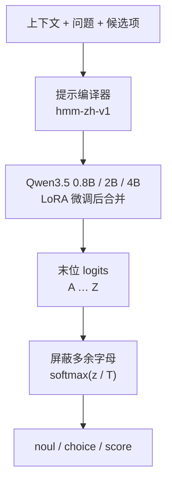

# 一次前向给概率的中文决策模型：chinese-decision 源码解析

## 它是干什么的

很多 AI 调用是在"有限选项里选一个"——意图识别、工单分流、内容审核、数据打标、给模型输出打分、智能体的下一步动作。交给生成式大模型，又慢又贵，返回的还是一段要再解析的文本。

[yanqiangmiffy/chinese-decision](https://github.com/yanqiangmiffy/chinese-decision) 要解决的就是这个：一个**不做自回归生成的中文决策模型**。给定上下文和一组固定候选项，一次前向，直接返回每个候选项的概率。84 星，MIT，Python。下面只摆源码和文档里能核实的东西。

## 仓库里实际有什么

技术视角下，这个仓库的分层职责很规整——核心库的接口刻意模仿 transformers，命令行全部收在 `scripts/`，部署单独一层。

| 层 | 真实目录 / 文件 | 在读者日常里的职责 |
|---|---|---|
| 命令入口 | `scripts/train.py`、`scripts/serve.py`、`scripts/serve_gpu.py`、`scripts/finalize.py`、`scripts/evaluate*.py` | 训练 / 起服务 / 校准合并 / 评测，等同"写用例—执行—回归"的脚本化入口 |
| 核心库（仿 transformers） | `decision/modeling.py`、`decision/processing.py`、`decision/pipeline.py`、`decision/configuration.py` | 模型、提示编译、请求级 pipeline、配置 |
| 训练 | `decision/losses.py`（`RLCDLoss`）、`decision/training/`、`decision/data/` | 训练目标与数据读取 |
| 服务 | `decision/serving/`（HTTP 格式、Transformers / GGUF 后端、分组淘汰赛） | 对外接口、多候选淘汰 |
| 部署 | `deploy/gpu/`、`deploy/gguf/` | GPU 生产（动态批处理、检查点热更新）与 CPU GGUF |
| 文档 | `docs/MODEL_CARD_*.md`（八个模型卡）、`docs/MODEL_CARD_POINTER_4B.md` | 每发布一个模型配一个模型卡，含局限性 |

模型按三系发布，都基于 Qwen3.5-0.8B / 2B / 4B 做 LoRA 微调：纯决策（`chinese-decision-*`）、统一模型（`chinese-decision-unified-*`，决策 + 类型化抽取共用一份权重）、指针读出（`chinese-decision-pointer-4b`，为通用决策榜单训练）。

## 它对付的问题：你要的是判断，不是生成

设计核心就一条，README 写了原话：**"一次前向，零输出 token"**。编译成提示后，只读取最后位置上候选字母 `A`–`Z` 的 logits，softmax 即概率，不做自回归，也没有思维链。

三个能力点都能从源码 / 文档核实：

- **三种题型**：`noul`（是/否）、`choice`（单选）、`score`（有序等级，返回概率加权期望分）。
- **概率是校准过的**：发布权重附带验证集上拟合的温度。chinese-decision-0.8b / 2b / 4b 整体 ECE 为 **0.27% / 0.64% / 1.00%**，所有发布模型的四个领域 ECE 都低于对比论文中的模型。ECE 是 15 个等宽分箱下的校准误差，越低代表"说 80% 的把握，实际对 80%"越成立。
- **类别不止 26 个**：单题每个候选一个字母（训练覆盖 2–16 个）。候选更多的 `choice` 用 `/v1/tournament` 分组淘汰后决赛，服务端默认上限 1024，不用重新训练。

训练、评测、服务共用一个提示编译器（`decision/processing.py`），保证三者输入完全一致——这是可复现性的一条关键纪律，结果不会被"训练和上线提示词不一样"污染。

下面是决策读出的主流程，mermaid 直接来自 README：

## 它把"一份权重"做成了两用：统一模型与遗忘修复

统一模型（`chinese-decision-unified-*`）在工程上有个少见的设计：**同一份权重里同时做分类和抽取**，并为此修了一个真实的坑——联合训练的**灾难性遗忘**。`docs/UNIFIED_MODEL.md` 把整个过程和数字都留了档。

**结构上**，两个任务共享同一个底座和同一份 LoRA，只在最后的读出层分支：末位字母 logits 走分类，末层隐状态再过一小块"跨度头"（两个 MLP + none 向量 + 宽度嵌入，0.8B 上约 3M 参数，不到总量 0.4%）走抽取。真正独立的只有那个小头。发布形态是一个标准模型目录，`model.safetensors` 里 LoRA 已合并，`DecisionPipeline.from_pretrained` 加载一次，两个读出都能用。

**究竟是分类还是抽取，由请求决定**，不是由预测结果决定：请求带 `state` + `questions` 走决策，带 `text` + `types` 走抽取，两者都带则各答一次。文档专门点了一句"看哪个输出更可信就用哪个"行不通，因为两个数值不可比。

**遗忘是怎么发生的**：先试过在 chinese-decision-0.8b 上继续训练抽取，CJ-Bench 准确率从 **83.11% 掉到 71.02%**——法律领域从 67.84 掉到 39.98（−27.86）、金融从 74.00 掉到 53.81（−20.19）。文档列了四个原因：没有回放、单条样本更新强度高一个数量级、抽取梯度也会改共享参数、选 checkpoint 时没看旧能力指标。这个坑不特别，特别的是修复过程写得能复现：

| 机制 | 实现 | 默认值 |
|---|---|---|
| 旧任务回放 | 从 CJ-Dataset 训练集按领域固定预算抽样，领域内各来源按样本数平方根分配 | 通用 20 万、医疗 10 万、法律金融各约 2.4 万 |
| 向原模型蒸馏 | 回放批次在 CE/RLCD 之外加 `KL(原模型 ‖ 当前模型)`，原模型是关闭 LoRA 的同一模型 | `--kl-weight 1.0` |
| 降低单步强度 | 梯度累积到 4 卡 × 8 micro-batch | `--accumulate 8` |
| 保留感知的选点 | 选 checkpoint 时，在 CJ-dev 准确率下降 ≤1 个点内挑新任务分最高的 | `--max-retention-drop 1.0` |

**模型选择和温度拟合只用验证集，从不读 CJ-Bench**——CJ-Bench 只用于最终回归评测。这一步守住了"选模型不看测试集"的纪律，和"训练、评测、服务共用提示编译器"是同一条原则的两面。

修复后三个尺寸的统一模型都反超同尺寸纯决策模型：`chinese-decision-unified-4b` CJ-Bench 全量 Micro ACC **86.86%**（纯决策 4B 为 85.97%），CJ-IE 测试集抽取 micro F1 **68.9**。

## 指针读出：打破 26 字母上限

字母读出的天然限制是候选数跟字母表绑死。指针模型 `chinese-decision-pointer-4b` 换了个读出：每个候选项后放标记 `<|object_ref_end|>`，每个问题末尾放决策标记 `<|object_ref_start|>`，用指针头（256 维）对"决策标记 × 候选标记"打分，softmax 得概率。候选数不受 26 限制，同一状态多个问题放一条序列一次前向答完。

它在 Jev Decision Index 0.4.1 榜单出分：**Full score 53.96**，在 147 个 4.9B 以下提交里排第 4（不计参考模型 Jev 1.14），且是那一档最高的 LoRA / 读出头方案——排在前面的三个 4B 都是全量微调。公开题集 0.3 得 **61.69**。榜单方用作者服务代码复跑，831 条抽查的决策一致率 **99.60%**（门槛 98.5%）。

## 推理快、能上 CPU：GGUF

纯决策模型都发 BF16 和 Q8_0 GGUF。Q8_0 几乎无损：与同温度 BF16 逐条配对的首选项一致率，0.8B / 2B / 4B 为 **98.92% / 99.00% / 99.19%**，准确率变化 +0.02 / −0.001 / +0.02 个百分点。chinese-decision-4b-gguf 4.48 GB，CPU 用 llama.cpp 跑，不需要 PyTorch。同组 25 条输入、预热后单条请求 p50：

| 指标（单条请求 p50） | 0.8b | 2b | 4b |
|---|---:|---:|---:|
| GPU · BF16（Transformers） | 44.4 ms | 44.8 ms | 60.1 ms |
| GPU · Q8_0（llama.cpp） | 17.9 ms | 23.6 ms | 47.3 ms |
| CPU 16 线程 · Q8_0 | 427 ms | 818 ms | 2004 ms |

对做 AI 评测和智能体工程的人来说，这仓库的参考价值不在"又多一个分类器"，而在三处能直接带走的工程纪律：**训练、评测、服务共用同一提示编译器**保证结果可复现；**选模型和拟合温度绝不读测试集**守住泛化；**把评测口径和限制写进 README 而不是藏起来**。最后这条在当下尤其稀缺——数字好不好看，跟会不会被误读，是两件事。

仓库地址：https://github.com/yanqiangmiffy/chinese-decision

---

## 标题候选

1. 一次前向给概率的决策模型：不做生成本的中文分类器，快在哪、坑在哪
2. 它把"判断"做成了一次前向：读末位字母 logits 给概率的中文决策模型
3. 联合训练把准确率打到 71.02%，他们用回放和蒸馏修了回来——chinese-decision 源码解析
4. 只回概率不吐字的 AI：意图识别、分流、审核，为什么该给这类任务换一个小模型
5. 一份权重两用：分类加抽取的联合训练，以及它的遗忘修复全程

## 附：事实台账与未尽核实项

- 全部模型 ID、ACC/ECE、Q8_0 一致率、延迟、Decision Index 分数：来自仓库 README 与 `docs/MODEL_CARD_POINTER_4B.md`（raw 原文，2026-11-15 读取）。
- 统一模型结构、遗忘数据（83.11→71.02）、修复机制、校验纪律：来自 `docs/UNIFIED_MODEL.md`（raw 原文）。
- CJ-IE 抽取 F1、来源数、CJ-Bench 样本数：来自 README 评测章节。
- **未核实项**：论文 arXiv:2610.23170 v3 全文只读项目方自述；CJ-Bench / CJ-IE 的基准数字、外部模型（Chinese-Jev、Jev）对比值均以项目方 README 报告为准，未独立复现；未在本地跑通训练或单条推理，延迟列为项目自测值。