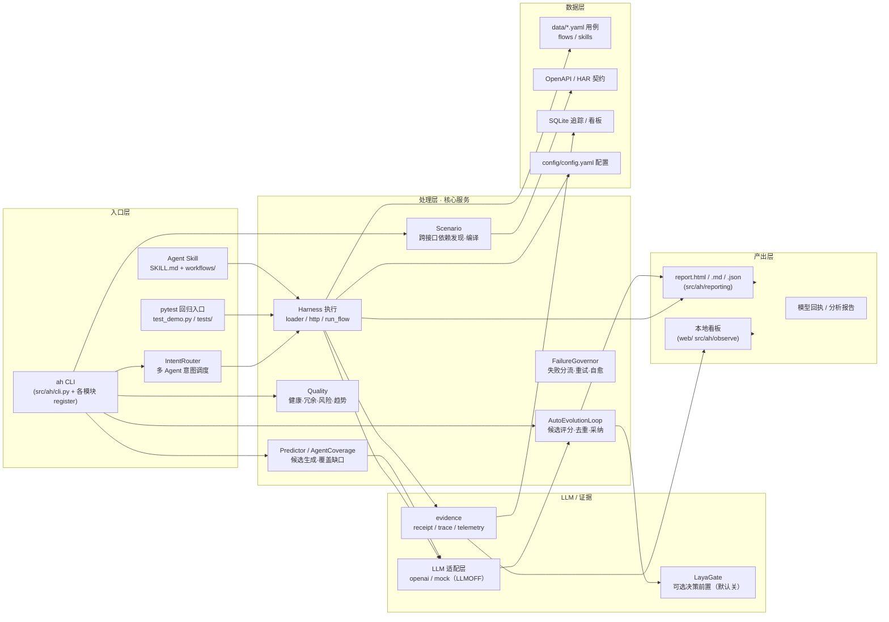
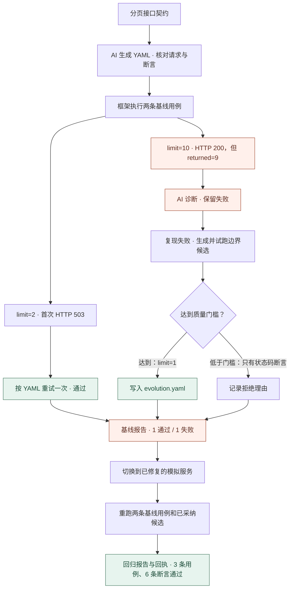

# Auto API Test Harness


**面向 Agent 的 API 测试与用例演进框架。**

AI驱动: 用 Python、pytest 和 YAML，把接口契约与变更转成可执行用例；
再把回归失败转成诊断证据、复现草稿和待验证的补测候选。

------


## 是什么


`auto-api-test-harness` 是一个 **面向 Agent 的 API 测试与用例演进框架**。它把「接口契约与变更」转成可执行的 YAML/pytest 用例，再把「回归失败」转成诊断证据、复现草稿和待验证的补测候选。

HTTP 请求、变量传递和业务断言由 Harness 执行；模型可以参与**规划、候选生成、语义诊断或报告分析**。普通回归在 `LLMOFF=1` 下即可离线运行，无需任何模型。

## 为什么需要


手工维护 API 测试用例，在接口变更多、步骤链长、断言复杂时成本极高，且回到失败后难以定位根因。常见痛点：

| 痛点                               | 本方案                                                   |
| ---------------------------------- | -------------------------------------------------------- |
| 用例靠手写，随接口变更经常过时     | 契约（OpenAPI）导入用例骨架 + 覆盖缺口扫描，自动补候选   |
| 失败后只能看到"断言失败"，难以定位 | 失败治理收集断言/状态码/异常，结合规则与失败指纹分流诊断 |
| 补用例靠人肉记忆，容易漏           | Agent Loop 收集失败 → 生成候选 → 评分去重 → 回写演进     |
| 多步骤场景依赖难维护               | 跨接口依赖发现 + 严格场景前置失败阻塞下游并隔离上下文    |
| 回归过程不可观测                   | SQLite 追踪 + LLM 用量统计 + 本地看板 + 分能力报告       |


## 核心概念


- **用例（Case）**：一根 YAML 描述的单接口或单断言单元，可含变量、数据集、软断言与重试策略。
- **流程（Flow）**：多步骤场景，支持跨步变量传递、前置依赖与严格失败阻塞。
- **断言（Assertion）**：对响应状态码、JSON 路径（jmespath）等做业务断言，结果进入回执（receipt）。
- **回执（Receipt）**：记录「计划 vs 实际」执行，区分失败/阻塞/跳过/未验证，保留请求、响应与断言证据。
- **进化（Evolution）**：Agent Loop 从失败中生成候选，评分去重后回写 `data/evolution.yaml`，形成持续演进闭环。
- **失败治理（Governance）**：把失败分流到「保留缺陷 / 重跑原步骤 / 尝试修复候选」，支持失败簇与已审核知识复用。
- **Skill**：可复用的 API 能力单元，支持条件、轮询与约定的资源清理。

## 目录结构


```text
auto-api-test-harness-v5/
├── README.md               # 本文件（英文版）
├── README.zh-CN.md         # 中文版
├── pyproject.toml          # 包定义与依赖（uv）
├── uv.lock                 # 锁定依赖版本
├── LICENSE                 # MIT 许可
├── .gitignore              # 排除产物与密钥
├── .gitattributes          # 统一行尾
│
├── src/
│   └── ah/                 # 框架核心包（包名 ah，命令前缀同为 ah）
│       ├── cli.py          # 统一 CLI：挂载各模块子命令并分发
│       ├── core/           # 核心：config 配置 / dispatch 分发 / orchestrator 编排
│       │                   #       / receipt 回执 / variables 变量 / trace 追踪
│       ├── harness/        # 执行 Harness：loader 用例加载 / http 请求
│       │                   #       / registry 用例注册 / 多步场景编排
│       ├── evolution.py    # Agent Loop 与用例演进（evolve / run）
│       ├── failure/        # 失败治理：governor 分流 / triage 诊断
│       │                   #       / cluster 失败簇 / knowledge 知识
│       ├── llm/            # LLM 适配：agents 助手 / openai / mock（LLMOFF）
│       ├── predict/        # 预测与候选生成：generator / risk / assist
│       ├── scenario/       # 跨接口场景：dependencies 发现 / compile 编译
│       ├── coverage/       # 契约覆盖：gap 接口差集 / openapi 导入
│       ├── quality/        # 质量：audit / health / redundancy / lowvalue
│       ├── observe/        # 本地观测：server 看板 / ingest / store / llmdetail
│       ├── skill/          # API Skill：executor / flow / validate
│       ├── reporting/      # 报告：writer（html / md / json）
│       ├── scheduler.py    # 变更驱动 / 计划运行 / 并行调度
│       ├── scaffold.py     # 脚手架：生成独立测试项目
│       └── property.py     # 属性探索（Hypothesis）
│
├── config/
│   └── config.yaml         # 框架配置：基础地址 / LLM / token / 报告目录
├── projects/
│   └── demo/               # 离线示例项目（data / flows / skills / pytest）
├── tests/                  # 框架测试（pytest，默认 LLMOFF 离线）
├── skills/
│   └── auto-api-test-harness/   # Agent 接入 Skill（SKILL.md / references / workflows）
├── docs/                   # 操作指南与设计文档
└── web/                    # 本地看板前端（React）
```

## 架构图


框架按「入口 → 处理 → 数据 → 产出」四层展开，箭头表示主要数据流与控制流。




> 图注：`ah evolve`（离线演进）、`ah add-case`（生成用例）、`ah scenario`（场景发现）、`ah observe`（看板）等命令由各自模块的 `register(subparsers)` 挂载到统一 CLI；`LLMOFF=1` 时 LLM 适配层走 `mock`，全程零网络。

## 快速开始


### 环境要求


- Python 3.10+
- [uv](https://docs.astral.sh/uv/)

### 安装


在仓库根目录：

```
uv sync --locked --extra all
```

### 跑离线示例


```
LLMOFF=1 AH_LOCAL_OBS=0 AH_TRACE_ENABLED=0 uv run --locked pytest -q -p no:cacheprovider projects/demo
```

预期 **4 passed**。打开 `projects/demo/report/report.html`，同目录还有 `report.md`、`report.json` 和 `run.log`。

单独打印一条健康检查的桩执行结果：

```
LLMOFF=1 AH_LOCAL_OBS=0 uv run --locked ah debug demo health-check --stub
```

### 跑框架测试


```
LLMOFF=1 AH_LOCAL_OBS=0 AH_TRACE_ENABLED=0 uv run --locked pytest -q -p no:cacheprovider tests projects/demo
```

预期 **698 passed**（当前版本）。

### 构建发布产物


```
uv build
# 产出 dist/auto_api_test_harness-<版本>.tar.gz (sdist) 与 -py3-none-any.whl (wheel)
```

## 功能与用法


### Agent Loop 与用例演进


执行用例、收集失败、规划回归、生成候选、评分并去重。符合条件的候选追加到 `data/evolution.yaml`，每轮记录采纳、拒绝理由与停止条件，失败可写本地复现草稿。后续执行按用例筛选条件选取。

```
ah evolve
```

### 失败自检与治理


收集失败断言、状态码和异常，结合规则、已知问题与失败指纹分流。可保留产品缺陷、对可恢复问题只重跑原步骤，或为高置信脚本问题尝试修复候选。支持失败簇与已审核知识复用。

```
ah run
```

### 生成与扩展用例


从自然语言生成 YAML 草案。根据失败、已有用例和覆盖缺口补充边界值、异常输入等候选。预测和覆盖助手可通过注入的 HTTP 客户端执行候选验证。

```
ah add-case example_api '生成 GET /health 的健康检查，期望状态码为 200'
```

### 执行 Harness


管理单接口、多步骤场景、多服务、认证、数据集、类型保持和跨步依赖。严格场景在前置依赖失败时阻塞下游并隔离上下文。复用 API Skill 支持条件、轮询和约定的资源清理。

入口：YAML、pytest、`run_single`、`run_flow`、`ah skill validate`。

### 可验证的执行结果


记录计划与实际执行，区分失败、阻塞、跳过和未验证。Python 回执接口对空跑和零有效断言分别给出未执行、未验证结果。报告保留请求、响应与断言证据。

入口：`build_verification_receipt`，报告支持 Markdown / JSON / HTML。

### 契约与依赖发现


从 OpenAPI 导入用例骨架，比较接口覆盖差集。从本地 OpenAPI/HAR 提取跨接口依赖候选，审核字段来源和业务断言后编译为可执行场景。

```
ah openapi
ah coverage-gap
ah scenario
```

### 变更驱动与长期回归


按 Git 变更选取受影响接口，按环境、优先级和标签筛选，独立用例可并行。支持 flaky 隔离、风险排序、趋势分析、用例健康度与冗余检查。

```
ah ci-trigger
ah scheduled-run
ah trend-gate
ah quality
```

### 过程可观测


记录运行、步骤和模型调用明细。可选 SQLite 追踪、LLM 用量汇总与本地看板。

```
ah observe
ah telemetry
```

### 属性探索


用 Hypothesis 扫描请求参数或 JSON 请求体，复用用例断言，并用 seed 复现样本。

```
ah property
```

### 脚手架与入口生成


从零生成独立测试项目，也可从已有 YAML 刷新 pytest 入口。项目可独立执行、维护和产出报告。

```
ah scaffold example-api --api http://127.0.0.1:8000/health
ah scaffold --gen-entry
```

### 多 Agent 意图调度


规则优先、可选模型兜底，把自然语言分发到数据生成、诊断、自愈、报告、预测、扩展助手、单接口或场景执行。缺依赖时返回可检查的跳过结果。

### 可选 Laya 决策前置层


为意图、数据、断言、失败分类、质量门控和停止判断等环节提供分流信号。默认关闭，接入需单独配置 Laya 后端。

### HTML 报告能力矩阵


按本次运行信号展示 28 项能力的使用状态和证据，汇总演进质量、模型用量、接口健康、趋势与风险。

## 配置


配置文件 `config/config.yaml`，含基础地址、token、报告目录与 LLM 模型设置。

常用环境变量：

| 变量                                         | 说明                                     |
| -------------------------------------------- | ---------------------------------------- |
| `LLMOFF=1`                                   | 关闭全部模型调用，走 canned/mock，零网络 |
| `AH_BASE_URL`                                | 服务基址（相对路径入口使用）             |
| `AH_TRACE_ENABLED`                           | 是否启用链路追踪                         |
| `AH_LOCAL_OBS`                               | 是否启用本地观测                         |
| `OPENROUTER_API_KEY`                         | LLM 服务 API Key（via env，不入库）      |
| `AH_LLM_MODEL_CHEAP` / `AH_LLM_MODEL_STRONG` | 便宜/强模型 ID                           |
| `OPENROUTER_BASE_URL`                        | 兼容 OpenAI 的服务地址                   |


> 敏感配置一律通过环境变量注入，不写入仓库。

## 集成与扩展


- **Coding Agent 接入**：为编码助手提供用例 schema、执行与诊断工作流、配置说明和 YAML 模板（见 `skills/auto-api-test-harness/`）。
- **OpenAPI / HAR**：导入契约，构建用例骨架与跨接口场景。
- **Langfuse / 用量账本**：可选导出 Langfuse 链路，结合本地 SQLite 追踪或用量账本查看模型调用、成本和成功率。
- **pytest 插件**：通过 `ah.core.plugin` 提供 pytest 能力。

# demo — 框架演示项目（参考模板）

框架自带的演示业务项目，展示「一个业务项目一个自包含目录」的标准结构，也是新增 业务用例的参考模板。**不指向真实被测服务**，全部演示用例通过桩传输隔离驱动。

想先看 AI 怎么生成、执行、诊断和补测，直接运行 [AI 接口测试闭环示例](ai-loop.md)。 想分别跑订单编排、OpenAPI/HAR 建链、失败治理和报告看板，参见 [框架能力实操](capability-examples.md)。

```
projects/demo/
├─ data/           数据集
│  ├─ users_single.yaml    单接口：GET /users/{id}，含 `${var}` 插值与 auth
│  ├─ order_flow.yaml      场景流程：登录 → 下单，user_token 向下游传递，on_failure: stop
│  └─ categorized.yaml     分类元数据：env/priority/suite/tags，供 select_cases 过滤
├─ conftest.py     pytest 配置：报告目录兜底指向本项目 report/
├─ test_demo.py    执行入口：桩传输演示单接口 / 流程 / 分类过滤三种形态
├─ report/         报告输出目录（AH_REPORT_DIR 兜底）
└─ README.md
```

## 运行

```bash
# 本项目自包含运行（桩传输，不连网）
LLMOFF=1 .venv/bin/python -m pytest -q projects/demo -p no:cacheprovider
```

框架层接线演示（`tests/test_demo_single.py` / `tests/test_demo_flow.py`）也复用 同一份 `data/` 数据，验证 `run_single` / `run_flow` 的完整接线。

## 新增业务项目

复制本项目结构：`data/` + `test_<业务>.py` + `conftest.py` + `report/` + `README`。

- 真实巡检项目：在 conftest 注册 `--run-live`，用例连专用测试环境。
- 纯演示/桩项目：保持与 demo 一致，桩传输隔离驱动。

# AI 接口测试闭环示例

商品目录有 20 件商品。给定 `GET /products?limit=N`，当 `N` 在 1 到 20 之间时，接口应返回 HTTP 200 和 `{"returned": N}`。示例用这个可独立核对的契约，演示 AI 如何生成用例、解释失败并补齐边界，然后由框架执行断言和回归。

## 闭环流程图



## 一条命令跑完

在仓库根目录运行：

```bash
uv run --locked --extra dev python -m projects.demo.ai_loop
```

业务 HTTP 走 `httpx.MockTransport`，模型回复默认由框架的 `MockLLM` 回放，无需 API Key。请求发送、断言执行、重试、候选试跑、质量门控、YAML 写入和报告均经过框架。每次执行会在 `projects/demo/report/ai-loop-*/` 下创建一个新目录，终端打印绝对路径。可用 `--output-dir` 指定父目录。

示例预期看到：

```text
生成 generated.yaml，待审核=True
瞬时 503：请求 2 次，判定 passed
业务断言：{jsonpath.returned.eq} expected 10, got 9
演进：round 1: 采纳 1，拒绝 1，跳过重复 0
baseline: FAIL (1/2 通过)
regression: PASS (3/3 通过)
```

命令退出码 0 表示完整演示符合预期。第一轮的业务失败在 `baseline-receipt.json` 中仍为 `FAIL`，实际回归门禁读对应批次的回执。

## 跟着产物走一遍

| 步骤                 | 示例里发生了什么                                             | 从哪里看                                                     |
| -------------------- | ------------------------------------------------------------ | ------------------------------------------------------------ |
| 1. 从需求建用例      | `AgentNL2Case` 生成请求、状态码断言和响应字段断言。演示先对照已知契约，再写入本次运行目录。 | `data/generated.yaml`                                        |
| 2. 执行并重试        | `limit=2` 首次收到 HTTP 503。YAML 配置 `retries: 1`，第二次请求通过。 | `data/transient.yaml`、`report/ah.log`、基线报告的 `attempts` 和 `llm_notes.retried` |
| 3. 断言报错，AI 诊断 | `limit=10` 的 HTTP 状态断言通过，`returned` 字段断言失败。回放的 `AgentTriage` 指出分页契约偏差，`FailureGovernor` 记录 `product_defect → block`，保留原失败。 | `report/baseline.html` 的用例详情、`issues/*.md` 中的复现草稿 |
| 4. 自动补测并门控    | `AutoEvolutionLoop` 复现失败，把已有用例和失败事实交给 `Predictor`。两个候选试跑均通过。只检查状态码的候选得分 0.85，低于本例门槛 0.90。检查响应数量的 `limit=1` 候选通过门控并写入演进 YAML。 | `_evolution_log.jsonl`、`data/evolution.yaml`、HTML 报告的演进与能力矩阵 |
| 5. 修复后回归        | 示例切换到已修复的模拟响应，保留原始断言，重跑两个基线用例和从 YAML 读回的新增边界。3 条用例与 6 条断言全部通过。 | `report/regression.html`、`report/regression-receipt.json`   |

两个阶段均生成 HTML、Markdown、JSON 和机器可读回执。HTML 适合逐条看请求、响应、重试和失败诊断。JSON 回执包含执行状态、步骤和断言计数，以及报告和日志路径。模型运行观察位于报告的「运行分析」中。

## 用真实模型演练

配置 [模型提供商和模型 ID](../../README.md#4-按需启用-ai) 后运行。只有模型调用访问已配置的提供商，商品目录 HTTP 仍然走桩。

```bash
env -u LLMOFF uv run --locked --extra dev --extra llm python -m projects.demo.ai_loop --live-model
```

模型提供初始草案、失败诊断、补测候选和报告观察。真实模型的候选数量和分析内容可能不同。草案偏离演示契约或本轮没有候选通过并写入时，命令返回失败。默认回放用于得到固定的教学结果。

## 交给编码 Agent 的提示词

> 使用本仓库的 [API 测试 Skill](../../skills/auto-api-test-harness/SKILL.md)。先运行商品分页闭环示例，读取两个阶段的回执和演进审计。说明 503 为什么重试、HTTP 200 为什么仍失败，以及哪个候选被采纳。然后用我提供的接口契约创建 YAML 用例，并列出对应业务断言的依据。先按项目现有的离线入口执行。发生失败时保留原始证据，再诊断并生成同接口的边界候选。试跑候选，汇报保留与拒绝的原因。最后给出实际执行数、通过数、失败数、跳过或阻塞数以及报告路径。

## 其他能力怎么体验

可以跟着 [四个框架能力实操](capability-examples.md) 跑订单编排、合成 OpenAPI/HAR 建链、执行策略和失败治理，并把分页回归导入本地看板。

先跑项目原有的离线示例，再按表选一个扩展方向。分页闭环的 HTML 报告有「能力矩阵」，可以对照本轮使用的能力和对应证据。

```bash
LLMOFF=1 AH_LOCAL_OBS=0 AH_TRACE_ENABLED=0 uv run --locked --extra dev pytest -q projects/demo
```

| 能力                           | 给使用者带来的价值                                           | 体验入口和可观察的证据                                       |
| ------------------------------ | ------------------------------------------------------------ | ------------------------------------------------------------ |
| 单接口、场景编排、API Skill    | 用 YAML 复用登录、建单等步骤，显式处理跨步依赖               | 上面的 pytest 示例验证变量替换、响应提取、登录 token 传给下单，以及登录失败后下单被跳过。[运行说明](README.md) · [Skill 组装示例](flows/order-create.yaml) |
| 脚手架、OpenAPI 导入、依赖发现 | 用接口契约快速建项目，从调用样本发现可审核的步骤关系         | 用 `ah scaffold`、`ah openapi` 看项目和 YAML 骨架，用 `ah scenario discover/validate/compile` 看关系草案、验证和编译结果。[项目接入](../../docs/ai-api-testing.md#新建测试项目) · [依赖链实操](../../docs/operation.md#openapi-和离线依赖链) |
| 超时、软断言、属性探索         | 为接口单独配置等待和断言策略，用 seed 复现发现的异常输入     | 在离线测试看超时结果、软断言证据和固定 seed 的测试样本。[超时](../../tests/test_timeout.py) · [软断言](../../tests/test_soft_assert.py) · [属性探索](../../tests/test_property.py)（需 `prop` 依赖） |
| 失败治理、脚本自愈             | 按失败类型选择阻断、观察恢复或尝试脚本修复，保留原始失败证据 | 分页 demo 展示产品缺陷阻断。治理和自愈测试覆盖其他路径，检查分类、恢复和重跑结果。[失败治理接线](../../tests/test_failure_orchestrator.py) · [脚本自愈](../../tests/test_auto_heal.py) |
| 回归、CI 与质量分析            | 按套件和环境选取测试，用执行回执做门禁，并根据历史优先安排高风险接口 | 看 `scheduled-run` 的实际执行数和退出码，在历史风险分析中核对优先回归接口。[跑批与验收](../../docs/ai-api-testing.md#跑批与验收) · [质量检查与回归命令](../../skills/auto-api-test-harness/references/cli.md) · [风险排序](../../skills/auto-api-test-harness/references/predict.md) |
| 本地看板、追踪与模型用量       | 从整次回归下钻到请求步骤和模型调用，核对耗时、异常及用量     | 用 `ah observe seed/serve` 查看合成演示数据。真实模型模式产生的用量账本可用 `ah telemetry` 查看。[本地观察](../../docs/operation.md#本地观察与-ai-辅助) · [用量命令](../../skills/auto-api-test-harness/references/cli.md) |
| Agent 意图路由与 Laya          | 把自然语言分发到生成、执行或诊断；需要时引入额外的决策信号   | 意图路由可检查匹配和缺依赖时的返回值。Laya 需单独配置，测试覆盖高置信采纳与回退。[意图调度](../../tests/test_dispatch.py) · [Laya 门控](../../tests/test_laya_gate.py) |


## 安全边界


- 所有敏感配置（API Key 等）通过环境变量注入，不写入仓库；`.env` 已被 `.gitignore` 排除。
- `LLMOFF=1` 下框架完全不调用模型，可离线安全运行；`--llm-off` 等价。
- 报告与回执只写请求/响应/断言证据，不含密钥。

## FAQ


**一定要用模型吗？** 不用。普通回归在 `LLMOFF=1` 下即可运行；模型仅参与规划、候选生成、语义诊断或报告分析等增强环节。

**用什么语言写用例？** YAML。单接口、多步骤场景、数据集、断言与重试都在 YAML 里描述。

**如何接入自己的测试 API？**

```
LLMOFF=1 uv run --locked ah scaffold example-api --api http://127.0.0.1:8000/health
LLMOFF=1 uv run --locked pytest -q projects/example_api
```

**失败用例会不会自动写回？** `ah evolve` 会把高分候选追加到 `data/evolution.yaml`，应用层审查后再执行；可用 `ah evolve --undo` 撤回最近一轮写入。

## 路线图


-  执行 Harness（单接口 / 多步流程 / 多服务）
-  可验证回执与多格式报告
-  Agent Loop 与用例演进（`ah evolve`）
-  失败治理与自愈
-  OpenAPI / HAR 契约与场景发现
-  变更驱动与长期回归
-  过程可观测（SQLite / 看板 / telemetry）
-  属性探索、脚手架、多 Agent 调度
-  Laya 决策前置层端到端激活默认化
-  更多第三方报告/追踪后端集成


#agent #API #auto-api-test #接口自动化 #自动化框架 #harness #loop
