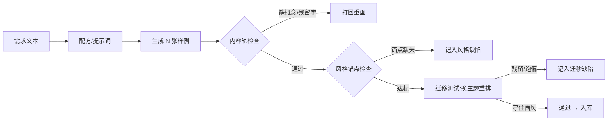

# 生图也能验收：当「画得好不好」需要有可复核的证据链

写代码的都知道一个朴素的规矩：改坏没改坏，跑一遍测试就知道。可一到了让 AI 画图，这套「能不能验」的手感就全丢了——图出来了，好不好看全靠眼缘，换张参考图、换个需求，味道对不对劲，又是重新猜一轮。

这本该是个可以验收的活。本文把「画得好不好」这件事，拆成一条能点开、能复核、能回归的证据链，讲清楚生图验收到底验什么、怎么验、谁说了算。

## 1. 先承认一件反直觉的事：好不好看不该让「第一眼」说了算

以前我们验收图，靠的是「看像不像」。这个动作有两个致命问题：

- **不可复核**：当时觉得像，一周后回看可能开始怀疑当初为什么放行。
- **不可迁移**：「这张像」，不等于「这一族图都能长成这个样」。你真正要保住的是后者。

回想我给 AI 配画风的老路子：把一张满意的参考图复制一遍、把新需求丢一遍，对齐全靠运气。等到想复现，才发现「当初到底靠什么定稿」根本没记录。**画图缺的不是灵感，是验收记录。**

> 换个说法：代码验收靠 test，生图验收靠的是把「像不像」翻译成一组能勾选、能留痕、能被机器和人都检查的锚点。

## 2. 验收的五个层，从「跑不跑得动」到「对不对味」

一张图能不能算过关，我把它拆成五层。每层解决的问题不同、检查手段不同、谁拍板也不同：

| 层 | 验的是什么 | 典型检查项 | 谁说了算 |
|---|---|---|---|
| L1 可交付 | 图真的出来了，格式对 | 非空、可打开、分辨率、比例、无破损 | 程序 |
| L2 语义遵从 | 该有的东西都画对了 | 节点数、栏目数、文字是否残留/截断、概念是否遗漏 | 程序 + 人 |
| L3 风格锚点 | 家里那股劲还在 | 布局分区、容器嵌套、箭头形态、字体分级、图标统一 | 程序 + 人 |
| L4 内容边界 | 没把不想带的东西带进来 | 无水印、无 Logo、无原图文字/数据残留 | 程序 |
| L5 可迁移 | 换个主题它还能守住同一套画风 | 同配方、新内容，风格锚点复现率 | 人 |

关键在 **L1–L4 能尽量用代码兜底，L5 只能靠人，但人也要有统一的尺子**。别把「判卷」这件事整段丢给一次人工圈图，那样既不能复核，也防不了回归。

> 注意第一列：这个分层和代码测试的层级是同构的——不是「跑通就行」的冒烟（L1），也不是只有「业务对不对」（L2/L4），中间夹杂着「风格基线」这种只有图像才有的维度（L3）。

## 3. 一句话说清验收逻辑：分离「内容」与「画风」，再分轨判定

生图验收最该抓住的一件事是：**内容对不对、和画风对不对，是两件事，必须分开判。**

- **内容轨**：这张图是否包含了需求要求的节点、栏目、概念——它对错和画风无关，换一套画风它也得对。
- **风格轨**：这张图是不是「家里那股劲」——它的分区、箭头、字体、配色逻辑，是否符合画风基线。

混在一起判，最常见的翻车是：图长得很合眼缘（风格看着对了），但需求里要求的概念漏画了一个（内容错了）——因为审美光环把内容错误盖过去了。分开判，才能让任意一条的错误都逃不掉。

落到句子层面就是一句验收判据：

> **内容正确 + 风格达标，才放行；两者都留下证据，才叫完成。**

## 4. 验收的第三条腿：一张图经不起判决，一组图才行

单张图「看着对」，说服力很弱。真正的验收要落在**批量**上——尤其当你建的是「一套画风」而不是「一张图」时。

> 这正是我从 [FigEcho](/articles/2026-08-28-FigEcho-%E6%8A%8A%E5%8F%82%E8%80%83%E5%9B%BE%E7%9A%84%E8%A7%86%E8%A7%89%E9%A3%8E%E6%A0%BC%E5%8F%98%E6%88%90%E5%8F%AF%E5%A4%8D%E7%94%A8%E7%9A%84%E9%85%8D%E6%96%B9-22936025/) 里读到的、被它讲得最透的一点：它把验收拆成 rendered validation（这张真的画出来、风格锚点体现没体现）和 portability validation（换一个主题重排拓扑、重派色彩、还没留下源内容残留）**两件事分别记**——因为「像」跟「能迁移」本来就是两件事。

把这条放大成通用铁律：**「像」是单图级的，必须用锚点逐张验；「能迁移」是画风级的，必须换主题换内容整体验，只评单张证明不了风格成立。**

用一张流程把它画顺：

X / Y / Z 三条路都该留下可点开的证据（图本身 + 检查结论），而不是一句「还行掉一地」。

## 5. 落地的检查清单（可直接抄）

给生图验收配一张不依赖具体工具的 checklist，按 L1–L5 排：

- [ ] **L1** 图能打开、非空、指定分辨率，原比例没被拉变形
- [ ] **L2** 需求里的每个节点/栏目/概念都画上了，没有漏
- [ ] **L2** 图上没有残留文字乱码、文字截断、字母拼错
- [ ] **L3** 分区层级、容器嵌套关系符合画风基线
- [ ] **L3** 箭头形态、粗细、线型统一，图标是同一种语言
- [ ] **L3** 字体分级（大标题/副标题/正文）与字号关系一致
- [ ] **L4** 无水印、无 Logo、无原参考图的业务数据残留
- [ ] **L5** 换一个主题重新规划拓扑后，风格锚点仍能复现

每勾一项，背后该有一张图 + 一个结论；这套记录本身就是要存档的「验收证据」。

## 6. 三条坦白话

- **人仍是最终拍板的**。L5 迁移性这种维度，代码只能给锚点复现率，最后的「认不认」还是人的事。本文的功用在把「凭感觉」压缩到最小、把「赌不起的感觉」集中到最少的一处。
- **别拿「风格分析」当免费设计顾问**。验收的前提是被验对象有明确的画风基线；越花哨越松散的图，锚点越不可判，验收越无从谈起。
- **参考图的边界要自己管好**。验收只认画风不认像素，它是为了守住「你家图那股劲」，不是为了复制原作、更不该拿去蹭水印或冒充原创。

## 7. 这篇能接着读什么

- [FigEcho：把参考图风格变成可复用配方](/articles/2026-08-28-FigEcho-%E6%8A%8A%E5%8F%82%E8%80%83%E5%9B%BE%E7%9A%84%E8%A7%86%E8%A7%89%E9%A3%8E%E6%A0%BC%E5%8F%98%E6%88%90%E5%8F%AF%E5%A4%8D%E7%94%A8%E7%9A%84%E9%85%8D%E6%96%B9-22936025/)——风格锚点从哪来，正是本篇 L3/L5 的原料。
- [手绘画风提示词配方库](/articles/2026-10-15-%E6%89%8B%E7%BB%98%E7%94%BB%E9%A3%8E%E6%8F%90%E7%A4%BA%E8%AF%8D%E9%85%8D%E6%96%B9%E5%BA%93%E8%A7%A3%E8%AF%BB%EF%BC%9A21%E5%A5%97%E7%94%BB%E9%A3%8E%EF%BC%8C%E8%BF%98%E5%B8%A6%E9%AA%8C%E6%94%B6%E5%90%88%E5%90%8C-ba624d14/)——写「带验收合同」的既有画风库，风格基线的现成样板。
- [别再让大模型给自己判卷](/articles/2026-08-25-report-validator-%E5%88%AB%E5%86%8D%E8%AE%A9%E5%A4%A7%E6%A8%A1%E5%9E%8B%E7%BB%99%E8%87%AA%E5%B7%B1%E5%88%A4%E5%8D%B7-d7e5b2fd/)——同一套「别让模型自己判卷、用确定性代码兜底」的思路，在文本侧如何落地。

#AI作图 #验收 #图像评测 #测试工程 #提示词工程